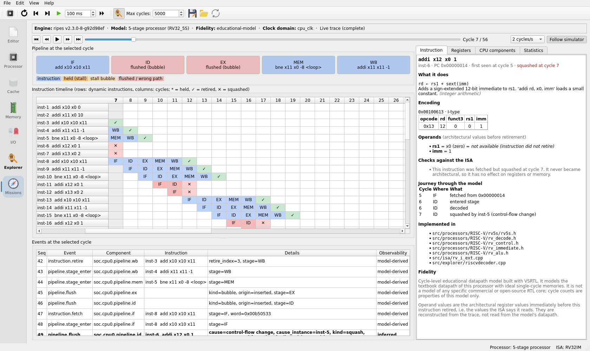
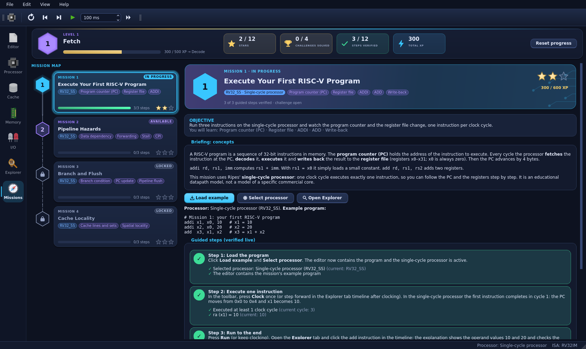
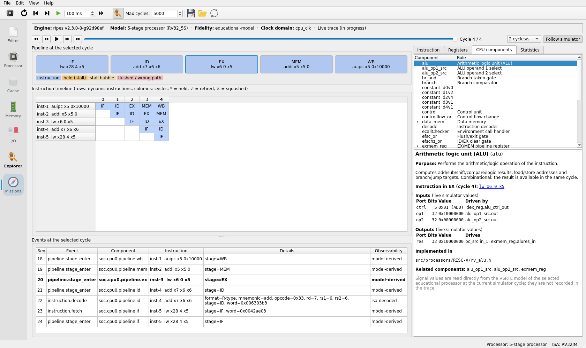
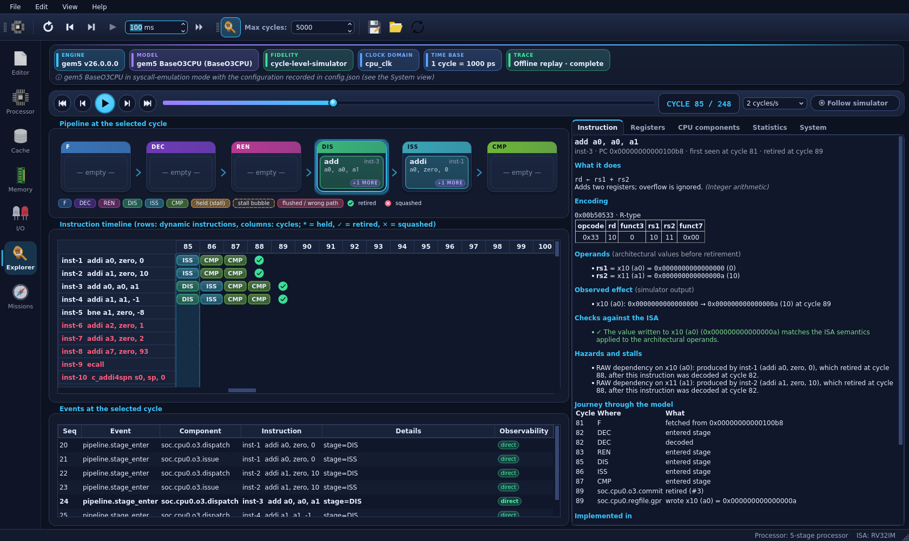
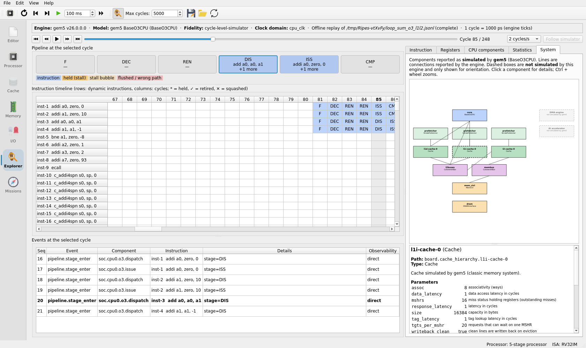

# Open SoC Explorer

**An interactive RISC-V, AI accelerator and SoC simulation & learning
platform — from instruction to Physical AI SoC.**

Open SoC Explorer turns real computer-architecture simulation into an
explorable, game-like learning experience. It is built on
[Ripes](https://github.com/mortbopet/Ripes) (graphical RISC-V processor
simulator by Morten Borup Petersen) and keeps Ripes' complete history and
functionality. On top of Ripes it adds a versioned execution-trace layer, a
CPU Explorer that replays every cycle, instruction explanations backed by
simulator data, and guided learning missions that are verified against the
simulator.



*The Explorer at cycle 7 of Mission 3 on Ripes' 5-stage processor: the taken
`bne` (now in MEM) has squashed the two younger instructions (✕, red rows),
ID and EX hold flush bubbles, and the instruction explanation shows the
squashed instruction's journey. Every value comes from the recorded trace.*

> **Fidelity note.** Ripes' processors are *educational* datapath models
> with ideal memories. Their cycle counts describe these models, not any real
> core. The Explorer always shows the engine, model and fidelity class
> ([docs/SIMULATION_FIDELITY.md](docs/SIMULATION_FIDELITY.md)).

## What works today

| Feature | Status |
|---|---|
| Everything Ripes provides: assembly/C editor, assembler, RISC-V processor models (single-cycle, multi-cycle, 5-stage variants, dual-issue, ISS; RV32/RV64), datapath view, registers, memory, cache simulator, I/O peripherals, CLI mode | ✅ unchanged upstream functionality; upstream tests pass |
| **Execution trace** (schema 0.2.0): fetch/decode/retire, stage entries, stalls, flushes/squashes, register writes, data memory requests/responses, with observability labels, plus the simulated system's components; recorded live for every Ripes model | ✅ |
| Trace export (GUI and `--trace-out` CLI option) and offline import (JSON Lines) | ✅ |
| **Deterministic replay**: pipeline occupancy and registers at any recorded cycle; step forwards/backwards, playback with speed control | ✅ |
| **CPU Explorer** tab: pipeline strip, instruction timeline, per-cycle events and registers, statistics (CPI, stalls, squashes, memory operations) | ✅ |
| **Instruction explanations**: encoding, semantics, architectural operands, observed result checked against the ISA, data hazards, journey, implementing source files | ✅ |
| **CPU component inspector**: purpose, live input/output signal values and wiring of datapath components (VSRTL models), instruction in the component's stage | ✅ |
| **Learning missions 1–4** (first program, pipeline hazards, branch & flush, cache locality) with live-verified steps and scored challenges | ✅ |
| **System view**: the components the engine simulated (Ripes: CPU, ideal memory, I/O; gem5: caches, prefetchers, crossbars, memory controller, DRAM), their connections, parameters and statistics; non-simulated SoC blocks clearly marked | ✅ |
| **gem5 (offline)**: run RISC-V programs on gem5's O3, TimingSimple or AtomicSimple CPU with configurable caches and replay them in the Explorer (`tools/gem5`); validated against real gem5 v26 output and against Ripes | ✅ |
| Python trace tool (`tools/trace/osx_trace.py`: validate, summary, ASCII pipeline) | ✅ |
| Ibex/Verilator RTL adapter, AI-accelerator lab, Physical-AI workloads, VHDL/FPGA lab, classic-console architecture research track (Neo Geo, PS3 Cell), missions 5–10 | 🗺️ planned — see [docs/ROADMAP.md](docs/ROADMAP.md) |

<p align="center">
  
  
</p>
<p align="center">
  
  
</p>

*Bottom: a gem5 O3CPU run (several instructions per stage, operands checked
in commit order) and the System view with gem5's caches, prefetchers,
crossbars and DRAM.*

## Quick start

### Build

Requirements: CMake, Ninja, a C++20 compiler and **Qt ≥ 6.8 with Qt Charts
and Qt SVG** (CI uses Qt 6.9.3). Details and Qt installation options:
[docs/DEVELOPMENT_GUIDE.md](docs/DEVELOPMENT_GUIDE.md).

```bash
git clone --recursive https://github.com/zfwk1992/open-soc-explorer.git
cd open-soc-explorer
cmake -S . -B build -G Ninja -DCMAKE_BUILD_TYPE=Release \
      -DRIPES_BUILD_TESTS=ON -DCMAKE_PREFIX_PATH=/path/to/Qt/6.9.3/gcc_64
ninja -C build
```

### Run

```bash
./build/Ripes            # the executable keeps its upstream name
```

1. *Missions* tab → pick Mission 1 → *Load example* → *Select processor*.
2. Press *Clock* / *Run* in the toolbar; the guided steps tick off as the
   simulator reaches them.
3. *Explorer* tab → click any instruction or cycle.

Headless trace export and analysis:

```bash
./build/Ripes --mode cli -t asm --src prog.s --proc RV32_5S --cpi --trace-out trace.jsonl
python3 tools/trace/osx_trace.py summary  trace.jsonl
python3 tools/trace/osx_trace.py pipeline trace.jsonl
```

The same program on gem5's out-of-order CPU with L1 + L2 caches (needs a
RISC-V gem5 build, see [tools/gem5/README.md](tools/gem5/README.md)):

```bash
GEM5=/path/to/gem5 tools/gem5/run_gem5.sh loop_sum o3 l1l2 out/loop_o3
# Explorer tab → "Open a trace file for offline replay…" → out/loop_o3/trace.jsonl
```

### Test

```bash
cd build/test && QT_QPA_PLATFORM=offscreen bash ../../.github/workflows/scripts/run_tests.sh
cd ../.. && OSX_RIPES_BIN=$PWD/build/Ripes python3 -m unittest discover -s tools/trace
OSX_RIPES_BIN=$PWD/build/Ripes python3 -m unittest discover -s tools/gem5
```

9 QtTest suites (110 test functions: 56 upstream, 54 Open SoC Explorer) and
27 Python tests (trace tool and gem5 converter, using recorded gem5 output).
CI runs the QtTest suites on Ubuntu, macOS and Windows.

## Documentation

| Document | Content |
|---|---|
| [PROJECT_VISION.md](docs/PROJECT_VISION.md) | Goals and principles |
| [ARCHITECTURE.md](docs/ARCHITECTURE.md) | Layers, data flow, code map |
| [RIPES_ARCHITECTURE.md](docs/RIPES_ARCHITECTURE.md) | Analysis of the Ripes code base and learning map |
| [TRACE_PROTOCOL.md](docs/TRACE_PROTOCOL.md) | Trace schema 0.2.0 |
| [tools/gem5/README.md](tools/gem5/README.md) | Running gem5 and converting its output; measured results |
| [SIMULATION_FIDELITY.md](docs/SIMULATION_FIDELITY.md) | What each model represents; findings |
| [LEARNING_GUIDE.md](docs/LEARNING_GUIDE.md) | Using the Explorer and missions; writing missions |
| [DEVELOPMENT_GUIDE.md](docs/DEVELOPMENT_GUIDE.md) | Build, test, CI, upstream sync |
| [ROADMAP.md](docs/ROADMAP.md) | Milestones and status |
| [LICENSING.md](docs/LICENSING.md) | Licenses and attribution |
| [RIPES_README.md](docs/RIPES_README.md) and the other files in `docs/` | Upstream Ripes documentation |

## Contributing

See [CONTRIBUTING.md](CONTRIBUTING.md). The most important rule: never
fabricate hardware behaviour — every visualisation and score must come from
simulator output, a recorded trace or the ISA specification.

## Syncing with upstream Ripes

`origin` is this repository, `upstream` is `mortbopet/Ripes`. Merge
`upstream/master` into a sync branch (no rebase, no force-push), rebuild and
run all tests; see
[DEVELOPMENT_GUIDE.md §7](docs/DEVELOPMENT_GUIDE.md#7-syncing-with-upstream-ripes).

## License and credits

MIT License — see [LICENSE](LICENSE). Ripes is © 2019 Morten Borup Petersen
and contributors; its history and notices are preserved. Third-party
components (VSRTL, ELFIO, libelfin, cereal, Signals, magic_enum, FancyTabBar,
Inconsolata, Flaticon icons, Qt) keep their own licenses. Note that Qt Charts
is GPL-3.0 for open-source use, which affects distributed binaries. Details:
[docs/LICENSING.md](docs/LICENSING.md).
