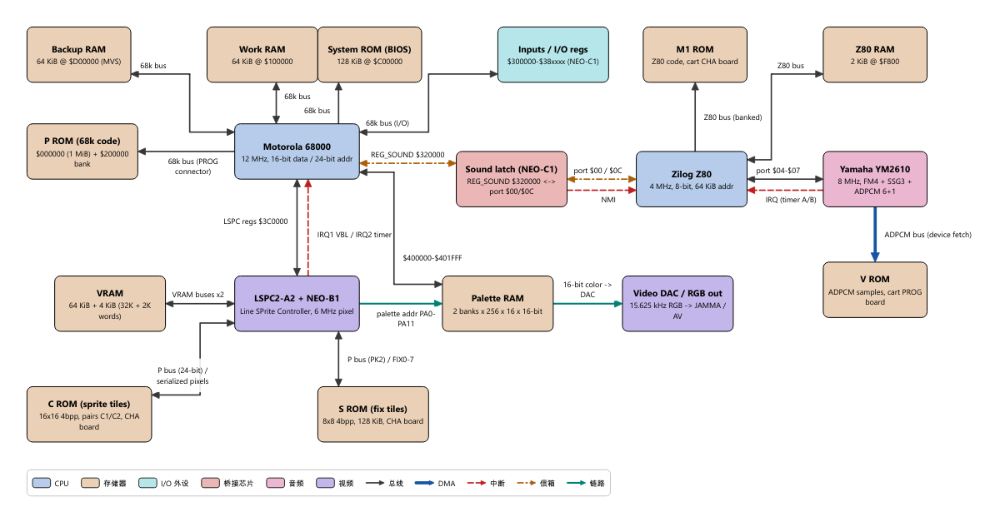
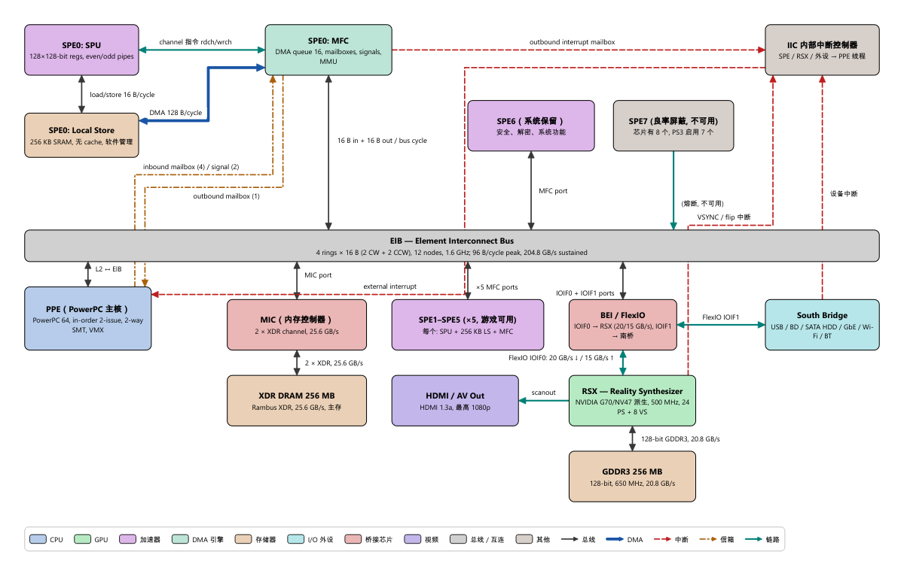
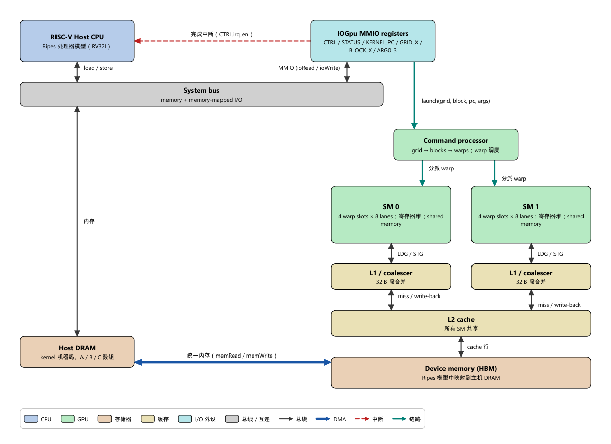
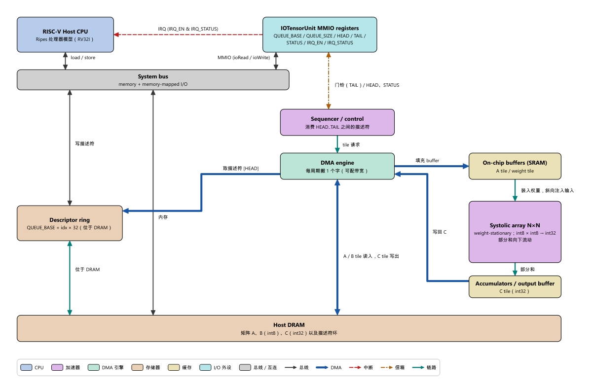
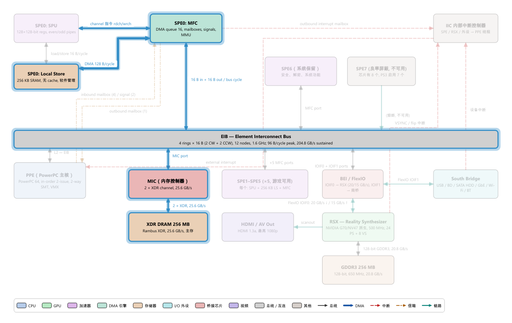
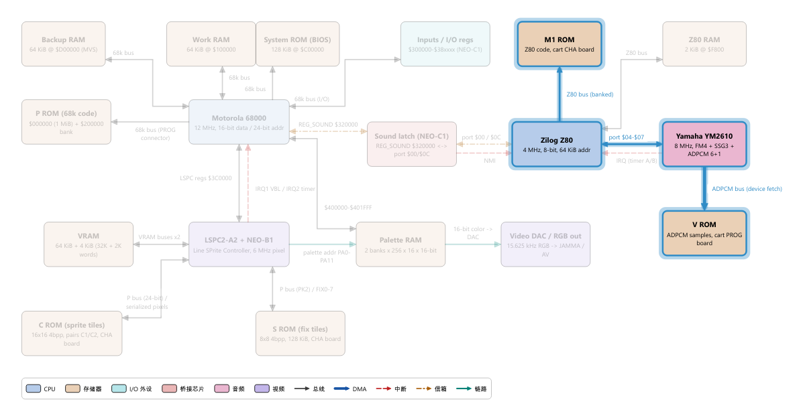

# 架构浏览器（Architecture Explorer）

架构浏览器是 open-soc-explorer 在 Ripes 之上新增的一个 Tab（左侧 FancyTabBar 中的 **Architecture**）。它是一个**由 JSON 驱动的框图 / 数据流演示器**：每个架构（拓扑，topology）用一个 JSON 文件描述其组成块（CPU、内存、总线、加速器……）、块之间的连线，以及若干条 "flow"——按步骤高亮块和连线并配以文字说明的数据流动画。

所有面向用户的文字都可以写成中英双语 `{"zh": "...", "en": "..."}`，界面按当前 UI 语言（设置里的 Language，重启生效）显示对应语言；界面本身的字符串通过 `resources/i18n/archexplorer_zh_CN.ts` 翻译。

内置的架构描述放在 `resources/arch/*.json`，通过 `resources/arch/arch.qrc` 打包进可执行文件；也可以在运行时用工具栏的 **Open architecture JSON...** 打开磁盘上的 JSON 文件。

本模块承载：
- 模块 C：NeoGeo（`neogeo.json`，见 [neogeo.md](neogeo.md)）
- 模块 D：PS3 / Cell（`ps3.json`，见 [ps3_cell.md](ps3_cell.md)）
- 模块 A/B 的系统级视图：`gpu_system.json`（主机 CPU + SIMT GPU）、`npu_system.json`（主机 CPU + 描述符环 / 门铃 / DMA / 脉动阵列）
- 模板：`example_minimal.json`

内置架构的渲染效果（由 `ArchScene` 离屏渲染，与 Tab 中看到的一致；`*_en.png` 为英文版）：

| | |
|---|---|
|  |  |
| `neogeo.json`（[English](images/neogeo_en.png)） | `ps3.json`（[English](images/ps3_en.png)） |
|  |  |
| `gpu_system.json`（[English](images/gpu_system_en.png)） | `npu_system.json`（[English](images/npu_system_en.png)） |

## 界面


*框图渲染示例：PS3 / Cell 架构，“PPE 通过 mailbox 派发任务给 SPE” flow 的某一步。被高亮的块和连线加粗并带光晕，其余元素变暗。*

Tab 由可拖动的 `QSplitter` 分成几块（拖动后的尺寸会记住，下次启动恢复；在 1280×800 窗口下所有区域都可见）：

| 区域 | 内容 |
|---|---|
| 顶部标题栏 | **Architecture Explorer: <拓扑标题>**、拓扑副标题（一句话说明）、操作提示；右侧 **?** 按钮打开用户手册第 11 章（`Ripes::showHelp("11-arch-explorer")`） |
| 左上 **Topology**（拓扑） | 拓扑下拉框（悬停显示副标题 / 文件路径）和拓扑说明（副标题、描述、块 / 总线 / flow 数量） |
| 左下 **Data flow**（数据流） | flow 下拉框（显示步数，悬停显示说明）、flow 说明、**步骤列表**（第 0 行为“概览”，当前步以 ▶ 标记并加粗高亮，点击任一行直接跳转）、**Reset / Previous / Play(Pause) / Next** 按钮、**Speed** 播放速度（0.5× / 1× / 2× / 4×，即每步 3 / 1.5 / 0.75 / 0.4 秒） |
| 中间 | 框图（滚轮以鼠标为中心缩放，空白处拖动平移，点击块查看详情；没有拓扑时显示空状态提示） |
| 中下 | **当前步骤说明**：`Step i of n – <flow 标题>`、步骤文字、本步高亮的块和总线名称（PS3 等大图不放大也能读到总线标签）、“Details panel (right): <块>” 指出右侧详情面板正显示哪个块 |
| 右上 **Block details**（方块详情） | 块名、类型（色块 + 类型名 + 含义）、sublabel、**Properties** 属性表（按 JSON 中书写的顺序）、**Connections** 连接表（总线名、类型、方向箭头 → / ← / ↔ 与另一端；双击一行选中另一端的块）、**Description** 详细说明。未选中块时显示提示 |
| 右下 **Legend**（图例） | 本拓扑用到的块类型（填充色 + 名称 + 含义）、连线类型（线型 + 含义）以及“高亮 / 变暗”的含义。图例在侧栏中固定显示，不随缩放消失；导出 PNG 时图例画在框图下方 |
| 底部状态行 | `Step i of n`（或 `Overview (step 0 of n)`）、播放状态（`▶ Playing at 1×` / `Paused`）与缩放比例 `Zoom: 85 %` |

选择拓扑后自动选中它的第一个 flow 并停在“概览”（第 0 步，无高亮），因此第一次按 → 就进入第 1 步。进入某一步时，`highlight` 列出的块和 `buses` 列出的连线加粗描边并带光晕，其余元素变暗；右侧详情面板自动显示该步第一个高亮块。上次选择的拓扑会被记住；内置拓扑按 PS3、Neo Geo、GPU、NPU、最小模板的顺序排列。

工具栏（随 Tab 切换显示）与快捷键（焦点在 Tab 内任意位置时有效，按钮 tooltip 中都标出了快捷键）：

| 按钮 / 动作 | 快捷键 | 作用 |
|---|---|---|
| Open architecture JSON... | | 从磁盘加载 JSON；与已有条目**路径或 id 相同则替换**而不是重复添加；打开过的文件会被记住，下次启动自动加载 |
| Reload topology file | Ctrl+R | 编辑 JSON 后重新读取当前拓扑（仅对从文件打开的拓扑有效），尽量保持当前 flow 与步骤 |
| Export PNG... | | 把框图（含当前高亮和图例）以 2 倍分辨率保存为 PNG |
| Fit to view | F | 让整张图适配窗口 |
| Reset zoom (100 %) | Ctrl+0 | 恢复 100 % 缩放 |
| Zoom in / Zoom out | Ctrl++ / Ctrl+-、滚轮 | 缩放 |
| Reset（数据流面板） | Home | 回到概览（第 0 步，无高亮） |
| Previous / Next | ← / → | 上一步 / 下一步 |
| Play / Pause | 空格 | 按所选速度自动前进，到末尾自动停止；在末尾再按 Play 从头播放 |


*Neo Geo 架构，“68000 → Z80 发送音效命令” flow 的一步：Z80 查 M1 ROM 并写 YM2610 寄存器，YM2610 随后从 V ROM 取样本。*

## JSON schema

文件必须是**严格 JSON**（不允许注释和尾逗号），UTF-8 编码。下面用 JSONC 注释说明各字段；`*` 标记必填。标为“文本”的字段既可以是普通字符串，也可以是双语对象（见下一节）。

```jsonc
{
  "id": "neogeo",                    // * 唯一 id（非空字符串，不翻译）
  "title": "SNK Neo Geo (MVS/AES)",  // * 文本：下拉框中的标题（非空）
  "subtitle": {"zh": "1990, 双 CPU 街机/家用机架构", "en": "1990, dual-CPU arcade/home console"},  // 可选，文本
  "description": {"zh": "总体介绍……", "en": "Overview..."},   // 可选，文本（可含 \n 换行）

  "blocks": [                        // * 至少一个块
    {
      "id": "m68k",                  // * 在 blocks 内唯一
      "label": "Motorola 68000",     // * 文本：块内粗体标题（单行，过长会省略号截断）
      "sublabel": {"zh": "12 MHz, 16/32 位", "en": "12 MHz, 16/32-bit"},   // 可选，文本：块内小字，自动换行
      "kind": "cpu",                 // * 见下表
      "x": 40, "y": 40, "w": 180, "h": 70,   // * 画布坐标与尺寸（逻辑像素，数字），w/h 必须 > 0
      "details": {"zh": "详细说明……", "en": "Details..."},   // 可选，文本：详情面板 Description
      "props": [                     // 可选：属性表，见“props 的两种写法”
        {"key": "Clock", "value": "12 MHz"},
        {"key": {"zh": "总线", "en": "Bus"}, "value": "16-bit data / 24-bit addr"}
      ]
    }
  ],

  "buses": [                         // 可选（可以为空数组或省略）
    {
      "id": "b_main",                // * 在 buses 内唯一
      "from": "m68k", "to": "workram",   // * 必须是已存在的 block id
      "label": {"zh": "16 位数据总线", "en": "16-bit data bus"},   // 可选，文本：画在连线旁
      "kind": "bus",                 // * 见下表
      "bidirectional": true,         // 可选，默认 false；true 时两端都画箭头
      "props": {"Width": "16 bit"}   // 可选，显示在连线 tooltip 和连接表 tooltip 中
    }
  ],

  "flows": [                         // 可选
    {
      "id": "sound_cmd",             // * 在 flows 内唯一
      "title": {"zh": "68000 → Z80 发送音效命令", "en": "68000 → Z80 sound command"},   // * 文本
      "description": {"zh": "……", "en": "..."},   // 可选，文本
      "steps": [                     // * 至少一步
        {
          "highlight": ["m68k"],     // 可选，要高亮的 block id（必须存在）
          "buses": ["b_latch"],      // 可选，要高亮的 bus id（必须存在）
          "text": {"zh": "68000 向 REG_SOUND 写入命令字节……", "en": "The 68000 writes the command byte to REG_SOUND..."}   // * 文本：本步说明
        }
      ]
    }
  ]
}
```

### 双语文本

文本字段（`title`、`subtitle`、`description`、`label`、`sublabel`、`details`、flow 的 `title`/`description`、step 的 `text`、props 的键和值）可以写成：

- 普通字符串：`"label": "Motorola 68000"`——两种语言下都显示同一文字（硬件名称常这样写）；
- 双语对象：`"label": {"zh": "声音锁存器", "en": "Sound latch"}`。

加载器用 `Ripes::localized()` 解析：先取当前 UI 语言（中文界面取 `zh`，否则取 `en`），缺失时依次回退到 `en`、`zh`。因此只写了一种语言也能加载（`tools/validate_arch_json.py` 会给出 warning）。对象中必须至少有 `zh` 或 `en` 之一，所有成员都必须是字符串；必填文本解析后不能为空。

`id`、`kind`、`from`、`to`、`highlight`、`buses` 是标识符，不翻译。

### props 的两种写法

- **对象**：`"props": {"Clock": "12 MHz", "Bits": 32}`——值可以是文本（含双语对象）、数字或布尔；**显示时按键名排序**（QJsonObject 的固有行为）。
- **数组**（推荐，内置文件都用这种）：`"props": [{"key": 文本, "value": 文本|数字|布尔}, ...]`——**按书写顺序显示**，键也可以双语。

### 块类型 `blocks[].kind`

| kind | 含义 | 图例名称（en / zh） |
|---|---|---|
| `cpu` | 通用处理器核 | CPU / CPU |
| `gpu` | GPU / SIMT 单元 | GPU / GPU |
| `accel` | 其他加速器（脉动阵列、控制器等） | Accelerator / 加速器 |
| `dma` | DMA 引擎 / MFC 之类的数据搬运单元 | DMA engine / DMA 引擎 |
| `memory` | 主存、ROM、Local Store、片上 SRAM | Memory / 存储器 |
| `cache` | cache、buffer | Cache / 缓存 |
| `io` | 外设、MMIO 寄存器窗口 | I/O / I/O 外设 |
| `bridge` | 桥接 / 接口芯片（FlexIO、BIC…） | Bridge / 桥接芯片 |
| `audio` | 音频芯片 | Audio / 音频 |
| `video` | 视频 / 显示芯片 | Video / 视频 |
| `bus` | 画成块的总线 / 互连（EIB、系统总线） | Bus / Interconnect / 总线 / 互连 |
| `misc` | 其他 | Misc / 其他 |

每种 kind 有固定的填充色（浅色主题用粉彩、深色主题用深色，文字颜色跟随调色板；切换主题时由 `ThemeManager` 通知刷新），并出现在图例中。

### 连线类型 `buses[].kind`

| kind | 画法 | 用途 |
|---|---|---|
| `bus` | 实线 2 px | 普通数据 / 地址总线、MMIO 访问 |
| `dma` | 粗实线 4.5 px | DMA 数据搬运 |
| `irq` | 虚线 | 中断线 |
| `mailbox` | 点划线 | 信箱、门铃、sound latch 等通知机制 |
| `link` | 实线 2.5 px（青色） | 点对点链路 / 控制路径 |

连线会自动从两个块相对的边出发，走直线或正交的"Z"形折线；同一个块的同一条边上有多条连线时会自动错开，连接同一对块的多条连线中段也会错开。连线标签放在最长（优先水平）线段旁；若与其他标签、块或其他连线重叠，会依次尝试线的另一侧、沿线段平移等候选位置（`ArchScene::resolveLabelOverlaps`）。

### 加载器实际执行的校验

`src/archexplorer/archmodel.cpp`（`ArchModel::fromJson`）和 `tools/validate_arch_json.py` 执行相同的检查，任何一条不满足都会拒绝整个文件并给出形如 `buses[2].to: references unknown block id 'foo'` 的错误：

1. 顶层必须是对象；`id` 为非空字符串；`title` 为非空文本；`subtitle`、`description` 若存在必须是文本。
2. `blocks` 必填且非空；每个块的 `id`、`kind` 为非空字符串，`label` 为非空文本，`x`、`y`、`w`、`h` 为数字且 `w`、`h` > 0；`kind` 必须在上表中；`id` 不得重复；`sublabel`、`details` 若存在必须是文本；`props` 若存在必须是对象或 `{key, value}` 数组，值为文本 / 数字 / 布尔（数字和布尔会转成字符串显示）。
3. `buses` 可选；每条的 `id`、`from`、`to`、`kind` 为非空字符串；`from`、`to` 必须是已定义的 block id；`kind` 必须在上表中；`id` 不得重复；`bidirectional` 若存在必须是布尔；`label`、`props` 同块。
4. `flows` 可选；每条的 `id` 为非空字符串、`title` 为非空文本，`steps` 必填且非空；`id` 不得重复；每步的 `text` 为非空文本，`highlight`、`buses` 若存在必须是字符串数组，其中每个 id 必须分别是已定义的 block / bus id。
5. 文本为双语对象时：至少含 `zh` 或 `en`，成员都是字符串。
6. 未知字段会被忽略（Python 校验器会打印 warning）。

Python 校验器另外会对缺少某一种语言的双语对象打印 warning；加 `--bilingual` 时还会把仍是普通字符串的文本字段（以及含中文的 props 键 / 值）列出来，便于检查翻译是否完整：

```
python -I tools/validate_arch_json.py --bilingual resources/arch
```

## 如何添加一个新架构

1. 复制 `resources/arch/example_minimal.json`，改名为 `resources/arch/<id>.json`，修改 `id`、`title`。
2. 规划画布：建议 1200×700 逻辑像素以内，块按层排布（例如 CPU 在上、内存在下、I/O 在右）。连线从相对的边出发，所以**上下排列的块用竖线相连、左右排列的块用横线相连**最整洁；尽量不要让折线穿过第三个块。英文标签通常比中文长，块宽要按英文估算（`label` 单行，粗体约 7.5 px/字符）。
3. 填写 `blocks` / `buses` / `flows`，文字写成 `{"zh", "en"}`。写 flow 时，每一步只高亮当前真正参与的块和连线（文字提到的数据通路也要在 `buses` 中列出），`text` 用一两句话说明"谁做了什么"。
4. 不编译也可以校验：

   ```
   python -I tools/validate_arch_json.py --bilingual resources/arch/<id>.json
   ```

5. 用 `tools/arch_render` 检查布局（两种语言都查）：`arch_render --lang en <file.json> dump` 应报告 `0 problem(s)`（见 [tools/arch_render/README.md](../../tools/arch_render/README.md)）。
6. 把文件登记到 `resources/arch/arch.qrc`：

   ```xml
   <file><id>.json</file>
   ```

7. 重新编译。`test/tst_archmodel` 会自动加载所有 `:/arch/*.json`，在中英两种语言下校验，并检查英文版里没有残留中文。
8. 在本目录下为该架构写一篇文档，并在 `docs/README.md` 加链接。

开发期间也可以不打包：用工具栏 **Open architecture JSON...** 打开磁盘上的文件，修改后按 **Reload topology file**（Ctrl+R）即可刷新。

## 代码结构

| 文件 | 内容 |
|---|---|
| `src/archexplorer/archmodel.h/.cpp` | 数据结构 `ArchModel` / `ArchBlock` / `ArchBus` / `ArchFlow` / `ArchFlowStep` 与 JSON 加载 / 校验（`fromJson`、`fromFile`、`loadBuiltin`）；双语文本用 `Ripes::localized()` 在加载时解析 |
| `src/archexplorer/archscene.h/.cpp` | `ArchScene`（QGraphicsScene）及 `ArchBlockItem`、`ArchBusItem`、`ArchLegendItem`；高亮 / 变暗；连线布线与标签避让；类型名称与说明（`archBlockKindDisplayName` 等，翻译上下文 `Ripes::ArchScene`） |
| `src/archexplorer/archview.h/.cpp` | `ArchView`（QGraphicsView）：滚轮缩放、拖拽平移、适配视图、100 % 复位、导出渲染、空状态提示、跟随浅色 / 深色主题 |
| `src/archexplorer/archexplorertab.h/.cpp/.ui` | `ArchExplorerTab : RipesTab`：界面、工具栏、快捷键、步进 / 播放、详情 / 图例面板、布局与最近文件的持久化（`QSettings` 键 `archexplorer/*`） |
| `src/archexplorer/CMakeLists.txt` | `archexplorer_lib`；编译 `arch.qrc`；声明对 `ripes_lib` 的反向依赖（使用 `i18n.cpp`、`ThemeManager`、`showHelp`） |
| `resources/arch/arch.qrc` | 打包 `resources/arch/*.json` |
| `resources/i18n/archexplorer_zh_CN.ts` | 界面字符串的中文翻译（`python tools/i18n/update_ts.py archexplorer` 更新） |
| `test/tst_archmodel.cpp` | 加载全部内置 JSON（中英两种语言）、双语解析与回退顺序、props 两种写法、负面测试，以及 Tab 的 GUI 测试（步进、点击步骤、播放、快捷键 ← → 空格 Home、导出、重新打开文件不重复） |
| `tools/validate_arch_json.py` | 独立的 Python 校验器 |
| `tools/arch_render/` | 离屏渲染 / 布局检查工具（`--lang zh|en`） |
