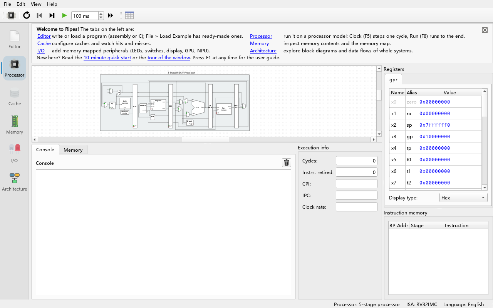

# 01 Installing and Building

> **What you will learn**
> - The ways to obtain open-soc-explorer: prebuilt programs versus building from source
> - How to build and run the tests on Windows with the user-space toolchain and the driver script `build.ps1`
> - How to build on Linux / macOS with generic CMake steps
> - How to run the unit tests and how to run the program without a display (headless)
> - Causes and fixes of common build errors
>
> **Prerequisites**
> - You can open a command line (PowerShell on Windows, a terminal on Linux/macOS)
> - About 5 GB of free disk space and 8 GB or more of RAM (the first full build takes 10–20 minutes)
> - If you only use a program your teacher already built, you can skip straight to [Chapter 02](02-quickstart.md)

---

## 1. Two ways to get the program

### 1.1 Prebuilt programs

The upstream Ripes project publishes prebuilt programs for Windows, Linux (AppImage) and macOS on its GitHub Releases page, plus a browser version (<https://ripes.dk/>). **These upstream builds do not contain this project's SIMT GPU and Tensor Unit (NPU) peripherals or the Architecture tab.**

open-soc-explorer currently has no publicly released prebuilt installer (to be verified). In a classroom, the teacher usually builds `Ripes.exe` from source on one machine and then copies the whole `build` directory (together with the Qt runtime libraries) to the students. If you received such a directory, just double-click `Ripes.exe` in it; you do not need the rest of this chapter.

> The executable is still called `Ripes.exe` (`Ripes` on Linux/macOS) and the window title is still "Ripes". This project is a fork of Ripes and keeps the original program name.

### 1.2 Building from source

A source build has three steps:

1. Prepare the dependencies: a C++20 compiler, CMake, Ninja (or make), and **Qt 6.8 or newer** (it must include the **Qt Charts** and **Qt Svg** modules).
2. Get the source code, including the three git submodules: `external/VSRTL`, `external/ELFIO` and `external/libelfin`.
3. Configure with CMake, build, and optionally run the tests.

Why Qt 6.8? The top-level `CMakeLists.txt` says:

```cmake
find_package(Qt6 6.8 COMPONENTS Core Widgets Svg Charts REQUIRED)
```

With a Qt older than 6.8, or without the Charts module, the CMake configure step fails immediately.

---

## 2. Windows: the user-space toolchain + `build.ps1`

On Windows this project uses a toolchain that is **installed entirely in a user directory**. It needs no administrator rights and does not modify the system PATH. The layout is:

```text
P:\workspace\soc\
├── build.ps1                     driver script: configure + build + test
├── open-soc-explorer\            source code (this repository)
│   └── build\                    build directory (Ripes.exe lives here)
└── toolchain\
    ├── venv\Scripts\             Python virtual environment: cmake.exe, ninja.exe, aqtinstall
    ├── Qt\6.8.3\mingw_64\        Qt 6.8.3 (with Qt Charts)
    ├── Qt\Tools\mingw1310_64\    MinGW-w64 13.1 compiler (gcc/g++)
    └── cmake\mingw-bigobj-fixup.cmake   CMake snippet that fixes the -mbig-obj option under MinGW
```

These components were installed with `pip install cmake ninja aqtinstall` (into `toolchain\venv`) and with `aqt install-qt windows desktop 6.8.3 win64_mingw -m qtcharts` and `aqt install-tool windows desktop tools_mingw...` (into `toolchain\`), see module F in `docs/arch/PLAN.md`. If this directory already exists on your machine, you can build right away.

> **Note**: never disable TLS certificate checks to "make downloads work", and do not install system-wide software or change the system PATH. All PATH changes made by `build.ps1` apply to its own session only.

### 2.1 The first build

**Do**: open PowerShell and run:

```powershell
powershell -ExecutionPolicy Bypass -File P:\workspace\soc\build.ps1
```

**What you see**: three kinds of section headers appear one after another:

```text
=== configure ===
...(CMake output)
=== configure done in 25.3s ===

=== build ===
ninja jobs: 4
[1/900] Building CXX object ...
...
=== build done in 900.0s ===

=== test tst_accel_e2e ===
...
=== test summary ===
Test          Exit Status
----          ---- ------
tst_accel_e2e    0 PASS
...
all 10 tests passed
```

(The numbers are only illustrative; real timings depend on the machine.)

**Why**: `build.ps1` does the following:

1. It checks that every toolchain component exists (`cmake.exe`, `ninja.exe`, `gcc.exe`, `g++.exe`, the fixup file, `Qt6Core.dll`). If one is missing it reports `Toolchain component missing: ...` and stops.
2. For the current session only, it puts MinGW, Qt's `bin` and `venv\Scripts` at the front of PATH (so the new g++ shadows an old `C:\MinGW` that may exist on the system) and sets `CC`/`CXX`.
3. If the build directory `<Repo>\build` has no `build.ninja` yet, it runs the CMake configure step with `-G Ninja`, `-DCMAKE_BUILD_TYPE=Release`, `-DRIPES_BUILD_TESTS=ON`, `-DCMAKE_PREFIX_PATH=<Qt dir>` and `-DCMAKE_PROJECT_INCLUDE=<fixup file>`.
4. It runs Ninja through `cmake --build`.
5. It runs every `tst_*.exe` in `build\test\` and prints a summary table; if any test fails, the script exits with code 1.

The script also sets `QT_QPA_PLATFORM=offscreen` for the session (unless you already set it), so tests that create windows can run without a display, and `QT_LOGGING_TO_CONSOLE=1`, so Qt test output goes to the console rather than to the Windows debugger channel.

After the build, the program is at:

```text
P:\workspace\soc\open-soc-explorer\build\Ripes.exe
```

### 2.2 `build.ps1` options

| Option | Effect | Example |
|---|---|---|
| (none) | Configure if needed → build all targets → run all tests | `.\build.ps1` |
| `-SkipTests` | Build only, do not run tests | `.\build.ps1 -SkipTests` |
| `-Configure` | Delete `CMakeCache.txt` and force a fresh configure (after changing CMake options or Qt) | `.\build.ps1 -Configure` |
| `-Target <name>` | Build a single target. If the name does not start with `tst_`, tests are skipped automatically; if it is `tst_xxx`, that test is run after building | `.\build.ps1 -Target Ripes` |
| `-Tests <name,...>` | Run only the listed tests (with or without `.exe`) | `.\build.ps1 -Target tst_gpu -Tests tst_gpu` |
| `-Jobs <n>` | Number of parallel build jobs; the default 0 means automatic | `.\build.ps1 -Jobs 2` |
| `-Repo <path>` | Build another source tree; its build directory is `<path>\build` | `.\build.ps1 -Repo P:\workspace\soc\agents\gpu` |
| `-BuildType <type>` | CMake build type, default `Release` | `.\build.ps1 -Configure -BuildType Debug` |

About the automatic `-Jobs` value: the script uses "one job per 1.5 GB of free RAM", clamped to between 2 and 8 and never more than the number of CPU cores. The processor/ISA translation units are template-heavy and each `cc1plus` process can use about 1.5 GB; Ninja's default of "cores + 2" jobs would run out of memory.

### 2.3 Common combinations

```powershell
# Rebuild only the main program (the most common case after changing GUI code)
powershell -ExecutionPolicy Bypass -File P:\workspace\soc\build.ps1 -Target Ripes

# Build and run only the GPU unit test
powershell -ExecutionPolicy Bypass -File P:\workspace\soc\build.ps1 -Target tst_gpu

# Build everything but run only two tests
powershell -ExecutionPolicy Bypass -File P:\workspace\soc\build.ps1 -Tests tst_npu,tst_archmodel

# Build another copy on a machine with little memory
powershell -ExecutionPolicy Bypass -File P:\workspace\soc\build.ps1 -Repo P:\workspace\soc\agents\core -Jobs 2 -Target Ripes
```

Why `powershell -ExecutionPolicy Bypass -File ...` instead of just `.\build.ps1`? Many Windows machines forbid running unsigned scripts by default; `-ExecutionPolicy Bypass` applies to this one invocation only and does not change the system policy.

### 2.4 Starting the program

**Do**: double-click `build\Ripes.exe` in Explorer, or in PowerShell:

```powershell
P:\workspace\soc\open-soc-explorer\build\Ripes.exe
```

**What you see**: the main window opens. On the left is a vertical column of tabs (Editor, Processor, Cache, Memory, I/O, Architecture); the **Processor** tab is selected by default and shows the circuit diagram of the 5-stage pipelined processor. On the first launch the window is maximized; afterwards it remembers its position and size from the last time it was closed.

**Why**: `build\Ripes.exe` runs because the Qt DLLs it depends on are in `toolchain\Qt\6.8.3\mingw_64\bin`. If double-clicking complains about a missing `Qt6Core.dll` or similar, that directory is not on PATH — see section 6, "Common build errors".



---

## 3. Linux / macOS: generic CMake steps

These steps do not use this repository's Windows script and work on any system with Qt 6.8+.

### 3.1 Install the dependencies

- **Compiler**: GCC / Clang with C++20 support.
- **CMake** ≥ 3.13 (a recent version is recommended), **Ninja** or make.
- **Qt 6.8 or newer**, including **Qt Charts** and **Qt Svg**. Installing into your home directory with the official Qt installer or `aqtinstall` is recommended, for example:

  ```bash
  python3 -m pip install --user aqtinstall
  python3 -m aqt install-qt linux desktop 6.8.3 linux_gcc_64 -m qtcharts -O ~/Qt
  ```

  (On macOS use `mac desktop 6.8.3 clang_64`; the exact architecture name is to be verified.)
- **Extra Linux dependency**: the upstream Ripes instructions require the EGL development package, e.g. `libegl1-mesa-dev` on Ubuntu.

### 3.2 Get the source

```bash
git clone --recursive <repository URL> open-soc-explorer
cd open-soc-explorer
# If you forgot --recursive when cloning:
git submodule update --init --recursive
```

### 3.3 Configure and build

```bash
cmake -S . -B build -G Ninja \
      -DCMAKE_BUILD_TYPE=Release \
      -DRIPES_BUILD_TESTS=ON \
      -DCMAKE_PREFIX_PATH=$HOME/Qt/6.8.3/gcc_64
cmake --build build -j 4
```

**Why** it is written like this:

- `-DCMAKE_PREFIX_PATH` tells CMake where Qt is; without it CMake only finds the system Qt, which is often too old.
- `-DRIPES_BUILD_TESTS=ON` enables the test targets (the default is `OFF`). Leave it out if you do not need the tests.
- `-j 4` limits the number of parallel jobs, for the same reason as in section 2.2: each compiler process may use about 1.5 GB of memory.

After a successful build the program is `build/Ripes` (on macOS possibly `build/Ripes.app`, to be verified).

---

## 4. Running the tests

With `RIPES_BUILD_TESTS=ON`, `test/CMakeLists.txt` creates the following 10 QTest executables (in `build/test/`):

| Test | Covers |
|---|---|
| `tst_riscv` | RISC-V instruction execution |
| `tst_assembler` | The assembler |
| `tst_expreval` | Expression evaluation in the assembler |
| `tst_cosimulate` | Co-simulation of every processor model against the ISA simulator |
| `tst_reverse` | Reverse execution (undoing clock cycles) |
| `tst_stall` | Pipeline stalls |
| `tst_gpu` | The SIMT GPU simulation core |
| `tst_npu` | The tensor processor simulation core and peripheral |
| `tst_archmodel` | Loading and validating architecture explorer topology JSON |
| `tst_accel_e2e` | GPU peripheral end to end (RISC-V host program + GPU) |

On Windows `build.ps1` runs all of them by default. To run a single test by hand:

```powershell
$env:QT_QPA_PLATFORM = "offscreen"
P:\workspace\soc\open-soc-explorer\build\test\tst_gpu.exe
```

Linux/macOS:

```bash
cd build/test
QT_QPA_PLATFORM=offscreen ./tst_gpu
# Run all of them
for t in tst_*; do QT_QPA_PLATFORM=offscreen ./$t || echo "FAILED: $t"; done
```

`test/CMakeLists.txt` calls `add_test` for every test, but the top-level `CMakeLists.txt` has no `enable_testing()`, so `ctest` may report "No tests were found" (to be verified). The loop above is the most reliable way.

**What you see**: QTest output ends with `Totals: N passed, 0 failed, 0 skipped`; exit code 0 means the test passed.

---

## 5. Running headless

On a server without a display, in CI or in a remote terminal, a Qt program normally exits because it cannot find a display. Setting the environment variable `QT_QPA_PLATFORM=offscreen` makes Qt "pretend" to have a screen in memory:

```powershell
# Windows PowerShell (current session only)
$env:QT_QPA_PLATFORM = "offscreen"
$env:PATH = "P:\workspace\soc\toolchain\Qt\6.8.3\mingw_64\bin;" + $env:PATH
```

```bash
# Linux / macOS
export QT_QPA_PLATFORM=offscreen
```

Typical uses:

- Running the unit tests (`build.ps1` sets it automatically).
- Batch-running programs in command-line mode (see [Chapter 15](15-cli.md)).
- The screenshot tool (`tools/gui_shots/`, planned in phase 2) renders the screenshots for this guide offscreen.

> Note: under `offscreen`, any action that opens a dialog (for example `--help`, which opens a message box on Windows) waits forever and looks "stuck". See [Chapter 15](15-cli.md) and [Chapter 16](16-faq.md).

---

## 6. Common build errors

| Symptom | Cause | Fix |
|---|---|---|
| `Toolchain component missing: P:\workspace\soc\toolchain\...` | `build.ps1` found that a toolchain component is missing | Reinstall it following module F of `docs/arch/PLAN.md`; do not switch to a system-wide install |
| `Could not find a configuration file for package "Qt6" ... version 6.8` | Qt is older than 6.8, or `CMAKE_PREFIX_PATH` does not point to Qt | Install Qt 6.8+ and pass `-DCMAKE_PREFIX_PATH=<Qt>/<version>/<compiler>` when configuring |
| `Could not find ... Qt6Charts` | Charts was not selected when installing Qt | Use `aqt install-qt ... -m qtcharts`, or tick Qt Charts in the Qt installer |
| `external/VSRTL/...: No such file or directory`, or CMake says a subdirectory does not exist | The git submodules were not fetched | `git submodule update --init --recursive` |
| `cc1plus.exe: out of memory` half-way through, or the machine freezes | Too many parallel jobs, memory exhausted | Use a smaller `-Jobs` (e.g. `-Jobs 2`), or `cmake --build build -j 2` on Linux |
| `g++: error: unrecognized command-line option '-mbig-obj'`, or the assembler reports "too many sections" | Under MinGW the top-level `CMakeLists.txt`'s `-mbig-obj` usage needs a fix-up | Use `build.ps1` (it includes `mingw-bigobj-fixup.cmake` via `-DCMAKE_PROJECT_INCLUDE`); pass the same option when configuring by hand |
| Odd `undefined reference` link errors, or the compiler version is 4.9.3 | An old `C:\MinGW` on the system is found first | Use `build.ps1` (it puts MinGW 13.1 first on PATH and sets `CC`/`CXX`); when building by hand pass `-DCMAKE_C_COMPILER`/`-DCMAKE_CXX_COMPILER` explicitly |
| PowerShell shows a red `NativeCommandError` although CMake did not fail | PowerShell 5.1 treats text that native programs write to stderr as errors | Check `$LASTEXITCODE` rather than the red text; `build.ps1` already does so |
| `build.ps1 cannot be loaded because running scripts is disabled on this system` | Execution Policy restriction | Invoke it with `powershell -ExecutionPolicy Bypass -File ...` |
| After changing a CMake option or the Qt version, old settings are still used | `CMakeCache.txt` caches the old values | `build.ps1 -Configure`, or delete `build/CMakeCache.txt` and configure again |
| Double-clicking `Ripes.exe` reports a missing `Qt6Core.dll` / `Qt6Charts.dll` | Qt's `bin` directory is not on PATH | Add `toolchain\Qt\6.8.3\mingw_64\bin` to PATH in the session that starts it; or copy the DLLs into `build` with Qt's `windeployqt` (to be verified) |
| A test reports `could not connect to display` / `no Qt platform plugin` | No display, or the platform plugin cannot be found | Set `QT_QPA_PLATFORM=offscreen`; make sure Qt's `plugins/platforms` can be found |
| TLS/certificate errors while downloading Qt or submodules | Proxy or certificate problem | Configure the proxy or certificates properly; **never** disable TLS verification |

---

## Exercises

1. Run `build.ps1 -SkipTests` once and note how many seconds the "build" stage took. Run it again and compare — why is the incremental build so much faster?
2. Use `-Target tst_archmodel` to build and run only the architecture explorer test, and find the `Totals:` line in its output.
3. Open `P:\workspace\soc\build.ps1` and find the lines that compute the default `-Jobs`. If your machine has 16 GB of free RAM and 12 cores, how many jobs are used by default?
4. (Linux/macOS) Configure once without `-DRIPES_BUILD_TESTS=ON` and check whether the `build/test/` directory exists.

## Summary

- The project needs Qt 6.8+ (with Charts and Svg), a C++20 compiler, CMake and three git submodules.
- On Windows, `P:\workspace\soc\build.ps1` drives the user-space toolchain: it changes PATH only within its session and configures, builds and tests automatically; the common options are `-SkipTests`, `-Configure`, `-Target`, `-Tests`, `-Jobs` and `-Repo`.
- On Linux/macOS it is the standard `cmake -S . -B build -DCMAKE_PREFIX_PATH=... -DRIPES_BUILD_TESTS=ON` + `cmake --build build`.
- In headless environments, set `QT_QPA_PLATFORM=offscreen`.
- When a build fails, check the table in section 6 first: most problems come from the Qt version/modules, submodules, memory or PATH.

Next chapter: [02 10-minute quick start](02-quickstart.md).
