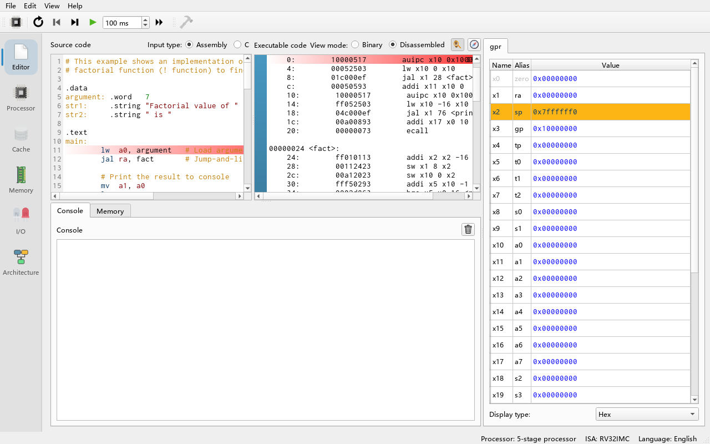
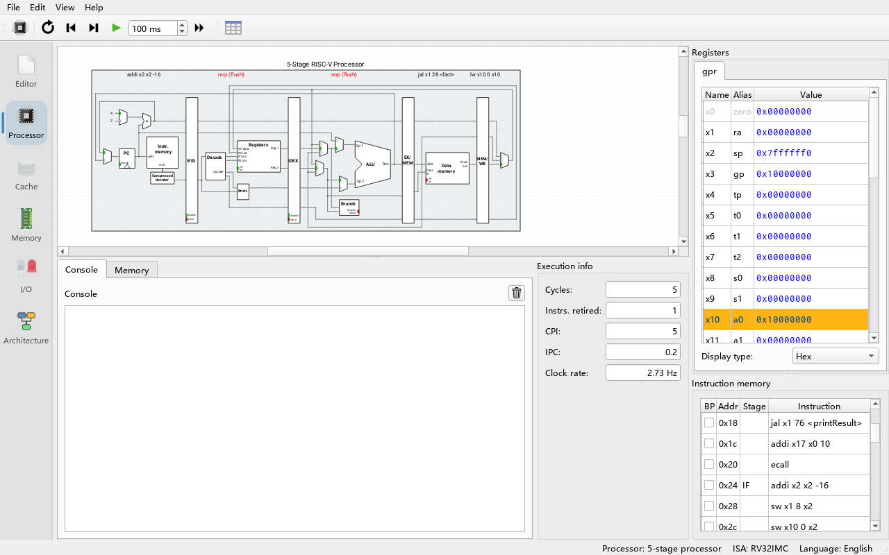
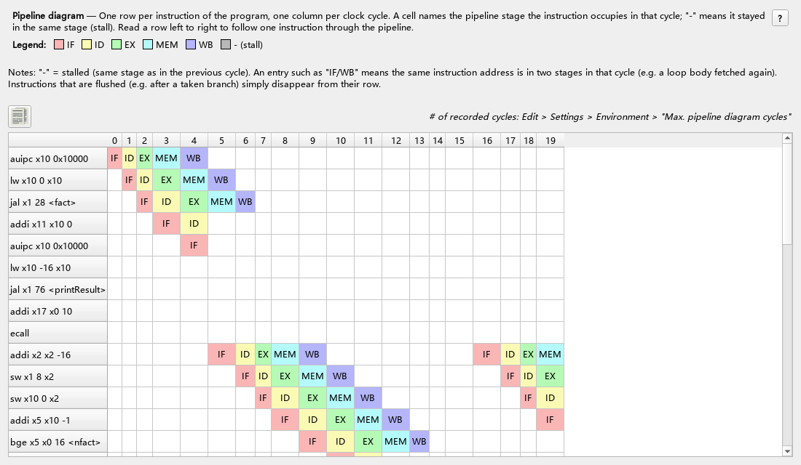

# 02 10-Minute Quick Start

> **What you will learn**
> - How to open an example program from **File → Load Example...**
> - How a program is "assembled" into machine code
> - How to execute cycle by cycle with **Clock** (F5) and watch the pipeline, registers and memory
> - How to run to completion with **Run** (F8) and read the program output in the Console
> - How to return to the start with **Reset** (F3) and undo cycles with **Reverse** (F4)
>
> **Prerequisites**
> - You can start the program (see [Chapter 01](01-install.md))
> - No RISC-V assembly knowledge is needed; this chapter only asks you to follow the steps and observe. The assembly language itself is explained in [Chapter 04](04-riscv-assembly.md)

The example we use is `factorial.s` (file `examples/assembly/factorial.s`). It computes the factorial of 7 recursively (7! = 5040) and prints the result to the console.

---

## Step 1: Open the example program

**Do**: in the menu bar choose **File → Load Example... → Assembly → factorial.s**.

**What you see**: the **Editor** tab (switch to it by clicking it on the left if it is not shown). It has two panes:

- Left, **Source code**: the text of `factorial.s` with syntax highlighting. **Input type:** above it is set to **Assembly**.
- Right, **Executable code**: the machine instructions the program was translated into. **View mode:** defaults to **Disassembled**, one instruction per line preceded by its address; switching to **Binary** shows the 32-bit encoding of each instruction.



**Why**: Ripes **assembles automatically** while you edit assembly source. As long as there is no syntax error, every change regenerates the machine code and loads it into the simulator, so there is no separate "compile" button. If a line has an error, it is marked red and hovering over it shows the message (for example `Unknown opcode 'xyz'`); the right pane keeps the result of the last successful assembly.

> Good to know: the instructions on the right are not identical to the source on the left. For example `lw a0, argument` in the source became two instructions, `auipc x10 0x10000` and `lw x10 0 x10`. `lw a0, argument` is a **pseudo-instruction** that the assembler expands into real instructions; `a0` is the ABI name (alias) of register `x10`.

---

## Step 2: Meet the Processor tab

**Do**: click the **Processor** tab on the left.

**What you see**:

- The large picture in the middle: the datapath of the current processor. The default processor is the **5-stage processor** (5-stage pipeline, RV32) with five stages from left to right: IF (instruction fetch), ID (decode), EX (execute), MEM (memory access) and WB (write back). Above each stage a label shows the instruction that stage is working on; before execution starts it shows `-`.
- On the right, **Registers**: the register table listing `x0`–`x31` with their aliases (`zero`, `ra`, `sp`…) and current values.
- On the right, **Instruction memory**: the program's instructions, with the columns breakpoint (BP), address (Addr), current stage (Stage) and instruction (Instruction).
- At the bottom left there are two small tabs, **Console** and **Memory**; at the bottom right, **Execution info** shows **Cycles**, **Instrs. retired**, **CPI**, **IPC** and **Clock rate**.
- The toolbar at the top of the window: **Select processor**, **Reset (F3)**, **Reverse (F4)**, **Clock (F5)**, **Auto clock (F6)** with its interval box (in ms), **Run (F8)**; plus the Processor-tab-only **Show pipeline diagram**.
- The right side of the status bar at the bottom shows the current processor, the ISA and the UI language, e.g. `Processor: 5-stage processor    ISA: RV32IMC    Language: English` (the ISA name changes with the enabled extensions).



**Why**: two registers are not 0 from the start: `sp` (`x2`) = `0x7ffffff0` and `gp` (`x3`) = `0x10000000`. These are the processor's default register initial values and are written again on every reset: the stack grows downward from a high address, and `gp` points to the start of the data section.

---

## Step 3: Single-step (Clock)

**Do**: press **Clock** once (or press **F5** on the keyboard).

**What you see**:

- The label above the IF stage becomes the first instruction, `auipc x10 0x10000`.
- In **Instruction memory**, the **Stage** column of that row shows `IF`.
- **Cycles** goes from 0 to 1.
- Some wires in the circuit briefly turn green (their value changed), and green dots on the multiplexers mark the currently selected input.

**Do**: press F5 four more times (five in total).

**What you see**: the first instruction has travelled all the way to the WB stage and the following instructions fill IF, ID, EX and MEM. In **Registers**, the value of `a0` (`x10`) becomes `0x10000000` and the row is shown with a highlighted background — the highlight marks "the most recently modified register".

**Why**: this is a **pipeline**: in every cycle each stage works on a different instruction, so after 5 cycles all five stages are full. The register table only changes once an instruction writes back in the WB stage. You will notice that **Instrs. retired** is smaller than **Cycles** — an instruction only "retires" after passing through every stage.

> Hover over any port in the circuit to see its name and current value; hold **Ctrl** and scroll the mouse wheel to zoom the circuit; click a wire to highlight the whole wire.

---

## Step 4: Watch a hazard

**Do**: keep pressing F5 until `jal x1 28 <fact>` enters the EX stage, then press once more.

**What you see**: the label above some stages becomes a red `nop (flush)`.

**Why**: `jal` is a jump. The processor only knows in the EX stage that it must jump to `fact`; the instructions already fetched in sequence are on the "wrong path" and must be flushed and replaced by no-ops (`nop`). Similarly, when an instruction needs data that has not been computed yet, you will see `nop (stall)`. These effects are explained in detail in [Chapter 06](06-processors-pipelines.md).

**Do**: click **Show pipeline diagram** (the table icon) in the toolbar.

**What you see**: the **Pipeline diagram** window opens: one row per instruction, one column per cycle, and each cell says which stage the instruction was in during that cycle. The **Copy table to clipboard** button (the icon at the top left, above the table) lets you paste the table into a spreadsheet.



---

## Step 5: Look at memory

**Do**: click the small **Memory** tab at the bottom of the Processor tab (or click the **Memory** tab on the left for a larger memory view). In the **Go to section:** drop-down choose `.data`.

**What you see**: the view jumps to address `0x10000000`. The first word has the value `7` (hex `0x00000007`), followed by the ASCII bytes of the strings `"Factorial value of "` and `" is "`.

**Why**: the source lines

```asm
.data
argument: .word   7
str1:     .string "Factorial value of "
```

tell the assembler to place this data in the data section. The data section starts at `0x10000000` by default (changeable in the **Assembler** group of **Edit → Settings → Compiler**). The program's first real instruction, `lw a0, argument`, reads the 7 from here into `a0`.

> The **Go to register:** drop-down moves the view to the address held in a register. Choose `sp`, for instance, to see the stack. While the program is inside `fact` you will see the saved return addresses and arguments on the stack.
>
> The display format (hexadecimal, signed/unsigned decimal, ASCII and so on) can be changed with the radix selector above the view.

---

## Step 6: Run to completion (Run)

**Do**: click **Run** (or press **F8**).

**What you see**: almost instantly, the **Console** at the bottom shows:

```text
Factorial value of 7 is 5040
```

**Execution info** is updated; on the default 5-stage pipelined processor this program takes about **189 cycles and 125 retired instructions from start to finish, CPI ≈ 1.51** (measured in command-line mode, see [Chapter 15](15-cli.md)). In **Registers**, both `a0` and `a1` are `5040` (`0x000013b0`). Afterwards the **Clock**, **Auto clock** and **Run** buttons are greyed out (disabled).

**Why**:

- In **Run** mode the simulator **does not update the GUI**, so it is much faster than stepping; it stops when the program exits or hits a breakpoint. The program ends with `li a7, 10` + `ecall`, which is the "exit" system call, so the simulation finishes and the buttons are disabled.
- The console text comes from `ecall`: `a7 = 4` prints a string, `a7 = 1` prints an integer. The full list of system calls is in **Help → System calls**.
- A CPI above 1 means there were quite a few stalls and flushes in the pipeline. With the single-cycle processor the CPI would be exactly 1, but each cycle does more work — exactly the trade-off discussed in Chapter 06.

---

## Step 7: Reset

**Do**: click **Reset** (or press **F3**).

**What you see**: **Cycles** returns to 0, all stage labels become empty, the registers return to their initial values (all 0 except `sp` and `gp`), the console gets an extra empty line, and **Clock**/**Run** are enabled again.

**Why**: a reset sets the program counter (PC) to the program's entry point and restores memory to the state right after the program was loaded — everything written to memory during execution is undone. The console history is not cleared; the reset only adds a line break to separate the two runs.

---

## Step 8: Breakpoints and auto clock

**Do**: in the right pane of the **Editor** tab (or in the **BP** column of **Instruction memory** on the Processor tab) click the empty area to the left of the `mul x10 x10 x6` line.

**What you see**: a red dot appears — this is a **breakpoint**.

**Do**: go back to the Processor tab, set the interval box next to **Auto clock** to `100 ms`, and click **Auto clock** (or **F6**).

**What you see**: the processor advances one cycle every 100 ms and the circuit keeps updating. When the `mul` instruction reaches the breakpoint, auto clocking stops. While running, the **Auto clock** button shows a pause symbol; pressing it again also stops it manually.

**Why**: **Auto clock** sits between **Clock** and **Run**: it steps continuously and refreshes the display like an animation, which suits classroom demonstrations; **Run** does not refresh the display and suits long programs. Both stop at breakpoints.

---

## Step 9: A first look at reverse execution

**Do**: after stopping at the breakpoint, press **Reverse** (or **F4**) a few times.

**What you see**: every press moves the processor **one cycle back**: stage labels, registers, memory and the cycle count are restored to the previous cycle.

**Why**: Ripes keeps the circuit state of the most recent cycles so they can be undone. The maximum number of undoable cycles is set by **Edit → Settings → Simulator → Max. undo cycles**, default **100**. Beyond that, or for cycles executed in **Run** mode, you cannot step back cycle by cycle (the **Reverse** button is greyed out).

> **Note**: reverse execution only rewinds the processor and memory. Peripherals in the I/O tab, especially this project's **SIMT GPU** and **Tensor Unit (NPU)** accelerators, may not rewind with it (or are reset after a reverse) — see [Chapter 06](06-processors-pipelines.md) and [Chapter 16](16-faq.md).

---

## Exercises

1. After a reset, step with F5 and count in which cycle the first `nop (flush)` appears. Which jump instruction causes it?
2. Change `argument: .word 7` in `factorial.s` to `5`. Does the right pane update immediately? What should the console print after running?
3. Open **Select processor**, switch to the **Single-cycle processor** and run the same program. Note Cycles and CPI and compare with the 189 cycles of the 5-stage pipeline.
4. Set a breakpoint on the first instruction at the `fact` label, run with Run, and look at `a0` every time it stops. How many times does it stop? Why?
5. In the **Memory** view choose **Go to register: sp** and look at the values saved on the stack at the deepest point of the recursion.

## Summary

- **File → Load Example...** loads an example; assembly source is **assembled automatically** whenever it changes, and the right pane shows the machine code.
- **Clock (F5)** steps one cycle, **Auto clock (F6)** steps continuously, **Run (F8)** runs fast without refreshing the GUI, **Reset (F3)** resets, **Reverse (F4)** undoes one cycle.
- The Processor tab contains the datapath diagram, stage labels, Registers, Instruction memory, Console/Memory and Execution info (Cycles, Instrs. retired, CPI, IPC).
- Breakpoints are set in the editor's right pane or in the BP column of Instruction memory; both Auto clock and Run stop at them.
- Programs print output and exit through `ecall`.

Next chapter: [03 GUI tour](03-gui-tour.md).
