# 03 GUI Tour

> **What you will learn**
> - The parts of the main window: menu bar, toolbars, the tab bar on the left, status bar
> - What each of the six tabs **Editor / Processor / Cache / Memory / I/O / Architecture** is for and how to read it
> - What every button of the simulator control toolbar does, and the tab-specific toolbars
> - The three dialogs **Load Program**, **Save File** and **Select Processor**
> - The four pages of the **Settings** dialog, and how to switch the UI between English and Chinese
> - All keyboard shortcuts and the in-app help **Help → User Guide / 用户手册**
>
> **Prerequisites**
> - You have done the 10-minute quick start in [Chapter 02](02-quickstart.md) and know the basics of Clock, Run and Reset

This chapter is a "map". You do not need to remember everything at once; whenever you meet a button you do not recognise, come back and look it up here.

> This guide describes the GUI that is currently being improved: every tab will get a "title + one-sentence description + **?** help button" at the top, and every control will have a tooltip and a status-bar tip. If your version does not have these elements yet, or the names differ slightly, the real GUI wins; this applies especially where the text says "(to be verified)".

---

## 1. Main window layout

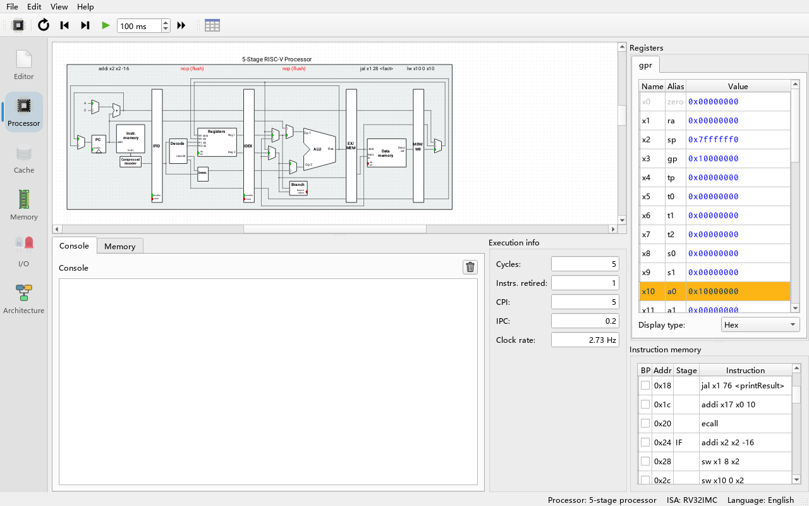

**Do**: start the program and, before clicking anything, look at the areas of the window.

**What you see**: from top to bottom and left to right:

| Area | Contents |
|---|---|
| Menu bar | **File**, **Edit**, **View**, **Help** |
| Simulator control toolbar | **Select processor**, **Reset**, **Reverse**, **Clock**, **Auto clock** + interval box, **Run**. **Always visible**, whichever tab is current |
| Tab-specific toolbar | Right next to the simulator control toolbar; its contents change with the current tab (e.g. Editor's **Compile C program**, Processor's **Show pipeline diagram**, Architecture's step/play buttons) |
| Tab bar on the left | Six large vertical icon buttons: **Editor**, **Processor**, **Cache**, **Memory**, **I/O**, **Architecture** |
| Central area | The contents of the current tab |
| Status bar | Temporary messages on the left (e.g. saved files, system-call status); on the right, permanently, `Processor: <processor name>    ISA: <ISA name>    Language: <UI language>` |

**Why**: the simulator control toolbar is always visible so that you can step or run from any tab — for example press F5 while watching a peripheral in the **I/O** tab, or run a program while watching the hit-rate plot in the **Cache** tab.

> The right side of the status bar also shows the current UI language (`Language: English` / `语言：简体中文`), and the tab buttons on the left have tooltips explaining what each tab is for.

---

## 2. Menus

### 2.1 File

| Item | Shortcut | Effect |
|---|---|---|
| **New Program** | Ctrl+N | Clears the editor. If the current program has not been saved, asks **Save program before creating new file?** |
| **Load Program** | Ctrl+O | Opens the **Load program...** dialog (section 5.1) to load a source file, a flat binary or an ELF executable |
| **Load Example...** | — | Sub-menus **Assembly**, **C** and **ELF (precompiled C)** listing the built-in examples |
| **Save File** | Ctrl+S | Saves to the previous location; the first save automatically becomes Save File As |
| **Save File As...** | Ctrl+Shift+S (plus the platform's standard "Save As" key where one exists; Qt defines none on Windows, so the program adds this binding itself) | Opens the **Save files...** dialog (section 5.2) |
| **Exit** | Ctrl+Q (plus the platform's standard "Quit" key where one exists; on Windows only Ctrl+Q) | Closes the program. If the editor has contents, asks **Save current program before exiting?** |

The examples in **Load Example...** (from the `examples/` directory, bundled into the program):

- **Assembly**: `complexMul.s`, `consolePrinting.s`, `consoleReading.s`, `exercise_gpu_divergence.s`, `exercise_gpu_saxpy.s`, `exercise_npu_batch.s`, `factorial.s`, `gpu_vecadd.s`, `leds.s`, `neogeo_mailbox.s`, `npu_matmul.s`
- **C**: `consoleInput.c`, `leds.c`, `matrixmul.c`, `npu_matmul.c`, `ranpi.c`, `spe_double_buffer.c`, `switchesAndLeds.c` (a C compiler must be configured first, see [Chapter 05](05-c-programs.md))
- **ELF (precompiled C)**: `RanPi-RV32`, `RanPi-RV64` (precompiled `ranpi.c`, no compiler needed)

> The `exercise_*` programs are the solutions to exercises of chapters 09 and 10. The menu simply lists every file bundled under `examples/assembly`, so any program added there appears automatically.

### 2.2 Edit

| Item | Effect |
|---|---|
| **Settings** | Opens the settings dialog (section 6) |

### 2.3 View

| Item | Effect |
|---|---|
| **Show processor signal values** | When checked, the current value is shown next to every output port of the circuit in the Processor tab. The choice is remembered |

### 2.4 Help

| Item | Effect |
|---|---|
| **User Guide** (F1) | Opens the in-app help window showing this guide in the current UI language (`docs/guide/en/` or `docs/guide/zh/`) |
| **Quick Start (10 minutes)** | Opens the help window directly at [Chapter 02](02-quickstart.md) |
| **Show Welcome Panel** | Shows the welcome panel that explains the six tabs again (it is hidden once you close it) |
| **System calls** | Opens the **Supported system calls** window listing every `ecall` number with its arguments and return values |
| **Online Documentation (upstream Ripes)** | Opens the upstream Ripes documentation on GitHub in a browser |
| **About Ripes...** | Shows an **About Ripes** box with the version number, the Qt version, the licence and the upstream project link |

The **?** button at the top right of each tab and peripheral widget also opens the help window, directly at the matching chapter; for example the GPU peripheral's **?** opens [Chapter 09](09-gpu.md).

---

## 3. The simulator control toolbar

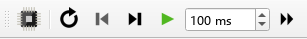

| Button | Shortcut | Effect | Disabled when |
|---|---|---|---|
| **Select processor** (CPU icon) | — | Opens the processor selection dialog (section 5.3) | Running or auto-clocking |
| **Reset** (circular arrow) | F3 | Sets the PC back to the program entry, restores memory to the freshly loaded state, restores the register initial values, clears the cycle count | Running or auto-clocking |
| **Reverse** (left triangle with bar) | F4 | Undoes one clock cycle | Nothing to undo (undo limit reached, just reset, or just ran with Run) |
| **Clock** (right triangle with bar) | F5 | Advances the circuit by one cycle | The program has exited |
| **Auto clock** (green triangle / pause symbol) | F6 | Clocks continuously at the interval in the box to its right (1–10000 ms, default 100 ms) while refreshing the display; stops at breakpoints. Press again to stop | The program has exited |
| Interval box (` ms`) | — | Auto clock interval in milliseconds | — |
| **Run** (double triangle) | F8 | Executes as fast as possible without refreshing the display until the program exits or a breakpoint is hit; press again to pause | The program has exited |

**Why is Run so much faster than Auto clock?** Auto clock redraws the circuit, register table and instruction table every cycle; during Run those widgets are disabled and only the statistics are refreshed periodically, at most **Edit → Settings → Environment → Max. UI updates per second** times per second (default 25).

The toolbar icons change colour automatically with the light/dark theme.

---

## 4. The six tabs

### 4.1 Editor

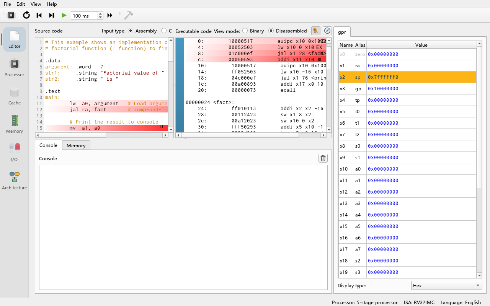

| Area | Description |
|---|---|
| **Source code** | The editable source. **Input type:** chooses **Assembly** or **C**. In assembly mode changes are assembled automatically; error lines are marked red, hover to see the message |
| **Executable code** | Read-only program view. **View mode:** chooses **Binary** (machine code) or **Disassembled**. Click the left sidebar to set/clear breakpoints. Instructions currently in the pipeline are coloured by stage |
| Follow button (**Follow program execution**) | When checked, the disassembly scrolls automatically so the instruction in the processor's first stage is always visible |
| Compass button (**Show symbol navigator**) | Lists all symbols (labels) in the program; choosing one jumps to its address |
| Register panel | A register view on the right of the editor (can be hidden in Settings → Editor) |
| Console | A console below the editor (can be hidden in Settings → Editor) |
| Toolbar **Compile C program (Ctrl+B)** | Only available when Input type = C; compiles with the configured RISC-V compiler and loads the result |

When you load an ELF or flat binary file, the source area is replaced by a page showing **Current input source:**, **File:** (the path) and an **Enable editor** button. Clicking the button clears the loaded program and returns to the editable state.

### 4.2 Processor

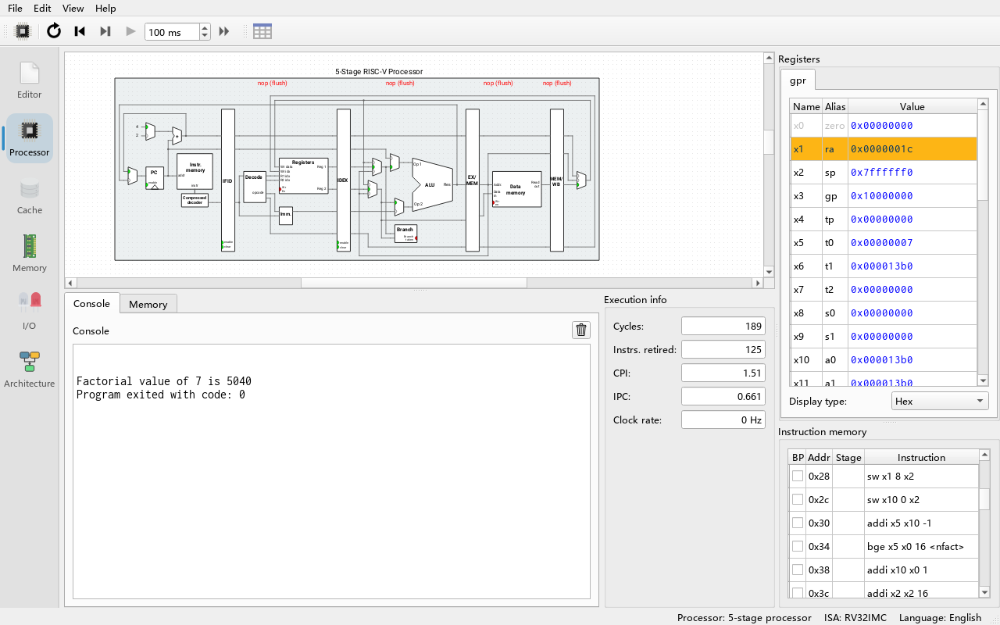

| Area | Description |
|---|---|
| Circuit diagram (centre) | The datapath of the current processor. Ctrl+wheel zooms; hover a port to see its name and value; click a wire to highlight the whole wire; right-click a port to show a value label and change its radix. 1-bit wires are green for 1 and grey for 0; multi-bit signals flash green briefly when they change |
| Stage labels | Above each pipeline stage, the instruction being processed; a red `nop (flush)` / `nop (stall)` / `nop (way hazard)` / `nop (unused)` indicates a flush, stall and so on |
| **Registers** | All registers (`x0`–`x31` on RV32). Click a value to **edit** the register directly; the most recently modified register is highlighted; the radix can be switched; the context menu copies values or moves the memory views to that address |
| **Instruction memory** | Columns **BP** (breakpoint, click to toggle), **Addr** (address), **Stage**, **Instruction** (disassembly). The table scrolls automatically to follow the instruction in the first stage |
| **Console** | Output printed by `ecall`; programs that read input (such as `consoleReading.s`) are typed into here too |
| **Memory** (small tab) | A compact memory view, the same as the Memory tab |
| **Execution info** | **Cycles**, **Instrs. retired**, **CPI** (cycles per instruction), **IPC** (instructions per cycle), **Clock rate** (the clock frequency the simulator actually reaches) |
| Toolbar **Show pipeline diagram** | Opens the pipeline diagram (one row per instruction, one column per cycle). Note: stage information is not recorded in Run mode |

### 4.3 Cache

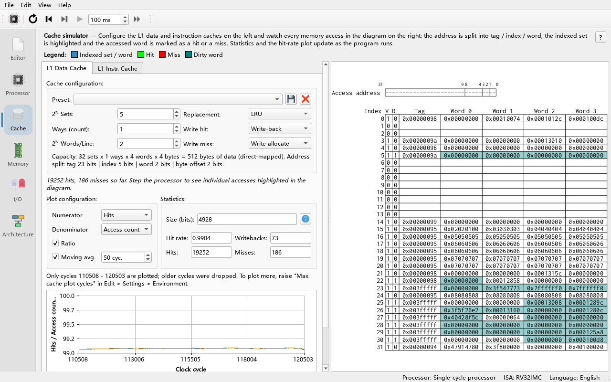

The Cache tab has two sub-tabs, **L1 Data Cache** and **L1 Instr. Cache**. Each contains:

- **Cache configuration:** the **Preset:** drop-down with buttons to store/delete presets (**Store cache preset** / **Delete cache preset**); **2^N Sets:**, **Ways (count):** and **2^N Words/Line:** — note that the number of sets and the words per line are entered as powers of two (5 means 2^5 = 32 sets), while the number of ways is entered directly; **Write hit:** / **Write miss:** (write-hit / write-miss policies); **Replacement:** (replacement policy, LRU or Random). A summary line below spells out the capacity and the tag / index / word / byte-offset split of the address.
- The cache table: one row per cache way, with columns V (valid), D (dirty), LRU, Tag and the words; hover to see addresses, click to jump to the memory view.
- **Statistics:** **Hits**, **Misses**, **Hit rate**, **Writebacks**, **Size (bits)**.
- The hit-rate plot: **Plot configuration:** selects the **Numerator** / **Denominator**, **Moving avg.** (moving-average window in cycles) and a **Ratio** toggle; the context menu offers **Enable ratio crosshair**, **Enable moving average crosshair**, **Copy data to clipboard** and **Save plot to file**.

There are three built-in presets: `32-entry 4-word direct-mapped`, `32-entry 4-word fully associative` and `32-entry 4-word 2-way set associative`. See [Chapter 07](07-cache.md) for details.

### 4.4 Memory

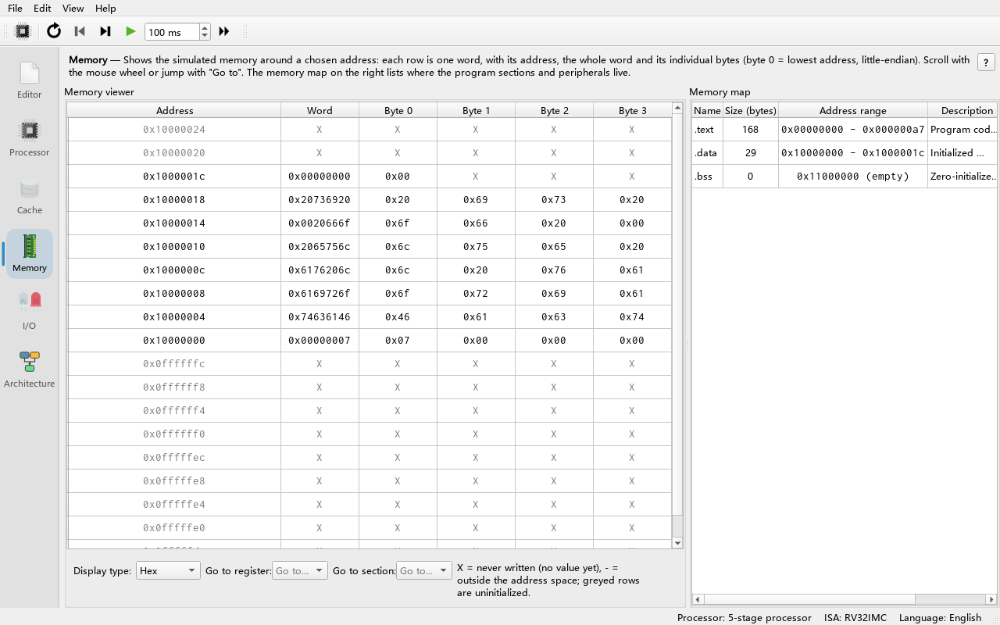

| Area | Description |
|---|---|
| **Memory viewer** | A word-by-word view of the whole address space. **Go to register:** jumps to the address held in a register; **Go to section:** jumps to `.text`, `.data` and so on, or choose **Address...** to type any address; the radix selector changes the display format |
| **Memory map** | Lists the regions of the current address space: the program sections and the address ranges occupied by I/O peripherals |

On reset, all memory written while the program ran is restored.

### 4.5 I/O

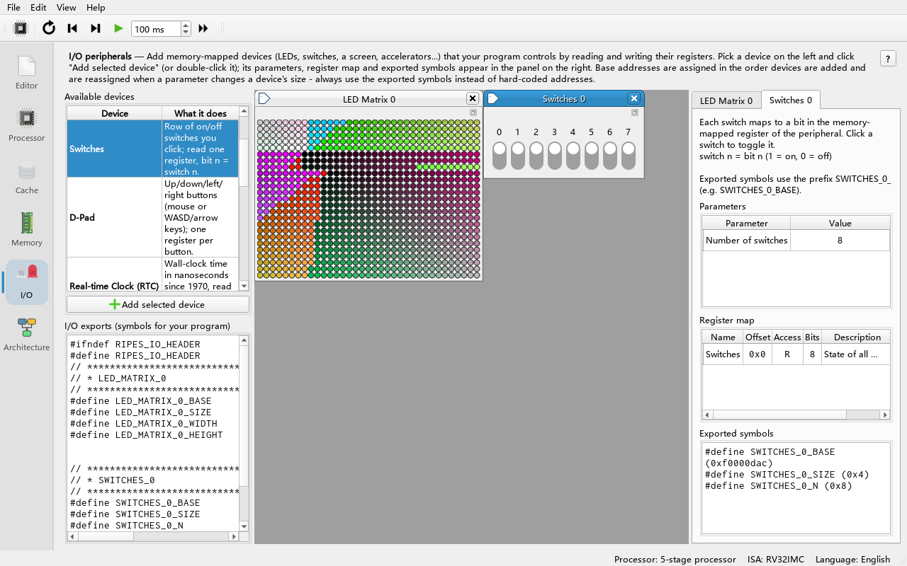

| Area | Description |
|---|---|
| **Available devices** (top left) | A table with the columns **Device** and **What it does**: **LED Matrix**, **Switches**, **D-Pad**, **Real-time Clock (RTC)**, **Screen**, **SIMT GPU**, **Tensor Unit (NPU)**. Select an item and click **Add selected device** below the list, or **double-click** it, to create that peripheral |
| **I/O exports** (bottom left) | The symbols exported by all created peripherals (e.g. `LED_MATRIX_0_BASE`), usable directly in assembly or C (`#include "ripes_system.h"`) |
| Central MDI area | One sub-window per peripheral showing its visualisation (LEDs, switches, the GPU warp grid, the NPU systolic array…). Sub-windows can be dragged out of the main window so you can watch other tabs at the same time |
| Peripheral details (right) | One tab per peripheral: description text, **Parameters** (editable, e.g. LED matrix width/height, GPU SM count), **Register map** (offset, read/write access, bit width, meaning), **Exported symbols** (the symbols this peripheral exports) |

Peripherals are allocated upwards starting at **Edit → Settings → Simulator → I/O start address** (default `0xF0000000`). While running you cannot create or close peripherals or change their parameters. When the program closes it remembers the created peripherals and their parameters and restores them on the next start.

See [Chapter 08](08-mmio-peripherals.md) for peripherals in general, and [Chapter 09](09-gpu.md) and [Chapter 10](10-npu.md) for the GPU and NPU.

### 4.6 Architecture

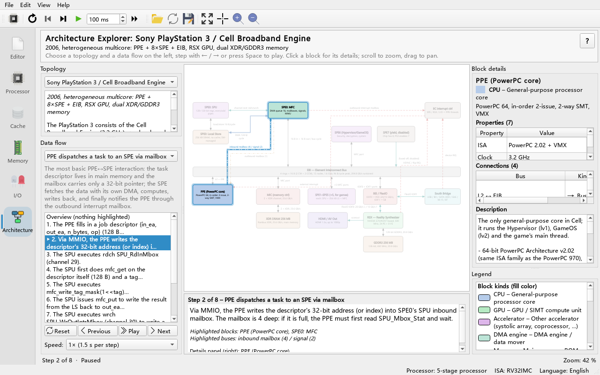

This tab is new in this project. It explains the architecture of real machines with block diagrams and "data-flow animations", and is **independent of the RISC-V program being simulated**.

| Area | Description |
|---|---|
| **Topology** drop-down (left) | Chooses a built-in topology (Neo Geo, PS3/Cell, GPU system view, NPU system view, minimal example); the box below it describes the topology |
| **Data flow** (left) | A drop-down with all data flows of that topology, a short description of the selected flow, the clickable list of its steps, the **Reset** / **Previous** / **Play** / **Next** buttons and the **Speed** box; step with these buttons, the toolbar or the arrow keys |
| Step text (below the diagram) | Title and explanation of the current step, with the highlighted blocks and buses |
| Central diagram | Wheel zooms, drag pans, click a block for details; the legend explains the colours |
| **Block details** (right) | The selected block's name, kind, **Properties** table, **Connections** table and **Description** text; below it the **Legend** of block kinds and bus styles |
| Status line (bottom) | The current step, e.g. `Step 2 of 8`, whether the flow is playing or paused, and the zoom level |
| Toolbar | **Open architecture JSON...** (load a topology from disk), **Reset flow**, **Previous step**, **Next step**, **Play**/**Pause** (advance one step every 1.5 s), **Fit to view**, **Zoom in**, **Zoom out** |

See [Chapter 11](11-arch-explorer.md) for details.

---

## 5. Three common dialogs

### 5.1 Load Program

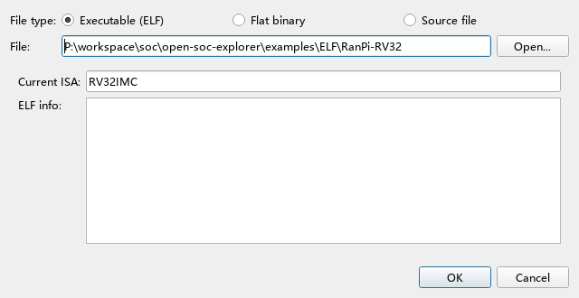

**File type:** has three choices:

- **Source file**: `.s`, `.as` and `.asm` load as assembly, `.c` loads as C (needs a compiler).
- **Flat binary**: a raw machine-code file. You must fill in **Load at:** (load address) and **Entry point:**, both hexadecimal.
- **Executable (ELF)**: a RISC-V ELF executable. The dialog shows **Current ISA:** (the ISA of the current processor) and checks that the file is compatible; if not, **ELF info:** shows why (e.g. "Expected 32 bit executable, but input program is 64 bit", "Only executable ELF files are supported").

Type a path after **File:** or browse with **Open...**. If the path does not exist, the field turns red and **OK** is disabled.

### 5.2 Save files

Tick what to save: **source code** (saved as `.s` or `.c`) and/or **assembled/compiled binary** (the `.text` section as binary, saved as `.bin`). **File:** takes a path without extension; **Output:** previews the file names that will be written.

### 5.3 Select Processor

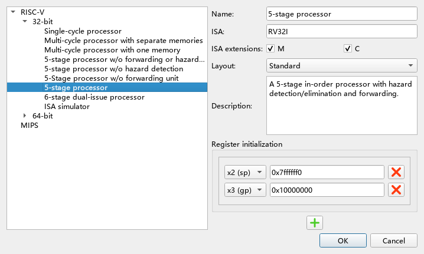

On the left is a tree: **RISC-V → 32-bit / 64-bit → processor**. The processor currently in use is shown in bold. The available processors (one set each for 32-bit and 64-bit):

| Name | Command-line ID (RV32 / RV64) |
|---|---|
| Single-cycle processor | `RV32_SS` / `RV64_SS` |
| Multi-cycle processor with separate memories | `RV32_5MC_2M` / `RV64_5MC` |
| Multi-cycle processor with one memory | `RV32_5MC_1M` / `RV64_5MC_1M` |
| 5-stage processor w/o forwarding or hazard detection | `RV32_5S_NO_FW_HZ` / `RV64_5S_NO_FW_HZ` |
| 5-stage processor w/o hazard detection | `RV32_5S_NO_HZ` / `RV64_5S_NO_HZ` |
| 5-Stage processor w/o forwarding unit | `RV32_5S_NO_FW` / `RV64_5S_NO_FW` |
| 5-stage processor (full 5-stage pipeline, **default**) | `RV32_5S` / `RV64_5S` |
| 6-stage dual-issue processor | `RV32_6S_DUAL` / `RV64_6S_DUAL` |
| ISA simulator (instruction-level, no circuit diagram, fastest) | `RV32_ISS` / `RV64_ISS` |

On the right, for the selected processor:

- **Name:**, **ISA:**, **Description:**
- **ISA Exts.**: one check box per extension (e.g. `M` multiply/divide, `C` compressed instructions); hover to see a description. The extensions decide which instructions the assembler accepts and which instructions a C compiler generates.
- **Layout**: **Standard** (simplified view without control signals) or **Extended** (shows control components, signals and bit widths). The layout only affects the display, not the processor's behaviour.
- Register initialization: values written to chosen registers on every reset (by default `sp = 0x7ffffff0`, `gp = 0x10000000`).

Double-click a processor or press **OK** to apply. If the old and new processors implement the same ISA, the loaded program is kept.

---

## 6. Settings

**Do**: **Edit → Settings**.

**What you see**: a list of pages on the left and the matching settings on the right. Every change **takes effect immediately** and is saved automatically; just press **OK** to close (except the language, which needs a restart).

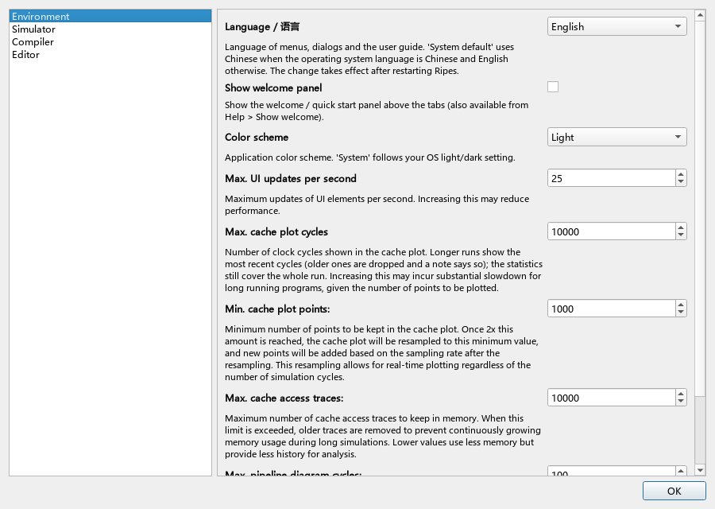

### 6.1 Environment

| Setting | Description |
|---|---|
| **Color scheme** | **System** (follow the OS light/dark setting), **Light**, **Dark**. The circuit diagram, toolbar icons and I/O backdrop follow immediately |
| **Language / 语言** | **System default**, **English**, **简体中文**. **Takes effect after a restart**. It is the first setting on this page |
| **Max. UI updates per second** | How many times per second the UI is refreshed at most (1–100, default 25). Higher is smoother but slower |
| **Max. cache plot cycles** | How many cycles the cache plot draws at most (default 10000); longer runs show the most recent cycles. Lower it for long programs to avoid slowdowns |
| **Min. cache plot points:** | The minimum number of points kept after the cache plot is resampled |
| **Max. cache access traces:** | How many cache access records are kept in memory at most |
| **Max. pipeline diagram cycles:** | How many cycles the pipeline diagram records at most |
| **Console → Echo console input:** | Echo user input in the console |
| **Show welcome panel** | Shows the "Welcome / quick start" panel above the tabs (it is shown on the first launch; **Help → Show Welcome Panel** turns it on as well) |

### 6.2 Simulator

| Setting | Description |
|---|---|
| **Max. undo cycles:** | How many cycles Reverse can undo at most (default 100). Larger values use more memory |
| **Clock rate averaging window (ms):** | Averaging window of Clock rate in Execution info (default 250 ms) |
| **I/O start address:** | Start of peripheral address allocation (default `0xF0000000`) |
| **Enable simulation VCD traces:** / **VCD trace file:** | Write simulation signals to a VCD waveform file, viewable in tools such as GTKWave (see [Chapter 06](06-processors-pipelines.md)) |

### 6.3 Compiler

| Setting | Description |
|---|---|
| **RISC-V C/C++ Compiler** → **Compiler path:** + **Browse** | Path to a RISC-V cross compiler (e.g. `riscv64-unknown-elf-gcc`). When valid the field turns green and **Compile command:** shows the actual command line; when invalid it turns red and shows **Error:** |
| **Compiler arguments:** / **Linker arguments:** | Extra compile and link arguments (e.g. `-O1`, `-nostdlib`) |
| **Assembler** → **.text / .data / .bss section start address:** | Section start addresses (defaults `0x0`, `0x10000000`, `0x11000000`) |

### 6.4 Editor

| Setting | Description |
|---|---|
| **Indent size:** | Tab indent width in spaces |
| **Show registers in editor tab** | Show the register panel in the Editor tab |
| **Show console in editor tab** | Show the console in the Editor tab |
| **Highlight stages in source** | Colour the source lines being executed by each pipeline stage |
| **Formatter** → **clang-format path:**, **Format on save:**, **Formatter arguments:** | Format `.c` files with clang-format |

---

## 7. Switching the UI language

1. **Edit → Settings → Environment**.
2. Set **Language / 语言** to **English** (or **简体中文**, **System**).
3. A message explains that a restart is needed; close and restart the program.

**What you see**: after the restart, menus, buttons, tab names, dialogs and peripheral descriptions are in the chosen language; **Help → User Guide** opens the guide in that language.

**Why a restart is needed**: Qt translations are loaded when the program starts, before the windows are created (`main.cpp` calls `installTranslators`); windows that already exist do not change language. With **System**, Chinese is used when the OS locale is Chinese and English otherwise.

> This guide gives every UI element by its English text (and the Chinese version also by its Chinese name), so you can follow it whichever language the UI uses.

---

## 8. Keyboard shortcuts

| Shortcut | Effect | Scope |
|---|---|---|
| Ctrl+N | New Program | Global |
| Ctrl+O | Load Program | Global |
| Ctrl+S | Save File | Global |
| Ctrl+Shift+S (plus the platform "Save As" key, if any) | Save File As... | Global |
| Ctrl+Q (plus the platform "Quit" key, if any) | Exit | Global |
| F3 | Reset | Global |
| F4 | Reverse (undo one cycle) | Global |
| F5 | Clock (step one cycle) | Global |
| F6 | Auto clock on/off | Global |
| F8 | Run / pause | Global |
| Ctrl+B | Compile C program | Editor, Input type = C |
| Ctrl+wheel | Zoom the circuit / cache table / editor font | Processor, Cache, Editor |
| → / ← | Next step / Previous step of a data flow | Architecture tab |
| Home | Reset flow (back to step 0) | Architecture tab |
| Space | Play / Pause | Architecture tab |

> Note: F6 is **Auto clock**; **single-stepping is F5**. Some older documents say F6 for single-stepping; this table is authoritative.

---

## 9. In-app help

**Do**: **Help → User Guide / 用户手册**.

**What you see**: a help window showing this guide's index (README). On the left is the chapter list, at the top the back / forward / index buttons, a button that switches between 中文 and English, and a **Find in page** box. Click a link to jump to a chapter; the language matches the UI language.

**Do**: switch to the **I/O** tab, create a **SIMT GPU** peripheral and click the **?** at the top right of its widget.

**What you see**: the help window opens [Chapter 09 SIMT GPU](09-gpu.md) directly.

**Why**: every tab and peripheral is linked to its chapter through `Ripes::showHelp("<chapter>")`, so when you "don't know what this is", press **?** first. If the help window cannot find the guide files, it tells you that the guide is in the repository's `docs/guide` directory.

---

## Exercises

1. Without looking at this chapter, name the six buttons of the simulator control toolbar from left to right with their shortcuts, then check against section 3.
2. In **Select processor**, switch to the **Extended** layout and compare it with **Standard**. Which components are new?
3. Set **Color scheme** to **Dark**, see how the Processor and I/O tabs change, then set it back to **System**.
4. In the I/O tab create an **LED Matrix**, change its width to 8 in **Parameters** on the right, and watch how **Register map** and **Exported symbols** change.
5. In the Architecture tab select a flow and step it from beginning to end using only the keyboard (→, ←, Home).
6. Switch the UI to the other language, restart, and find the translated names of three settings from the tables in section 6.

## Summary

- Main window = menu bar + the always-visible simulator control toolbar + a toolbar that changes with the tab + six tabs on the left + a status bar (processor and ISA on the right).
- **Editor** writes/shows programs, **Processor** shows the circuit and execution, **Cache** the caches, **Memory** the memory, **I/O** manages peripherals (including GPU/NPU), **Architecture** shows block diagrams and data flows of real machines.
- Three dialogs: **Load Program** (source / flat binary / ELF), **Save files**, **Select Processor** (processor, extensions, layout, register initial values).
- **Settings** has four pages: Environment, Simulator, Compiler, Editor; the language is on the Environment page and needs a restart.
- Shortcuts: F3 reset, F4 reverse, F5 step, F6 auto clock, F8 run, Ctrl+B compile C; ←/→/Home in Architecture.
- When in doubt, press **?** or use **Help → User Guide / 用户手册**.

Next chapter: [04 RISC-V assembly tutorial](04-riscv-assembly.md).
