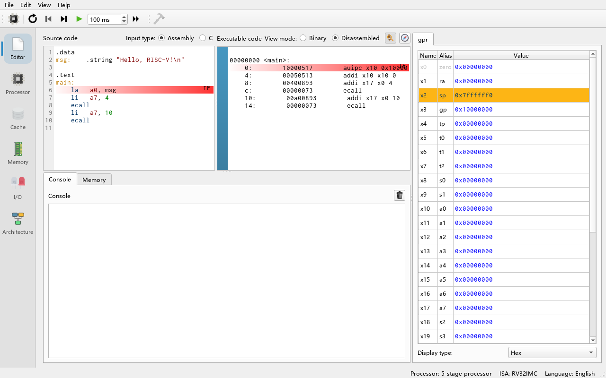
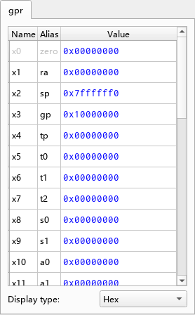
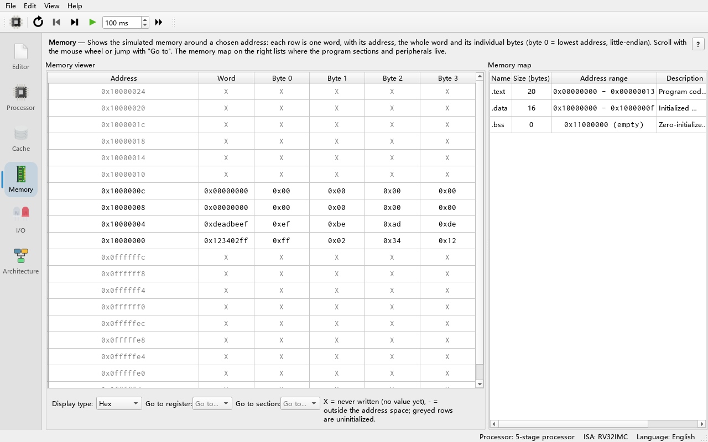
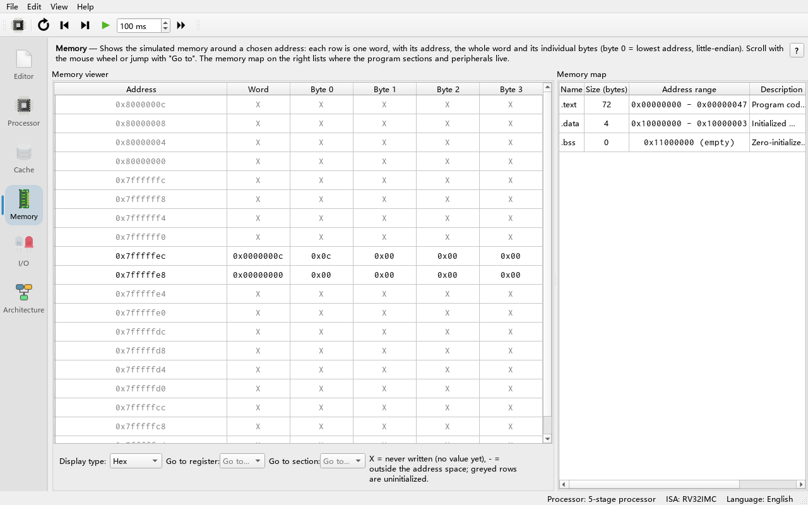
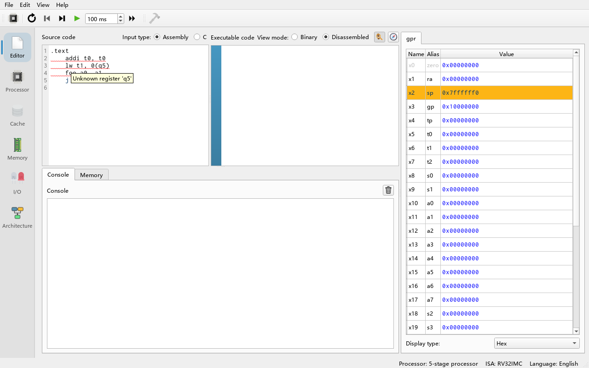

# 04 RISC-V Assembly Tutorial

> **What you will learn**
>
> - The 32 RISC-V general purpose registers and their ABI names (`a0`, `sp`, `ra`, ...);
> - The main instruction classes: arithmetic/logic, immediate, load/store, branch, jump, with examples of each;
> - What a pseudo-instruction is and which real instructions the assembler expands it into;
> - How to organise data with directives such as `.data` / `.text` / `.word` / `.string`;
> - How to write loops and functions and how to save registers on the stack;
> - How to print integers and strings and exit the program with `ecall`;
> - How to read assembler error messages and fix them.
>
> **Prerequisites**
>
> - You can start the program and know the **Editor** tab and the **Processor** tab (chapters 02 and 03).
> - You know what binary and hexadecimal are. No prior assembly knowledge is needed.

---

## 4.1 Your first program

**Do**: Open the **Editor** tab and make sure **Input type:** in the top-left corner is set to **Assembly**. Clear the **Source code** area on the left and type:

```asm
.data
msg:    .string "Hello, RISC-V!\n"

.text
main:
    la   a0, msg        # a0 = address of the string
    li   a7, 4          # system call 4: print string
    ecall
    li   a7, 10         # system call 10: exit
    ecall
```

**What you see**: As soon as you stop typing, the program is assembled automatically. The **Executable code** area on the right shows the disassembled instructions. Note that the first line `la a0, msg` became **two** instructions on the right, `auipc` and `addi` — this is pseudo-instruction expansion, explained in section 4.4.



**Do**: Press **Run (F8)** in the toolbar.

**What you see**: The **Console** at the bottom shows:

```text
Hello, RISC-V!

Program exited with code: 0
```

**Why**: `ecall` (environment call) hands control to the simulator. The simulator looks at the number in `a7` to decide what to do: 4 = print the zero-terminated string that `a0` points to, 10 = end the program and print "Program exited with code: 0".

> **Tip**: Ripes does not require a `main` label. Execution starts at the first instruction of the `.text` segment (address `0x0` by default). If the program does not exit with `ecall`, it also ends naturally after its last instruction.

## 4.2 Registers and ABI names

RV32I has 32 general purpose registers of 32 bits each, `x0`–`x31`. In assembly you can write either `x10` or its **ABI name** (the alias defined by the application binary interface) `a0`. The **Registers** panel on the right of the **Processor** tab shows both names; hovering shows a description of each register (from `src/isa/rvisainfo_common.cpp`).

| Register | ABI name | Purpose | Saved by |
|---|---|---|---|
| `x0` | `zero` | Always 0, writes are ignored | — |
| `x1` | `ra` | Return address | Caller |
| `x2` | `sp` | Stack pointer | Callee |
| `x3` | `gp` | Global pointer | — |
| `x4` | `tp` | Thread pointer | — |
| `x5`–`x7` | `t0`–`t2` | Temporaries | Caller |
| `x8` | `s0` (`fp`) | Saved register / frame pointer | Callee |
| `x9` | `s1` | Saved register | Callee |
| `x10`–`x11` | `a0`–`a1` | Function arguments / return values | Caller |
| `x12`–`x17` | `a2`–`a7` | Function arguments (`a7` is also the system call number) | Caller |
| `x18`–`x27` | `s2`–`s11` | Saved registers | Callee |
| `x28`–`x31` | `t3`–`t6` | Temporaries | Caller |

**Do**: Press **Reset (F3)**, switch to the **Processor** tab and look at the **Registers** panel.

**What you see**: Most registers are 0, but `sp` = `0x7ffffff0` and `gp` = `0x10000000`.

**Why**: Every processor model has default register initialisation values (`defRegVals` in `src/processorregistry.cpp`): the stack grows downwards from the high address `0x7ffffff0`, and `gp` points to the start of the data segment. You can change these initial values in the processor selection dialog (chapter 06). You can also click a register value in the panel and edit it directly.



## 4.3 Instruction classes

RISC-V instructions have a very regular format: most are "operation destination, source1, source2/immediate". The Ripes assembler accepts operands separated by commas or spaces (`addi a0, a0, 1` is the same as `addi a0 a0 1`).

### 4.3.1 Register-register operations (R-type)

```asm
add  t0, t1, t2     # t0 = t1 + t2
sub  t0, t1, t2     # t0 = t1 - t2
and  t0, t1, t2     # bitwise AND
or   t0, t1, t2     # bitwise OR
xor  t0, t1, t2     # bitwise XOR
sll  t0, t1, t2     # shift left logical by t2 bits
srl  t0, t1, t2     # shift right logical (fill with 0)
sra  t0, t1, t2     # shift right arithmetic (fill with sign bit)
slt  t0, t1, t2     # t0 = (t1 < t2) ? 1 : 0 (signed)
sltu t0, t1, t2     # same, but unsigned comparison
```

### 4.3.2 Immediate operations (I-type)

An immediate is a constant encoded in the instruction. Its range is a 12-bit signed number, i.e. −2048 to 2047.

```asm
addi t0, t1, -5     # t0 = t1 - 5 (there is no subi; use a negative immediate)
andi t0, t1, 0xFF   # keep the low 8 bits
ori  t0, t1, 1
xori t0, t1, -1     # bitwise NOT
slli t0, t1, 2      # shift left by 2 = multiply by 4
srli t0, t1, 1
srai t0, t1, 1
slti t0, t1, 10
```

For larger constants, use `lui` (load upper immediate, which places a 20-bit immediate in the upper 20 bits) together with `addi`, or simply the pseudo-instruction `li`:

```asm
lui  a0, 0x12345    # a0 = 0x12345000
```

### 4.3.3 Multiply and divide (M extension)

`mul`, `mulh`, `mulhsu`, `mulhu`, `div`, `divu`, `rem`, `remu` belong to the **M extension** (integer multiplication and division). In the GUI the M extension is enabled by default; if you untick M under **ISA Exts.** in the processor selection dialog, these instructions report "Unknown opcode".

```asm
mul  t0, t1, t2     # low 32 bits of the product
div  t0, t1, t2     # signed division
rem  t0, t1, t2     # remainder
```

### 4.3.4 Loads and stores

RISC-V is a load/store architecture: only load and store instructions access memory; arithmetic works only on registers. Addresses are written as `offset(base register)`.

```asm
lw   t0, 0(a0)      # load 4 bytes (word)
lh   t0, 2(a0)      # load 2 bytes, sign-extend
lhu  t0, 2(a0)      # load 2 bytes, zero-extend
lb   t0, 1(a0)      # load 1 byte, sign-extend
lbu  t0, 1(a0)      # load 1 byte, zero-extend
sw   t0, 8(sp)      # store 4 bytes
sh   t0, 0(a0)      # store 2 bytes
sb   t0, 0(a0)      # store 1 byte
```

RISC-V is little-endian: the least significant byte of a word is stored at the lowest address.

### 4.3.5 Branches and jumps

```asm
beq  t0, t1, label  # branch if equal
bne  t0, t1, label  # branch if not equal
blt  t0, t1, label  # less than (signed)
bge  t0, t1, label  # greater or equal (signed)
bltu t0, t1, label  # less than (unsigned)
bgeu t0, t1, label  # greater or equal (unsigned)
jal  ra, func       # jump to func, store the return address (next instruction) in ra
jalr x0, 0(ra)      # jump to the address in ra (i.e. return from a function)
```

## 4.4 Pseudo-instructions

Pseudo-instructions are not real machine instructions but shorthands provided by the assembler; each is expanded into one or two real instructions. The table lists the pseudo-instructions supported by Ripes (from `src/isa/rv_i_ext.h`):

| Pseudo-instruction | Expands to | Meaning |
|---|---|---|
| `nop` | `addi x0, x0, 0` | No operation |
| `li rd, imm` | `addi`, or `lui` + `addi` | Load any 32-bit constant |
| `la rd, symbol` | `auipc rd, %pcrel_hi(symbol)` + `addi rd, rd, %pcrel_lo(...)` | Load the address of a label |
| `mv rd, rs` | `addi rd, rs, 0` | Copy a register |
| `not rd, rs` | `xori rd, rs, -1` | Bitwise NOT |
| `neg rd, rs` | `sub rd, x0, rs` | Negate |
| `seqz` / `snez` / `sltz` / `sgtz` | `sltiu` / `sltu` / `slt` | Compare with 0 and set |
| `beqz` / `bnez` / `blez` / `bgez` / `bltz` / `bgtz` | `beq`/`bne`/`bge`/`blt` against `x0` | Branch on comparison with 0 |
| `bgt` / `ble` / `bgtu` / `bleu` | `blt` / `bge` / `bltu` / `bgeu` with swapped operands | The missing comparison branches |
| `j label` | `jal x0, label` | Unconditional jump |
| `jal label` | `jal x1, label` | Call (with `ra` omitted) |
| `jr rs` | `jalr x0, rs, 0` | Jump to the address in a register |
| `jalr rs` | `jalr x1, rs, 0` | Call the address in a register |
| `ret` | `jalr x0, x1, 0` | Return from a function |
| `call label` | `auipc x1, ...` + `jalr x1, x1, ...` | Far call |
| `tail label` | `auipc x6, ...` + `jalr x0, x6, ...` | Tail call |
| `lw rd, symbol` (also `lb`/`lh`/`ld`) | `auipc rd, ...` + `lw rd, ...(rd)` | Load directly from a label |
| `sw rs, symbol, rt` (also `sb`/`sh`/`sd`) | `auipc rt, ...` + `sw rs, ...(rt)` | Store to a label, `rt` is a scratch register |

**Do**: Type `li a0, 0x12345678` in the editor and look at the disassembly on the right.

**What you see**: It becomes two instructions, `lui` + `addi`. If you write `li a0, 5`, there is only a single `addi`.

**Why**: `0x12345678` does not fit in a 12-bit immediate, so the assembler first uses `lui` for the upper 20 bits and then `addi` for the lower 12 bits.

> **Note**: `li` only accepts numbers or defined symbols. Character literals like `li a0, 'A'` are **not supported**, and the error message is the unhelpful "Unknown opcode 'li'". Write the ASCII code instead: `li a0, 65`.

## 4.5 Segments and directives

A program is usually split into segments:

- **`.text`**: the code segment, default start address `0x0`;
- **`.data`**: the initialised data segment, default start address `0x10000000`;
- **`.bss`**: the uninitialised data segment, default start address `0x11000000`.

These three addresses can be changed in **Edit → Settings**, on the **Compiler** page, in the **Assembler** group (`.text section start address:` and so on).

Common directives (defined in `src/assembler/gnudirectives.cpp`):

| Directive | Effect | Example |
|---|---|---|
| `.word` / `.long` / `.4byte` | Emit 4-byte integers | `nums: .word 3, 5, 7` |
| `.half` / `.short` / `.2byte` | Emit 2-byte integers | `.half 0x1234` |
| `.byte` | Emit single bytes | `.byte 0xFF, 2` |
| `.dword` | Emit 8-byte integers | `.dword 1` |
| `.string` / `.asciz` | Emit a zero-terminated string (supports `\n`) | `.string "abc"` |
| `.zero n` | Emit n zero bytes | `buf: .zero 64` |
| `.align n` | Align to 2ⁿ bytes | `.align 2` |
| `.equ name, value` | Define a constant symbol | `.equ N, 10` |
| `.global` / `.globl` | Accepted but ignored (for GCC output compatibility) | `.globl main` |

The following program demonstrates these directives and reads the same byte with different load instructions:

```asm
.equ COUNT, 3
.data
b:      .byte 0xFF, 2
        .align 2
h:      .half 0x1234
w:      .word 0xDEADBEEF
buf:    .zero 8
.text
    la   t0, b
    lb   a0, 0(t0)      # sign-extended: -1
    li   a7, 1
    ecall
    li   a0, 32         # space
    li   a7, 11
    ecall
    lbu  a0, 0(t0)      # zero-extended: 255
    li   a7, 1
    ecall
    li   a0, 32
    li   a7, 11
    ecall
    li   a0, COUNT      # .equ constant: 3
    li   a7, 1
    ecall
```

**What you see**: The console prints `-1 255 3`.

**Do**: Switch to the **Memory** tab and choose `.data` in **Go to section:**.

**What you see**: Address `0x10000000` holds the bytes `ff 02`, followed by two zero bytes inserted by `.align 2`, and then `34 12` (`0x1234` stored little-endian) ...

**Why**: `.align 2` makes the next item start at a multiple of 4; little-endian order puts the low byte `34` of `0x1234` first.



## 4.6 Branches and loops

The basic loop pattern is "counter + conditional branch back". The following program sums an array:

```asm
.data
nums:   .word 3, 5, 7, 9
.text
main:
    la   t0, nums       # t0 = address of the current element
    li   t1, 4          # t1 = elements remaining
    li   t2, 0          # t2 = running sum
loop:
    lw   t3, 0(t0)
    add  t2, t2, t3
    addi t0, t0, 4      # next word, address + 4
    addi t1, t1, -1
    bnez t1, loop       # continue while elements remain
    mv   a0, t2
    li   a7, 1          # print integer: 24
    ecall
    li   a7, 10
    ecall
```

**Do**: Press **Reset (F3)**, then press **Clock (F5)** (advance one cycle) repeatedly while watching the **Stage** column of the **Instruction memory** panel on the right of the **Processor** tab and the registers `t1` and `t2`.

**What you see**: Every time execution reaches `bnez` and `t1` is not 0, the next fetched instruction is `loop` again; the last time `t1` becomes 0 and execution falls through to `mv a0, t2`. The console prints `24`.

**Why**: Each array element is 4 bytes, so the pointer advances by 4. On a pipelined processor, the instructions already fetched after the branch are flushed when it jumps back to `loop`; chapter 06 explains this in detail.

> **Writing if / else**: invert the condition and branch around the then-part. For example `if (a < b) x = 1; else x = 2;`:
>
> ```asm
>     bge  a0, a1, else_   # condition false: go to else
>     li   t0, 1
>     j    endif
> else_:
>     li   t0, 2
> endif:
> ```

## 4.7 Function calls and the stack

The RISC-V calling convention:

1. Arguments go in `a0`–`a7`, the return value in `a0` (and `a1`);
2. Call with `jal ra, func` (or `call func`); the function returns with `ret`;
3. A callee that uses `s0`–`s11` must first save the old values on the stack and restore them before returning; if the function itself calls other functions, it must also save `ra`;
4. The stack grows towards lower addresses; keeping `sp` 16-byte aligned is good practice (Ripes does not enforce it).

```asm
.data
n:  .word 5
.text
main:
    lw   a0, n              # argument: 5
    jal  ra, square_plus_one
    li   a7, 1              # print the return value 26
    ecall
    li   a0, 42
    li   a7, 93             # call 93: exit with a code
    ecall

# square_plus_one(a0) = a0*a0 + 1
square_plus_one:
    addi sp, sp, -8         # allocate an 8-byte stack frame
    sw   ra, 4(sp)          # save the return address
    sw   s0, 0(sp)          # save s0 (callee-saved)
    mv   s0, a0
    mul  a0, s0, s0
    addi a0, a0, 1
    lw   s0, 0(sp)          # restore
    lw   ra, 4(sp)
    addi sp, sp, 8          # free the stack frame
    ret
```

**What you see**: The console prints `26`, then `Program exited with code: 42`.

**Do**: Set a breakpoint on the `mv s0, a0` instruction (click the blue sidebar to the left of the instruction in the **Executable code** area), press **Run (F8)**, and the program stops at the breakpoint. Go to the **Memory** tab and choose `sp` in **Go to register:**.

**What you see**: The top of the stack at `0x7fffffe8` holds the old value of `s0` (0), and `0x7fffffec` holds `ra` (the address of the instruction after `jal`).



**Why**: `addi sp, sp, -8` first "claims" 8 bytes and `sw` stores the registers there; before returning they are restored in reverse order. Recursive functions work precisely because every call gets its own stack frame. For fuller examples see **File → Load Example... → Assembly → factorial.s** (`examples/assembly/factorial.s`, computes 7! = 5040 recursively) and **complexMul.s** (`examples/assembly/complexMul.s`, complex multiplication, showing several arguments and temporaries on the stack).

## 4.8 System calls (ecall)

Before `ecall`, put the call number in `a7` and the arguments in `a0`–`a2`. All system calls are defined in `src/isa/rvisainfo_common.h` (`RVABI::SysCall`) and `src/syscall/`; inside the program you can also see the list via **Help → System calls**.

| `a7` | Name | Arguments | Effect |
|---|---|---|---|
| 1 | PrintInt | `a0` = integer | Print as signed decimal |
| 2 | PrintFloat | `a0` = bit pattern of a single-precision float | Print a floating point number |
| 4 | PrintString | `a0` = string address | Print a zero-terminated string |
| 10 | Exit | — | Exit with code 0 |
| 11 | PrintChar | `a0` = character | Print one ASCII character (lowest byte) |
| 17 | GetCWD | buffer address, size | Get the current working directory |
| 30 | Time_msec | — | Milliseconds since 1970 (`a0` low 32 bits, `a1` high 32 bits) |
| 31 | Cycles | — | Cycles since program start (`a0` low, `a1` high) |
| 34 | PrintIntHex | `a0` = integer | Print in hexadecimal (with `0x`) |
| 35 | PrintIntBinary | `a0` = integer | Print in binary (with `0b`, padded to 32 bits) |
| 36 | PrintIntUnsigned | `a0` = integer | Print as unsigned decimal |
| 57 | Close | `a0` = file descriptor | Close a file |
| 62 | LSeek | descriptor, offset, base | Move the file position |
| 63 | Read | `a0` = descriptor, `a1` = buffer, `a2` = max bytes | Read a file; descriptor 0 is console input |
| 64 | Write | descriptor, buffer, byte count | Write a file |
| 80 | FStat | — | File status |
| 93 | Exit2 | `a0` = exit code | Exit with a code |
| 214 | brk | `a0` = new program break | Move the end of the heap (used by C library `malloc`) |
| 1024 | Open | `a0` = path, `a1` = flags | Open a file |

Examples: **File → Load Example... → Assembly → consolePrinting.s** (`examples/assembly/consolePrinting.s`) prints strings, integers, floats and characters; **consoleReading.s** (`examples/assembly/consoleReading.s`) reads characters from the console with call 63.

> **Note**: On a 32-bit processor, call 34 PrintIntHex only zero-pads to 4 hexadecimal digits (255 prints as `0x00ff`, while `0x12345678` prints in full as `0x12345678`). This is the behaviour of the current implementation (`src/syscall/print.h`).

## 4.9 Assembler errors and how to fix them

Ripes assembles while you type. If there is an error, the offending text in the editor is underlined in red and hovering over the line shows the error message (for example `Unknown register 'q5'`); the disassembly on the right is not updated and the new program cannot be run.



The following program deliberately contains 4 errors:

```asm
.text
    addi t0, t0          # missing immediate
    lw t1, 0(q5)         # there is no register q5
    foo a0, a1           # there is no instruction foo
    j nowhere            # the label does not exist
```

Common error messages and what they mean (these strings come from `src/assembler/` and `src/isa/instruction.h`):

| Error message | Meaning | Fix |
|---|---|---|
| `Unknown opcode 'foo'` | Unknown instruction name | Check the spelling; multiply/divide needs the M extension |
| `Required immediate with field index '2' not provided` | An operand is missing | Complete the instruction format |
| `Instruction 'add' expects 3 arguments, but got 4` | Wrong number of operands (exact wording, e.g. for `add a0, a1, a2, a3`) | Compare with the formats in 4.3 |
| `Unknown register 'q5'` | Misspelled register name | Use `x0`–`x31` or ABI names |
| `Immediate value 'xxx' ...` | Immediate out of range or not a number | Use `li`, or split into `lui` + `addi` |
| `Unknown symbol 'nowhere'` | Label not defined | Check the label spelling; a label definition needs a colon |
| `Multiple definitions of symbol 'x'` | A label is defined twice | Rename one |
| `Unknown directive '.xyz'` | Unsupported directive | See the list in 4.5 |
| `Missing terminating '"' character.` | String without closing quote | Add the `"` |

> **Tip**: The assembler first reports "syntax" errors (instructions, registers, operands); only after all of these are fixed does it report "symbol" errors (such as `Unknown symbol`). It is therefore normal that new errors appear after you fix a batch. The program above first reports the first three errors; `Unknown symbol 'nowhere'` appears only after they are fixed.

## 4.10 Exercises

1. **Maximum of an array**: `.data` contains `arr: .word 12, -5, 40, 7, 33` and `len: .word 5`. Write a program that finds the maximum and prints it with call 1.
2. **String length**: Write a function `strlen` whose argument `a0` is the address of a string and whose return value `a0` is its length (not counting the terminating 0). Call it on `.string "pipeline"` and print the result.
3. **Recursive Fibonacci**: Write a recursive function `fib(n)` with `fib(0)=0`, `fib(1)=1` and print `fib(10)`. Save `ra` and any `s` registers you use correctly.
4. **Signed vs unsigned**: With `t1 = -3` and `t2 = 2`, what are the results of `slt a0, t1, t2` and `sltu a0, t1, t2`? Why?
5. **Pseudo-instruction expansion**: Which two instructions does `la a0, msg` expand into? Why can't a single `addi` do the job?

### Answers

1. The following program prints `40`:
   ```asm
   .data
   arr:    .word 12, -5, 40, 7, 33
   len:    .word 5
   .text
   main:
       la   t0, arr
       lw   t1, len
       lw   a0, 0(t0)        # current maximum = arr[0]
   next:
       addi t0, t0, 4
       addi t1, t1, -1
       beqz t1, done
       lw   t2, 0(t0)
       ble  t2, a0, next     # skip if not larger than the current maximum
       mv   a0, t2
       j    next
   done:
       li   a7, 1
       ecall
       li   a7, 10
       ecall
   ```
2. The following program prints `8`:
   ```asm
   .data
   s:  .string "pipeline"
   .text
   main:
       la   a0, s
       jal  ra, strlen
       li   a7, 1
       ecall
       li   a7, 10
       ecall
   strlen:
       mv   t0, a0
       li   t1, 0
   sl_loop:
       lbu  t2, 0(t0)
       beqz t2, sl_done
       addi t1, t1, 1
       addi t0, t0, 1
       j    sl_loop
   sl_done:
       mv   a0, t1
       ret
   ```
   `strlen` is a leaf function (it calls no other function) and uses only `t` registers, so it needs no stack frame.
3. The following program prints `55`:
   ```asm
   .text
   main:
       li   a0, 10
       call fib
       li   a7, 1
       ecall
       li   a7, 10
       ecall
   fib:
       li   t0, 2
       blt  a0, t0, fib_base # for n < 2 return n directly
       addi sp, sp, -12
       sw   ra, 8(sp)
       sw   s0, 4(sp)
       sw   s1, 0(sp)
       mv   s0, a0
       addi a0, s0, -1
       call fib
       mv   s1, a0           # s1 = fib(n-1)
       addi a0, s0, -2
       call fib
       add  a0, a0, s1       # fib(n-2) + fib(n-1)
       lw   s1, 0(sp)
       lw   s0, 4(sp)
       lw   ra, 8(sp)
       addi sp, sp, 12
   fib_base:
       ret
   ```
   On the single-cycle processor this takes about 2000 cycles — a good feel for the cost of recursion.
4. `slt` gives 1 (−3 < 2); `sltu` gives 0, because the bit pattern of −3, `0xFFFFFFFD`, read as an unsigned number is 4294967293, which is larger than 2.
5. `auipc a0, %pcrel_hi(msg)` and `addi a0, a0, %pcrel_lo(...)`. `msg` is near `0x10000000`, far beyond the reach of a 12-bit immediate from the code addresses, so `auipc` first puts "current PC + upper 20 bits of the offset" into the register and `addi` then adds the lower 12 bits.

## Summary

- The 32 registers have two sets of names, `xN` and ABI names; `a0`–`a7` pass arguments, `ra` holds the return address, `sp` is the stack pointer, and `s` registers are saved by the callee.
- Instructions fall into arithmetic, immediate, load/store, branch and jump classes; multiply/divide belongs to the M extension.
- Pseudo-instructions (`li`, `la`, `mv`, `j`, `ret`, `call`, ...) are expanded by the assembler; the disassembly on the right shows the expansion.
- Use `.data` / `.text` for segments and `.word` / `.string` / `.zero` / `.equ` and friends for data; the data segment starts at `0x10000000` by default.
- `ecall` selects its function with `a7`: 1 prints an integer, 4 a string, 11 a character, 10 / 93 exit.
- Assembler errors are reported while you type; fix syntax errors first, then symbol errors.
- Next: chapter 05 programs in C, and chapter 06 shows how these instructions execute in a pipeline.
