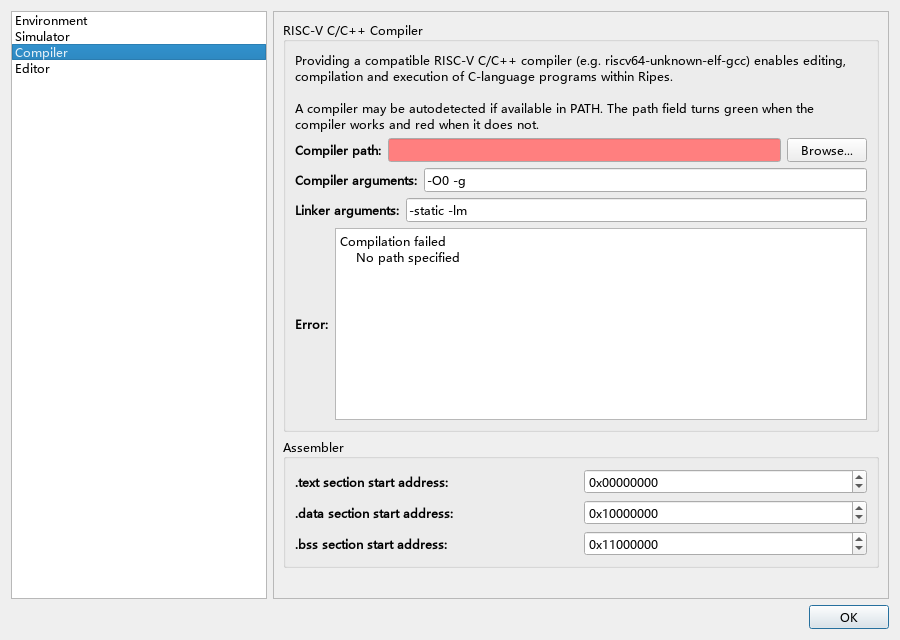
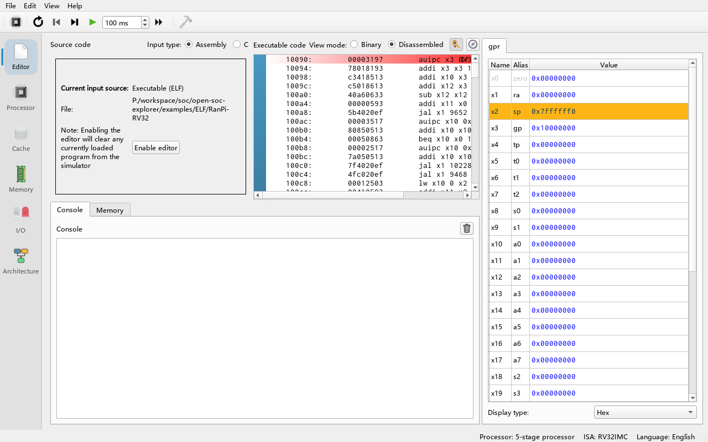
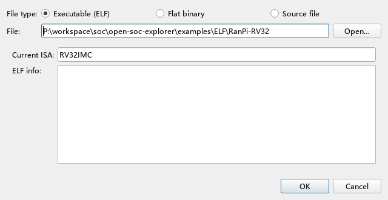

# 05 Programming in C

> **What you will learn**
>
> - Why you need a bare-metal RISC-V GCC toolchain and where to get one;
> - How to register the compiler, compiler arguments and linker arguments in **Edit → Settings → Compiler**;
> - How the `-march` / `-mabi` options that Ripes passes to the compiler follow from the current processor;
> - The complete flow of writing, compiling (Ctrl+B) and running a C program in the editor;
> - How to print with `printf` (standard library) or with your own `ecall` wrappers (`-nostdlib`);
> - How to compile by hand, inspect the ELF file and load it with **Load Program**;
> - Common errors and how to fix them.
>
> **Prerequisites**
>
> - Chapter 04: registers, `ecall`, the calling convention.
> - You can write simple C programs (variables, loops, functions, pointers).
> - You can run programs from a command line (needed to install the toolchain).

---

## 5.1 Why a separate compiler is needed

Ripes ships with an **assembler**, not a C compiler. To run C programs you need a **bare-metal toolchain** that produces RISC-V machine code without depending on an operating system. Its tuple is `riscv64-unknown-elf-...`, for example `riscv64-unknown-elf-gcc`. The `riscv64` in the name does not matter: such a toolchain also produces 32-bit programs with `-march=rv32...` (provided it was built with multilib).

Where to get one (from the upstream document `docs/c_programming.md`):

- Download a prebuilt toolchain, for example SiFive's `freedom-tools` (the upstream document recommends release v2020.04.0);
- Or build the **newlib** variant yourself following the `riscv-gnu-toolchain` repository; you must configure it with `--enable-multilib`.

> **Note**: Toolchains from Linux distribution repositories such as `gcc-riscv64-linux-gnu` (`linux-gnu` rather than `unknown-elf`) **do not work**: their start-up files contain C-extension instructions and they target Linux system calls.

## 5.2 Registering the compiler

**Do**: Open **Edit → Settings** and select the **Compiler** page on the left.

**What you see**: A short explanation at the top, followed by:

- the **Compiler path:** field with a **Browse** button;
- **Compiler arguments:**, default `-O0 -g`;
- **Linker arguments:**, default `-static -lm`;
- an information area showing either **Compile command:** or **Error:**;
- the **Assembler** group: start addresses of the `.text` / `.data` / `.bss` sections.



**Do**: Click **Browse** and select `riscv64-unknown-elf-gcc` in the toolchain's `bin` folder (`riscv64-unknown-elf-gcc.exe` on Windows).

**What you see**: If the compiler works, the path field turns green and the information area shows the full compile command; if not, the field turns red and the information area shows the reason (for example `'...' is not an executable file.`).

**Why**: Ripes does not just check that the file exists. It actually compiles a test program `int main() { return 0; }` with this compiler and checks that the produced ELF file fits the current processor (`verifyCC` in `src/ccmanager.cpp`). A green path therefore means the whole toolchain (compiler, assembler, linker, C library) works.

> **Auto-detection**: On first start, if `riscv64-unknown-elf-gcc`, `riscv64-unknown-elf-g++` or `riscv64-unknown-elf-c++` is found on the `PATH`, Ripes fills it in automatically.

> **macOS users**: The system may report that programs of the toolchain are "from an unidentified developer". For each blocked program (compiler, assembler, linker, ...) right-click → Open once in Finder, or allow it under "Security & Privacy".

## 5.3 The compile command Ripes actually runs

The command is assembled by `CCManager::createCompileCommand`, in this order:

```text
<compiler path> -march=<from processor> -mabi=<from processor> <Compiler arguments> -x c <source file> [ripes_system.h] -o <output file> <Linker arguments>
```

You do **not** write `-march` and `-mabi` yourself; they come from the current processor (chapter 06 explains how to switch processors):

| Processor width | Enabled extensions (ISA Exts.) | `-march` | `-mabi` |
|---|---|---|---|
| 32-bit | none | `rv32i` | `ilp32` |
| 32-bit | M (default) | `rv32im` | `ilp32` |
| 32-bit | M + C | `rv32imc` | `ilp32` |
| 64-bit | M (default) | `rv64im` | `lp64` |
| 64-bit | M + C | `rv64imc` | `lp64` |

Extension letters are appended in the canonical order of the RISC-V specification (`_CCmarch` in `src/isa/rvisainfo_common.h`). `ilp32` means int, long and pointers are 32 bits and arguments are passed in integer registers and on the stack. The Ripes processors have no floating point unit, so the compiler implements floating point arithmetic with soft-float library routines.

A few more points:

- `-x c` forces compilation as C, so registering `g++` also works, but the code is still treated as C;
- If you added peripherals in the **I/O** tab, Ripes generates `ripes_system.h` and passes it to the compiler as well (chapter 08);
- The editor contents are first written to a temporary `.c` file in the system temp folder; the output also goes there.

## 5.4 Your first C program

**Do**: In the **Editor** tab, switch **Input type:** to **C**.

**What you see**: If no valid compiler is registered yet, an error dialog "No C compiler set." appears and the input type falls back to **Assembly**. Once a compiler is registered, the **Compile C program (Ctrl+B)** toolbar button becomes enabled.

> **Note**: The dialog points to **Edit > Settings > Compiler**, the page where the compiler path is set.

**Do**: Enter the following program and press **Ctrl+B**:

```c
#include <stdio.h>

int square(int x) { return x * x; }

int main() {
    int sum = 0;
    for (int i = 1; i <= 10; i++) {
        sum += square(i);
    }
    printf("sum of squares 1..10 = %d\n", sum);
    return 0;
}
```

**What you see**: While compiling, an "Executing compiler..." progress dialog appears (you can click **Abort**). On success, the **Executable code** area on the right shows the disassembly — a very long one, because it includes the C library start-up code and the implementation of `printf`. Press **Run (F8)** and the **Console** prints:

```text
sum of squares 1..10 = 385
```



*Screenshot note: no RISC-V compiler was available when the screenshots were made, so the picture shows the precompiled C example `examples/ELF/RanPi-RV32` (loaded with **File → Load Program...** as **Executable (ELF)**) instead of the program above. For a loaded ELF file the source area shows the **Current input source** page instead of C source.*

**Why**: Compilation produces a complete ELF executable, which Ripes loads as an **Executable (ELF)**. Its entry point is the C library start-up code (`_start`), which sets up the stack and global data and then calls `main`. `printf` ends up in newlib's `write`, whose system call stub issues an `ecall` with call 64 (Write) — exactly what Ripes' system call handler implements (chapter 04, section 4.8). After `main` returns, the start-up code calls `exit`, i.e. call 93 Exit2 (to be verified: which system call is used to exit depends on the newlib version of your toolchain).

> **Tip**: Click **Show symbol navigator** (the compass icon) above the code area on the right to list all symbols; choosing `main` skips the large library code and jumps straight to your function.

## 5.5 Without the standard library: `-nostdlib`

Linking the standard library makes the program large and your own code hard to find when stepping. If you do not need `printf`, `malloc` and the like, add `-nostdlib` to **Linker arguments:** (or to **Compiler arguments:**). Then:

1. Only the functions you wrote are linked;
2. There is no C start-up code; **the entry point is the first instruction of the executable**, so either put the entry function first in the file or write a small start-up sequence with inline assembly as below;
3. You must implement printing yourself with `ecall`.

**File → Load Example... → C → matrixmul.c** (`examples/C/matrixmul.c`) is written this way:

```c
asm("li sp, 0x100000");  // stack pointer at 1 MB
asm("jal main");         // call main
asm("mv a1, a0");        // keep the return value
asm("li a7, 10");        // prepare exit
asm("ecall");            // the simulator stops
```

An example with your own print functions:

```c
asm("li sp, 0x100000");
asm("jal main");
asm("li a7, 10");
asm("ecall");

void print_str(const char *s) {   // s is passed in a0
    asm volatile("li a7, 4\n ecall" : : "r"(s) : "a7");
}

void print_int(int v) {
    register int a0 asm("a0") = v;
    asm volatile("li a7, 1\n ecall" : : "r"(a0) : "a7");
}

int main() {
    print_str("6 * 7 = ");
    print_int(6 * 7);
    return 0;
}
```

Expected output: `6 * 7 = 42` (to be verified: no RISC-V GCC was available while writing this chapter, so the C examples were not actually compiled and run; the `register ... asm("a0")` form relies on a GCC extension).

**Why `register int a0 asm("a0")`**: By the calling convention the first argument is already in `a0`, but with optimisation the compiler may move it elsewhere; binding the variable to `a0` guarantees that `a0` holds the value to print when `ecall` executes. The `"r"(s)` constraint in `print_str` does not guarantee that the register is `a0`; the safer form is again to bind it to `a0` first.

> **Note**: The `-nostdlib` example in the upstream document `docs/c_programming.md` relies on the argument "still being in `a0`", which usually holds at `-O0` but is not guaranteed; this guide recommends the form above.

## 5.6 Accessing peripherals from C

The address symbols of peripherals are written into the automatically generated `ripes_system.h`. Add the peripheral in the **I/O** tab first, then `#include "ripes_system.h"` in your program:

```c
#include "ripes_system.h"

unsigned *led_base = LED_MATRIX_0_BASE;

void main() {
    for (int i = 0; i < LED_MATRIX_0_WIDTH; i++)
        led_base[i] = 0xFF0000;   // light the whole first row red
    while (1) {}
}
```

Complete examples are **File → Load Example... → C → leds.c** (`examples/C/leds.c`) and **switchesAndLeds.c** (`examples/C/switchesAndLeds.c`); chapter 08 explains them in detail.

## 5.7 Compiling by hand and loading the ELF

If you prefer compiling on the command line, or need several source files, compile by hand and load the result.

**Do**: In a terminal, go to the toolchain's `bin` folder (or add it to `PATH`) and run:

```bash
riscv64-unknown-elf-gcc -march=rv32im -mabi=ilp32 -O1 -static foo.c -o foo.elf
```

`-march` must match the extensions of the current Ripes processor (see the table in 5.3). Optionally add `-s` to strip the symbol table (Ripes then cannot show function names).

**Do**: Check the ELF header:

```bash
riscv64-unknown-elf-readelf -h foo.elf
```

You should see:

```text
  Class:                             ELF32
  Data:                              2's complement, little endian
  Type:                              EXEC (Executable file)
  Machine:                           RISC-V
  Flags:                             0x0
```

`Flags` of `0x0` means no C extension and no hardware floating point ABI; if you used `-march=rv32imc`, the flags contain the RVC bit and the processor must have the C extension enabled as well.

**Do**: In Ripes choose **File → Load Program** (Ctrl+O). In the dialog, set **File type:** to **Executable (ELF)**, click **Open...** and select `foo.elf`.

**What you see**: The lower part of the dialog shows **ELF info:** and **Current ISA:**. If the file is incompatible, the reason is shown and it cannot be loaded; otherwise click **OK** to load it. The **Editor** tab then shows "Current input source: Executable (ELF)" and the editor becomes read-only; click **Enable editor** to edit source again (this clears the loaded program).



Ripes' ELF checks (`validateELFFile` in `src/loaddialog.cpp`) and the corresponding errors:

| Check | Error message | Cause / fix |
|---|---|---|
| Is an ELF file | `Not an ELF file` | Wrong file selected |
| Machine type is RISC-V | `Incompatible ELF machine type (ISA)...` | Compiled with an x86/ARM compiler |
| Matching width | `Expected 32 bit executable, but input program is 64 bit.` | `-march`/`-mabi` do not match the processor width, or switch to a 64-bit processor |
| Is an executable | `Only executable ELF files are supported...` | Only an object file was produced (`-c`), or a dynamically linked file; drop `-c`, add `-static` |
| Supported flags | `ELF flag '0b...' unsupported` | C extension used but not enabled on the processor, or a hardware float ABI |

The precompiled example **File → Load Example... → ELF (precompiled C) → RanPi-RV32** (`examples/ELF/RanPi-RV32`) runs without any compiler. It is a C program that estimates π with random numbers and uses soft-float arithmetic. On a 64-bit processor choose **RanPi-RV64**.

## 5.8 Common problems

| Symptom | Cause | Fix |
|---|---|---|
| "No C compiler set." when switching to C | No compiler registered, or verification failed | Register it as in 5.2 and check that the path field is green |
| Compiler path turns red, error mentions `cannot find crt0.o` / `-lc` | Toolchain lacks the 32-bit multilib | Use a toolchain built with multilib |
| "Compilation failed. Error output was:" dialog | C syntax error or link error | Read GCC's stderr output in the dialog and fix the reported lines |
| `ELF flag ... unsupported` after compiling | The toolchain defaults to the C extension | Enable the C extension on the processor, or make sure `-march` does not contain `c` |
| Nothing is printed | `printf` used together with `-nostdlib`, or output not flushed | Use your own `ecall` functions, or call `fflush(stdout)` after `printf` |
| The program "runs away" to strange addresses | With `-nostdlib` the entry function is not first in the file | Put the start-up code / entry function at the top of the file |
| Stepping keeps going through library functions | The standard library is linked | Use breakpoints + **Run**, or `-nostdlib` |
| Peripheral symbols reported as "undeclared" | Peripheral not added in the **I/O** tab first, or missing `#include "ripes_system.h"` | Add the peripheral before compiling |

> **CLI mode**: The command line mode can also compile C sources with `-t c` (chapter 15), using the same compiler settings. CLI mode cannot instantiate peripherals, so C programs that use peripheral symbols do not compile there.

## 5.9 Exercises

1. Compile the program of section 5.4 once with `-O0` and once with `-O2` in **Compiler arguments:** (you may drop `printf` and use the `-nostdlib` print functions instead) and compare **Cycles** and **Instrs. retired** in the **Processor** tab.
2. Switch to the 64-bit 5-stage processor, recompile the same program and check what `-march` / `-mabi` become in the compile command.
3. Write a `-nostdlib` program that computes and prints the sum of all numbers from 1 to 100 that are divisible by 3.
4. Compile and run **File → Load Example... → C → matrixmul.c**, find `mmul` with the symbol navigator, set a breakpoint in its innermost loop and count how many instructions one iteration executes.
5. Why can the upstream `ranpi.c` program, which uses floating point arithmetic, run on a processor without a floating point unit?

### Answers

1. With `-O2` variables live in registers, loops may be unrolled or even computed at compile time, so both cycles and instructions drop sharply; with `-O0` every variable lives on the stack and each use needs `lw`/`sw`. The exact numbers depend on the compiler version.
2. They become `-march=rv64im -mabi=lp64` (with the default M extension enabled).
3. For example:
   ```c
   asm("li sp, 0x100000");
   asm("jal main");
   asm("li a7, 10");
   asm("ecall");

   void print_int(int v) {
       register int a0 asm("a0") = v;
       asm volatile("li a7, 1\n ecall" : : "r"(a0) : "a7");
   }

   int main() {
       int sum = 0;
       for (int i = 1; i <= 100; i++)
           if (i % 3 == 0) sum += i;
       print_int(sum);   // 1683
       return 0;
   }
   ```
4. At `-O0`, `c[row][col] += a[row][k] * b[k][col]` must first load `row`, `col`, `k` and the three array pointers from the stack, compute the addresses, then `lw`, `mul`, `add`, `sw` — typically twenty to thirty instructions; at `-O2` it can drop below ten. The exact count depends on the compiler.
5. Because `-march=rv32im` contains no F/D extension, the compiler turns floating point operations into calls to soft-float library routines (such as `__adddf3`, `__muldf3`) that implement floating point arithmetic with integer instructions only.

## Summary

- Ripes needs a bare-metal `riscv64-unknown-elf-gcc` toolchain (with multilib), registered under **Edit → Settings → Compiler**; a green path means it passed verification.
- `-march` / `-mabi` follow automatically from the width and extensions of the current processor; the default extra arguments are `-O0 -g` and the linker arguments `-static -lm`.
- Choose the **C** input type in the editor and press **Ctrl+B** to compile; on success the ELF is loaded automatically; the standard library's `printf` prints through `ecall`.
- `-nostdlib` keeps programs small and readable but requires your own start-up code and `ecall` print functions.
- Hand-compiled ELF files are loaded with **File → Load Program**; Ripes checks machine type, width, file type and flags.
- Next chapter: run programs on different processor models and watch the pipeline.
