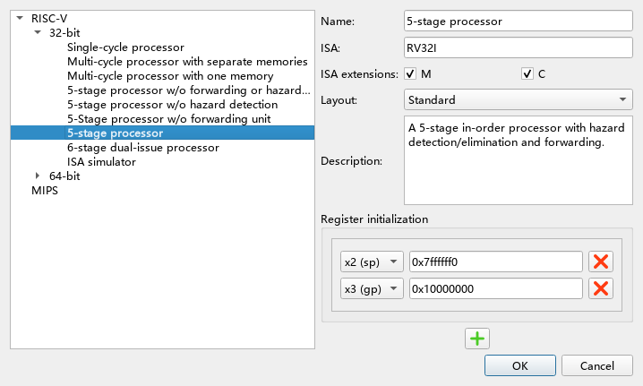
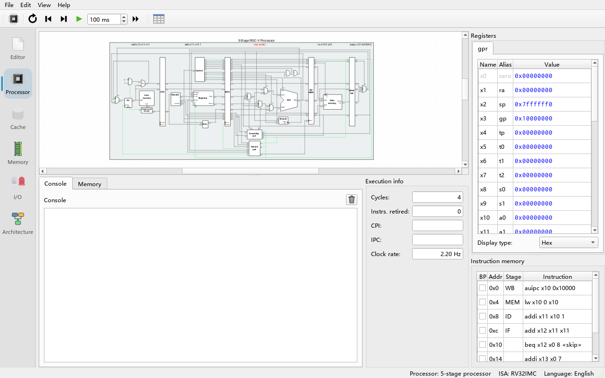
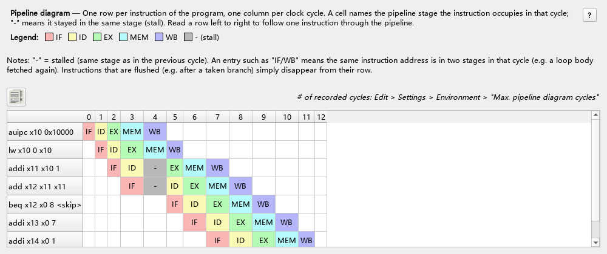
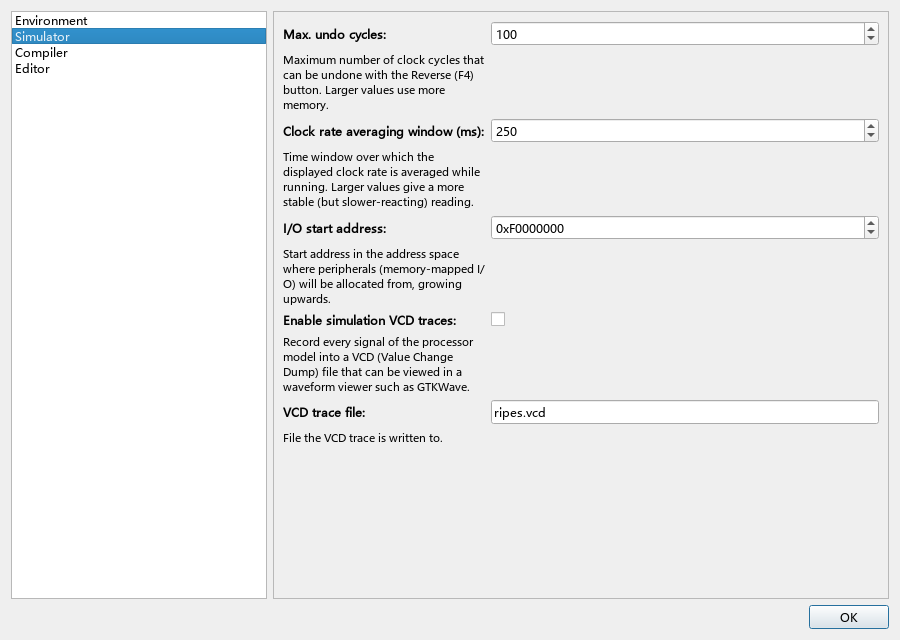

# 06 Processor Models and Pipelines

> **What you will learn**
>
> - Which processor models Ripes offers: single-cycle, multi-cycle, 5-stage pipeline (four variants), 6-stage dual-issue, instruction set simulator, in 32-bit and 64-bit;
> - How to switch processor, layout, ISA extensions and initial register values in the processor selection dialog;
> - How to read the datapath view: multiplexers, wire colours, hovering to see signal values;
> - What data hazards and control hazards are and how forwarding and stalls resolve them — compared with a concrete program on different models;
> - How to use the pipeline diagram to see which stage each instruction is in every cycle;
> - Reverse execution and VCD waveform tracing.
>
> **Prerequisites**
>
> - Chapter 04: you can read simple RISC-V assembly.
> - You know what a clock cycle is; having heard of pipelining helps but is not required.

---

## 6.1 Overview of the processor models

**Do**: Click **Select processor** (the CPU icon) in the toolbar of the **Processor** tab.

**What you see**: The processor selection dialog opens. On the left is a tree: **RISC-V** → **32-bit** / **64-bit** → the processors. The right side shows the selected processor's **Name:**, **Description:**, **ISA:**, **ISA Exts.** (extension check boxes), **Layout** and a register initialisation table.



Processor models (names as shown in the dialog, defined in `src/processorregistry.cpp`; the IDs in parentheses are used by the command line option `--proc`):

| Processor | Description | Stages | Layouts |
|---|---|---|---|
| **Single-cycle processor** (`RV32_SS` / `RV64_SS`) | Single cycle: each cycle executes one complete instruction | 1 | Standard, Extended |
| **Multi-cycle processor with separate memories** (`RV32_5MC_2M` / `RV64_5MC`) | Multi-cycle, similar to the Harris & Harris textbook; instructions take a variable number of cycles, the control unit shows the current state; separate instruction and data memories | 5 phases | Extended |
| **Multi-cycle processor with one memory** (`RV32_5MC_1M` / `RV64_5MC_1M`) | As above, but uses a single memory since instructions and data are never accessed in the same cycle | 5 phases | Extended |
| **5-stage processor w/o forwarding or hazard detection** (`RV32_5S_NO_FW_HZ`) | 5-stage pipeline with neither forwarding nor hazard detection | 5 | Standard, Extended |
| **5-stage processor w/o hazard detection** (`RV32_5S_NO_HZ`) | Forwarding, but no hazard detection | 5 | Standard, Extended |
| **5-Stage processor w/o forwarding unit** (`RV32_5S_NO_FW`) | Hazard detection (stalls), but no forwarding | 5 | Standard, Extended |
| **5-stage processor** (`RV32_5S` / `RV64_5S`) | Complete 5-stage pipeline with hazard detection and forwarding (**the default processor**) | 5 | Standard, Extended |
| **6-stage dual-issue processor** (`RV32_6S_DUAL` / `RV64_6S_DUAL`) | 6-stage in-order dual issue: both ways execute arithmetic; way 1 is reserved for control flow and `ecall`, way 2 for memory accesses | 6 | Extended |
| **ISA simulator** (`RV32_ISS` / `RV64_ISS`) | Instruction set simulator: a software interpreter executes one full instruction per cycle; fast, used as a reference model | — | Standard |

The description of the two 5-stage models without hazard detection carries a bold warning: **programs with hazards will execute incorrectly unless you insert `nop`s by hand to stall the pipeline.**

The five stages of the 5-stage pipeline are **IF** (fetch), **ID** (decode / register read), **EX** (execute), **MEM** (memory access) and **WB** (write back). The 6-stage dual-issue processor adds an **II** stage (instruction issue): IF, ID, II, EX, MEM, WB.

### Options

- **32-bit / 64-bit**: each model exists as RV32 and RV64. The 64-bit version has 64-bit registers, supports RV64 instructions such as `ld`/`sd`/`addiw`, and C compilation uses `-mabi=lp64`.
- **ISA Exts.**: **M** (integer multiply/divide, checked by default) and **C** (compressed 16-bit instructions). Extensions decide which instructions the assembler accepts and the `-march` of the C compiler (chapter 05).
- **Layout**: different drawings of the same processor. **Standard** is a simplified view without control components and control signals; **Extended** shows control components, control signals and wire widths. The layout **only affects the display, not the processor's behaviour**.
- **Register initialisation**: values written to registers on every reset; by default `sp` (x2) = `0x7ffffff0` and `gp` (x3) = `0x10000000`.

**Do**: Choose **5-stage processor** under **32-bit**, set **Layout** to **Extended** and click **OK**.

**What you see**: The centre of the **Processor** tab now shows the full 5-stage datapath with the stage names IF, ID, EX, MEM, WB above it. Switching processors resets the simulator, but the loaded program is kept (it is reassembled).

## 6.2 Reading the datapath view



The parts of the **Processor** tab:

- Centre: the processor datapath view. **Ctrl + mouse wheel** zooms, dragging pans.
- Right, **Registers**: the most recently modified register is highlighted; click a value to edit it.
- Right, **Instruction memory**: columns **BP** (breakpoint, click to toggle), **Addr** (address), **Stage** (the stage the instruction is currently in), **Instruction** (disassembly).
- Bottom, **Execution info**: **Cycles:**, **Instrs. retired:** (instructions that have left the final stage), **CPI:** (cycles per instruction), **IPC:** (instructions per cycle), **Clock rate:** (simulation speed).
- Bottom, **Console**: `ecall` output.

Visual conventions of the datapath (from the upstream `docs/introduction.md`):

- **Multiplexers** mark the currently selected input with a green dot;
- **1-bit signals**: a green wire means 1, a grey wire means 0;
- **Multi-bit signals**: the wire flashes green briefly when its value changes;
- Some components have indicators showing that a register was clocked, a branch was taken, and so on.

**Do**: Hover over any port.

**What you see**: A tooltip shows the port name and its current value.

**Do**: Click **Show processor signal values** in the toolbar, or right-click a port and choose "show value".

**What you see**: Value labels appear next to all output ports; right-click a label to change its radix. Clicking a wire highlights the whole wire, which helps to trace signals through complex layouts.

## 6.3 Controlling the simulation

Toolbar buttons (`src/processortab.cpp`):

| Button | Shortcut | Effect |
|---|---|---|
| **Reset** | F3 | Reset: PC back to the program entry, memory restored to its initial contents |
| **Reverse** | F4 | Undo one clock cycle |
| **Clock** | F5 | Advance one clock cycle |
| **Auto clock** | F6 | Clock repeatedly at the interval (ms) shown next to it; stops at breakpoints |
| **Run** | F8 | Run at full speed without GUI updates; stops at a breakpoint or an exit `ecall` |
| **Show pipeline diagram** | — | Open the pipeline diagram (section 6.5) |

> **Note**: In **Run** mode no pipeline diagram data is recorded and the GUI is not refreshed live; to see cycle-by-cycle behaviour use **Clock** or **Auto clock**.

## 6.4 Hazards: one program on five models

This small program contains typical hazards:

```asm
.data
x: .word 10
.text
    lw   a0, x          # pseudo: auipc a0, ... + lw a0, ...(a0)
    addi a1, a0, 1      # uses the just-loaded a0 — load-use hazard
    add  a2, a1, a1     # uses a1 of the previous instruction — data hazard
    beq  a2, zero, skip # branch (not taken here)
    addi a3, zero, 7
skip:
    addi a4, zero, 1
```

Correct result: `a0 = 10`, `a1 = 11`, `a2 = 22`, `a3 = 7`, `a4 = 1`. Note that `lw a0, x` expands into two instructions, `auipc` + `lw`, so there are 7 instructions in total.

**Do**: Enter the program, switch to each processor in the table below in turn, press **Run (F8)** each time and note **Cycles** and the register results.

| Processor | Cycles | Correct result? |
|---|---|---|
| Single-cycle processor | 7 | Correct |
| 5-stage processor w/o forwarding or hazard detection | 12 | **Wrong** (`a0`, `a1`, `a2`, `a3` all wrong) |
| 5-stage processor w/o hazard detection | 12 | **Wrong** (`a0` right, `a1` and `a2` wrong, the branch goes the wrong way so `a3` = 0) |
| 5-Stage processor w/o forwarding unit | 19 | Correct |
| 5-stage processor | 12 | Correct |
| 6-stage dual-issue processor | 13 | Correct |
| Multi-cycle processor with separate memories | 28 | Correct |

(These numbers were measured with this project's `build/Ripes.exe` in CLI mode; the GUI gives the same results.)

**Why**:

- **Single-cycle**: each instruction completes within one cycle; when the next one starts, the previous one has already written back, so there are no hazards; 7 instructions, 7 cycles. But the single-cycle clock period must fit the slowest instruction (usually `lw`), so the real frequency is low.
- **No forwarding, no hazard detection**: when `addi a1, a0, 1` reads `a0` in ID, `lw` has not reached WB yet, so it reads the old value. Even the dependency `auipc a0` → `lw a0, ...(a0)` goes wrong.
- **Forwarding only**: the EX stage can take freshly computed results back from the MEM and WB stages ("forwarding", `src/processors/RISC-V/rv5s/rv5s_forwardingunit.h`), which fixes `add` depending on `addi`; but the data of `lw` is only available at the end of MEM, and the immediately following `addi` is already in EX — forwarding is too late. This is the **load-use hazard**; it requires a one-cycle stall, and this model has no detection unit.
- **Hazard detection only**: it stalls on every data dependency until the producing instruction has written the register file; the result is correct but takes 7 extra cycles.
- **Complete 5-stage**: forwarding resolves most dependencies, and the hazard detection unit (`rv5s_hazardunit.h`) inserts a one-cycle stall only for load-use: 7 instructions + 4 fill cycles + 1 stall = 12 cycles.
- **Multi-cycle**: each instruction occupies several phases in turn without overlap, hence the most cycles.

## 6.5 The pipeline diagram

**Do**: Switch back to **5-stage processor**, press **Reset (F3)**, press **Clock (F5)** until the program ends (about 12 times), then click **Show pipeline diagram** (the table icon) in the toolbar.

**What you see**: The **Pipeline diagram** window opens: each row is an instruction, each column a cycle, and each cell names the stage the instruction is in during that cycle:

```text
                     0   1   2   3   4   5   6   7   8   9   10  11
auipc x10 0x10000    IF  ID  EX  MEM WB
lw x10 0 x10             IF  ID  EX  MEM WB
addi x11 x10 1               IF  ID  -   EX  MEM WB
add x12 x11 x11                  IF  -   ID  EX  MEM WB
beq x12 x0 8 <skip>                      IF  ID  EX  MEM WB
addi x13 x0 7                                IF  ID  EX  MEM WB
addi x14 x0 1                                    IF  ID  EX  MEM WB
```



**Why**: In cycle 4 `addi` stays in ID (shown as `-`), and `add` behind it stays in IF. In cycle 5 `lw` has its data in MEM and can forward it to `addi` in EX. `-` means the stage is **stalled** in that cycle (it holds the same instruction as in the previous cycle).

A button at the top left of the table copies the table to the clipboard (tab separated). A note above the table says that the number of recorded cycles can be changed in the settings — **Max. pipeline diagram cycles:** (default 100) on the **Edit → Settings → Environment** page.

### Control hazards

Replace the program with a loop that branches back:

```asm
.text
    li   t0, 2
loop:
    addi t0, t0, -1
    bnez t0, loop
    addi a0, zero, 1
    addi a1, zero, 2
```

**Do**: On **5-stage processor**, reset, step to the end and open the pipeline diagram.

**What you see** (13 cycles):

```text
                   0   1   2   3   4   5      6      7   8   9   10  11  12
addi x5 x0 2       IF  ID  EX  MEM WB
addi x5 x5 -1          IF  ID  EX  MEM IF/WB  ID     EX  MEM WB
bne x5 x0 -4 <loop>        IF  ID  EX  MEM    IF/WB  ID  EX  MEM WB
addi x10 x0 1                  IF  ID                IF  ID  EX  MEM WB
addi x11 x0 2                      IF                    IF  ID  EX  MEM WB
```

**Why**: The branch is resolved only in **EX** (in `rv5s.h`, the branch unit result is ANDed with the `do_br` bit of the ID/EX register to select the next PC). The first time `bne` executes, it enters EX in cycle 4 and decides "taken"; by then `addi x10` and `addi x11` have already been fetched into IF and ID and must be **flushed** — in the diagram their rows simply stop. Every taken branch therefore costs 2 cycles. The second `bne` is not taken, and the following instructions flow through normally. `IF/WB` means two executions of the same address are in two stages at once.

### 6-stage dual issue

**Do**: Switch to **6-stage dual-issue processor** (Extended layout only), run the program from 6.4 and open the pipeline diagram.

**What you see**: The datapath has an upper and a lower way, each stage has two slots, and the pipeline diagram can show two instructions in the same stage in the same cycle.

**Why**: Up to two instructions are fetched and issued per cycle; but way 1 only handles control flow and `ecall`, way 2 only memory accesses, and two mutually dependent instructions cannot issue together, so the actual IPC is usually well below 2. For this small program with its long dependency chain it even takes one cycle more than the 5-stage pipeline.

## 6.6 Inserting nops by hand

On a processor without hazard detection you can avoid hazards by inserting `nop`s yourself:

```asm
.text
    addi a0, zero, 5
    addi a1, a0, 1      # immediately after: reads the old value without forwarding/detection
    nop
    nop
    addi a2, a0, 1      # two nops later: reads the correct a0
```

**Do**: Run it on **5-stage processor w/o forwarding or hazard detection**.

**What you see**: `a1` = 1 (wrong, it read the old value 0 of `a0`), `a2` = 6 (correct).

**Why**: When `addi a2` is in ID, `addi a0` is exactly in WB; this model's register file writes before it reads within the same cycle, so two instructions in between are enough. This is the idea of early processors such as MIPS that left hazard handling to the compiler.

## 6.7 Reverse execution

**Do**: After stepping a few cycles, press **Reverse (F4)**.

**What you see**: Processor state, registers, memory, pipeline diagram and cache state all return to the previous cycle.

**Why**: The simulator keeps undoable state for every cycle. The maximum number of undoable cycles is set by **Max. undo cycles:** on the **Edit → Settings → Simulator** page, default 100. History beyond that cannot be reversed; to start over, use **Reset**.

> **Note**: For the reverse behaviour of I/O peripherals such as the SIMT GPU and Tensor Unit see chapters 09 and 10. Text that `ecall` printed to the console is not removed by reversing (verified: the console only ever appends, and is cleared only by its trash-can button).

## 6.8 VCD waveform tracing

VCD (Value Change Dump) is a waveform format common in digital circuit simulation; it can be viewed with tools such as GTKWave.

**Do**: Open **Edit → Settings → Simulator**, tick **Enable simulation VCD traces:** and enter a file name in **VCD trace file:** (default `ripes.vcd`). Then reset and run the program.

**What you see**: While simulating, signal changes inside the processor are written to the VCD file. Open it with GTKWave:

```bash
gtkwave ripes.vcd
```

You can see the PC, the pipeline registers of each stage and the control signals as waveforms over the cycles.

> A relative path is relative to the current working directory of the Ripes process (the VCD writer opens it with a plain `std::ofstream`), i.e. the directory you started it from, which is not necessarily the `build` folder; an absolute path is recommended. The VCD file grows with the number of simulated cycles, so watch the disk space on long runs.



## 6.9 Exercises

1. In the program of 6.4 on **5-stage processor**, insert an unrelated instruction (e.g. `addi t0, zero, 3`) between `addi a1, a0, 1` and `add a2, a1, a1`. Does the cycle count change? Why? What if you insert it between `lw` and `addi a1` instead?
2. On **5-Stage processor w/o forwarding unit**, the program of 6.4 takes 7 cycles more than the complete 5-stage processor. Open the pipeline diagram and name the pair of instructions behind each stall.
3. Write a loop that runs 10 times (`li t0, 10`, then a loop body of a single `addi` plus `bnez`). Compute its cycle count on the 5-stage pipeline and on the single-cycle processor and explain the part of the difference that comes from branches.
4. Replace `lw a0, x` in the 6.4 program by `li a0, 10`. Is the result still wrong on **5-stage processor w/o hazard detection**? Why?
5. On **6-stage dual-issue processor**, run 8 independent `addi`s (each writing a different register). Then turn them into a chain where each depends on the previous one. Compare the cycle counts.

### Answers

(All cycle counts below were measured with this project's `build/Ripes.exe` in CLI mode.)

1. It depends on where. Between `addi a1` and `add a2`: the cycle count becomes **13**, because the stall is still there and there is one more instruction. Between `lw` and `addi a1`: 8 instructions and **still 12** cycles — the unrelated instruction fills the slot of the load-use stall. Conclusion: **only an unrelated instruction placed between a load and its user removes the load-use stall**, which is why compilers do instruction scheduling.
2. The diagram shows 4 dependencies, each stalling 2 cycles: `auipc a0` → `lw a0, ...(a0)`, `lw a0` → `addi a1`, `addi a1` → `add a2`, `add a2` → `beq` — 8 stall cycles in total (7 instructions + 4 fill + 8 = 19). The complete 5-stage pipeline has only 1 load-use stall, hence 7 cycles less. Without forwarding, the dependent instruction must wait in ID until the producer reaches WB.
3. 21 instructions execute (`li` plus 10 × (`addi` + `bnez`)). Single-cycle: 21 cycles. 5-stage: 43 cycles = 21 instructions + 4 fill cycles + 9 taken branches × 2 flushed cycles (the last branch is not taken). The `addi` → `bnez` dependency is resolved by forwarding and causes no stall.
4. It is **still wrong**: measured `a0` = 10, `a1` = 11, `a2` = 22 are correct (ALU results can be forwarded), but `a3` = 0, so `beq` went the wrong way and skipped `addi a3`. Besides load-use, a branch right after the instruction computing its operand also compares wrongly on this model: in `rv5s_no_hz.h` the branch comparator takes its operands straight from the ID/EX register, bypassing the forwarding multiplexers that feed the ALU, so it sees the old register value. On the complete 5-stage pipeline the same program gives `a3` = 7.
5. 8 independent `addi`s: 9 cycles; 8 chained `addi`s: 13 cycles. Without dependencies both ways issue together and about 2 instructions complete per cycle; with the chain only one can issue per cycle, just like the 5-stage pipeline. (The IPC reported by the CLI is skewed by fill cycles and the retirement count, so comparing cycles is more direct.)

## Summary

- Ripes has single-cycle, multi-cycle, four 5-stage pipeline variants, 6-stage dual-issue and an ISA simulator, each in 32- and 64-bit; the default is the 32-bit **5-stage processor** with the M extension.
- The layout (Standard / Extended) only changes the drawing; ISA extensions change the available instructions and the C compiler arguments.
- Data hazards are resolved by forwarding; a load-use hazard always needs a 1-cycle stall; branches are resolved in EX and a taken branch flushes 2 instructions.
- Models without hazard detection compute wrong results, which shows the consequences of hazards; inserting `nop`s by hand fixes them.
- **Show pipeline diagram** shows the stage of each instruction in each cycle, `-` meaning stalled; **Run** mode records nothing.
- **Reverse (F4)** undoes cycles (up to 100 by default); the **Simulator** settings page enables VCD waveform tracing.
- Next chapter: cache simulation.
