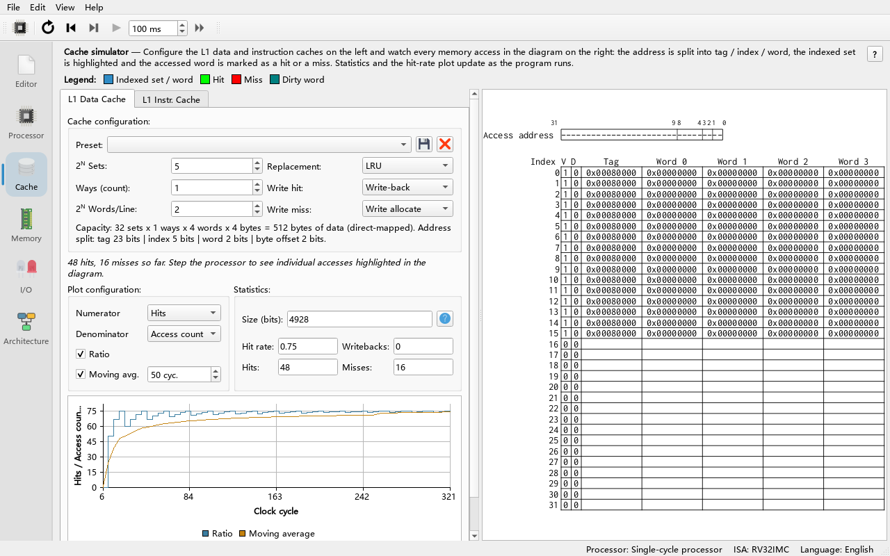
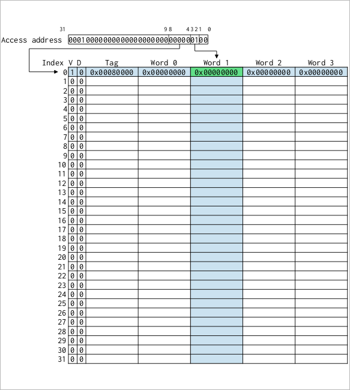
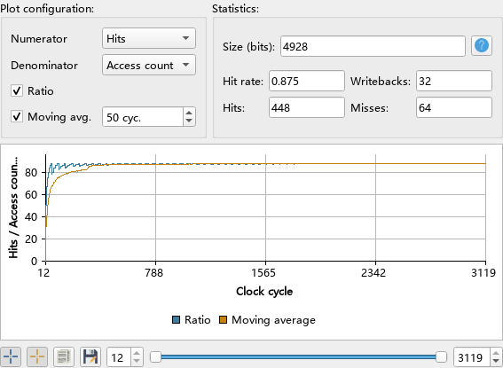

# 07 Cache Simulation

> **What you will learn**
>
> - What Ripes' cache simulator models and what it does not;
> - The cache parameters: sets, ways, words per line, and how an address is split into tag / index / word / byte;
> - What hits, misses and writebacks are, and the difference between replacement policies (LRU / Random) and write policies (write-back / write-through, write allocate / no write allocate);
> - How to use presets and read the cache table view and the hit-rate plot;
> - The difference between the data cache and the instruction cache;
> - Two experiments: stride loops and row-wise vs column-wise matrix traversal.
>
> **Prerequisites**
>
> - Chapter 04: you can write assembly programs with loops; chapter 06: you know how to switch processors.
> - You know powers of two and binary addresses.

---

## 7.1 What the cache simulator does

Memory is much slower than the processor. A cache is a small, fast memory between the processor and main memory that keeps recently used data. Ripes simulates two level-1 caches in the **Cache** tab: the **L1 Data Cache** and the **L1 Instr. Cache**.

Things to know first (from the upstream `docs/cache_sim.md`, checked against `src/cachesim/`):

- The cache simulator **does not change program execution**: the processor does not go through the cache when it accesses memory; instead the cache simulator "listens" to the processor's memory accesses every cycle (`src/cachesim/l1cacheshim.cpp`) and simulates them as an access trace.
- Ripes therefore **does not simulate cache latency**; misses do not add cycles. It tells you hit rate, miss count, writeback count and so on.
- In write-back mode "dirty" data has in fact also been written to memory, so the **Memory** tab always shows the latest values.
- **Use the single-cycle processor for cache experiments.** On pipelined processors, if the stage doing a memory access is stalled, every stalled cycle counts as an extra access; the single-cycle processor avoids this and also runs faster.
- Accesses are handled word-aligned (4 bytes); byte and half-word accesses count as accesses to their containing word.

## 7.2 Cache parameters

**Do**: Switch to **Single-cycle processor** (chapter 06), open the **Cache** tab and select the **L1 Data Cache** sub-tab.

**What you see**: The **Cache configuration:** group at the top, the cache table view below it, and **Plot configuration:**, **Statistics:** and the hit-rate plot to the side (or below).



Configuration controls (`src/cachesim/cacheconfigwidget.ui`):

| Control | Meaning | Values |
|---|---|---|
| **Preset:** | A preset; selecting one fills in all parameters below | See 7.4 |
| **2ᴺ Sets:** | Exponent N of the number of sets; sets = 2ᴺ | 0–10 |
| **Ways (count):** | Associativity (ways per set), **entered directly** | 1–1024 |
| **2ᴺ Words/Line:** | Exponent N of words per line (block); words = 2ᴺ | 0–10 |
| **Replacement:** | Replacement policy | **LRU**, **Random** |
| **Write hit:** | Write-hit policy | **Write-back**, **Write-through** |
| **Write miss:** | Write-miss policy | **Write allocate**, **No write allocate** |

> **Note**: The upstream document says **Ways** is also a power-of-two exponent, but in the current code **Ways (count):** is the number of ways itself (`CacheSim::setWays`; the "fully associative" preset sets it to 32). Total capacity = sets × ways × words per line × 4 bytes.

The default configuration is 32 sets, 1 way, 4 words per line (**2ᴺ Sets** = 5, **Ways** = 1, **2ᴺ Words/Line** = 2), write-back + write allocate + LRU; total capacity 32 × 1 × 4 × 4 = 512 bytes.

### How an address is split

A 32-bit byte address is split like this (`CacheSim::recalculateMasks`):

```text
 31                     9 8       4 3    2 1    0
+------------------------+---------+------+------+
|          tag           |  index  | word | byte |
+------------------------+---------+------+------+
   remaining high bits (23)  N_sets bits  N_words bits  2 bits
```

- **byte** (2 bits): byte offset within the word, ignored;
- **word**: selects the word within the line; its width is the N of **2ᴺ Words/Line**;
- **index**: selects the set; its width is the N of **2ᴺ Sets**;
- **tag**: the remaining high bits, stored in the cache to decide "is this line the address I want".

The figure shows the default configuration: 2 word bits, 5 index bits, 32 − 2 − 2 − 5 = 23 tag bits.

**Do**: Click the **...** button next to **Size (bits):** under **Statistics:**.

**What you see**: A size breakdown: Valid bits 32, Dirty bits 32, LRU bits 0 (not needed with 1 way), Tag bits 32 × 23 = 736, Data bits 32 × 4 × 32 = 4096, 4896 bits in total (`CacheSim::getCacheSize`). Besides the data itself, a cache spends extra storage on tags and status bits.

## 7.3 Hits, misses and policies

On each access the cache uses the index to find a set and then compares the tag against every way of that set:

- **Hit**: some way is valid and has the same tag — the data is in the cache;
- **Miss**: no way matches, and a whole line must be fetched from memory. If the set is full, the **replacement policy** chooses a way to evict.

Replacement policies (`CacheSim::locateEvictionWay`):

- **LRU** (least recently used): evict the way unused for the longest time. The cache view has an **LRU** column: 0 for the way just accessed, the largest value for the next victim.
- **Random**: choose a random way in a full set (empty ways are used first).

Write policies:

- **Write-back**: a write hit only updates the cache and marks the line dirty (**D** column); it is written to memory only when evicted, counted as a writeback.
- **Write-through**: every write also goes to memory; every write counts as a writeback; no dirty bit is needed.
- **Write allocate**: on a write miss the line is first brought into the cache, then written.
- **No write allocate**: on a write miss the data goes straight to memory without bringing the line into the cache (counted as a writeback).

## 7.4 Presets

The **Preset:** drop-down has three presets by default (`src/ripessettings.cpp`). All have the same capacity (32 lines × 4 words = 128 words = 512 bytes) and use write-back + write allocate + LRU:

| Preset | Sets | Ways | Words/Line |
|---|---|---|---|
| **32-entry 4-word direct-mapped** | 2⁵ = 32 | 1 | 2² = 4 |
| **32-entry 4-word fully associative** | 2⁰ = 1 | 32 | 4 |
| **32-entry 4-word 2-way set associative** | 2⁴ = 16 | 2 | 4 |

- The save button (**Store cache preset**) stores the current configuration as a new preset after you type a name;
- The delete button (**Delete cache preset**) deletes the current preset (after confirmation);
- After you change any parameter by hand, **Preset:** becomes empty, meaning the configuration is no longer a preset.

> Changing the cache configuration resets the processor.

## 7.5 Reading the cache view

The cache is drawn as a table (`src/cachesim/cachegraphic.cpp`):

- Columns: **Index** (set number), **V** (valid bit), **D** (dirty bit, write-back only), **LRU** (only with more than one way and the LRU policy), **Tag**, **Word 0**, **Word 1**, ... (the cached data);
- Rows: sets are separated by **solid** lines, ways within a set by **dashed** lines.

On each access:

- The indexed set (row) and word (column) are highlighted (with the Highlight colour of the system palette); their intersection holds the cells that may contain the data — 1 cell for direct-mapped, N cells for N-way set associative;
- A **green** cell means a hit, **red** a miss, **dark cyan** marks a dirty word (write-back mode);
- Hovering over a word shows its memory address; clicking it makes the **Memory** tab jump to that address;
- **Ctrl + mouse wheel** zooms.



> In dark themes the colours switch to softer green/red/cyan tones.

## 7.6 Statistics and plot

**Statistics:** shows **Hit rate:**, **Hits:**, **Misses:**, **Writebacks:** and **Size (bits):**.

The plot shows the ratio of any two quantities over the cycles. **Numerator** and **Denominator** can be: **Writes**, **Reads**, **Hits**, **Misses**, **Writebacks**, **Access count** (reads + writes), **Was hit**, **Was miss**, **1**. The default is **Hits** / **Access count**, i.e. the hit-rate curve.

- **Ratio** check box: show/hide the ratio curve;
- **Moving avg.**: adds a moving average over the given number of cycles (**cyc.**), useful to see in which part of the program the hit rate changes;
- **Min. cycle** / **Max. cycle** sliders choose the plotted range;
- Buttons left of the range slider: enable markers on the total and moving-average curves, copy the plotted data (one row per cycle) to the clipboard, save the plot as an image.

The plot covers at most the last **Max. cache plot cycles** cycles (**Edit → Settings → Environment**, default 10000). In a longer run it shows the most recent cycles, and a note above the plot says which cycles are plotted, for example "Only cycles 110508 - 120503 are plotted; older cycles were dropped. To plot more, raise "Max. cache plot cycles" in Edit > Settings > Environment." The ratio is still counted from cycle 0, and the **Statistics** cover the whole run. **Max. cache access traces** on the same settings page limits how many cache accesses are kept; when it drops older accesses the same note appears.

> At 1280×800 the left column (configuration, statistics and plot) can be taller than the window; scroll it to reach the controls below the plot.



## 7.7 Instruction cache vs data cache

- **L1 Data Cache** records only the data accesses of load/store instructions such as `lw`/`sw` (reads and writes);
- **L1 Instr. Cache** records every instruction fetch (reads only).

They are independent caches and can be configured separately. Instructions usually run in sequential loops, so the instruction cache hit rate is generally high; the data cache hit rate depends on your data access pattern — which the experiments below explore.

## 7.8 Experiment 1: stride loop

Enter the following program (the hit rates below are expected values worked out by hand for the given configuration):

```asm
# Read N words, skipping STRIDE words each time
.equ N, 64          # number of loads
.equ STRIDE, 1      # stride in words: try 1, 2, 4, 8
.data
arr:    .zero 2048  # 512 words
.text
main:
    la   t0, arr
    li   t1, N
    li   t2, STRIDE
    slli t2, t2, 2      # stride in bytes
    li   a0, 0
loop:
    lw   t3, 0(t0)
    add  a0, a0, t3
    add  t0, t0, t2
    addi t1, t1, -1
    bnez t1, loop
    li   a7, 10
    ecall
```

**Do**: With **Single-cycle processor**, choose the preset **32-entry 4-word direct-mapped** for the data cache, press **Run (F8)** and note the **Hit rate** of the **L1 Data Cache**. Then change `STRIDE` to 2, 4 and 8 and repeat.

**What you see** (expected):

| STRIDE | Accesses | Misses | Hit rate |
|---|---|---|---|
| 1 | 64 | 16 | 0.75 |
| 2 | 64 | 32 | 0.5 |
| 4 | 64 | 64 | 0 |
| 8 | 64 | 64 | 0 |

**Why**: Each line holds 4 words. With stride 1, the first word of each line misses and the next 3 hit — the benefit of **spatial locality**. With stride 2 only 2 words of each line are used; with stride ≥ 4 every access lands in a new line and the cache cannot help at all.

**Do**: Also look at the hit rate of the **L1 Instr. Cache**.

**What you see**: Close to 1. The loop body has only 5 instructions occupying two lines; after the first iteration every fetch hits — **temporal locality**.

## 7.9 Experiment 2: row-wise vs column-wise matrix traversal

C stores two-dimensional arrays row by row (row-major): the address of `m[i][j]` is `base + (i*DIM + j)*4`. The following program does `m += 1` on every element of a 16 × 16 word matrix, traversing either row by row or column by column:

```asm
# Traverse a 16x16 word matrix row by row (ROWMAJOR=1) or column by column (ROWMAJOR=0)
.equ DIM, 16
.equ ROWMAJOR, 1
.data
mat:    .zero 1024      # 16*16*4 bytes
.text
main:
    la   s0, mat
    li   s1, DIM
    li   t0, 0              # i
outer:
    li   t1, 0              # j
inner:
    li   t4, ROWMAJOR
    beqz t4, colmajor
    mul  t2, t0, s1         # row-major: index = i*DIM + j
    add  t2, t2, t1
    j    access
colmajor:
    mul  t2, t1, s1         # column-major: index = j*DIM + i
    add  t2, t2, t0
access:
    slli t2, t2, 2
    add  t2, s0, t2
    lw   t3, 0(t2)
    addi t3, t3, 1
    sw   t3, 0(t2)
    addi t1, t1, 1
    blt  t1, s1, inner
    addi t0, t0, 1
    blt  t0, s1, outer
    li   a7, 10
    ecall
```

The matrix is 1024 bytes, twice the cache capacity (512 bytes). Each element gets one `lw` and one `sw`: 512 data accesses in total.

**Do**: With **Single-cycle processor**, run `ROWMAJOR=1` and `ROWMAJOR=0` under each of the three presets and note the data cache hit rate.

**What you see** (expected values derived from the address mapping by hand):

| Preset | Row-wise (ROWMAJOR=1) | Column-wise (ROWMAJOR=0) |
|---|---|---|
| 32-entry 4-word direct-mapped | 0.875 | 0.5 |
| 32-entry 4-word 2-way set associative | 0.875 | 0.5 |
| 32-entry 4-word fully associative | 0.875 | 0.875 |

**Why**:

- **Row-wise**: consecutive accesses touch neighbouring words; per line (4 elements, 8 accesses) only the first `lw` misses: 64 misses out of 512, hit rate 0.875. Each `sw` follows the `lw` to the same address, so it always hits.
- **Column-wise, direct-mapped**: consecutive accesses are one matrix row = 64 bytes = 4 cache lines apart; the set number is (j × 4 + i/4) mod 32, so matrix rows j and j+8 map to the same set and evict each other. The next column (i+1) could reuse the same cache lines, but they have already been evicted, so every `lw` misses and only the `sw`s hit: hit rate 0.5. Misses caused by mapping collisions are called **conflict misses**.
- **Column-wise, 2-way set associative**: 16 sets, set number (j × 4 + i/4) mod 16, so rows j, j+4, j+8, j+12 share a set — 4 lines competing for 2 ways; with LRU everything still misses.
- **Column-wise, fully associative**: one column touches 16 cache lines, and the fully associative cache holds 32 lines, so the 4 columns sharing those lines all reuse them: only 16 misses per 4 columns, hit rate back to 0.875.

The lesson: **with the same capacity, the organisation (associativity) can change the hit rate dramatically**, and changing the program's access order (loop interchange) is often more effective than changing the hardware.

> The example in the upstream `docs/cache_sim.md` shows the same effect: two addresses 512 words apart give a hit rate of about 0.01 in a direct-mapped cache and about 0.99 in a 2-way set associative cache.

## 7.10 Exercises

1. With the default configuration (32 sets, 1 way, 4 words per line), what are the tag, index and word of address `0x10000124`?
2. In experiment 1, set `STRIDE` to 1 and `N` to 128 and wrap the whole access sequence in an outer loop so it runs twice. What is the hit rate? What if `N` = 256?
3. In experiment 1, change `lw` into `sw` and run (stride 1) with **Write allocate** and with **No write allocate**. How do **Writebacks** and the hit rate differ?
4. Using a **fully associative**, 4-words-per-line, LRU cache (**2ᴺ Sets** = 0), what is the minimum **Ways** value that brings the column-wise traversal of experiment 2 to a hit rate of 0.875? What capacity in bytes is that?
5. Why is the single-cycle processor recommended for cache experiments?

### Answers

1. Byte address `0x10000124` = binary `...0001 0010 0100`. byte = low 2 bits = 0; word = bits 3:2 = `01` = 1; index = bits 8:4 = `10010` = 18; tag = address shifted right by 9 = `0x80000`.
2. With `N` = 128 and stride 1, 128 words = 512 bytes are accessed, exactly the cache capacity, so the second pass hits entirely; over both passes the hit rate = (96 + 128) / 256 = 0.875 (32 misses in the first pass). With `N` = 256 the data is twice the cache capacity; when the second pass starts, the cache holds the second half of the array, so each line misses once again and the hit rate stays at 0.75.
3. **Write allocate**: the first write to each line misses and brings the line in, the next 3 writes hit, hit rate 0.75; writebacks only increase when dirty lines are evicted (they may still be in the cache when the program ends). **No write allocate**: write misses do not fill the cache, so every write misses, hit rate 0, and every write counts as a writeback (64).
4. 16 ways (16 lines × 4 words × 4 bytes = 256 bytes). One column touches 16 distinct cache lines, and the next 3 columns touch the same lines in the same order; as long as all 16 stay in the cache, those 3 columns hit entirely. With only 15 ways, LRU under this cyclic order always evicts exactly the line needed next, and every `lw` misses again (hit rate 0.5).
5. In pipelined processors, every stalled cycle of the memory stage is counted again as an access by the cache simulator, distorting the statistics; on the single-cycle processor each load/store produces exactly one access, and it runs faster.

## Summary

- The **Cache** tab simulates an L1 data cache and an L1 instruction cache; it listens to the processor's memory accesses, does not model latency and does not affect execution.
- Parameters: **2ᴺ Sets**, **Ways** (the number of ways itself), **2ᴺ Words/Line**, plus replacement, write-hit and write-miss policies; addresses are split into tag / index / word / byte.
- The three default presets have the same capacity (512 bytes): direct-mapped, fully associative, 2-way set associative.
- In the cache view green = hit, red = miss, dark cyan = dirty; the statistics show hit rate, hit/miss/writeback counts and a size breakdown; the plot shows any ratio plus a moving average.
- Use the single-cycle processor for experiments; stride and traversal order decide spatial locality, associativity decides conflict misses.
- Next chapter: memory-mapped I/O peripherals.
