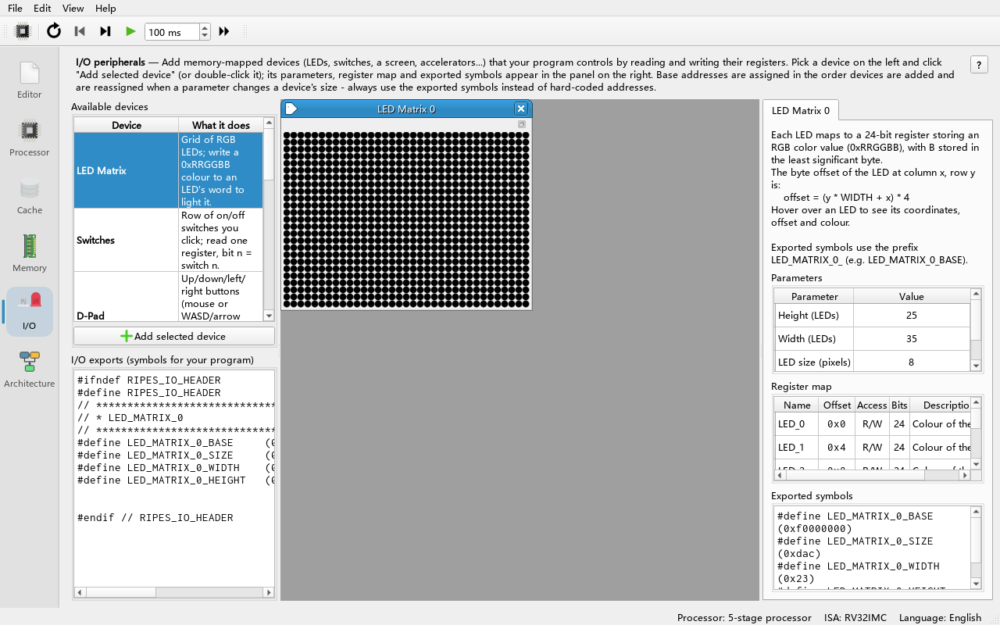
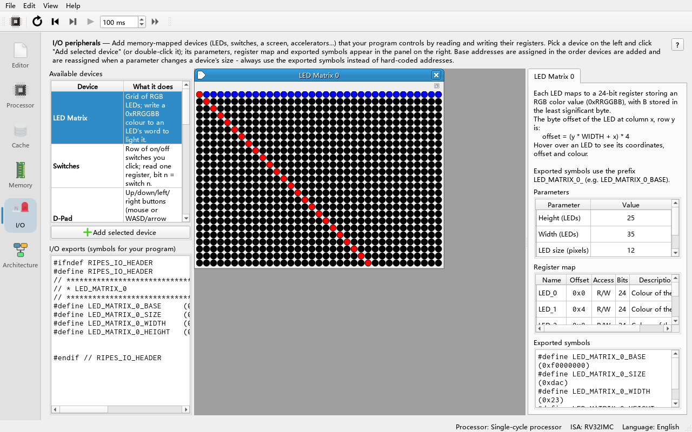
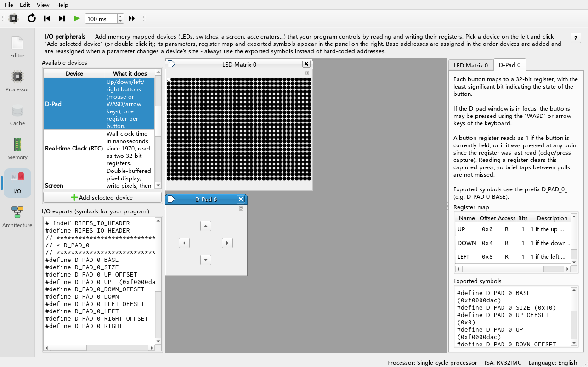
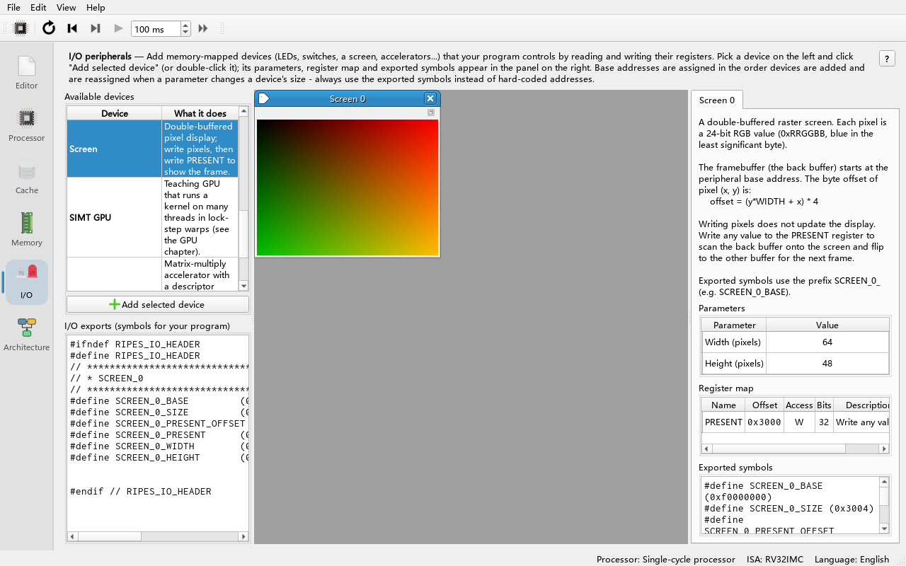

# 08 Memory-Mapped I/O Peripherals

> **What you will learn**
>
> - What memory-mapped I/O (MMIO) is: reading and writing peripherals with ordinary `lw`/`sw`;
> - The peripheral start address setting and how peripherals are assigned addresses one after another;
> - Adding, configuring and popping out peripherals in the **I/O** tab;
> - How exported symbols (such as `LED_MATRIX_0_BASE`) are used in assembly and C;
> - The registers and parameters of each built-in peripheral (LED matrix, switches, D-pad, real-time clock, screen);
> - A complete LED matrix program, plus switch/D-pad polling, reading the RTC and drawing on the screen.
>
> **Prerequisites**
>
> - Chapter 04 (assembly, loops, `lw`/`sw`). Using peripherals from C also needs the compiler set-up of chapter 05.
> - You know hexadecimal addresses and RGB colours.

> The SIMT GPU and Tensor Unit (NPU) peripherals are also added in the **I/O** tab and are used the same way, but they are programmable accelerators and are covered separately in chapters 09 and 10.

---

## 8.1 What is memory-mapped I/O

The processor only knows two kinds of accesses: "read memory" and "write memory". The idea of memory-mapped I/O is to assign an address range to a peripheral; the processor's `lw`/`sw` to that range no longer go to memory but to the peripheral — writing a word can light an LED, reading a word can return the state of the switches.

In Ripes the peripheral address space starts at the **I/O start address:**, by default `0xF0000000`. It is set on the **Edit → Settings → Simulator** page. Peripherals are placed **back to back** in the order they are added: the first starts at the start address, the next starts where the previous one ends (`IOManager::nextPeripheralAddress`).

## 8.2 Adding a peripheral

**Do**: Open the **I/O** tab.

**What you see**: The **Available devices** list on the left shows the available peripherals with a one-line description each (**Device** / **What it does**): **LED Matrix**, **Switches**, **D-Pad**, **Real-time Clock (RTC)**, **Screen**, **SIMT GPU**, **Tensor Unit (NPU)**. Hovering shows "Double-click (or select and click Add) to add this device to the system."; the **Add selected device** button below the list does the same as a double-click. The **I/O exports** area below lists the symbols exported by all created peripherals.

**Do**: Double-click **LED Matrix**.

**What you see**:

- An LED matrix widget titled **LED Matrix 0** appears in the middle; a button in its top-right corner "pops it out" into a separate window, so you can still see it while switching to other tabs;
- The details of the peripheral appear on the right: a description, **Parameters** (editable), **Register map** (columns **Name**, **Offset**, **Access**, **Bits**, **Description**) and **Exported symbols** (the symbols exported by this peripheral);
- **I/O exports** now contains `LED_MATRIX_0_BASE`, `LED_MATRIX_0_SIZE`, `LED_MATRIX_0_WIDTH`, `LED_MATRIX_0_HEIGHT`.



**Do**: Double-click **Switches** as well, then switch to the **Memory** tab and look at the **Memory map** table on the right.

**What you see**: Besides the program segments there are two new entries, `LED Matrix 0` and `Switches 0`; their **Address range** column shows `0xf0000000 - 0xf0000dab` and `0xf0000dac - 0xf0000daf` (first and last byte, inclusive), and **Size (bytes)** shows 3500 and 4.

**Why**: The default LED matrix has 35 × 25 = 875 LEDs of 4 bytes each, 3500 = `0xDAC` bytes in total; the switches follow immediately. **A peripheral's address therefore depends on the order of adding and on parameters** — never hard-code addresses in programs, always use the exported symbols.

> **Changing parameters moves addresses**: Changing a peripheral parameter (e.g. the LED matrix size) changes its size; all base addresses are reassigned, the exported symbols are updated and assembly programs are reassembled automatically.

> The peripheral configuration is stored in the settings and restored the next time Ripes starts (`RIPES_SETTING_PERIPHERAL_SETTINGS`).

## 8.3 Exported symbols

The symbols of each peripheral are generated by `IOManager::assemblerSymbolsForPeriph` with these rules:

- The peripheral name (`LED Matrix 0`) is upper-cased and spaces and `-` become `_` → prefix `LED_MATRIX_0`;
- `<prefix>_BASE`: base address; `<prefix>_SIZE`: number of bytes occupied;
- For each "exported" register `REG`: `<prefix>_REG` = absolute address, `<prefix>_REG_OFFSET` = offset from the base;
- Extra constants of the peripheral, e.g. `<prefix>_WIDTH`, `<prefix>_HEIGHT`, `<prefix>_N`.

You can add several peripherals of the same kind; numbering starts at 0: `LED_MATRIX_0_...`, `LED_MATRIX_1_...`.

**In assembly**: symbols can be used wherever an immediate is expected, most commonly with `li`:

```asm
li a0, LED_MATRIX_0_BASE
```

**In C**: `#include "ripes_system.h"`; the symbols are ordinary `#define`s. Whenever the peripherals change, Ripes regenerates `ripes_system.h` in the system temp folder, with contents like:

```c
#ifndef RIPES_IO_HEADER
#define RIPES_IO_HEADER
// *****************************************************************************
// * LED_MATRIX_0
// *****************************************************************************
#define LED_MATRIX_0_BASE	(0xf0000000)
#define LED_MATRIX_0_SIZE	(0xdac)
#define LED_MATRIX_0_WIDTH	(0x23)
#define LED_MATRIX_0_HEIGHT	(0x19)
...
#endif // RIPES_IO_HEADER
```

> **CLI limitation**: The command line mode (`--mode cli`, chapter 15) cannot create peripherals, so programs using peripheral symbols do not assemble there. The error message is a misleading `Unknown opcode 'li'` (the real cause is the undefined symbol). Run the programs of this chapter in the GUI.

## 8.4 LED Matrix

| Item | Details |
|---|---|
| Parameters | **Height** (default 25, 1–256), **Width** (default 35, 1–256), **LED size** (drawing size, default 8, 1–100, display only) |
| Registers | `LED_0` … `LED_{W*H-1}`, one 32-bit word per LED (only the low 24 bits are used), read/write, **not exported individually** |
| Colour format | `0x00RRGGBB`: red in bits 23:16, green in bits 15:8, blue in the lowest byte |
| Address | Offset of the LED at (x, y) = `(y * WIDTH + x) * 4` (row by row) |
| Exported symbols | `LED_MATRIX_0_BASE`, `_SIZE`, `_WIDTH`, `_HEIGHT` |

> The peripheral's own description gives the formula `offset = (y + x*N_LEDS_ROW) * 4`, but the drawing code (`IOLedMatrix::paintEvent`) uses `y * width + x`, i.e. row by row; the table follows the drawing code.

### Complete example: a diagonal and a row

**Do**: Create an **LED Matrix** in the **I/O** tab (default parameters), switch to **Single-cycle processor** (faster), and enter in the editor:

```asm
# Light the LED matrix diagonal red, then the rest of the first row blue
.text
main:
    li   s0, LED_MATRIX_0_BASE
    li   s1, LED_MATRIX_0_WIDTH
    li   s2, LED_MATRIX_0_HEIGHT
    li   t0, 0
diag:
    bge  t0, s1, row        # stop beyond the width or height
    bge  t0, s2, row
    mul  t1, t0, s1         # offset = (y*WIDTH + x) * 4, here x = y = t0
    add  t1, t1, t0
    slli t1, t1, 2
    add  t1, s0, t1
    li   t2, 0xFF0000       # red
    sw   t2, 0(t1)
    addi t0, t0, 1
    j    diag
row:
    li   t0, 1
row_loop:
    bge  t0, s1, end
    slli t1, t0, 2          # row 0: offset = x * 4
    add  t1, s0, t1
    li   t2, 0x0000FF       # blue
    sw   t2, 0(t1)
    addi t0, t0, 1
    j    row_loop
end:
    li   a7, 10
    ecall
```

**Do**: Go back to the **I/O** tab and press **Run (F8)**.

**What you see**: A red diagonal starting in the top-left corner (25 LEDs, since the height is only 25), and the rest of the first row in blue.



**Why**: Every `sw` into the LED matrix address range makes the simulator call the peripheral's `ioWrite`; the peripheral stores the colour and schedules a repaint. Increase **LED size** to see it better; after changing **Width**/**Height** the program needs no change because it uses the exported symbols.

**Another example**: **File → Load Example... → Assembly → leds.s** (`examples/assembly/leds.s`) draws a continuously changing colour gradient animation over the whole matrix; the C version is **C → leds.c** (`examples/C/leds.c`). Create an LED Matrix before running them. The animation is smoothest with **Run** at full speed.

## 8.5 Switches

| Item | Details |
|---|---|
| Parameters | **# Switches** (number of switches, default 8, 1–32) |
| Registers | One read-only register `Switches` at offset 0: switch n is bit n (1 = on); not exported separately, use the base address |
| Size | 4 bytes |
| Exported symbols | `SWITCHES_0_BASE`, `SWITCHES_0_SIZE`, `SWITCHES_0_N` (number of switches) |

### Polling example: switches to LEDs

**Do**: Create an **LED Matrix** and a **Switches**, enter the program below, press **Run (F8)** and click the switches.

```asm
# Show the switch states on the first row of the LED matrix
.text
main:
    li   s0, SWITCHES_0_BASE
    li   s1, LED_MATRIX_0_BASE
    li   s2, SWITCHES_0_N
poll:
    lw   t0, 0(s0)          # read all switches at once
    li   t1, 0              # bit index
bit:
    srl  t2, t0, t1
    andi t2, t2, 1          # t2 = state of switch t1
    slli t3, t1, 2
    add  t3, s1, t3         # address of LED t1
    beqz t2, off
    li   t4, 0x00FF00       # green
    sw   t4, 0(t3)
    j    next
off:
    sw   zero, 0(t3)
next:
    addi t1, t1, 1
    blt  t1, s2, bit
    j    poll               # loop forever
```

**What you see**: Turning on switch n lights LED n of the first row green; turning it off clears it.

**Why**: This is **polling**: the program keeps reading the switch register and checking every bit. It never ends; stop it with **Reset (F3)** or by pressing the run button again (to be verified: the name of the stop button while running). The C version is **File → Load Example... → C → switchesAndLeds.c** (`examples/C/switchesAndLeds.c`).

> **Try it**: Instead of **Run**, step with **Clock (F5)** or a slow **Auto clock** and toggle a switch — the LED reacts only much later, because one round of the polling loop executes many instructions. The upstream documentation recommends using the single-cycle processor with peripherals and lowering **Max. cache plot cycles** under **Edit → Settings → Environment** to reduce the overhead of other parts of the simulator.

## 8.6 D-Pad

| Item | Details |
|---|---|
| Parameters | None |
| Registers | `UP` (offset 0), `DOWN` (4), `LEFT` (8), `RIGHT` (12), each 32-bit read-only, the lowest bit is the button state; **all exported** |
| Size | 16 bytes |
| Exported symbols | `D_PAD_0_BASE`, `D_PAD_0_SIZE`, `D_PAD_0_UP`, `D_PAD_0_UP_OFFSET`, `D_PAD_0_DOWN`, `D_PAD_0_DOWN_OFFSET`, `D_PAD_0_LEFT`, `D_PAD_0_LEFT_OFFSET`, `D_PAD_0_RIGHT`, `D_PAD_0_RIGHT_OFFSET` |

Note the prefix `D_PAD_0`: the `-` in the peripheral name "D-Pad 0" becomes `_`.

Read rules (`IODPad::description`):

- A button reads 1 while it is held;
- It also reads 1 if it was pressed at any time since the register was last read, even if already released (**press capture**, edge capture);
- **Reading clears** the captured press, so brief taps between polls are neither lost nor counted twice.

You can click the buttons with the mouse, or click the D-pad widget to give it focus and use the keyboard **W/A/S/D** or **arrow keys**.

### Polling example: moving a dot with the D-pad

**Do**: Create an **LED Matrix** and a **D-Pad** and run:

```asm
# Move a white dot around the LED matrix with the D-pad
.text
main:
    li   s0, LED_MATRIX_0_BASE
    li   s1, LED_MATRIX_0_WIDTH
    li   s2, LED_MATRIX_0_HEIGHT
    li   s3, 0              # x
    li   s4, 0              # y
    li   s5, 0xFFFFFF       # white
draw:
    mul  t0, s4, s1         # offset = (y*WIDTH + x) * 4
    add  t0, t0, s3
    slli t0, t0, 2
    add  s6, s0, t0         # s6 = address of the dot
    sw   s5, 0(s6)
poll:
    li   t1, D_PAD_0_UP
    lw   t2, 0(t1)
    bnez t2, up
    li   t1, D_PAD_0_DOWN
    lw   t2, 0(t1)
    bnez t2, down
    li   t1, D_PAD_0_LEFT
    lw   t2, 0(t1)
    bnez t2, left
    li   t1, D_PAD_0_RIGHT
    lw   t2, 0(t1)
    bnez t2, right
    j    poll
up:
    beqz s4, poll           # already at the top edge
    addi s4, s4, -1
    j    move
down:
    addi t3, s2, -1
    bge  s4, t3, poll
    addi s4, s4, 1
    j    move
left:
    beqz s3, poll
    addi s3, s3, -1
    j    move
right:
    addi t3, s1, -1
    bge  s3, t3, poll
    addi s3, s3, 1
move:
    sw   zero, 0(s6)        # erase the old dot
    j    draw
```

**What you see**: A white dot in the top-left corner; each press of a direction moves it one step. Holding a button moves it continuously.



**Why**: Reading a direction register clears its captured press, so a short tap moves exactly one step; while held, the register stays 1 and the dot moves on every polling round.

## 8.7 Real-time Clock

It is called **Real-time Clock (RTC)** in the **Available devices** list; the created peripheral is named **RTC 0**.

| Item | Details |
|---|---|
| Parameters | None |
| Registers | `TIME_LO` (offset 0, low 32 bits), `TIME_HI` (offset 4, high 32 bits), read-only, **exported** |
| Meaning | The host's wall-clock time in nanoseconds since 1970-01-01 (Unix epoch), 64 bits |
| Size | 8 bytes |
| Exported symbols | `RTC_0_BASE`, `RTC_0_SIZE`, `RTC_0_TIME_LO`, `RTC_0_TIME_LO_OFFSET`, `RTC_0_TIME_HI`, `RTC_0_TIME_HI_OFFSET` |

**The read order matters**: reading `TIME_LO` samples the full 64-bit time, returns the low 32 bits and "latches" the high 32 bits; a following read of `TIME_HI` returns the latched high word. So **read `TIME_LO` first, then `TIME_HI`**, and both belong to the same instant, without "tearing" when the low word carries over between the two reads. On a 64-bit processor a single 8-byte `ld` at offset 0 returns the whole 64-bit value.

```asm
# Read the RTC time twice and print it
.text
main:
    li   s0, RTC_0_TIME_LO
    li   s1, RTC_0_TIME_HI
    li   s2, 2
again:
    lw   t0, 0(s0)          # read TIME_LO first: latches TIME_HI
    lw   t1, 0(s1)
    mv   a0, t1
    li   a7, 34             # print the high 32 bits in hex
    ecall
    li   a0, 32
    li   a7, 11
    ecall
    mv   a0, t0
    li   a7, 36             # print the low 32 bits as unsigned decimal
    ecall
    li   a0, 10
    li   a7, 11
    ecall
    addi s2, s2, -1
    bnez s2, again
    li   a7, 10
    ecall
```

**What you see**: Two output lines with the same (or off-by-one) high word and an increasing low word. The peripheral widget also shows "Epoch: ... ns" and a readable date and time, updated live.

**Why**: The RTC returns **real time**, not simulated cycles, so the measured time difference of the same code differs completely between computers, and between stepping with **Clock** and running with **Run**. To measure simulated cycles use system call 31 `Cycles` (chapter 04).

## 8.8 Screen

| Item | Details |
|---|---|
| Parameters | **Width** (default 64, 1–1024), **Height** (default 48, 1–1024) |
| Framebuffer | Starts at the base address, one word `0x00RRGGBB` per pixel; offset of pixel (x, y) = `(y * WIDTH + x) * 4` |
| Registers | `PRESENT` (offset = number of pixels × 4), write-only, **exported** |
| Size | (pixels + 1) × 4 bytes |
| Exported symbols | `SCREEN_0_BASE`, `SCREEN_0_SIZE`, `SCREEN_0_WIDTH`, `SCREEN_0_HEIGHT`, `SCREEN_0_PRESENT`, `SCREEN_0_PRESENT_OFFSET` |

The screen is **double-buffered**: the program writes the back buffer, and writing pixels does **not** change the display immediately; writing any value to `PRESENT` shows the back buffer and then flips to the other buffer for drawing the next frame. Animations therefore never show a half-drawn frame.

```asm
# Draw a colour gradient on the Screen and present it
.text
main:
    li   s0, SCREEN_0_BASE
    li   s1, SCREEN_0_WIDTH
    li   s2, SCREEN_0_HEIGHT
    li   t0, 0              # y
row:
    li   t1, 0              # x
col:
    slli t2, t1, 18         # red   = x * 4 (bits 23:16)
    slli t3, t0, 10         # green = y * 4 (bits 15:8)
    or   t2, t2, t3
    mul  t4, t0, s1         # offset = (y*WIDTH + x) * 4
    add  t4, t4, t1
    slli t4, t4, 2
    add  t4, s0, t4
    sw   t2, 0(t4)
    addi t1, t1, 1
    blt  t1, s1, col
    addi t0, t0, 1
    blt  t0, s2, row
    li   t5, SCREEN_0_PRESENT
    sw   zero, 0(t5)        # write PRESENT: show this frame
    li   a7, 10
    ecall
```

**What you see**: The screen stays black while the program runs, until the final write to `PRESENT` makes the whole gradient appear at once (yellowish bottom-left, reddish top-right).



**Why**: Without the final `sw` to `PRESENT` nothing is shown — the most common beginner mistake. Note that x is at most 63, so `x * 4` stays below 252 and fits in an 8-bit colour component.

> The framebuffer is large (3073 words by default); you can see the written values directly in the **Memory** tab.

## 8.9 Common problems

| Symptom | Cause | Fix |
|---|---|---|
| Assembler reports `Unknown symbol` or `Unknown opcode 'li'` | The peripheral was not created, or the name/number is wrong (e.g. the second instance is numbered 1) | Create the peripheral in the **I/O** tab and compare with the names in **I/O exports** |
| Assembly fails in the CLI | The CLI cannot create peripherals | Run in the GUI |
| LED / screen does not react | Wrong address or colour format; forgot to write `PRESENT` for the screen | Use the exported symbols; colours are `0xRRGGBB` |
| Program behaves differently after changing a parameter | Base addresses were reassigned | Always use symbols, never hard-coded addresses |
| Peripheral reacts slowly | Using **Clock** / slow **Auto clock**, or a slower pipelined processor | Use **Run** and the single-cycle processor |

## 8.10 Exercises

1. Add **Switches** first and then an **LED Matrix** (default parameters). What is `LED_MATRIX_0_BASE`? And in the opposite order?
2. Set the LED matrix **Width** to 8 and **Height** to 1 and modify the program of 8.5 so that switches that are on show red and switches that are off show dim grey `0x202020`.
3. Modify the program of 8.6: pressing **UP** cycles the dot's colour through red, green, blue instead of moving up.
4. Using the RTC and system call 31 `Cycles`, measure how many nanoseconds and how many cycles an empty loop of 100000 iterations (`addi` + `bnez`) takes, and compute the "simulation frequency". Measure once with **Run** and once with **Auto clock** and compare.
5. Modify the program of 8.8 to draw two frames: first all red, write `PRESENT`; then all blue, write `PRESENT` again. Step with **Clock**: what does the screen show while the second frame is half drawn?

### Answers

1. With the switches added first, they occupy `0xF0000000`–`0xF0000003` and the LED matrix starts at `0xF0000004`, so `LED_MATRIX_0_BASE` = `0xF0000004`. In the opposite order `LED_MATRIX_0_BASE` = `0xF0000000` and `SWITCHES_0_BASE` = `0xF0000DAC`.
2. Change the colour after `beqz t2, off` to `0xFF0000`, and replace `sw zero, 0(t3)` in the `off:` branch by:
   ```asm
   off:
       li   t4, 0x202020
       sw   t4, 0(t3)
   ```
   Since the first row is exactly the 8 LEDs, nothing else needs to change.
3. Keep a colour index 0/1/2 in a register (e.g. `s7`) and replace the `up:` branch by:
   ```asm
   up:
       addi s7, s7, 1
       li   t3, 3
       blt  s7, t3, pick
       li   s7, 0
   pick:
       li   s5, 0xFF0000
       beqz s7, move
       li   s5, 0x00FF00
       li   t3, 1
       beq  s7, t3, move
       li   s5, 0x0000FF
       j    move
   ```
   and add `li s7, 0` at the start of `main`. (`move` erases the old dot and redraws it in the new colour.)
4. Read the RTC (first `TIME_LO`, then `TIME_HI`) and call `Cycles` (`li a7, 31` + `ecall`, result in `a0`/`a1`) before and after the loop and subtract. The cycle count is about 200000 regardless of how you run; the nanoseconds are much larger under **Auto clock**. Simulation frequency = cycles / seconds; it reflects the speed of the simulator, not a "real" frequency of the simulated processor.
5. The screen keeps showing the first frame (all red) until the second write to `PRESENT` turns it all blue at once — double buffering guarantees that no half-drawn frame is shown.

## Summary

- MMIO accesses peripherals with ordinary `lw`/`sw`; peripherals are placed back to back from the **I/O start address:** (default `0xF0000000`) in the order they are added.
- Double-click an entry in **Available devices** in the **I/O** tab to create a peripheral; the right side shows parameters, register map and exported symbols; widgets can be popped out into separate windows.
- Exported symbols are named `<NAME>_<n>_BASE / _SIZE / _<REG> / _<REG>_OFFSET / _<CONST>`; use them as immediates in assembly and via `#include "ripes_system.h"` in C. Always use symbols, never hard-coded addresses.
- LED matrix: one word `0xRRGGBB` per LED at offset `(y*WIDTH + x)*4`; switches: one register, bit n = switch n; D-pad: 4 registers with press capture cleared on read; RTC: read `TIME_LO` before `TIME_HI`; screen: double-buffered, shown only after writing `PRESENT`.
- CLI mode cannot create peripherals; programs using peripheral symbols run only in the GUI.
- Next: the SIMT GPU (chapter 09) and the Tensor Unit / NPU (chapter 10).
