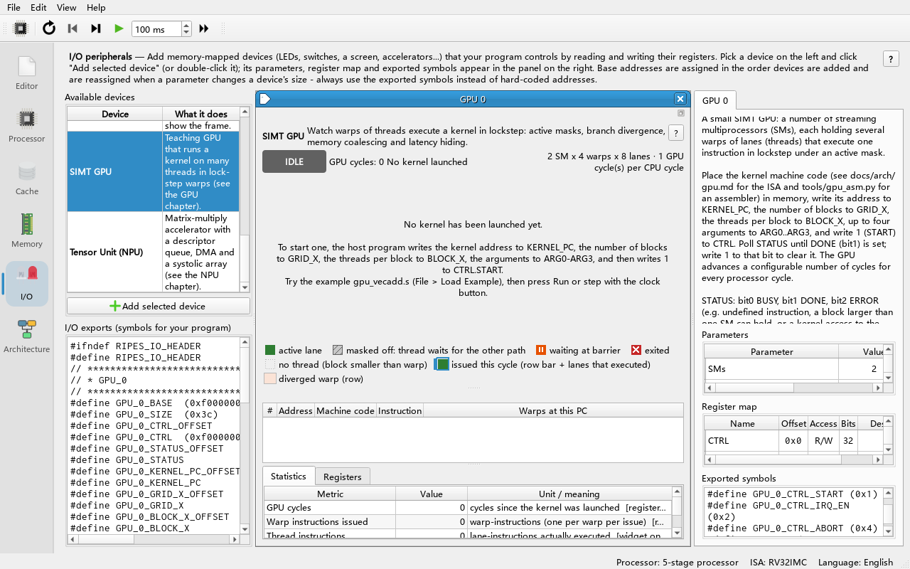
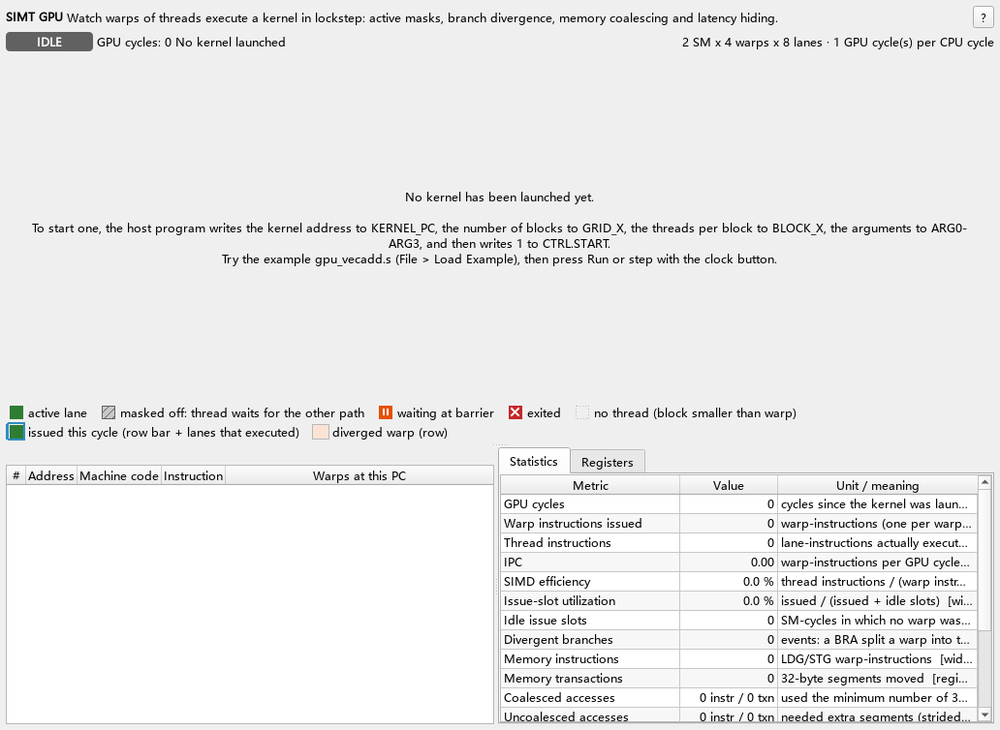
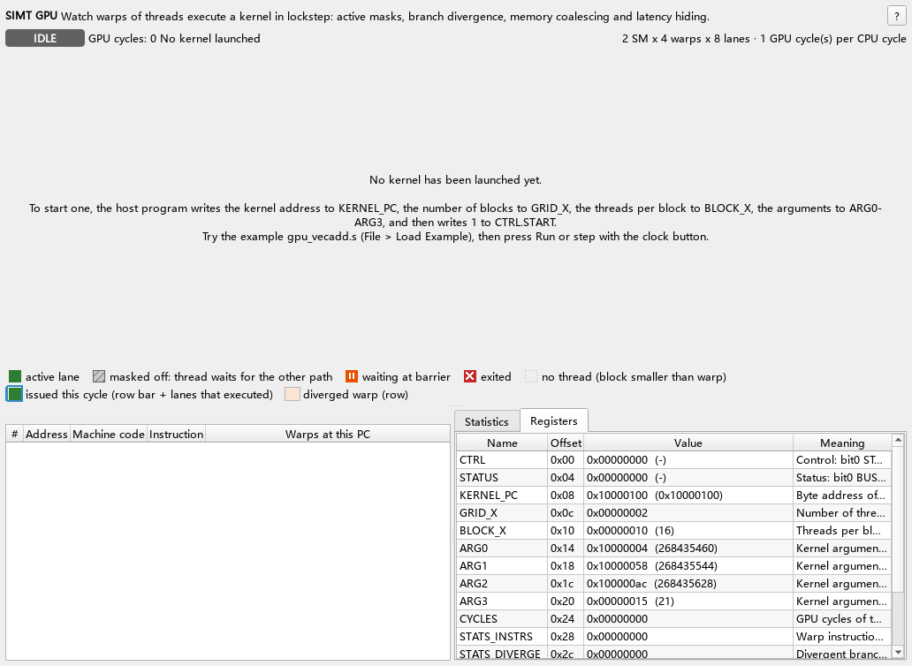
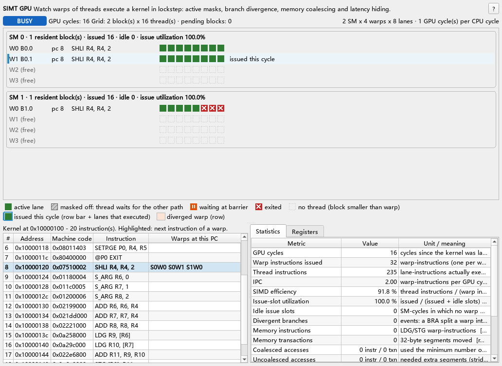
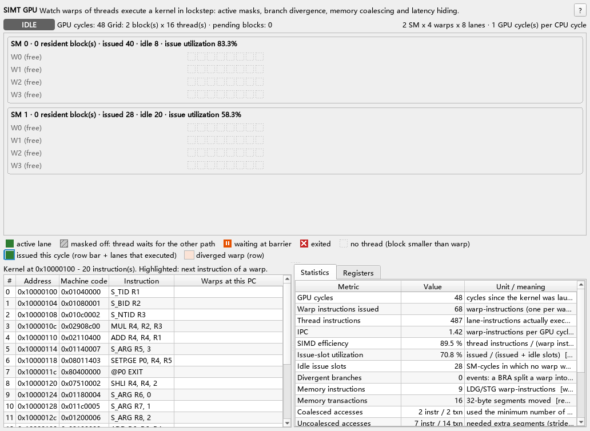
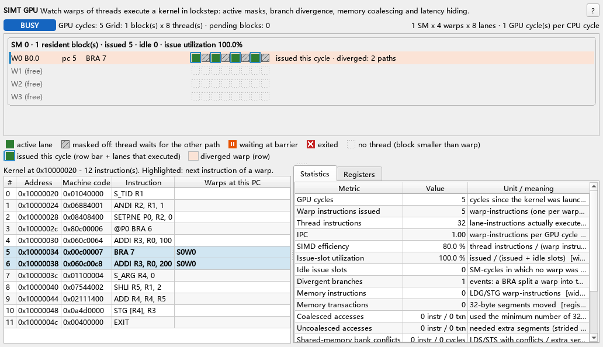

# 09 SIMT GPU Tutorial

> **What you will learn**
>
> - Why a GPU can "run thousands of threads at once": how CPU threads, SIMD and SIMT differ;
> - What the simulator's **SIMT GPU** peripheral is made of (SMs, warps, lanes, scheduler, memory interface);
> - How to add the GPU in the **I/O** tab, tune its parameters, and what every register means;
> - Every opcode and encoding of the kernel ISA, and how to assemble kernels with `tools/gpu_asm.py`;
> - How to step through the vector-add example `gpu_vecadd.s` and read every square and every statistic on the widget;
> - Four experiments: branch divergence and reconvergence, memory coalescing, shared-memory bank conflicts, barriers;
> - The model's limitations (no reverse execution of the accelerator, the CLI cannot instantiate peripherals).
>
> **Prerequisites**
>
> - You can start Ripes, load an example, assemble and run it (chapter 02);
> - You can read simple RISC-V assembly: `li`, `la`, `lw`, `sw`, loops (chapter 04);
> - You know that an MMIO peripheral is "a set of registers mapped into the address space" and can add one in the **I/O** tab (chapter 08).
> - No GPU programming experience is needed.

---

## 09.1 Why GPUs

Suppose we want `C[i] = A[i] + B[i]` for a million elements. On a CPU, even with 8 cores, each core fetches, decodes and executes one instruction after another; most of its transistors go into making one instruction stream fast (branch prediction, out-of-order execution, large caches). A GPU takes the opposite approach: **run a huge number of simple threads together and trade latency for throughput**.

The three forms of parallelism:

| | CPU threads (multicore) | SIMD (vector instructions) | SIMT (GPU) |
|---|---|---|---|
| One instruction drives | 1 thread | 1 vector register (e.g. 8 ints) | 1 **warp** (e.g. 32 threads) |
| The programmer writes | a thread function | vector code: "add these 8 numbers" | **scalar** code: "add *my* element" |
| Branches | independent per thread | handled manually with masks | hardware keeps an **active mask** |
| Typical scale | 4–64 cores | 128–512 bit | 32 lanes × tens of warps × tens of SMs |

- **SIMD** (Single Instruction, Multiple Data) exposes the vector width to the programmer.
- **SIMT** (Single Instruction, Multiple Threads) lets the programmer write scalar code for one thread; the hardware groups threads into a **warp** and drives them with **the same instruction**; each thread (a **lane**) has its own registers and its own addresses.
- When threads of one warp take different branches, the hardware switches off some lanes with the active mask, runs both paths one after the other and merges them again. This is **branch divergence** — transparent to the programmer but it wastes compute. You will watch it happen in section 09.9.

## 09.2 The GPU inside the simulator

The open-soc-explorer GPU is a **minimal teaching GPU** (model in `src/accel/gpu/simtgpu.*`, peripheral in `src/io/iogpu.*`, design notes in `docs/arch/gpu.md`). It leaves out caches, texture units and so on, but keeps the core mechanisms needed to understand GPUs.

```
                RISC-V CPU (Ripes processor)
                  │  lw / sw  (MMIO)
                  ▼
   ┌───────────── SIMT GPU peripheral (GPU_0_*) ─────────┐
   │  registers: CTRL STATUS KERNEL_PC GRID_X BLOCK_X     │
   │             ARG0-3 CYCLES STATS_* CONFIG             │
   │                      │ CTRL.START                    │
   │                      ▼                               │
   │        block scheduler (hands out blocks in turn)    │
   │          ┌───────────┴────────────┐                  │
   │      ┌───▼────┐               ┌───▼────┐             │
   │      │  SM0   │               │  SM1   │  ...        │
   │      │ warp slot0 ── lane0..7 │ warp slot0 │          │
   │      │ warp slot1 ── lane0..7 │ warp slot1 │          │
   │      │ warp slot2             │ ...        │          │
   │      │ warp slot3             │            │          │
   │      │ warp scheduler: 1 warp instruction per cycle    │
   │      │ shared memory: 1 KiB per block, 8 banks         │
   │      └───┬────┘               └───┬────┘             │
   │          └──────── LDG/STG ───────┘                  │
   └──────────────────────┼───────────────────────────────┘
                          ▼
         Ripes main memory (shared with the CPU; the kernel code lives here too)
```

The execution hierarchy:

| Concept | Meaning | In this model |
|---|---|---|
| **lane / thread** | one scalar thread with 16 32-bit registers R0–R15 (R0 is always 0) and 4 predicate bits P0–P3 | `S_TID` reads the thread index threadIdx.x |
| **warp** | the unit of scheduling: `warp size` lanes execute the same instruction in lockstep | parameter *Warp size (lanes)*, default 8 (32 on real NVIDIA GPUs) |
| **block** (thread block, CTA) | threads that can cooperate through shared memory and `BAR`; must live entirely on **one SM** | register `BLOCK_X` (threads per block) |
| **grid** | all blocks of one kernel launch | register `GRID_X` (number of blocks) |
| **SM** (Streaming Multiprocessor) | owns warp slots, registers, shared memory and a warp scheduler | parameters *SMs*, *Warps per SM* |

A few rules (from `simtgpu.cpp`; all the experiments below rely on them):

1. A block needs `ceil(BLOCK_X / warpSize)` warp slots. The scheduler dispatches the next block to an SM only when it has enough free slots; each SM receives at most one block per cycle.
2. Each SM **issues at most one** warp instruction per cycle. The scheduler is loose round-robin: starting after the warp issued last, it picks the first **ready** warp (not waiting for memory, not waiting at a barrier). If none is ready, an **idle issue slot** is counted.
3. `LDG` (global load) stalls the issuing warp for `memLatency + (transactions − 1)` cycles; `STG` for `transactions − 1` cycles. Other warps may issue meanwhile — this is how GPUs **hide latency**.
4. The GPU is driven by the CPU clock: for every CPU cycle it advances *GPU cycles per CPU cycle* cycles. A CPU loop polling `STATUS` really does run in parallel with the GPU.

## 09.3 Adding the SIMT GPU peripheral

**Do**: click the **I/O** tab in the left tab bar. In the **Available devices** list at the top left, double-click **SIMT GPU** (or select it and click **Add selected device**).

**You see**: a widget window called **GPU 0** appears in the middle area; the right-hand panel shows the peripheral's description, **Parameters**, **Register map** and **Exported symbols**; the **I/O exports** text box at the bottom left lists a set of new `GPU_0_*` symbols. The GPU widget is about 1000 pixels wide, so in a 1280 × 800 window its sub-window does not fit into the middle area; enlarge the window, narrow the side panels, or maximise the sub-window.



**Why**: once a peripheral is created, Ripes assigns it an address range (0x3C bytes starting at `GPU_0_BASE`) and exports the register addresses and bit masks as symbols to the assembler and the C compiler (C programs `#include "ripes_system.h"`). That is why programs say `GPU_0_CTRL_OFFSET` instead of hard-coding numbers.

Parameters (right-hand **Parameters** table):

| Parameter (on-screen text) | Default | Range | Meaning |
|---|---|---|---|
| SMs | 2 | 1–8 | number of SMs |
| Warps per SM | 4 | 1–16 | warp slots per SM |
| Warp size (lanes) | 8 | 1–32 | lanes per warp |
| Global memory latency (cycles) | 4 | 0–64 | minimum stall of a warp after `LDG` |
| GPU cycles per CPU cycle | 1 | 1–64 | GPU cycles per CPU cycle (clock ratio) |

> Note: changing SMs / Warps per SM / Warp size / latency **rebuilds the GPU model and aborts a running kernel**. Set the parameters before you run the program. The shared memory size (1024 bytes per block) and number of banks (8) are model constants and cannot be changed in the GUI.

The GPU widget:

| Area | Contents |
|---|---|
| Title bar | "SIMT GPU" plus a one-line description; a "?" button on the right opens this chapter |
| Status line | badge `IDLE` / `BUSY` / `DONE` / `ERROR` (colour + text), `GPU cycles`, grid size and pending blocks, error reason; on the right the configuration (`2 SM x 4 warps x 8 lanes · 1 GPU cycle(s) per CPU cycle`) |
| SM / warp / lane view | one frame per SM (`SM 0 · 1 resident block(s) · issued … · idle … · issue utilization …`), one row per warp slot: `W<slot> B<block>.<warp>  pc <n>` + disassembly of the next instruction + one square per lane; free slots show `W<slot> (free)`. Before the first launch the view shows the hint "No kernel has been launched yet." instead. A legend follows below |
| Kernel disassembly | `#`, **Address**, **Machine code**, **Instruction**, **Warps at this PC** (the next instruction of each warp is highlighted) |
| **Statistics** tab | **Metric** / **Value** / **Unit / meaning**: GPU cycles, warp instructions issued, thread instructions, IPC, SIMD efficiency, issue-slot utilisation, idle issue slots, divergent branches, memory instructions/transactions, coalesced/uncoalesced accesses, shared-memory bank conflicts, … |
| **Registers** tab | **Name** + **Offset** + **Value** + **Meaning** |

Lane squares (the legend below the SM view shows the same symbols):

| Appearance | Meaning |
|---|---|
| solid green | **active lane**: the lane is on the current path and executes the next instruction |
| grey, hatched | **masked off**: the thread waits for the other branch path |
| orange with a pause sign | **waiting at barrier** |
| red with a white cross | **exited**: the thread has executed `EXIT` |
| dotted outline | no thread (spare lanes when a block does not fill a warp) |
| blue outline (and a blue bar at the start of the row) | **issued this cycle**: the lane executed the warp's instruction in the last GPU cycle |
| light orange row background | **diverged warp** |

Row suffixes: `issued this cycle`, `stall n` = still waiting n cycles for memory, `waiting at BAR` = waiting at a barrier, `diverged: k paths` = the warp is split into k control-flow paths.

## 09.4 Register table

The base address is assigned by the I/O tab (symbol `GPU_0_BASE`). Every register is 32 bits; the symbol `GPU_0_<NAME>` is the absolute address and `GPU_0_<NAME>_OFFSET` the offset.

| Offset | Name | R/W | Bits | Meaning |
|---|---|---|---|---|
| 0x00 | `CTRL` | RW | bit0 `START` | write 1 to launch the kernel (the doorbell); reads as 0 |
| | | | bit1 `IRQ_EN` | interrupt enable; **rewritten by every write to CTRL** |
| | | | bit2 `ABORT` | write 1 to abort a running kernel (`DONE` is set afterwards) |
| 0x04 | `STATUS` | RW | bit0 `BUSY` | a kernel is running |
| | | | bit1 `DONE` | kernel finished (sticky); **write 1 to clear** (W1C) |
| | | | bit2 `ERROR` | an error occurred (sticky); write 1 to clear |
| | | | bit3 `IRQ` | `DONE & IRQ_EN` (read-only, cleared with DONE) |
| 0x08 | `KERNEL_PC` | RW | 31:0 | **byte address** of the first kernel instruction (4-byte aligned) |
| 0x0C | `GRID_X` | RW | 31:0 | number of blocks (≥1) |
| 0x10 | `BLOCK_X` | RW | 31:0 | threads per block (≥1, and `ceil(BLOCK_X/warpSize) ≤ Warps per SM`) |
| 0x14 | `ARG0` | RW | 31:0 | kernel argument 0, read in the kernel with `S_ARG rd, 0` |
| 0x18 | `ARG1` | RW | 31:0 | kernel argument 1 |
| 0x1C | `ARG2` | RW | 31:0 | kernel argument 2 |
| 0x20 | `ARG3` | RW | 31:0 | kernel argument 3 |
| 0x24 | `CYCLES` | R | 31:0 | **GPU cycles** used by the current (or last) kernel |
| 0x28 | `STATS_INSTRS` | R | 31:0 | **warp instructions** issued (all SMs) |
| 0x2C | `STATS_DIVERGE` | R | 31:0 | divergent branches (a warp split into two paths) |
| 0x30 | `STATS_MEMTXN` | R | 31:0 | 32-byte global memory transactions |
| 0x34 | `STATS_IDLE` | R | 31:0 | idle issue slots (an SM issued nothing in a cycle) |
| 0x38 | `CONFIG` | R | 7:0 / 15:8 / 23:16 | warp size / warps per SM / number of SMs |

Additional constant symbols: `GPU_0_CTRL_START` (1), `GPU_0_CTRL_IRQ_EN` (2), `GPU_0_CTRL_ABORT` (4), `GPU_0_STATUS_BUSY` (1), `GPU_0_STATUS_DONE` (2), `GPU_0_STATUS_ERROR` (4), `GPU_0_STATUS_IRQ` (8), `GPU_0_NUM_SMS`, `GPU_0_WARPS_PER_SM`, `GPU_0_WARP_SIZE` (the last three follow the parameters).

> **Pitfall**: `IRQ_EN` in `CTRL` does not "stay set"; every write to `CTRL` sets it from bit1 of the written value. To launch with interrupts enabled, write `GPU_0_CTRL_START | GPU_0_CTRL_IRQ_EN` (= 3) in one go. `STATS_*` are only cleared when a kernel is launched; bank-conflict cycles have no register and are visible only in the widget's statistics panel.

What sets `ERROR`: `GRID_X` or `BLOCK_X` is 0; a block needs more warps than *Warps per SM*; `KERNEL_PC` is not a multiple of 4; an undefined instruction word is executed (the message gives the kernel pc, block and warp). The behaviour of writing `START` while a kernel is running is being revised (phase 1 wrongly flags the running kernel as ERROR; after the fix the launch should simply be ignored — to be verified).

## 09.5 The launch protocol on the CPU side

On a real system the driver puts the kernel and its parameters in GPU memory, writes a command queue, rings a doorbell, and the GPU notifies the CPU when done. This peripheral compresses that path into a handful of `sw` instructions:

```asm
li   s0, GPU_0_BASE
la   t0, kernel                       # 1. kernel machine code is in memory (.word in .data)
sw   t0, GPU_0_KERNEL_PC_OFFSET(s0)
li   t0, 2
sw   t0, GPU_0_GRID_X_OFFSET(s0)      # 2. grid / block size
li   t0, 16
sw   t0, GPU_0_BLOCK_X_OFFSET(s0)
la   t0, A
sw   t0, GPU_0_ARG0_OFFSET(s0)        # 3. arguments: pointers or values
li   t0, GPU_0_CTRL_START
sw   t0, GPU_0_CTRL_OFFSET(s0)        # 4. doorbell
li   t1, GPU_0_STATUS_DONE
wait:
lw   t0, GPU_0_STATUS_OFFSET(s0)      # 5. poll DONE
and  t2, t0, t1
beqz t2, wait
sw   t1, GPU_0_STATUS_OFFSET(s0)      # 6. write 1 to clear DONE (W1C)
```

Step 6 is required: `DONE` is sticky; if you do not clear it, the next launch will read the previous `DONE`.

## 09.6 The kernel instruction set (ISA)

### 09.6.1 Execution model

- Each lane has 16 32-bit integer registers **R0–R15**; **R0 is always 0** (writes are ignored, like RISC-V x0); and 4 predicate bits **P0–P3**.
- The PC is an **instruction index** (word index relative to `KERNEL_PC`), not a byte address; `BRA` targets are absolute indices too.
- All arithmetic is 32-bit integer (no floating point).
- Any instruction may carry a guard `@Pn` or `@!Pn`: only lanes whose predicate is true (or false) execute it; the others skip it. If no lane passes the guard, the instruction still uses an issue slot.

### 09.6.2 Encoding (32-bit fixed length)

```
 bit  31  30  29..28  27..22  21..18  17..14  13..10  9..6   5..0
     +---+---+-------+-------+-------+-------+-------+------+------+
R:   |GE |GN | GP    |opcode |  rd   |  rs1  |  rs2  | rs3  |funct |
I:   |GE |GN | GP    |opcode |  rd   |  rs1  |         imm14        |
P:   |GE |GN | GP    |opcode | pidx  |  rs1  | cond  |    imm10     |
B:   |GE |GN | GP    |opcode |              target22               |
```

- **Guard (bits 31–28)**: `GE` = enable, `GN` = negate, `GP` = predicate number. `@P0` → top nibble `0x8`; `@!P0` → `0xC`; `@P1` → `0x9`; no guard → `0x0`.
- `imm14` and `imm10` are signed (sign-extended), ranges −8192…8191 and −512…511; `target22` is an absolute instruction index.
- For `STG`/`STS` the `rd` field holds **the register being stored**.
- The register form of `SETP` keeps the condition in `funct`; the immediate (P) form keeps it in bits 13–10.

### 09.6.3 Opcode table

| Opcode | Mnemonic | Form | Semantics |
|---|---|---|---|
| 0 | `NOP` | – | no operation |
| 1 | `EXIT` | – | the executing lanes terminate; the warp retires when all lanes are done |
| 2 | `BAR` | – | block-wide barrier: the warp waits until all live warps of its block arrive |
| 3 | `BRA target` | B | lanes passing the guard jump to `target`, the rest fall through (may diverge) |
| 4 | `MOVS rd, id` | I | read a special register (table below) |
| 8 | `ADD rd, rs1, rs2` | R | rd = rs1 + rs2 |
| 9 | `SUB rd, rs1, rs2` | R | rd = rs1 − rs2 |
| 10 | `MUL rd, rs1, rs2` | R | low 32 bits of the product |
| 11 | `FMA rd, rs1, rs2, rs3` | R | rd = rs1 × rs2 + rs3 |
| 12 | `AND rd, rs1, rs2` | R | bitwise and |
| 13 | `OR rd, rs1, rs2` | R | bitwise or |
| 14 | `XOR rd, rs1, rs2` | R | bitwise xor |
| 15 | `SHL rd, rs1, rs2` | R | shift left (amount = low 5 bits of rs2) |
| 16 | `SHR rd, rs1, rs2` | R | logical shift right |
| 17 | `SRA rd, rs1, rs2` | R | arithmetic shift right |
| 24 | `ADDI rd, rs1, imm` | I | rd = rs1 + imm |
| 25 | `MULI rd, rs1, imm` | I | rd = rs1 × imm |
| 26 | `ANDI rd, rs1, imm` | I | and with immediate |
| 27 | `ORI rd, rs1, imm` | I | or with immediate |
| 28 | `XORI rd, rs1, imm` | I | xor with immediate |
| 29 | `SHLI rd, rs1, imm` | I | shift left by immediate |
| 30 | `SHRI rd, rs1, imm` | I | logical shift right by immediate |
| 31 | `SRAI rd, rs1, imm` | I | arithmetic shift right by immediate |
| 32 | `SETP.cond pd, rs1, rs2` | R | pd = (rs1 cond rs2) |
| 33 | `SETP.cond pd, rs1, imm` | P | pd = (rs1 cond imm10) |
| 40 | `LDG rd, [rs1+imm]` | I | global memory load (32-bit) |
| 41 | `STG [rs1+imm], rd` | I | global memory store |
| 42 | `LDS rd, [rs1+imm]` | I | load from the block's shared memory (byte offset; out of range reads 0) |
| 43 | `STS [rs1+imm], rd` | I | store to shared memory (out-of-range stores are ignored) |

All other opcode values (5–7, 18–23, 34–39, 44–63) are undefined; executing one sets `ERROR`.

Conditions `cond`: 0 `EQ`, 1 `NE`, 2 `LT`, 3 `GE`, 4 `LTU`, 5 `GEU`, 6 `LE`, 7 `GT` (`LT/GE/LE/GT` signed, `LTU/GEU` unsigned).

Special registers (`MOVS` id):

| id | Name | Pseudo-instruction | Value |
|---|---|---|---|
| 0 | TID | `S_TID rd` | thread index in the block, threadIdx.x = warpInBlock × warpSize + lane |
| 1 | BID | `S_BID rd` | block index blockIdx.x |
| 2 | NTID | `S_NTID rd` | threads per block blockDim.x (= `BLOCK_X`) |
| 3 | NBID | `S_NBID rd` | number of blocks gridDim.x (= `GRID_X`) |
| 4–7 | ARG0–ARG3 | `S_ARG rd, k` | registers `ARG0`–`ARG3` |
| 8 | LANEID | `S_LANE rd` | lane number inside the warp |
| 9 | WARPID | `S_WARP rd` | warp number inside the block |
| 10 | SMID | `S_SMID rd` | number of the SM it runs on |

### 09.6.4 Assembler syntax

- One instruction per line; `#`, `//` and `;` start a comment; `label:` defines a label (may share a line with an instruction).
- Registers `R0..R15`, predicates `P0..P3`; immediates in decimal, negative, or `0x` hex.
- Memory operands: `[R4]`, `[R4+8]`, `[R4-4]`. `STG`/`STS` accept both operand orders (`STG [R8], R11` or `STG R11, [R8]`).
- An immediate third operand selects the I form automatically: `ADD R1, R2, 5` → `ADDI`; `SHL R4, R4, 2` → `SHLI`; `SUB R1, R2, 5` → `ADDI R1, R2, -5`.
- Pseudo-instructions: `MOV rd, rs` (= `ADD rd, rs, R0`), `MOV rd, imm` (= `ADDI rd, R0, imm`), `S_TID/S_BID/S_NTID/S_NBID/S_LANE/S_WARP/S_SMID rd`, `S_ARG rd, k`.
- `SETP` needs a condition suffix, e.g. `SETP.GE P0, R4, R5`.

Hand-encoded examples (identical to `tst_encoding` in `test/tst_gpu.cpp`):

| Instruction | Fields | Machine code |
|---|---|---|
| `S_TID R1` | op=4, rd=1, imm=0 | `0x01040000` |
| `MUL R4, R2, R3` | op=10, rd=4, rs1=2, rs2=3 | `0x02908C00` |
| `SETP.GE P0, R4, R5` | op=32, pd=0, rs1=4, rs2=5, funct=3 | `0x08011403` |
| `@P0 EXIT` | guard=0x8, op=1 | `0x80400000` |
| `SETP.LT P0, R1, 4` | op=33, pidx=0, rs1=1, cond=2, imm=4 | `0x08404804` |
| `@P0 BRA 4` | guard=0x8, op=3, target=4 | `0x80C00004` |
| `MOV R2, -5` | op=24, rd=2, rs1=0, imm=−5 (`0x3FFB`) | `0x06083FFB` |

Take `MUL R4, R2, R3`: `10<<22 = 0x02800000`, `4<<18 = 0x00100000`, `2<<14 = 0x8000`, `3<<10 = 0xC00`; the sum is `0x02908C00`.

## 09.7 Assembling kernels with `tools/gpu_asm.py`

The Ripes RISC-V assembler does not know GPU instructions, so a kernel is first turned into `.word` lines by a Python tool and then pasted into the `.data` section of the host program.

**Do**: save the kernel source to a file (for example `vecadd.gpu`) and run:

```sh
python tools/gpu_asm.py vecadd.gpu            # .word lines (default)
python tools/gpu_asm.py vecadd.gpu -f hex     # one hex word per line
python tools/gpu_asm.py vecadd.gpu -f c       # C array initialiser
python tools/gpu_asm.py -d 0x02908c00 0x80c00004   # disassemble
python tools/gpu_asm.py --selftest            # cross-check against the C++ assembler
```

With this repository's Windows toolchain, Python is `P:\workspace\soc\toolchain\venv\Scripts\python.exe`; anywhere else any Python 3 works.

**You see**: by default one line per instruction with the disassembly as a comment, ready to paste:

```
    .word 0x02908c00    #  3: MUL R4, R2, R3
    .word 0x80c00004    #  ..: @P0 BRA 4
```

`--selftest` prints `selftest OK (20 words)`. Assembly errors give the line number, e.g. `error: line 3: ADD expects 3 operand(s), got 2`.

**Why**: the repository has two implementations with identical encodings: the C++ `Ripes::gpu::assembleKernel()` (used by the tests and by the widget's disassembly) and `tools/gpu_asm.py`. Both are checked against the same reference machine code by `test/tst_gpu.cpp` and `--selftest`.

> Note: the kernel words must be in memory (usually the `.data` section) and `KERNEL_PC` receives their address. `BRA` targets inside the kernel are **indices**, so the machine code does not change wherever the kernel is placed.

## 09.8 Stepping through the vector add `gpu_vecadd.s`

Example: Examples menu **File → Load Example... → Assembly → gpu_vecadd.s** (file `examples/assembly/gpu_vecadd.s`). It computes `C[i] = A[i] + B[i]` with N = 21 and 16 threads per block, so grid = ceil(21/16) = 2.

The kernel source (also in the example's comments):

```
 0  S_TID   R1            # threadIdx
 1  S_BID   R2            # blockIdx
 2  S_NTID  R3            # blockDim
 3  MUL     R4, R2, R3
 4  ADD     R4, R4, R1    # i = blockIdx*blockDim + threadIdx
 5  S_ARG   R5, 3         # N
 6  SETP.GE P0, R4, R5    # P0 = (i >= N)
 7  @P0 EXIT              # out-of-range threads leave (predicated, no branch)
 8  SHL     R4, R4, 2     # byte offset
 9  S_ARG   R6, 0         # &A
10  S_ARG   R7, 1         # &B
11  S_ARG   R8, 2         # &C
12  ADD     R6, R6, R4
13  ADD     R7, R7, R4
14  ADD     R8, R8, R4
15  LDG     R9, [R6]      # A[i]
16  LDG     R10, [R7]     # B[i]
17  ADD     R11, R9, R10
18  STG     [R8], R11     # C[i] = A[i] + B[i]
19  EXIT
```

### Step 1: preparation

**Do**: add a **SIMT GPU** in the **I/O** tab (default parameters 2 SMs × 4 warps × 8 lanes). Load the example and check in the **Editor** tab that it assembles without errors.

**You see**: the GPU widget is `IDLE` with `GPU cycles: 0 No kernel launched`; all statistics are 0. Instead of the warp slots the widget shows the hint "No kernel has been launched yet. To start one, the host program writes the kernel address to KERNEL_PC, … and then writes 1 to CTRL.START."



**Why**: if you forget to add the peripheral, assembly fails with undefined symbols such as `GPU_0_BASE` — the symbols are exported by the peripheral.

### Step 2: step up to the doorbell

**Do**: switch to the **I/O** tab (so the widget stays visible) and step cycle by cycle with the toolbar **Clock** (F5), or set a breakpoint at `sw t0, GPU_0_CTRL_OFFSET(s0)` in the **Editor** and press **Run** (F8).

**You see**: each `sw` changes the matching register in the register table: `KERNEL_PC` = kernel address, `BLOCK_X` = 16, `GRID_X` = 2, `ARG0..2` = addresses of A/B/C, `ARG3` = 21. The GPU is still `IDLE`.



**Why**: writing these registers only "fills in the command"; it starts nothing. Only writing `CTRL.START` rings the doorbell.

### Step 3: ring the doorbell

**Do**: execute one more `sw` (writing `GPU_0_CTRL_START`) and keep stepping.

**You see**: the state becomes `BUSY` (the phase-1 widget shows `RUNNING`). In the next cycle block 0 is dispatched to warp slots 0 and 1 of SM0 (shown as `B0.0`, `B0.1`) and block 1 to slots 0 and 1 of SM1 (`B1.0`, `B1.1`). In each SM only one warp per cycle has blue-outlined lanes — that is the warp issued in this cycle.

**Why**: every cycle the scheduler tries to dispatch one block to each SM; each SM gets one. Each SM issues only one warp instruction per cycle, so the two warps on one SM take turns.

### Step 4: watch the predicated exit

**Do**: keep stepping until both warps on SM1 have executed pc 7 (`@P0 EXIT`).

**You see**: block 1 holds threads 16–31. Warp `B1.0` holds threads 16–23: lanes 0–4 (i = 16..20 < 21) stay green, lanes 5–7 turn red. Warp `B1.1` holds threads 24–31, all with i ≥ 21, so all 8 lanes turn red, the warp finishes and its slot becomes free. On SM0 no lane satisfies the guard of `@P0 EXIT`, so all stay green (but the instruction still used an issue slot).



**Why**: `@P0 EXIT` is predicated execution, not a branch, so `STATS_DIVERGE` stays 0. Lanes switched off this way do no more work; `B1.0` has only 5 of 8 lanes useful — that is the "tail block wastes SIMD efficiency" effect.

### Step 5: memory stalls and latency hiding

**Do**: keep stepping to pc 15/16 (`LDG`).

**You see**: the row of a warp that executed `LDG` ends with `[stall n]`, and n drops by one every cycle. Meanwhile the other warp on the same SM is issued. When both warps are stalled the SM issues nothing that cycle and the idle-slot counter increases by 1.

**Why**: the `LDG` stall is `memLatency + transactions − 1`. With only 2 warps per SM there are not enough warps to cover a 4-cycle latency completely, so idle slots appear.

### Step 6: completion

**Do**: press **Run** (F8) to finish the program.

**You see**: console output (numbers measured by `test/tst_accel_e2e.cpp` on the RV32_5S + M processor):

```
Launching vecadd kernel: grid=2 block=16
waiting for GPU
GPU done in 48 GPU cycles, 68 warp instructions, 16 memory transactions
Result OK: C[i] = A[i] + B[i] for all i
```

The whole program, from start to the exit `ecall`, takes 489 CPU cycles. The state becomes `DONE`, and goes back to idle once the program writes 1 to clear it.



**Why these numbers**:

- **68 warp instructions**: the two warps of block 0 execute 20 each (40); `B1.0` executes 20; `B1.1` is completely gone after pc 7 (8). 40 + 20 + 8 = 68.
- **9 memory instructions but 16 transactions**: 3 useful warps × (2×LDG + 1×STG) = 9 memory instructions. If each warp's 8 consecutive words fell into a single 32-byte segment there would be 9 transactions (`tst_vecadd` in `tst_gpu` uses aligned addresses and gets exactly 9). In the example, however, the `.data` section starts with `N` (4 bytes), so `A` starts 4 bytes after a 32-byte boundary, and B and C are not aligned either. Most warps therefore straddle **two** segments: 6 + 6 + 4 = 16 transactions. Coalescing needs accesses that are not only contiguous but also aligned.
- **48 GPU cycles**: SM0 has 40 instructions to issue, plus the idle slots when both its warps wait for `LDG`. The GPU advances 1 step per CPU cycle, so the GPU is busy for only about 48 of the 489 CPU cycles; the rest is printing and CPU verification.

> For comparison: the register-level test in `tst_accel_e2e` (N = 13, block = 8, grid = 2) logs `DONE after 31 CPU cycles, 31 GPU cycles, 40 warp instructions, 11 memory transactions`.

## 09.9 Experiment A: branch divergence and reconvergence

The model handles divergence with the **min-PC rule**: each warp keeps a set of paths `{(pc, mask)}`.

1. Normally there is one path; its mask is the active mask;
2. A divergent branch splits the current path into `(target, lanes that jump)` and `(pc+1, lanes that do not)`, and `STATS_DIVERGE` increases by 1;
3. **The path with the smallest pc always runs first**;
4. When two paths have the same pc their masks are OR-ed together — that is **reconvergence**;
5. `EXIT` removes the executing lanes from the path; when the set is empty the warp is finished.

For structured code such as if/else and loops the join point has a larger pc than both branch bodies, so the path that runs first always "waits" at the join until the other catches up.

**Do**: assemble the kernel below with `gpu_asm.py` (it is `tst_divergenceReconvergence` from `test/tst_gpu.cpp`), launch it following 09.5 with `GRID_X = 1`, `BLOCK_X = 8`, `ARG0` = address of an 8-word array, set SMs to 1, and step cycle by cycle.

```
 0  S_TID R1
 1  ANDI R2, R1, 1
 2  SETP.NE P0, R2, 0
 3  @P0 BRA odd          # odd lanes jump
 4  MOV R3, 100          # even path
 5  BRA join
 6  odd:  MOV R3, 200    # odd path
 7  join: S_ARG R4, 0
 8  SHL R5, R1, 2
 9  ADD R4, R4, R5
10  STG [R4], R3
11  EXIT
```

**You see**: the (pc : exec mask, lowest bit = lane 0) executed by warp 0 in each cycle:

```
0:FF 1:FF 2:FF 3:AA | 4:55 5:55 | 6:AA | 7:FF 8:FF 9:FF 10:FF 11:FF
```

- After pc 3 the odd lanes turn grey (hatched) and the even lanes stay green; the row turns light orange and ends with `diverged: 2 paths`;
- at pc 6 it is the other way round: odd lanes green, even lanes grey;
- at pc 7 everything is green again — reconvergence.
- Result: array = 100, 200, 100, 200, …; `STATS_DIVERGE = 1`, `STATS_INSTRS = 12`.



**Why**: pc 3 splits into `(4, 0x55)` and `(6, 0xAA)`. Min-PC runs pc 4 and 5 (even path) first; `BRA join` turns it into `(7, 0x55)`; now `(6, 0xAA)` has the smaller pc, so the odd path runs; after pc 6 it also reaches 7, the two paths have equal pc and merge into `(7, 0xFF)`. The cost of divergence: each of the 3 instructions at pc 4–6 uses only half of the lanes.

**Divergence in loops**: `tst_loopDivergence` has thread t compute 1+2+…+t, so each lane loops a different number of times. Lanes leave the loop one after another — 7 divergences in total; the lanes that left wait at the loop exit, and finally all 8 lanes execute `STG` together.

> Real GPUs: before Volta, a **SIMT stack** with compiler-marked reconvergence points; since Volta, per-thread PCs (Independent Thread Scheduling). Min-PC is a teaching simplification of both and behaves the same on structured code.

## 09.10 Experiment B: memory coalescing

When a warp executes `LDG`/`STG`, the model counts how many **distinct 32-byte segments** the addresses of the executing lanes touch; each segment is one **transaction**.

**Do**: assemble the kernel below with `STRIDE` = 4 (lanes one word apart) and 32 (eight words apart), `ARG0` pointing to a large 32-byte-aligned array, `BLOCK_X = 8`, `GRID_X = 1`:

```
S_TID R1
MULI  R2, R1, STRIDE     # replace STRIDE by 4 or 32
S_ARG R3, 0
ADD   R3, R3, R2
LDG   R4, [R3]
EXIT
```

**You see** (consistent with `tst_coalescing`):

| Stride | Address range of the 8 lanes | `STATS_MEMTXN` | `LDG` stall (latency = 4) |
|---|---|---|---|
| 4 bytes (contiguous) | 32 bytes, 1 segment | 1 | 4 cycles |
| 32 bytes (strided) | one segment per lane | 8 | 4 + 7 = 11 cycles |

The strided version has clearly larger `CYCLES`.

**Why**: the bus moves whole segments. With contiguous access one transaction serves the whole warp; with strided access each lane needs its own transaction and only 1/8 of the bandwidth is useful. Recall 09.8: even contiguous accesses straddle two segments if they are **not aligned**.

## 09.11 Experiment C: shared memory and bank conflicts

Each block has 1024 bytes of shared memory made of 8 four-byte-wide **banks**: word address `w` (= byte address / 4) lives in bank `w % 8`. If several **different** words of one `LDS`/`STS` fall into the same bank, they are serialised, costing `(max distinct words in one bank − 1)` extra cycles; several lanes reading **the same word** is not a conflict (broadcast).

**Do**:

```
S_TID R1
MULI  R2, R1, STRIDE     # 4, 8 or 32
STS   [R2], R1
EXIT
```

**You see** (computed from the rule; "bank-conflict cycles" appear only in the widget's statistics panel, there is no register):

| Stride | Word address per lane | Bank distribution | Extra cycles |
|---|---|---|---|
| 4 bytes | 0,1,…,7 | one per bank | 0 |
| 8 bytes | 0,2,4,…,14 | banks 0,2,4,6 twice each | 1 |
| 32 bytes | 0,8,16,…,56 | all in bank 0 | 7 |

**Why**: banks exist so that 8 lanes can access 8 different memory arrays at the same time. When the stride is a multiple of the number of banks, all lanes collide in one bank and the access is effectively serial. The usual remedy is padding: give each row of a 2-D array one extra word so the stride becomes odd.

## 09.12 Experiment D: barriers (`BAR`)

`BAR` stops a warp until **all live warps of its block** have reached `BAR`, then releases them together; a waiting warp shows `[BAR]` on the widget. It only works inside a block — there is no synchronisation between blocks.

**Do**: follow `tst_barrier` in `test/tst_gpu.cpp`: `BLOCK_X = 16` (two warps in one block); warp 1 first does a few slow `LDG`s (*Global memory latency* = 20), then writes `tid*10` to `shared[tid]` and executes `BAR`; warp 0 executes `BAR` immediately, then reads `shared[15 − tid]` and stores it to global memory.

**You see**: warp 0 shows `[BAR]` very early and keeps waiting; in the cycle in which warp 1 reaches `BAR` after its `STS`, both warps are released. The result array is 150, 140, …, 80; the statistics show barriers = 2.

**Why**: without `BAR`, warp 0 would read shared memory before warp 1 wrote it and get 0. The barrier guarantees "read after write".

> Note: do not use `BAR` inside a divergent branch (where only some lanes execute it). The phase-1 model may release the barrier too early in that case; after the fix it will count per warp or report an error (PLAN2 §6(4); exact behaviour to be verified).

## 09.13 Experiment E: latency hiding and occupancy

**Do**: set *SMs* = 1, *Warps per SM* = 8, *Global memory latency* = 10; run a kernel that does 3 consecutive `LDG`s, first with `BLOCK_X = 8` (1 warp), then with `BLOCK_X = 32` (4 warps); compare IPC = `STATS_INSTRS / CYCLES` and `STATS_IDLE`.

**You see**: with 4 warps the IPC is clearly higher, and there are fewer than 4× the idle slots of the 1-warp run (`tst_latencyHiding` asserts both).

**Why**: while one warp waits for memory the scheduler issues another. **Occupancy** = resident warps / warp slots; the higher it is, the better latency is hidden. GPUs do not rely on big caches and out-of-order execution but on "there is always another warp with work to do".

## 09.14 Reading the statistics

| Statistic | Source | How to use it |
|---|---|---|
| cycles | `CYCLES` | total kernel time (GPU cycles) |
| instrs | `STATS_INSTRS` | warp instructions issued |
| IPC | instrs / cycles | summed over SMs; upper bound = number of SMs |
| issue util | instrs / (instrs + idle) | issue-slot utilisation |
| idle slots | `STATS_IDLE` | +1 for every SM-cycle with no issue; `instrs + idle = cycles × SMs` holds |
| divergences | `STATS_DIVERGE` | divergent branches |
| mem instrs / mem transactions | widget / `STATS_MEMTXN` | their ratio = transactions per memory instruction, ideally 1 |
| bank-conflict cycles | widget only | extra cycles caused by shared-memory conflicts |
| blocks launched / completed | widget only | blocks dispatched / finished |
| thread instrs | widget only | sum of executing lanes over all instructions; **SIMD efficiency** = thread instrs / (instrs × warp size) |

## 09.15 Limitations

- **No reverse execution of the accelerator**: the processor's **Reverse** (F4) only rewinds the CPU; the phase-1 GPU ignores it and its state does not go back. With the PLAN2 §6(9) fix, after a reverse step the GPU either restores a snapshot or is reset to "before launch" with a notice on the widget ("accelerator was reset after reverse execution") — which one is to be verified. To start an experiment again, use **Reset** (F3).
- **The CLI cannot instantiate peripherals**: `Ripes --mode cli` has no I/O tab, so the GPU examples run only in the GUI (or in the QTest tests).
- **The CPU receives no interrupt**: Ripes processor models have no external interrupt input; `STATUS.IRQ` can only be read and observed, it never interrupts the CPU.
- Integer arithmetic only; no caches, atomics or inter-block synchronisation; a kernel exchanges data with the CPU only through `ARG0–3` and memory.
- Changing parameters aborts a running kernel.

## 09.16 Troubleshooting

| Symptom | Cause and fix |
|---|---|
| assembler says `GPU_0_BASE` is undefined | no SIMT GPU was added in the I/O tab |
| `STATUS` never shows `DONE` | the processor is not running (the GPU only advances while the CPU is clocked), or the kernel loops forever |
| `ERROR`, message says the block needs N warps | `BLOCK_X` too large: `ceil(BLOCK_X / Warp size)` must be ≤ *Warps per SM* |
| `ERROR: undefined instruction` | `KERNEL_PC` points to the wrong place, or the machine code was copied wrongly; disassemble with `gpu_asm.py -d` |
| `DONE` is read immediately after the second launch | the previous `DONE` was not cleared by writing 1 |
| `IRQ_EN` was set but `STATUS.IRQ` is 0 | a later write of `CTRL_START` alone overwrote `IRQ_EN` with 0 |

## 09.17 Exercises

**Exercise 1 (SAXPY)**: write a kernel computing `Y[i] = a × X[i] + Y[i]`, with `a` passed by value in `ARG2` and `N` in `ARG3`.

<details><summary>Answer</summary>

The complete program is `examples/assembly/exercise_gpu_saxpy.s` (Examples menu name `exercise_gpu_saxpy.s`, once added to the resource file). The key is `FMA`:

```
    S_TID R1
    S_BID R2
    S_NTID R3
    MUL R4, R2, R3
    ADD R4, R4, R1
    S_ARG R5, 3
    SETP.GE P0, R4, R5
    @P0 EXIT
    SHL R4, R4, 2
    S_ARG R6, 0            # &X
    S_ARG R7, 1            # &Y
    S_ARG R8, 2            # a (a value)
    ADD R6, R6, R4
    ADD R7, R7, R4
    LDG R9, [R6]
    LDG R10, [R7]
    FMA R11, R8, R9, R10   # machine code 0x02ee2680
    STG [R7], R11
    EXIT
```

With N = 10 and block = 8, grid = 2; the second block has only 2 useful threads and 6 lanes turn red at pc 7. The program prints `Result OK: Y[i] = 3*X[i] + 1000`.

</details>

**Exercise 2 (hand encoding)**: write the machine code of `@!P1 ADDI R3, R2, -1` and `STG [R8+4], R11`, then check with `gpu_asm.py -d`.

<details><summary>Answer</summary>

- `@!P1 ADDI R3, R2, -1`: guard = GE|GN|P1 = `0xD`; op = 24 → `24<<22 = 0x06000000`; rd = 3 → `0xC0000`; rs1 = 2 → `0x8000`; imm14 = −1 → `0x3FFF`. Total `0xD60CBFFF`.
- `STG [R8+4], R11`: op = 41 → `0x0A400000`; rd (data) = 11 → `0x2C0000`; rs1 = 8 → `0x20000`; imm = 4. Total `0x0A6E0004`.

</details>

**Exercise 3 (branch vs predication)**: implement `X[i] = |X[i]|` twice, once with `BRA` and once with a guarded `SUB`. Data: `5, -3, 7, -1, 0, -8, 2, -6` (one warp). Compare `STATS_DIVERGE` and `STATS_INSTRS`.

<details><summary>Answer</summary>

See `examples/assembly/exercise_gpu_divergence.s`, which launches both kernels in turn and prints the statistics.

```
# branch version                    # predicated version
SETP.LT P0, R9, 0                   SETP.LT P0, R9, 0
@!P0 BRA store                      @P0 SUB R9, R0, R9
SUB R9, R0, R9                      STG [R6], R9
store: STG [R6], R9                 EXIT
EXIT
```

By the model's rules the branch version diverges once (negative lanes run pc 7, non-negative lanes wait at pc 8, then they merge) and issues 10 warp instructions; the predicated version has 0 divergences and 9 instructions (check the run in the GUI — to be verified). For short ifs predication is cheaper — this is what a compiler's if-conversion does.

</details>

**Exercise 4 (alignment)**: change the data section of `gpu_vecadd.s` so that `STATS_MEMTXN` drops from 16 to 9.

<details><summary>Answer</summary>

Make A, B and C start on 32-byte boundaries: move `N` after the arrays (or add `.zero 28` after `N`) and pad each array to 24 words (96 bytes = 3 × 32). Each warp's 8 words then fall into one segment and 9 memory instructions = 9 transactions (as in the aligned `tst_vecadd`; GUI result to be verified).

</details>

**Exercise 5 (bank conflicts)**: a block of 8 threads executes `STS [R2], R1` with `R2 = tid × 12`. How many extra cycles?

<details><summary>Answer</summary>

Word addresses = tid × 3 = 0, 3, 6, 9, 12, 15, 18, 21; banks = 0, 3, 6, 1, 4, 7, 2, 5 — 8 different banks, 0 extra cycles. An odd stride (in words) is coprime to 8 and never conflicts.

</details>

**Exercise 6 (resources)**: with default parameters (2 SMs × 4 warps × 8 lanes), can `BLOCK_X = 24`, `GRID_X = 5` be launched? How many blocks are dispatched in the first cycle? What about `BLOCK_X = 40`?

<details><summary>Answer</summary>

`BLOCK_X = 24` needs 3 warps ≤ 4, so it launches. Each SM can hold only one such block (the remaining slot is not enough), so in the first cycle SM0 and SM1 get one block each; the other 3 blocks are dispatched as earlier ones finish. `BLOCK_X = 40` needs 5 warps > 4: the launch fails and `STATUS` shows `DONE | ERROR`.

</details>

**Exercise 7 (latency)**: in the exercise 1 program, change *Global memory latency* from 4 to 20. How does `CYCLES` change? Then set *Warps per SM* to 8 and `BLOCK_X` to 16. Explain.

<details><summary>Answer</summary>

With a larger latency both `CYCLES` and `STATS_IDLE` grow, because too few warps are resident to fill the waiting time. More threads per block put more warps on each SM, which hide each other's latency, so idle slots drop (but here N is only 10 and most lanes exit immediately, so the effect is small — raise N to 64 and compare). Measure the actual numbers in the GUI.

</details>

## 09.18 Summary

- SIMT = write scalar thread code; the hardware packs threads into warps executed in lockstep; branch divergence is handled by running each path under an active mask and merging at the join point.
- CPU–GPU interaction is a few MMIO writes (`KERNEL_PC`, `GRID_X`, `BLOCK_X`, `ARG0–3`, `CTRL.START`), then polling `STATUS.DONE` and writing 1 to clear it.
- The three performance factors: **coalesced and aligned memory accesses** (watch `STATS_MEMTXN`), **little divergence** (watch `STATS_DIVERGE`, SIMD efficiency), **enough warps to hide latency** (watch `STATS_IDLE`, IPC).
- Avoid bank conflicts in shared memory; `BAR` synchronises one block only.
- Accelerator state cannot be reverse-executed; the CLI cannot instantiate peripherals.

The next chapter (10) introduces a different accelerator — a tensor processor (NPU) driven by a descriptor ring and DMA. See chapter 17 for the glossary.
