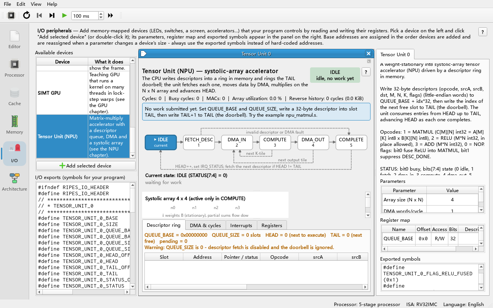
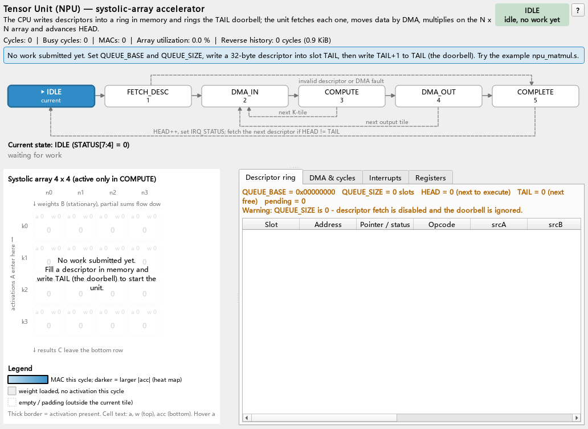
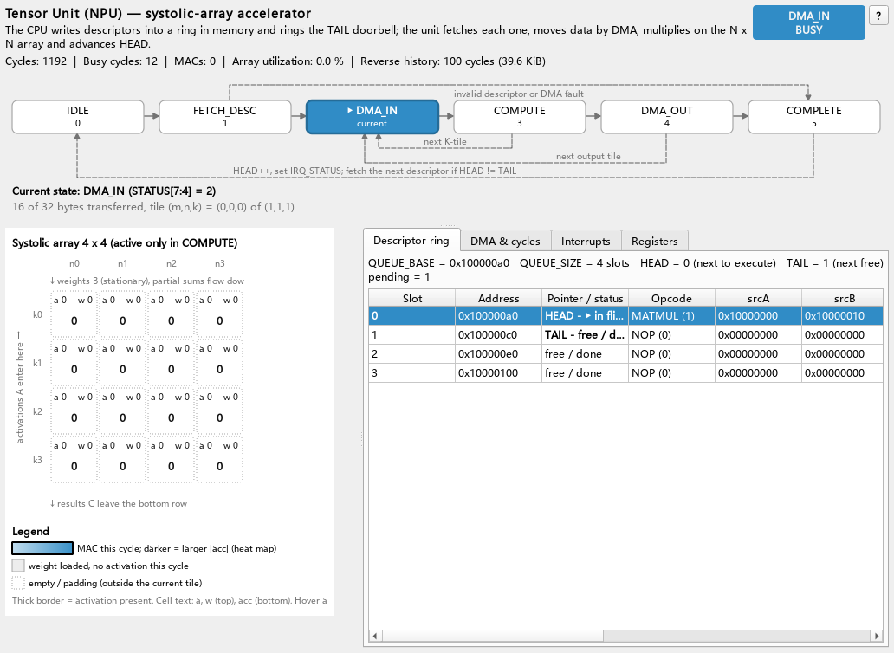
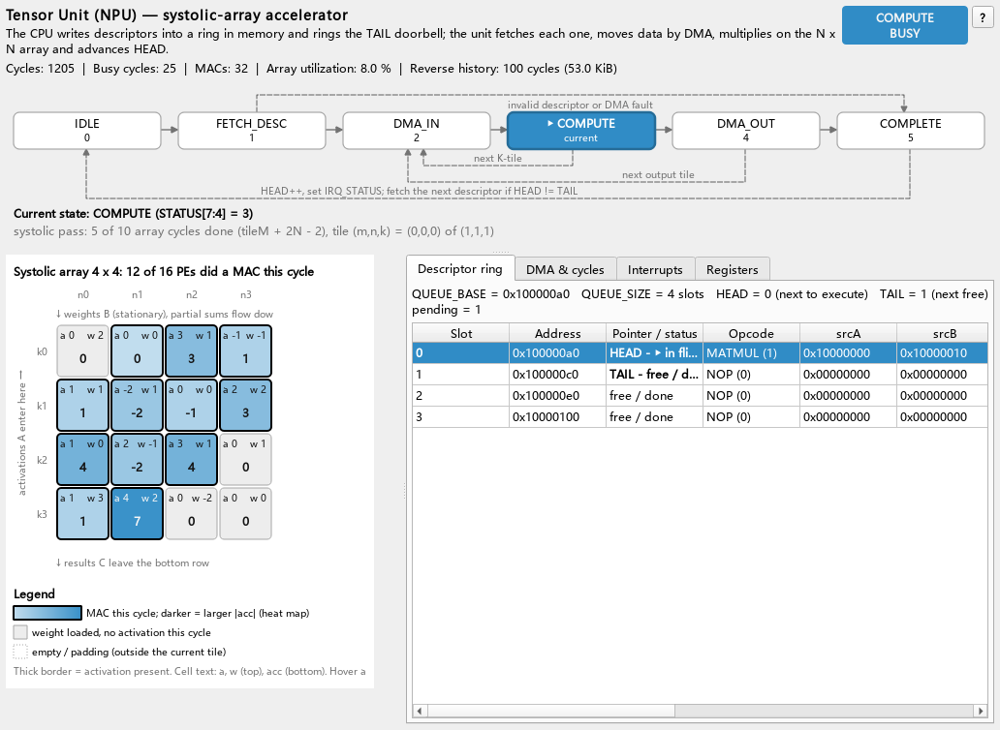
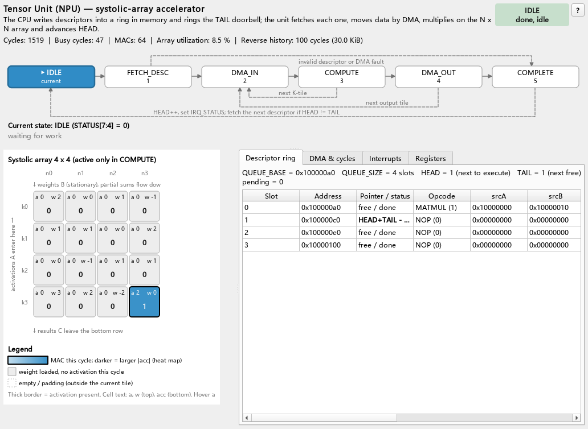

# 10 The Tensor Processor (NPU) and CPU Interaction

> **What you will learn**
>
> - Why matrix multiplication is handed to a separate accelerator (offload), and when it is not worth it;
> - How the CPU passes work to the accelerator through a **descriptor ring** in memory and a **doorbell** register;
> - How the accelerator's **DMA** engine moves data, and what each step of its internal **state machine** does and costs;
> - How to use the interrupt registers `IRQ_EN` / `IRQ_STATUS` (write-1-to-clear), and the limitation that "Ripes CPUs have no external interrupt input";
> - The int8 **systolic array** and the **weight-stationary** dataflow, worked through cycle by cycle on real 4×4 data;
> - How to step through `npu_matmul.s` (assembly) and `npu_matmul.c` (C) and read the CPU-cycle vs NPU-cycle comparison.
>
> **Prerequisites**
>
> - You can load examples, assemble, step and run (chapter 02) and read `lw`/`sw`/loops in RISC-V assembly (chapter 04);
> - You can add a peripheral in the **I/O** tab and use its exported symbols (chapter 08);
> - Chapter 09 (GPU) is recommended; this chapter compares the two accelerators;
> - You only need the definition of matrix multiplication `C[m][n] = Σ_k A[m][k]·B[k][n]`; no machine-learning background.

---

## 10.1 Why a separate accelerator

Matrix multiplication `C[M][N] = A[M][K] × B[K][N]` needs `M·N·K` multiply-accumulates (MACs). On a CPU every MAC goes through fetch, decode, two loads, a multiply, an add, address arithmetic and a loop test — in this chapter's example a 4×4×4 matrix multiply (64 MACs) takes **1129 cycles** on the 5-stage pipelined CPU, about 17.6 cycles per MAC.

An **accelerator** instead computes with a whole field of multipliers side by side and passes data directly between them for reuse, bypassing registers and instructions. This module's Tensor Unit (also called the **NPU**, Neural Processing Unit) has 4×4 = 16 multipliers by default, i.e. up to 16 MACs per cycle.

But an accelerator is not free: the CPU has to **describe** the task, the accelerator has to move the data in and out with its own **DMA**, and the CPU has to be **notified** at the end. These fixed costs decide "how big must a task be to be worth offloading" — the end of the chapter answers that with measured numbers.

**Arithmetic intensity** = operations per byte moved. An n×n×n int8 matrix multiply does n³ MACs and moves 2n² bytes in and 4n² bytes out, an intensity of about n/6. The bigger the matrix, the more dedicated hardware pays off; for small matrices most of the time goes into moving data (**memory-bound**, limited by memory bandwidth).

## 10.2 Overview of the peripheral

```
   RISC-V CPU                          Tensor Unit (NPU) peripheral TENSOR_UNIT_0_*
   ──────────                          ────────────────────────────────────────────
   sw descriptors → ring in memory      registers: QUEUE_BASE QUEUE_SIZE HEAD TAIL
   sw TAIL (doorbell) ───────────────►  STATUS IRQ_EN IRQ_STATUS CYCLES ...
   lw HEAD / IRQ_STATUS (polling) ◄───        │
                                              ▼
                                    ┌──────────────────────┐
                                    │ state machine IDLE → │
                                    │ FETCH_DESC → DMA_IN →│
                                    │ COMPUTE → DMA_OUT →  │
                                    │ COMPLETE             │
                                    └───┬──────────┬───────┘
                                        │          │
                              ┌─────────▼──┐   ┌───▼──────────────────┐
   memory ◄──────────────────►│ DMA engine │──►│ on-chip tile buffers │
   (descriptors, A, B, C)     └────────────┘   │ N×N systolic array   │
                         W words/cycle         │ (int8)               │
                                               └──────────────────────┘
```

Sources: model `src/accel/npu/tensorunit.*` (Qt-free cycle model), peripheral `src/io/iotensorunit.*`, design notes `docs/arch/tensor_cpu.md`, tests `test/tst_npu.cpp`, `test/tst_accel_e2e.cpp`.

Like the GPU, the NPU is driven by the CPU clock: **one NPU cycle for every CPU cycle**. While the CPU polls, the NPU really works in parallel.

## 10.3 Adding the peripheral and its parameters

**Do**: open the **I/O** tab and double-click **Tensor Unit (NPU)** in the **Available devices** list.

**You see**: a widget named **Tensor Unit 0** appears; the right-hand **Parameters**, **Register map** and **Exported symbols** panels describe it; `TENSOR_UNIT_0_*` symbols appear in **I/O exports**. Like the GPU widget, it is wider than the middle area of a 1280 × 800 window.



**Why**: as with every MMIO peripheral, creating it assigns an address range and exports symbols, so programs say `TENSOR_UNIT_0_TAIL`.

| Parameter (on-screen text) | Default | Range | Meaning |
|---|---|---|---|
| Array size (N x N) | 4 | 1–32 | side N of the systolic array (N×N multipliers) |
| DMA words/cycle | 1 | 1–64 | 32-bit words the DMA moves per cycle (bandwidth W) |
| PE cell size | 56 | 24–160 | drawing size of each PE square in the widget (pixels), display only |

> Changing Array size or DMA words/cycle reconfigures and resets the model. Beginners should start with N = 4 (or 2, which is easier to follow square by square).

The NPU widget:

| Area | Contents |
|---|---|
| Top | "Tensor Unit (NPU) — systolic-array accelerator" title + one-line description; the counters `Cycles | Busy cycles | MACs | Array utilization | Reverse history`; on the right a state badge (e.g. `IDLE` / `done, idle`, `DMA_IN` / `BUSY`) and "?", which opens this chapter |
| State-machine diagram | IDLE → FETCH_DESC → DMA_IN → COMPUTE → DMA_OUT → COMPLETE, current state highlighted; below it `Current state: <state> (STATUS[7:4] = n)` and a progress line such as `16 of 32 bytes transferred, tile (m,n,k) = (0,0,0) of (1,1,1)`, `weight load: k of 4 rows shifted in` or `systolic pass: k of n array cycles done` |
| Systolic array | `Systolic array 4 x 4` with N×N squares showing `a`, `w`, `acc`; a legend below |
| **Descriptor ring** tab | `QUEUE_BASE`, `QUEUE_SIZE`, `HEAD`, `TAIL`, pending count; one row per slot (**Slot**, **Address**, **Pointer / status**, **Opcode**, **srcA**, **srcB**, …) with the decoded descriptor fields |
| **DMA & cycles** tab | DMA direction and progress bar, cumulative DMA bytes and cycle counters |
| **Interrupts** tab | meaning and current value of the `IRQ_EN` / `IRQ_STATUS` bits |
| **Registers** tab | name + offset + current value + meaning |

PE squares: `a` and `w` in the top line, bold `acc` below. A thick border = the PE holds an activation this cycle; a blue fill = the PE did a MAC this cycle (darker = larger |acc|, a heat map); light grey = weight loaded, no activation this cycle; dotted = padding outside the current tile.

## 10.4 Register table

The base address is assigned by the I/O tab. `TENSOR_UNIT_0_<NAME>` is the absolute address, `TENSOR_UNIT_0_<NAME>_OFFSET` the offset.

| Offset | Name | R/W | Bits | Meaning |
|---|---|---|---|---|
| 0x00 | `QUEUE_BASE` | RW | 31:0 | byte address of the descriptor ring in memory |
| 0x04 | `QUEUE_SIZE` | RW | 31:0 | number of slots (32 bytes each); 0 = no descriptors are fetched. Writing it reduces HEAD/TAIL modulo the new size (writing 0 clears them) |
| 0x08 | `HEAD` | R | 31:0 | next slot the accelerator will process; +1 (mod `QUEUE_SIZE`) per completed descriptor |
| 0x0C | `TAIL` | RW | 31:0 | first empty slot after the last one filled by the CPU; **writing it is the doorbell**; the value is taken modulo `QUEUE_SIZE` |
| 0x10 | `STATUS` | R | bit0 `BUSY` | state is not IDLE |
| | | | bits 7:4 | state: 0 IDLE, 1 FETCH_DESC, 2 DMA_IN, 3 COMPUTE, 4 DMA_OUT, 5 COMPLETE |
| | | | bit8 `QUEUE_EMPTY` | HEAD == TAIL |
| | | | bit9 `ERROR` | the last descriptor was rejected (cleared when the next one is fetched) |
| | | | bit10 `WEIGHT_LOAD` | COMPUTE is loading weights |
| 0x14 | `IRQ_EN` | RW | 2:0 | interrupt enable, same bits as `IRQ_STATUS` |
| 0x18 | `IRQ_STATUS` | RW (W1C) | bit0 `DESC_DONE` | a descriptor completed (not with `NO_IRQ`) |
| | | | bit1 `QUEUE_EMPTY` | the queue became empty on completion |
| | | | bit2 `ERROR` | a descriptor was rejected |
| | | | | **writing 1 clears the bit, writing 0 has no effect** |
| 0x1C | `CYCLES` | R | 31:0 | cycles since reset (busy or not — a free timer) |
| 0x20 | `DMA_BYTES` | R | 31:0 | bytes moved by DMA (descriptors, inputs and outputs) |
| 0x24 | `MACS` | R | 31:0 | useful int8 MACs (padding zeros excluded) |
| 0x28 | `ARRAY_N` | R | 31:0 | array dimension N |
| 0x2C | `BUSY_CYCLES` | R | 31:0 | cycles in which the state was not IDLE |
| 0x30 | `CTRL` | W | bit0 `SOFT_RESET` | abort the current task, HEAD = TAIL = 0, clear `IRQ_STATUS`; keeps `QUEUE_*`, `IRQ_EN` and the counters |
| | | | bit1 `CLEAR_COUNTERS` | zero the counters |

Additional constant symbols (usable in C after `#include "ripes_system.h"`):

| Symbol | Value | Use |
|---|---|---|
| `TENSOR_UNIT_0_N` | N | array dimension |
| `TENSOR_UNIT_0_DESC_SIZE` | 32 | descriptor size in bytes |
| `_DESC_OPCODE/_SRCA/_SRCB/_DST/_M/_N/_K/_FLAGS` | 0/4/8/12/16/20/24/28 | descriptor field offsets |
| `_OP_NOP/_OP_MATMUL/_OP_RELU/_OP_ADD` | 0/1/2/3 | opcodes |
| `_FLAG_RELU_FUSED/_FLAG_NO_IRQ` | 1/2 | descriptor flags |
| `_STATUS_BUSY/_STATUS_QUEUE_EMPTY/_STATUS_ERROR` | 0x1/0x100/0x200 | STATUS bits |
| `_IRQ_DESC_DONE/_IRQ_QUEUE_EMPTY/_IRQ_ERROR` | 1/2/4 | IRQ bits |
| `_CTRL_SOFT_RESET/_CTRL_CLEAR_COUNTERS` | 1/2 | CTRL bits |

(The `TENSOR_UNIT_0` prefix is omitted in the table.)

## 10.5 Descriptors: a 32-byte work order

Why not simply have `SRCA`, `DST`, `M`… registers? Because then the CPU would have to wait for each task to finish before submitting the next. Writing a task as a **descriptor** in main memory that the accelerator fetches itself lets the CPU queue several tasks and go do something else — this is how real NIC, GPU and NPU drivers work.

Each descriptor is 8 little-endian 32-bit words at `QUEUE_BASE + slot × 32`:

| Offset | Field | MATMUL | RELU | ADD |
|---|---|---|---|---|
| +0 | `opcode` | 1 | 2 | 3 (0 = NOP, completes immediately) |
| +4 | `srcA` | address of A: M×K int8, row-major | input: M·N int32 | input 0: M·N int32 |
| +8 | `srcB` | address of B: K×N int8, row-major | ignored | input 1: M·N int32 |
| +12 | `dst` | address of C: M×N int32, row-major | output (may equal srcA, in place) | output |
| +16 | `M` | rows of A and C | M·N = element count | same |
| +20 | `N` | columns of B and C | | |
| +24 | `K` | columns of A = rows of B | ignored | ignored |
| +28 | `flags` | bit0 `RELU_FUSED`: apply ReLU before writing back; bit1 `NO_IRQ`: do not set `DESC_DONE` on completion | | |

Validation: the opcode must be 0–3; MATMUL needs M, N, K in [1, 4096]; RELU/ADD need M, N in [1, 4096]. An invalid descriptor is **rejected**: `STATUS.ERROR` and `IRQ_STATUS.ERROR` are set, but `HEAD` advances as usual — a bad descriptor does not jam the queue (`tst_invalidDescriptor`).

## 10.6 The descriptor ring, HEAD/TAIL and the doorbell

```
            QUEUE_BASE
            ┌──────┬──────┬──────┬──────┐      QUEUE_SIZE = 4
            │ slot0│ slot1│ slot2│ slot3│
            └──────┴──────┴──────┴──────┘
                      ▲             ▲
                    HEAD          TAIL
           (device processes next) (CPU fills next)
```

- **Empty**: `HEAD == TAIL`. Pending tasks = `(TAIL − HEAD) mod SIZE`.
- **Submit**: the CPU writes the descriptor into `slot[TAIL]` (ordinary `sw`), then writes `TAIL = (TAIL + 1) mod SIZE`. This write is the **doorbell** — it carries no data, it just "knocks": there is new work. An idle device leaves IDLE in the next cycle.
- **Full**: the classic "leave one slot empty" rule — stop submitting when `(TAIL + 1) mod SIZE == HEAD`. Otherwise, after filling all 4 slots TAIL equals HEAD again and the device thinks the queue is empty. **The hardware does not check this**; software must.
- **Wrap-around**: `tst_ringWraparound` submits slots 0 and 1 of a 3-slot ring (TAIL = 2), then slot 2 and slot 0 (TAIL written as 1) — HEAD goes 0→1→2→0→1.

## 10.7 The state machine

```
                 doorbell (HEAD != TAIL)
        ┌───────┐─────────────────────►┌────────────┐
        │ IDLE  │                      │ FETCH_DESC │  read 8 words: ceil(8/W) cycles
        └───────┘◄───┐                 └─────┬──────┘
                     │                       │ validate; failure → COMPLETE (sets ERROR)
                     │                       ▼
                     │                 ┌──────────┐   A/B tile (int8)
                     │            ┌───►│  DMA_IN  │   or an int32 chunk
                     │            │    └────┬─────┘
                     │            │         ▼
                     │            │    ┌──────────┐   weight load N cycles + array tileM+2N−2
                     │  next K tile    │ COMPUTE  │   (RELU/ADD: ceil(chunk/N) cycles)
                     │            └────┴────┬─────┘
                     │                      ▼ all K tiles of this output tile done
                     │                 ┌──────────┐
                     │ next output tile│ DMA_OUT  │   write back the C tile (int32)
                     │     → DMA_IN    └────┬─────┘
                     │                      ▼ everything done
                     │                 ┌──────────┐
                     └─────────────────│ COMPLETE │   1 cycle: HEAD++, set IRQ_STATUS
                                       └──────────┘
```

Each state advances cycle by cycle (numbers from `tensorunit.cpp`, W = DMA words/cycle):

| State | What it does | Cycles |
|---|---|---|
| IDLE | on `HEAD != TAIL` moves to FETCH_DESC; this cycle is not counted in `BUSY_CYCLES` | — |
| FETCH_DESC | reads 8 words from `QUEUE_BASE + HEAD×32` (32 bytes of DMA), validates | ceil(8 / W) |
| DMA_IN | moves in one A tile and one B tile (int8, 4 elements per word) | ceil(bytes / (4W)) |
| COMPUTE | shifts the B tile into the array row by row (N cycles), then streams A through diagonally (tileM + 2N − 2 cycles) | N + tileM + 2N − 2 |
| DMA_OUT | writes back the C tile (int32, 1 word per element), optionally with fused ReLU | ceil(elements / W) |
| COMPLETE | `HEAD = (HEAD+1) mod SIZE`, sets `DESC_DONE`/`ERROR`, and `QUEUE_EMPTY` if the queue is empty | 1 |

**Tiling**: the array is only N×N, so big matrices are processed in tiles: for each output tile `(mt, nt)`, all K tiles are processed in turn (one DMA_IN + one COMPUTE each, accumulating on chip), followed by one DMA_OUT. Edges smaller than N are padded with 0, and padding is not counted in `MACS`. The widget's `tile(m,n,k)=(…) of (…)` shows the current position.

## 10.8 The DMA engine

The accelerator **cannot** use the CPU's loads and stores. It has its own DMA (Direct Memory Access) engine that reads and writes main memory directly on the bus (in Ripes: the peripheral's `memRead/memWrite`). In this model the DMA moves at most `W` 32-bit words per cycle:

- a descriptor: 8 words;
- int8 matrix elements: 4 per word (A, B);
- int32 elements: 1 per word (C, RELU/ADD inputs and outputs).

Data volume of the 4×4×4 multiply: descriptor 32 B + A 16 B + B 16 B + C 64 B = **128 B** (`DMA_BYTES`, measured by `tst_accel_e2e`).

DMA_IN, COMPUTE and DMA_OUT run **one after another** (no double buffering), so for small matrices most of the time is spent moving data. Real accelerators use **double buffering** to overlap the transfer of the next tile with the computation of the current one — the PS3 SPE double buffering in chapter 13 is the same idea.

> Memory coherence: on a real SoC the descriptors and matrices written by the CPU may still sit in its caches, so before ringing the doorbell you must flush them and execute a fence; before reading results you must invalidate. Ripes' cache simulation is only a statistics model over a single coherent memory, so none of this is needed here (the comments in the examples mark where a real SoC would need it).

## 10.9 Completion: polling vs interrupts

**Polling**: the CPU reads a register in a loop until the task is complete. Possible conditions:

| What to read | Condition | Assessment |
|---|---|---|
| `HEAD` | `HEAD == the TAIL I wrote` | recommended: exactly "everything I submitted is done" (used by the examples) |
| `IRQ_STATUS` | `DESC_DONE` bit is 1 | fine, but remember to write 1 to clear it |
| `STATUS` | `BUSY` is 0 | a trap: the device leaves IDLE only in the cycle after the doorbell, so reading `BUSY = 0` too early looks like "done"; there are also IDLE cycles between descriptors |

**Interrupts**: the CPU sets bits in `IRQ_EN` and does other work; on completion `IRQ_STATUS` is set, and if `IRQ_STATUS & IRQ_EN != 0` the interrupt line is active and the CPU jumps into the interrupt service routine (ISR). The ISR must **write 1 to clear** the bits it handled (W1C, write-1-to-clear); otherwise the line stays active and the CPU re-enters the ISR immediately after leaving it (an "interrupt storm"). W1C lets the ISR clear only the bits it handled without accidentally clearing events that arrived meanwhile.

`IRQ_STATUS` has level semantics: completion events are recorded even while `IRQ_EN` is 0; enabling `IRQ_EN` later makes a pending interrupt take effect immediately (verified by `tst_irqW1C`).

> **Important limitation**: Ripes' RISC-V processor models have **no external interrupt input**, so the NPU interrupt **never actually interrupts the CPU**. The state of the interrupt line is only shown on the widget (`[IRQ PENDING]` / "IRQ pending"), and a program can "emulate" an ISR by reading `IRQ_STATUS`. The end of the example program shows this: it reads `IRQ_STATUS` = 3 and then writes 1s to clear it.

```c
/* If the CPU had interrupts: a typical ISR */
void npu_isr(void) {
    unsigned st = REG(TENSOR_UNIT_0_IRQ_STATUS);
    if (st & TENSOR_UNIT_0_IRQ_DESC_DONE) {
        REG(TENSOR_UNIT_0_IRQ_STATUS) = TENSOR_UNIT_0_IRQ_DESC_DONE;  /* clear only this bit */
        done_count++;
    }
    if (st & TENSOR_UNIT_0_IRQ_ERROR) {
        REG(TENSOR_UNIT_0_IRQ_STATUS) = TENSOR_UNIT_0_IRQ_ERROR;
        handle_error();
    }
}
```

**Interrupt coalescing**: when submitting several descriptors at once, set `NO_IRQ` on all but the last so only the last one raises `DESC_DONE`, reducing the number of interrupts. Exercise 2 tries this.

## 10.10 The systolic array and the weight-stationary dataflow

### 10.10.1 Structure

```
            n0        n1        n2        n3        ← columns (columns of C)
         ┌───────┐ ┌───────┐ ┌───────┐ ┌───────┐
 a[m][0]→│PE(0,0)│→│PE(0,1)│→│PE(0,2)│→│PE(0,3)│   row k0 (holds B[0][*])
         └───┬───┘ └───┬───┘ └───┬───┘ └───┬───┘
             ↓psum     ↓         ↓         ↓
         ┌───────┐ ┌───────┐ ┌───────┐ ┌───────┐
 a[m][1]→│PE(1,0)│→│PE(1,1)│→│PE(1,2)│→│PE(1,3)│   row k1 (holds B[1][*])
         └───┬───┘ └───┬───┘ └───┬───┘ └───┬───┘
             ↓         ↓         ↓         ↓
                     … (rows k2, k3) …
             ↓         ↓         ↓         ↓
          C[m][0]   C[m][1]   C[m][2]   C[m][3]      ← results leave at the bottom
```

Every cycle each PE (processing element) computes `acc = psum_in + a × w`, where

| Value | Meaning |
|---|---|
| `w` | the **stationary weight**: one element `B[k][n]`, fixed while one K tile is computed |
| `a` | the activation (an element of A) passing through the PE this cycle; handed to the right next cycle |
| `acc` | this cycle's partial sum: the upper PE's `acc` of the previous cycle plus `a × w`; handed downwards next cycle |

"**Weight-stationary**": the weights are loaded into the array and stay put; activations flow left to right and partial sums flow top to bottom. Each weight is reused by M rows of activations without being read from memory again — this data reuse is where an accelerator saves bandwidth.

**Weight loading**: during the first N cycles of COMPUTE the B tile is pushed in at the top row by row and shifts downwards: in cycle 0 row N−1 of B is placed at the top; next cycle it moves down one row and row N−2 is placed at the top, and so on. After N cycles PE(k, n) holds B[k][n]. On the widget you see `w` dropping down row by row; the `WEIGHT_LOAD` bit of STATUS is 1.

**Skewed injection**: `A[m][k]` enters the left end of row k in cycle `t = m + k` and reaches PE(k, n) at `t = m + k + n`; the bottom of column n emits `C[m][n]` at `t = m + (N−1) + n`. Why skewed: a psum takes one cycle to move from PE(k−1,n) to PE(k,n), so `A[m][k]` must arrive in a column one cycle after `A[m][k−1]`. One tile takes `tileM + 2N − 2` cycles from the first activation entering to the last result leaving.

### 10.10.2 A 4×4 multiply worked through with the example data

The data in `npu_matmul.s`:

```
A = [ 1  2  3  4 ]      B = [ 2  0  1 -1 ]
    [-1  0  2  1 ]          [ 1  1  0  2 ]
    [ 3 -2  1  0 ]          [ 0 -1  1  1 ]
    [ 0  1 -1  2 ]          [ 3  2 -2  0 ]
```

The result (computed by hand; you can check it against the CPU version in the example):

```
C = [ 16  7 -4  6 ]
    [  1  0 -1  3 ]
    [  4 -3  4 -6 ]
    [  7  6 -5  1 ]
```

**Following C[0][0] down column 0** (t counts from the end of weight loading):

| t | Where | Computation | acc |
|---|---|---|---|
| 0 | PE(0,0), a = A[0][0] = 1, w = B[0][0] = 2 | 0 + 1×2 | 2 |
| 1 | PE(1,0), a = A[0][1] = 2, w = B[1][0] = 1 | 2 + 2×1 | 4 |
| 2 | PE(2,0), a = A[0][2] = 3, w = B[2][0] = 0 | 4 + 3×0 | 4 |
| 3 | PE(3,0), a = A[0][3] = 4, w = B[3][0] = 3 | 4 + 4×3 | **16** = C[0][0], leaves at the bottom |

**When each result leaves the array** (`t = m + 3 + n`):

| t | Elements leaving at the bottom this cycle |
|---|---|
| 3 | C[0][0] |
| 4 | C[1][0], C[0][1] |
| 5 | C[2][0], C[1][1], C[0][2] |
| 6 | C[3][0], C[2][1], C[1][2], C[0][3] |
| 7 | C[3][1], C[2][2], C[1][3] |
| 8 | C[3][2], C[2][3] |
| 9 | C[3][3] |

That is 10 cycles (= 4 + 2×4 − 2); with 4 cycles of weight loading COMPUTE takes 14 cycles for 64 MACs. Ideally 16 PEs at 16 MACs per cycle would need only 4 cycles — the ramp-up and drain time of filling and emptying the array is why systolic arrays have low utilisation on small matrices.

> To see it more clearly: set **Array size** to 2, write your own 2×2×2 descriptor (or follow the 2×2 cycle-by-cycle walk-through in `docs/arch/tensor_cpu.md` §2.3) and step through, watching every square.

## 10.11 Stepping through `npu_matmul.s` (assembly)

Example: **File → Load Example... → Assembly → npu_matmul.s** (`examples/assembly/npu_matmul.s`). It first computes the 4×4×4 multiply on the CPU (timed with the NPU's `CYCLES`), then offloads it to the NPU and compares the two results.

### Step 1: preparation

**Do**: add a **Tensor Unit (NPU)** in the **I/O** tab (default N = 4, W = 1), load the example and assemble it.

**You see**: the widget shows `Current state: IDLE (STATUS[7:4] = 0)` and the badge `IDLE` / `idle, no work yet`; the **Descriptor ring** tab shows `QUEUE_BASE = 0x00000000  QUEUE_SIZE = 0 slots  HEAD = 0  TAIL = 0` with a warning that QUEUE_SIZE is 0, and the array area shows the hint "No work submitted yet."



### Step 2: CPU reference computation

**Do**: **Run** (F8) to a breakpoint at `la t0, ring` (section 2, "Configure the descriptor ring").

**You see**: `cycles=` keeps growing, `busy=0`.

**Why**: `CYCLES` increments every CPU cycle regardless of whether the NPU is busy, so the program uses it to time the CPU code: `s2 = CYCLES(end) − CYCLES(start)`.

### Step 3: configure the ring and fill the descriptor

**Do**: step (**Clock**, F5) through the configuration and descriptor `sw`s.

**You see**: in the register table `QUEUE_BASE` = address of `ring`, `QUEUE_SIZE` = 4, `IRQ_EN` = 0. The following 8 `sw`s write to `ring` in **main memory** (the 32 bytes are visible in the **Memory** tab); the NPU registers do not change and the state stays IDLE.

**Why**: the descriptor is in ordinary memory; the NPU does not know it exists yet. Only the doorbell tells it.

### Step 4: the doorbell

**Do**: execute `sw t2, 0(t1)` (`TAIL = 1`) and step a few more cycles.

**You see**: `TAIL = 1`; in the next cycle the state becomes `FETCH_DESC`; 8 cycles later slot 0 of the **Descriptor ring** tab shows the decoded descriptor (`HEAD - in flight`, opcode `MATMUL (1)`, `srcA`, `srcB`, …), the state is `DMA_IN` and the progress line counts up to `32 of 32 bytes transferred, tile (m,n,k) = (0,0,0) of (1,1,1)` (the **DMA & cycles** tab shows the same progress as a bar, blue = inbound).



**Why**: with W = 1, fetching an 8-word descriptor takes 8 cycles; A and B are 16 bytes of int8 each = 8 words = 8 cycles.

### Step 5: weight loading and computation

**Do**: keep stepping.

**You see**: the state is `COMPUTE` with the progress line `weight load: k of 4 rows shifted in`: the rows of B drop into the array from the top (light grey squares = weight loaded). After 4 cycles it shows `systolic pass: k of 10 array cycles done`: the `a` values flow diagonally from left to right (thick border; the PEs that did a MAC are filled blue) and `acc` accumulates downwards; at the bottom of column 0 the `acc` values 16, 1, 4, 7 appear one after another — exactly column 0 of C.



**Why**: see 10.10. The widget's `k of 10 array cycles done` counts the array cycles already completed, so k is one higher than t in the table above.

### Step 6: write-back and completion

**Do**: keep stepping, or press **Run** (F8).

**You see**: during `DMA_OUT` the progress bar turns orange (on-chip → memory) and grows from `0 / 64 B` to `64 / 64 B` in 16 cycles; then one cycle of `COMPLETE`, `head=1`, back to `IDLE`; `IRQ_STATUS=0x3` (DESC_DONE | QUEUE_EMPTY). Because `IRQ_EN = 0`, no IRQ pending is shown. The CPU's polling loop sees `HEAD == 1` and exits.

Console output (measured by `test/tst_accel_e2e.cpp` on the RV32_5S + M processor):

```
Tensor Unit matmul demo (4x4x4 int8)
CPU matmul cycles: 1129
NPU wall cycles:   60
NPU busy cycles:   47
NPU DMA bytes:     128
NPU MACs:          64
Result: OK
```

The whole program runs for 1520 CPU cycles.



**Why busy = 47**:

| Phase | Cycles | Computation |
|---|---|---|
| FETCH_DESC | 8 | 32 B / 4 B per cycle |
| DMA_IN | 8 | (16 + 16) B / 4 B |
| COMPUTE | 14 | 4 (weight load) + 4 + 2×4 − 2 |
| DMA_OUT | 16 | 16 int32 / 1 word per cycle |
| COMPLETE | 1 | |
| **Total** | **47** | |

**wall = 60** is the time from the CPU reading `CYCLES` before the doorbell to reading it again after seeing `HEAD == 1`: 47 busy cycles plus the few instructions around the doorbell, the 1 IDLE cycle after the doorbell, and the delay until the polling loop notices the HEAD change.

## 10.12 The C version `npu_matmul.c`

Example: **File → Load Example... → C → npu_matmul.c** (`examples/C/npu_matmul.c`). Configure a RISC-V GCC in **Edit → Settings → Compiler** first and add `-nostdlib` to the compiler arguments (see chapter 05). It multiplies 6×5 by 5×4 (M = 6, K = 5, N = 4).

The key code:

```c
#define REG(addr) (*(volatile unsigned *)(addr))

static unsigned submit(unsigned tail, unsigned opcode, const void *srcA,
                       const void *srcB, void *dst, unsigned m, unsigned n,
                       unsigned k, unsigned flags) {
    volatile unsigned *d = ring[tail];
    d[D_OPCODE] = opcode;  d[D_SRCA] = (unsigned)srcA;
    d[D_SRCB] = (unsigned)srcB;  d[D_DST] = (unsigned)dst;
    d[D_M] = m;  d[D_N] = n;  d[D_K] = k;  d[D_FLAGS] = flags;
    tail = (tail + 1) % RING_SLOTS;
    REG(TENSOR_UNIT_0_TAIL) = tail;      /* doorbell */
    return tail;
}

static unsigned wait_head(unsigned tail) {
    unsigned polls = 0;
    while (REG(TENSOR_UNIT_0_HEAD) != tail) polls++;   /* polling */
    return polls;
}
```

What `volatile` does: it stops the **compiler** from moving the descriptor stores after the doorbell or optimising away the reads in the polling loop. (A real CPU also needs a fence to stop the **hardware** from reordering; Ripes processors execute in order.)

The program does two things:

1. submits one MATMUL descriptor, polls for completion, prints `NPU wall cycles`, `NPU busy cycles`, `NPU DMA bytes`, `NPU MACs`, `CPU polls`, and compares with the CPU result;
2. submits a **RELU** descriptor that zeroes the negative entries of the result in place (`srcA == dst`) — "chaining two layers".

From the model (`docs/arch/tensor_cpu.md` §4.1, N = 4, W = 1): the 6×4×5 MATMUL needs 2 M tiles × 2 K tiles, 103 busy cycles (FETCH 8 + DMA_IN 18 + COMPUTE 52 + DMA_OUT 24 + COMPLETE 1), 198 DMA bytes, 120 MACs. The CPU cycle count depends on the compiler version and optimisation level (to be verified).

## 10.13 CPU cycles vs NPU cycles: what offload teaches

Measured for 4×4×4:

| | Cycles | Note |
|---|---|---|
| CPU triple loop | 1129 | 64 MACs, ~17.6 cycles each |
| NPU wall clock (incl. submission and polling) | 60 | ~18.8× faster |
| NPU busy cycles | 47 | only 14 of them compute on the array |
| Array utilisation | 64 / (47 × 16) ≈ 8.5% | |

Busy cycles of the model in other configurations (from `docs/arch/tensor_cpu.md` §4.1, computed with the same model):

| Configuration | FETCH | DMA_IN | COMPUTE | DMA_OUT | COMPLETE | Total | Utilisation |
|---|---|---|---|---|---|---|---|
| N=4, W=1, 4×4×4 | 8 | 8 | 14 | 16 | 1 | 47 | 8.5% |
| N=4, W=4, 4×4×4 | 2 | 2 | 14 | 4 | 1 | 23 | 17.4% |
| N=4, W=1, 8×8×8 | 8 | 64 | 112 | 64 | 1 | 249 | 12.9% |
| N=8, W=1, 8×8×8 | 8 | 32 | 30 | 64 | 1 | 135 | 5.9% |
| N=8, W=4, 8×8×8 | 2 | 8 | 30 | 16 | 1 | 57 | 14.0% |

What these numbers teach:

1. **Moving data costs more than computing**: 33 of the 47 cycles of 4×4×4 fetch descriptors and move data. Raising DMA bandwidth from 1 to 4 words/cycle cuts the total from 47 to 23 without saving a single compute cycle — typical memory-bound behaviour.
2. **Amdahl's law**: for 8×8×8, going from a 4×4 to an 8×8 array quadruples compute and cuts COMPUTE from 112 to 30, but the total only drops from 249 to 135 because the DMA is no faster.
3. **A big array starves**: the 8×8 array has lower utilisation on 8×8×8 (5.9%) than the 4×4 array (12.9%). This is why inference frameworks fuse small operators into big ones.
4. **Fixed costs set the minimum offload size**: submitting a descriptor (8 CPU stores + doorbell), fetching it (8 cycles), weight loading and array ramp time, and polling latency do not depend on the matrix size. For tiny matrices (e.g. 2×2, 8 MACs, one or two hundred CPU cycles) offload gains almost nothing.
5. **The CPU can do other work meanwhile**: during the 60 wall-clock cycles the CPU only polls. If it instead "submits → does other work → checks later", the accelerator time can be hidden completely.

## 10.14 Limitations

- **The CPU has no external interrupt input**: interrupts can only be observed (widget, reading `IRQ_STATUS`); they never interrupt the CPU.
- **No reverse execution of the accelerator**: the processor's **Reverse** (F4) does not rewind the NPU. With the PLAN2 §6(9) fix, a reverse step either restores a snapshot or resets the NPU to "before launch" with a notice on the widget (which one is to be verified). To start over use **Reset** (F3) — a processor reset fully resets the NPU (counters included).
- **The CLI cannot instantiate peripherals**: the NPU examples run only in the GUI (or the QTest tests).
- Registers and descriptor fields are 32 bits; on RV64 processors addresses must lie in the low 4 GB.
- DMA_IN / COMPUTE / DMA_OUT are serial, no double buffering; no requantisation (results are int32).
- Pointing a descriptor or `QUEUE_BASE` at the NPU's own register block causes trouble (phase 1 may deadlock, being fixed, PLAN2 §6(2)) — don't do it.

## 10.15 Troubleshooting

| Symptom | Cause and fix |
|---|---|
| TAIL was written but the state stays IDLE | `QUEUE_SIZE` is 0; or TAIL was written with HEAD's value (e.g. all slots filled so TAIL wrapped onto HEAD) |
| `STATUS.ERROR` / `IRQ_STATUS.ERROR` set | opcode not 0–3, or M/N/K zero or above 4096 |
| results wrong but no error | `srcA/srcB` wrong (e.g. A not int8 row-major); C's `dst` overlaps an input (MATMUL is not in-place) |
| polling `STATUS.BUSY` exits immediately | the device leaves IDLE only in the cycle after the doorbell; poll `HEAD` instead |
| `IRQ_STATUS` never clears | you wrote 0; you must write 1 to the bits to clear |
| counters do not start at 0 on a second run | counters are cleared only by reset or `CTRL.CLEAR_COUNTERS`; take differences like the example |

## 10.16 Exercises

**Exercise 1 (reading the state)**: what is `STATUS` in busy cycles 1, 5, 12 and 25 after the doorbell? (N = 4, W = 1, 4×4×4.)

<details><summary>Answer</summary>

Busy cycles 1–8 are FETCH_DESC (state 1), 9–16 DMA_IN (2), 17–30 COMPUTE (3, weight loading in 17–20), 31–46 DMA_OUT (4), 47 COMPLETE. In all of them `BUSY` = 1 and `QUEUE_EMPTY` = 0 (HEAD 0 ≠ TAIL 1).

- cycles 1 and 5: FETCH_DESC → `0x1 | (1<<4)` = `0x11`;
- cycle 12: DMA_IN → `0x21`;
- cycle 25: COMPUTE with weights loaded → `0x31` (`0x431` during weight loading).

("Cycle k" means the number of busy cycles the state machine has completed when the register is read; which one a `lw` sees depends on its timing.)

</details>

**Exercise 2 (batching + interrupt coalescing)**: submit two descriptors with one doorbell: slot 0 is MATMUL (`flags = NO_IRQ`), slot 1 applies RELU to the result in place. What is `IRQ_STATUS` at the end? Roughly how many busy cycles?

<details><summary>Answer</summary>

Complete program: `examples/assembly/exercise_npu_batch.s` (Examples menu name `exercise_npu_batch.s`, once added to the resource file). Key points:

```asm
        li   t1, TENSOR_UNIT_0_FLAG_NO_IRQ
        sw   t1, TENSOR_UNIT_0_DESC_FLAGS(t0)    # slot 0: no DESC_DONE
        ...                                       # slot 1: RELU, srcA = dst = C, M = N = 4
        li   t1, TENSOR_UNIT_0_TAIL
        li   t2, 2
        sw   t2, 0(t1)                            # one doorbell, two tasks
        li   t1, TENSOR_UNIT_0_HEAD
poll:   lw   t4, 0(t1)
        bne  t4, t2, poll                         # wait for HEAD == 2
```

- When slot 0 completes: `NO_IRQ` → no `DESC_DONE`; HEAD = 1 ≠ TAIL = 2 → no `QUEUE_EMPTY`.
- When slot 1 completes: `DESC_DONE` is set and HEAD = TAIL = 2 → `QUEUE_EMPTY` is set.
- So `IRQ_STATUS = 3`: one "interrupt" for the whole batch.
- Busy cycles (derived from the model, to be verified in the GUI): MATMUL 47 + RELU (FETCH 8 + DMA_IN 16 words 16 + COMPUTE ceil(16/4) = 4 + DMA_OUT 16 + COMPLETE 1 = 45) = 92. The 1 IDLE cycle between the descriptors is not a busy cycle.
- Result: `relu(C)` = 16 7 0 6 / 1 0 0 3 / 4 0 4 0 / 7 6 0 1; the program compares with its `EXP` table and prints `Result: OK`.

</details>

**Exercise 3 (chaining layers in one descriptor)**: exercise 2 computes `relu(A × B)` with two descriptors. How can one descriptor do it, and what is gained?

<details><summary>Answer</summary>

Set `flags = TENSOR_UNIT_0_FLAG_RELU_FUSED` (1) in the MATMUL descriptor. The ReLU is applied during the DMA_OUT write-back, saving the second descriptor fetch (8 cycles), moving C back in (16), computing (4) and writing it out again (16) — busy cycles drop from 92 to 47. This is "operator fusion": putting element-wise operations into the write-back path saves a round trip through memory.

</details>

**Exercise 4 (full ring)**: `QUEUE_SIZE = 4`, HEAD = TAIL = 0. What happens if the CPU fills all 4 slots and writes `TAIL = 4`? How many can be submitted back to back at most?

<details><summary>Answer</summary>

`TAIL` is taken modulo `QUEUE_SIZE`: `4 mod 4 = 0`, so HEAD == TAIL, the device considers the queue empty and does nothing. At most 3 can be submitted (one slot stays empty): stop and wait when `(TAIL + 1) mod SIZE == HEAD`.

</details>

**Exercise 5 (bad descriptor)**: write opcode 9 into a descriptor and ring the doorbell. What do you observe? Does the queue get stuck?

<details><summary>Answer</summary>

After the 8 FETCH_DESC cycles validation fails and the unit goes straight to COMPLETE: `STATUS.ERROR` (bit9) and `IRQ_STATUS.ERROR` (bit2) are set, `DESC_DONE` is not; HEAD still increments, so the queue does not get stuck and later descriptors run normally. `MACS` is unchanged.

</details>

**Exercise 6 (bandwidth)**: set **DMA words/cycle** to 4 and run `npu_matmul.s` again. Predict `NPU busy cycles`.

<details><summary>Answer</summary>

FETCH ceil(8/4) = 2, DMA_IN 32 B / 16 B = 2, COMPUTE still 14, DMA_OUT 16 / 4 = 4, COMPLETE 1: total **23** (matching the `docs/arch/tensor_cpu.md` table). The CPU's 1129 cycles are unchanged; the wall-clock cycles drop accordingly.

</details>

**Exercise 7 (when offload does not pay)**: on a 4×4 array with W = 1, how many busy cycles does a 1×1×1 MATMUL take? How many cycles does one MAC take on the CPU? Conclusion?

<details><summary>Answer</summary>

FETCH 8 + DMA_IN ceil(2 B / 4 B) = 1 + COMPUTE 4 + (1 + 8 − 2) = 11 + DMA_OUT 1 + COMPLETE 1 = **22** busy cycles, plus the CPU writing the 8-word descriptor, the doorbell and polling. The CPU does one MAC in a dozen or so cycles (4×4×4 averaged 17.6 cycles/MAC). Conclusion: the fixed costs dwarf the computation; small tasks should stay on the CPU.

</details>

## 10.17 Summary

- The CPU writes a task as a 32-byte descriptor into a ring in memory and rings the doorbell by writing `TAIL`; the accelerator fetches the descriptor, DMAs inputs in, computes, DMAs results out and increments `HEAD`.
- Completion can be polled (poll `HEAD`, recommended) or signalled by interrupt (`IRQ_EN` + write-1-to-clear `IRQ_STATUS`); Ripes CPUs have no external interrupt input, so interrupts can only be observed.
- Weight-stationary systolic array: weights stay, activations flow right, partial sums flow down; skewed injection makes each column accumulate at the right moment; small matrices are limited by fill/drain time.
- The 4×4×4 example: CPU 1129 cycles vs NPU wall clock 60 cycles (47 busy, of which only 14 compute). Data movement and fixed costs dominate small tasks; bandwidth, operator fusion and batching are the ways to improve.

See chapter 17 for terms; the PS3 SPE double buffering (chapter 13) shows another way of overlapping DMA with computation.
