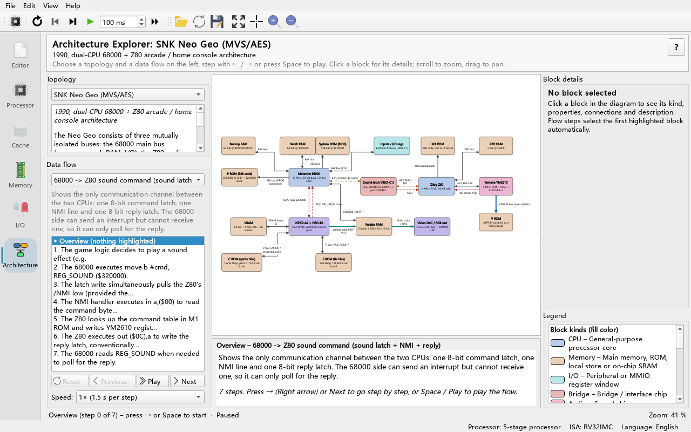
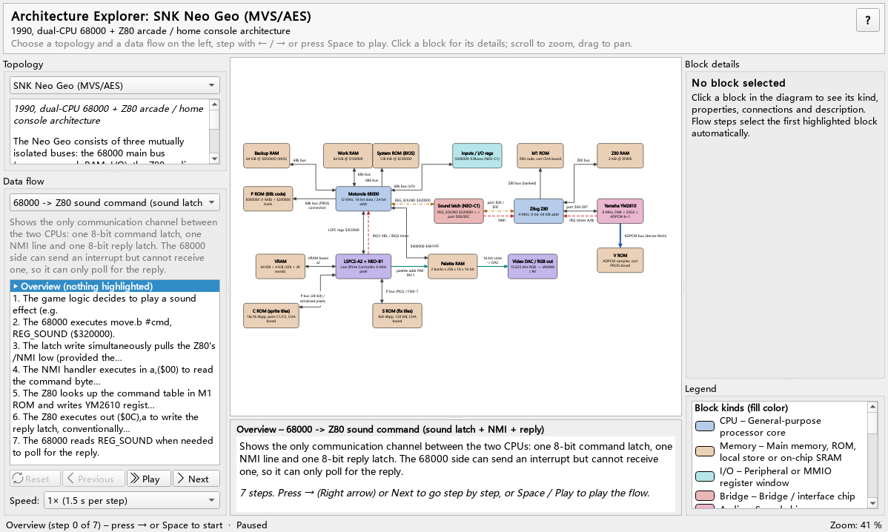
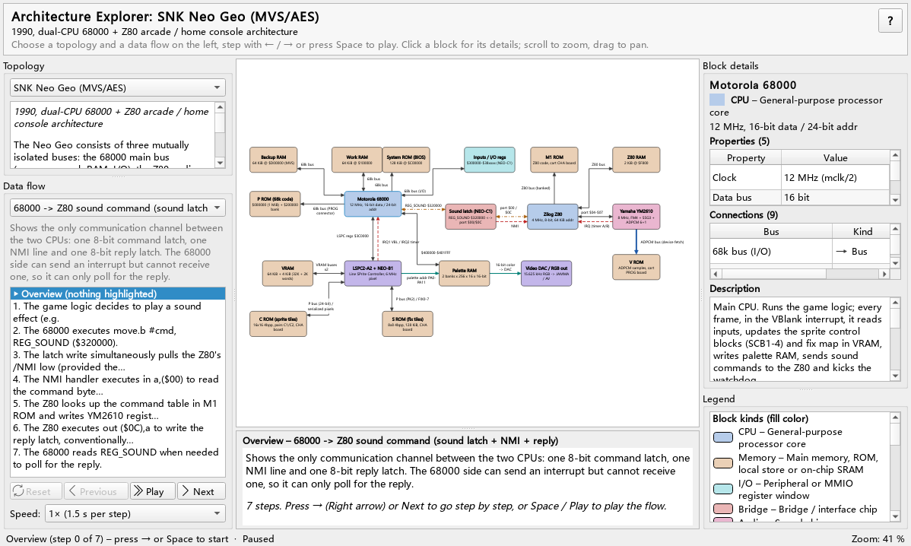
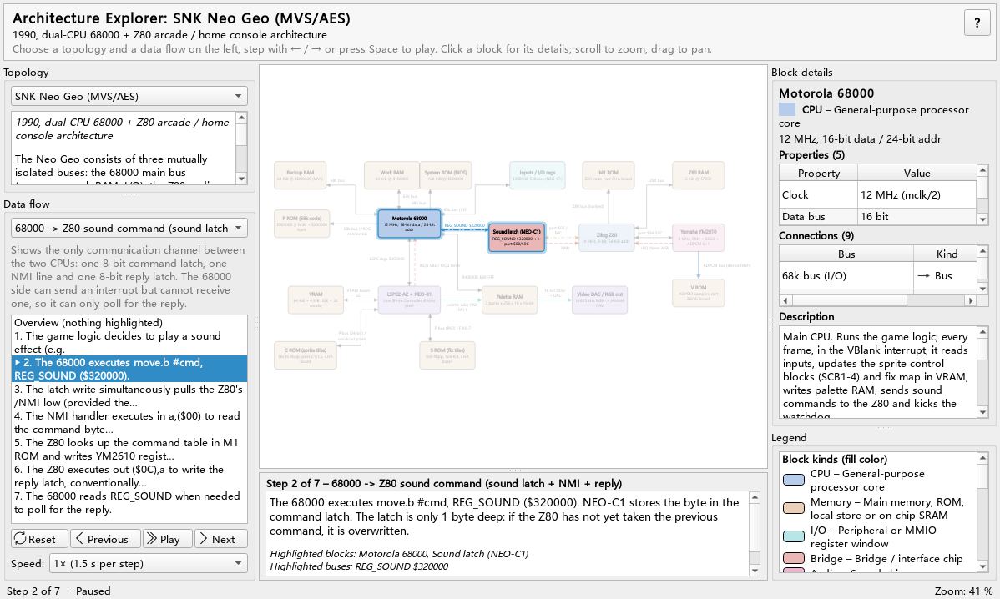

# 11 Architecture Explorer

> **What you will learn**
>
> - What a "topology" is, and how the Architecture Explorer differs from Ripes' processor simulation;
> - How to choose a built-in topology and read the colours and line styles of blocks and buses;
> - How to step through or play a data flow, and what changes on screen at each step;
> - How to zoom, pan, fit to the window, inspect block details and connections, and export a picture;
> - Which chapters of this guide each of the four built-in topologies belongs to.
>
> **Prerequisites**
>
> - You can start Ripes (chapters 01 and 02) and know the tab bar on the left of the main window (chapter 03).
> - No assembly knowledge is needed: this chapter only uses the mouse and keyboard to browse diagrams.

---

## 11.1 What the Architecture Explorer is

Ripes' **Processor** tab simulates a real RISC-V core that executes instructions: every clock cycle and every signal is *computed*. The **Architecture** tab is different. It runs no program at all; it is a **JSON-driven block diagram and data-flow presenter**:

- A **topology** is one JSON file. It describes which **blocks** a machine is made of (CPU, memory, DMA, GPU, ...) and which **buses** (connections) join them;
- A topology may also contain several **flows**. A flow is a list of **steps**; each step says "who hands which data to whom over which line" and highlights the blocks and buses involved.

Think of it as an "animated textbook figure": first look at the overall structure, then follow the data one step at a time. The text and highlights of a flow are written by the author, not simulated, so the explorer is good for explaining **system-level** structure (buses, DMA, interrupts, mailboxes), while cycle-level detail is still observed in the Processor tab and the I/O peripherals.

The text in the topologies is bilingual: with a Chinese UI you see Chinese titles and explanations, with an English UI English ones.

## 11.2 Opening the tab

**Do**: click the bottom-most **Architecture** icon in the tab bar on the left of the main window.

**What you see**:

| Area | Content |
|---|---|
| Header | Title of the current topology (large, bold), its subtitle and a one-line usage hint; the **?** button on the far right opens this chapter |
| Left, top: **Topology** | Topology drop-down; below it the topology's overall introduction |
| Left, bottom: **Data flow** | Data-flow drop-down; the **step list**; the four buttons **Reset / Previous / Play / Next**; the **Speed:** drop-down |
| Centre | The diagram on top; below it the **current-step panel** (step title + explanation) |
| Right, top: **Block details** | Title and kind of the selected block, the **Properties** table, the **Connections** table and the **Description** |
| Right, bottom: **Legend** | Block kinds, bus kinds and highlight styles used by this topology |
| Bottom status row | Current topology / flow / step / playback state, and the zoom level on the right (`Zoom: 100 %`) |

The toolbar (visible only while the Architecture tab is active) has buttons for opening, reloading, exporting, zooming and stepping; see sections 11.6–11.8.

**Why**: the left decides *what* to look at, the centre is where you *look* and *read the explanation*, and the right gives *details* and *what the colours mean*. The areas are separated by draggable splitters; when the window shrinks the diagram keeps the space, and splitter positions you set are remembered.

## 11.3 Choosing a built-in topology

**Do**: click the drop-down under **Topology** in the left column. Hover over an entry to see its subtitle.

**What you see**: five built-in topologies, real machines first and the template last:

| Title in the drop-down (English UI) | File | Size | Content |
|---|---|---|---|
| Sony PlayStation 3 / Cell Broadband Engine | `resources/arch/ps3.json` | 16 blocks / 21 buses / 4 flows | Heterogeneous Cell + RSX (chapter 13) |
| SNK Neo Geo (MVS/AES) | `resources/arch/neogeo.json` | 18 / 21 / 3 | 1990 dual-CPU arcade machine (chapter 12) |
| Host CPU + SIMT GPU (system view) | `resources/arch/gpu_system.json` | 11 / 13 / 2 | System view of host + SIMT GPU (goes with chapter 09) |
| Host CPU + tensor unit (...) | `resources/arch/npu_system.json` | 10 / 14 / 2 | Host + systolic-array NPU (goes with chapter 10) |
| Example: minimal system | `resources/arch/example_minimal.json` | 3 / 2 / 1 | Minimal template for authoring (chapter 14) |

With a Chinese UI the titles are shown in Chinese (e.g. "示例：最小系统"). Files opened with **Open architecture JSON...** come after these, with the file name after the title (chapter 14).

After choosing an entry:

1. the canvas shows the new topology and fits it to the window;
2. the header shows the topology title and subtitle, and the left column shows the introduction (plus a count of blocks, buses and data flows);
3. the **Data flow** drop-down is filled with this topology's flows and **the first one is selected automatically**; the step list stands on row 0, the overview;
4. the block details on the right are cleared and the legend switches to the kinds used here.

Ripes remembers the topology you chose last and shows it again next time.

**Why**: switching topology stops playback and clears all highlights, so state from the old topology never leaks into the new one.

## 11.4 Reading blocks and buses: the legend

**Do**: choose **SNK Neo Geo (MVS/AES)** and look at the **Legend** panel at the bottom of the right column.

**What you see**: the legend has three groups: **Block kinds (fill color)**, **Connection kinds (line style)** and **Flow highlighting** (Highlighted = takes part in the current step, Faded = not involved). Each entry is "swatch or line sample + name – one-line explanation". The legend is fixed in the right column, so it never zooms or pans out of view, and it lists only the kinds **actually used by this topology**. A block's fill colour is determined by its `kind`; the light theme uses pastel fills, the dark theme deeper shades of the same hue, and the text colour follows the theme.

| Block kind | Legend name (English UI) | Approx. colour (light theme) | Typical use |
|---|---|---|---|
| `cpu` | CPU | blue | General-purpose cores: 68000, Z80, PPE, RISC-V host |
| `gpu` | GPU | green | GPU, SM, command processor, RSX |
| `accel` | Accelerator | purple | Accelerators: SPE, systolic array, NPU controller |
| `dma` | DMA engine | teal-green | DMA engines, Cell's MFC |
| `memory` | Memory | orange/beige | DRAM, ROM, VRAM, Local Store |
| `cache` | Cache | yellow | Caches, on-chip buffers |
| `io` | I/O | cyan | Peripherals, MMIO register windows |
| `bridge` | Bridge | red/pink | Bridge chips: sound latch, MIC, FlexIO |
| `audio` | Audio | rose | Sound chips (YM2610) |
| `video` | Video | blue-violet | Video chips (LSPC), display output |
| `bus` | Bus / Interconnect | grey | A bus drawn as a block (EIB, System bus) |
| `misc` | Misc | grey-brown | Anything else (fused-off SPE, interrupt controller) |

The style of a bus is determined by the bus `kind`:

| Bus kind | Legend name (English UI) | Drawing | Meaning |
|---|---|---|---|
| `bus` | Bus | dark grey solid, 2 px | Ordinary address/data bus, MMIO access |
| `dma` | DMA | thick blue solid, 4.5 px | DMA or "the device fetches the data itself" bulk transfers |
| `irq` | Interrupt | red dashed | Interrupt line |
| `mailbox` | Mailbox | orange-brown dash-dot | Mailbox, doorbell, sound latch: "notification" mechanisms |
| `link` | Link | teal solid, 2.5 px | Point-to-point link or control path (FlexIO, pixel stream) |

(With a Chinese UI the legend names are Chinese.) Arrows show direction: a one-way bus has an arrow head at its end only; a bus with `bidirectional: true` has arrow heads at both ends. The small text next to a bus is its `label`.

**Why**: colour is only the first cue; line style (solid/dashed/dash-dot) and width also differ, so interrupt lines can be told apart from buses even in black-and-white print or with colour-vision deficiency.

**Do**: hover the mouse over a bus.

**What you see**: a tooltip with the bus label, `Kind: From → To` (`↔` when bidirectional), and the bus properties (e.g. `Width: 16 bit`).

## 11.5 Inspecting a block and its connections

**Do**: in the Neo Geo diagram, click the **Motorola 68000** block.

**What you see**:

- The block border takes the theme's accent colour (selected);
- The **Block details** title becomes `Motorola 68000`; the next line shows the kind swatch and "**CPU** – a one-line kind explanation", then the sublabel `12 MHz, 16-bit data / 24-bit addr`;
- The **Properties** table lists `Clock`, `Data bus`, `Address bus`, `Interrupts`, `Watchdog kick` in the order the author wrote them;
- The **Connections** table lists every bus attached to this block: **Bus** (bus label), **Kind**, and **Other end** (the block at the other end, prefixed with → for outgoing, ← for incoming, ↔ for bidirectional);
- The **Description** box shows a longer explanation.

**Do**: double-click the `REG_SOUND $320000` row in the **Connections** table.

**What you see**: the selection jumps to the other end, **Sound latch (NEO-C1)**, and the right column shows its details. This way you can "walk" along the buses without hunting for blocks in the diagram.

**Why**: a block only has room for a title and one or two lines of small text; register addresses, clocks and sizes live in the properties table and the description, and the connections table lists "who this part is connected to, and how".

Clicking empty canvas clears the selection. Hovering over a block shows a tooltip with the title and sublabel; use it when a long title is elided with "...".

## 11.6 Stepping through a data flow

### Choosing a flow

**Do**: in the **Data flow** drop-down in the left column, choose "68000 -> Z80 sound command (sound latch + NMI + reply)" (the number in brackets after each entry is its step count; this one has 7).

**What you see**:

- Row 0 of the **step list** is "Overview (nothing highlighted)", followed by short summaries of steps `1.` to `7.`; the current row is marked with **▶** and shown in bold;
- The step panel below the diagram is titled "Overview – <flow title>" and shows the flow description and a usage hint;
- Nothing in the diagram is highlighted yet.

### Forward and back

**Do**: press **→** on the keyboard (or the **Next** button / toolbar button).

**What you see**:

- The **▶** in the step list moves to row 1;
- The step panel title becomes "Step 1 of 7 – <flow title>"; the body is the step's explanation, followed in small print by **Highlighted blocks** and **Highlighted buses**, and a last line "Details panel (right): ..." telling you which block the right column is showing;
- The step's blocks and buses are **drawn thicker with a glow** (theme accent colour) and everything else is **dimmed**;
- The right column **automatically shows the details of the first highlighted block**.

| Action | Button | Shortcut |
|---|---|---|
| Next step | **Next** | **→** |
| Previous step | **Previous** | **←** |
| Back to the overview (row 0) | **Reset** | **Home** |
| Play / pause | **Play** / **Pause** | **Space** |
| Jump to any step | Click that row in the step list | — |

On the last step **Next** is disabled; on row 0 **Previous** and **Reset** are disabled. The shortcuts work anywhere inside the tab, including when the focus is on a control in the left column.

**Why**: each step highlights only the parts that really take part, so your attention stays on the data path. Other items are dimmed rather than hidden so you always know where the step sits in the whole machine. The step list lets you read all the step summaries first and then jump to the one that interests you.

## 11.7 Automatic playback and speed

**Do**: press **Space** (or the **Play** button).

**What you see**: the explorer advances step by step, the button text changes to **Pause**, and playback stops by itself on the last step. Pressing **Play** on the last step restarts from step 1. Press Space again to pause.

The **Speed:** drop-down sets how long each step stays on screen:

| Option | Time per step |
|---|---|
| 0.5× | 3 s |
| 1× (default) | 1.5 s |
| 2× | 0.75 s |
| 4× | 0.4 s |

Switching topology, switching flow or pressing **Reset** stops playback.

**Why**: playback suits classroom demonstrations (0.5× leaves time to talk); when studying alone, single-step with → and stop at each step to read the step panel and the right-hand details.

## 11.8 Zoom, pan, fit and export

| Action | Toolbar button | Shortcut / mouse |
|---|---|---|
| Zoom | **Zoom in** / **Zoom out** | Mouse wheel (centred on the mouse position); **Ctrl++** / **Ctrl+-** |
| Pan | — | Drag on empty canvas with the left mouse button |
| Fit to window | **Fit to view** | **F** |
| Actual size (100 %) | **Reset zoom (100 %)** | **Ctrl+0** |
| Export picture | **Export PNG...** | — |
| Open a topology from disk | **Open architecture JSON...** | — |
| Re-read the current topology file | **Reload topology file** | **Ctrl+R** |

The current zoom level is shown at the right of the bottom status row (`Zoom: 100 %`).

**Do**: zoom in until you can read the Neo Geo label "P bus (24-bit) / serialized pixels", then press **F** to return to the full diagram.

**Why**: large topologies (PS3 has 16 blocks and 21 buses) have small text in a small window. The usual routine: press F to see everything → wheel-zoom into the part of interest → press F again.

**Do**: stop at some step and click **Export PNG...**.

**What you see**: the save dialog suggests a name like `neogeo_sound_cmd_step2.png` (topology id + flow id + step number; just the topology id when no step is active). The exported image contains **the current highlight state**, has the legend attached below the diagram and is rendered at twice the resolution, which makes it suitable for lab reports. If you need repeatable, batch-generated images, use the command-line tool `tools/arch_render` described in chapter 14.

## 11.9 Light and dark themes

Block fills, bus colours, the canvas background and the legend swatches are read from the current palette. When you switch Ripes' theme the diagram repaints itself: pastel blocks with dark text in the light theme, dark blocks with light text in the dark theme. The highlight colour is the theme's accent ("Highlight") colour.

## 11.10 Five-minute walkthrough with the minimal template

The minimal template has only 3 blocks, which makes it ideal for learning the controls:

1. Choose **Example: minimal system** in the **Topology** drop-down (last in the list; "示例：最小系统" in the Chinese UI). The canvas shows `CPU` (blue), `RAM` (orange) and `UART` (cyan); CPU and RAM are joined by a bidirectional `load / store` bus, CPU to UART by a one-way MMIO write.
2. Click `UART`: the right column shows the kind **I/O** and the sublabel `MMIO 0x1000_0000`; the properties table has two rows, `Base` and `Regs`; the **Connections** table has one row, the MMIO write bus, with Other end `← CPU`.
3. The only flow ("The CPU sends a character through the UART") is already selected; the step list shows the overview plus 3 steps.
4. Press → three times and you see: CPU and RAM highlighted (fetch and read the character) → CPU and UART highlighted (`sw` to the TX register) → only UART highlighted with no bus (serial transmission).
5. Press Home to return to the overview, then press Space to watch it play.

Step 3, "blocks highlighted but no bus", is perfectly valid: a step may describe something happening inside one component. This template is also the starting point for writing topologies in chapter 14.

## 11.11 How the four built-in topologies relate to other chapters

| Topology | Read together with | How to use it |
|---|---|---|
| Host CPU + SIMT GPU | Chapter 09 (SIMT GPU) | Flow "Launching a kernel (vecadd)" follows `examples/assembly/gpu_vecadd.s` end to end: host writes MMIO → warps dispatched → coalesced memory access → completion interrupt. Flow "Warp scheduling and latency hiding" explains why a GPU needs many warps |
| Host CPU + tensor unit | Chapter 10 (NPU) | Flow "Offload one MATMUL to the NPU" follows `examples/C/npu_matmul.c`: descriptor ring → doorbell → DMA → systolic array → write-back → interrupt. Flow "Completion notification: polling vs. interrupt" matches chapter 10's polling/interrupt experiment |
| SNK Neo Geo | Chapter 12 | Three buses, no framebuffer, sound latch; together with `examples/assembly/neogeo_mailbox.s` |
| PS3 / Cell | Chapter 13 | PPE/SPE, MFC DMA, EIB, RSX; together with `examples/C/spe_double_buffer.c` |

Recommended order: first actually **run** the GPU/NPU examples in the I/O tab (chapters 09/10), then come here and use the system view to review "which path did that data just take". The two system views also point out where the Ripes model differs from real hardware; for example "Device memory (HBM)" in the GPU view is really the host DRAM in Ripes (unified memory).

## 11.12 Common questions

- **The data-flow drop-down says "(this topology has no data flows)"**: the topology has only blocks and buses; you can still click blocks to see their details and connections.
- **A block has no description**: the author wrote no `details`, so the Description box is empty.
- **JSON files I opened**: files opened with **Open architecture JSON...** are remembered and are still in the list after a restart (they are dropped automatically if deleted or broken). After editing a file press **Ctrl+R** to re-read it; opening the same file again **replaces** its entry instead of adding a new one.
- **A load-failure dialog**: the JSON is invalid; the message looks like `buses[2].to: references unknown block id 'foo'`. Use the validator from chapter 14 to locate the problem.

---

## Exercises

1. **Know the legend**: open each of the four built-in topologies and note which block kinds and bus kinds appear in its legend. Which topologies use all 5 bus kinds? Which block kinds appear in only one topology?
2. **Trace a frame**: choose the Neo Geo flow "Rendering a frame: VBL -> write VRAM -> LSPC per-scanline compositing -> DAC", step through it, copy the **bus labels** of each step from the "Highlighted buses" line of the step panel, and finally list every bus the frame crosses (without duplicates). Which are initiated by the 68000, which by the LSPC?
3. **Direction**: in the PS3 topology hover over "FlexIO IOIF0: 20 GB/s ↓ / 15 GB/s ↑" and read "Cell read GDDR3" from the tooltip. Why is this figure three orders of magnitude smaller than the other two? (Hint: chapter 13, section 13.6.)
4. **Compare**: in the GPU view's "Launching a kernel" flow and the NPU view's "Offload one MATMUL" flow, find the step where the CPU tells the device to start. Which register is written in each case? Is the bus kind the same?
5. **Walk the buses**: in the Neo Geo topology start at **Motorola 68000** and, using only double-clicks in the **Connections** table, reach **Yamaha YM2610 (OPNB)**. What is the minimum number of double-clicks, and which blocks do you pass?
6. **Classroom demo**: pick a flow, set Speed to 0.5×, press Space and explain each step aloud; then export a PNG of the step you think is most important.

### Answers

1. GPU view: blocks cpu, io, bus, gpu, cache, memory; buses bus, link, dma, irq (**no mailbox**). NPU view: blocks cpu, io, bus, accel, dma, memory, cache; all 5 bus kinds. Neo Geo: blocks cpu, io, bridge, memory, audio, video; all 5 bus kinds. PS3: blocks accel, misc, memory, dma, bus, cpu, bridge, io, gpu, video; all 5 bus kinds. So the NPU, Neo Geo and PS3 topologies use all 5 bus kinds. Block kinds that appear in only one topology: `audio` (Neo Geo's YM2610) and `misc` (PS3's fused-off SPE and IIC). Together the four topologies use exactly all 12 block kinds.
2. Step by step: ① `IRQ1 VBL / IRQ2 timer`; ② `68k bus (I/O)`, `68k bus` (Work RAM); ③ `LSPC regs $3C0000`, `VRAM buses x2`; ④ `$400000-$401FFF`, `REG_SOUND $320000`; ⑤ `VRAM buses x2`; ⑥ `VRAM buses x2`, `P bus (24-bit) / serialized pixels`; ⑦ `VRAM buses x2`, `P bus (PK2) / FIX0-7`; ⑧ `palette addr PA0-PA11`, `16-bit color -> DAC`. 11 distinct buses. Initiated by the 68000: 68k bus (I/O), 68k bus, LSPC regs, $400000-$401FFF, REG_SOUND. Initiated by the LSPC: IRQ1, VRAM buses, both P-bus paths, palette addr; palette RAM → DAC is the pixel stream. Note that in step ③ the 68000 writes VRAM **indirectly, through the LSPC**, and in step ⑦ the LSPC reads the fix map in VRAM.
3. About 16 MB/s. Cell reads of GDDR3 go through RSX's unpipelined host-read path, which allows only one outstanding read and waits a full round trip for each; writes are posted and can be pipelined, which is why they reach about 4 GB/s.
4. GPU: step 3 writes `CTRL.start = 1` (the bus `launch(...)` is a `link`; step 2 writes KERNEL_PC and the other parameters over the `MMIO` bus). NPU: step 4 writes `TAIL` (the doorbell) over the `MMIO (ioRead / ioWrite)` bus, and step 5's `doorbell (TAIL) / HEAD, STATUS` is of kind `mailbox`. Both start the device with one MMIO write, but the NPU's job content lives in a descriptor in memory while the GPU's parameters are written directly into registers.
5. At least 3: 68000 → (`REG_SOUND $320000`) Sound latch → (`port $00 / $0C` or `NMI`) Zilog Z80 → (`port $04-$07`) YM2610. The path shows that there is no direct line between the 68000 and the sound chip; it can only be controlled indirectly through the sound latch and the Z80.
6. Open-ended. The exported file is named like `neogeo_frame_render_step6.png`.

## Summary

- The Architecture Explorer shows a **block diagram + data flows** described in JSON; it runs no program, and its text follows the UI language;
- Block colour comes from the block `kind`, line style from the bus `kind`; the legend in the right column lists only the kinds used by the diagram;
- Choosing a topology selects its first flow; →/← step, Space plays, Home returns to the overview; the step list marks the current step with ▶ and can be clicked; Speed sets the playback rate;
- The right column shows a block's properties and connections; double-click a connection to jump to the other end;
- Wheel/Ctrl++/Ctrl+- zoom, drag pans, F fits, Ctrl+0 returns to 100 %; Export PNG saves the diagram with its highlights;
- The GPU/NPU system views go with chapters 09/10; Neo Geo and PS3 are explained in detail in chapters 12 and 13; writing your own topology is chapter 14.
