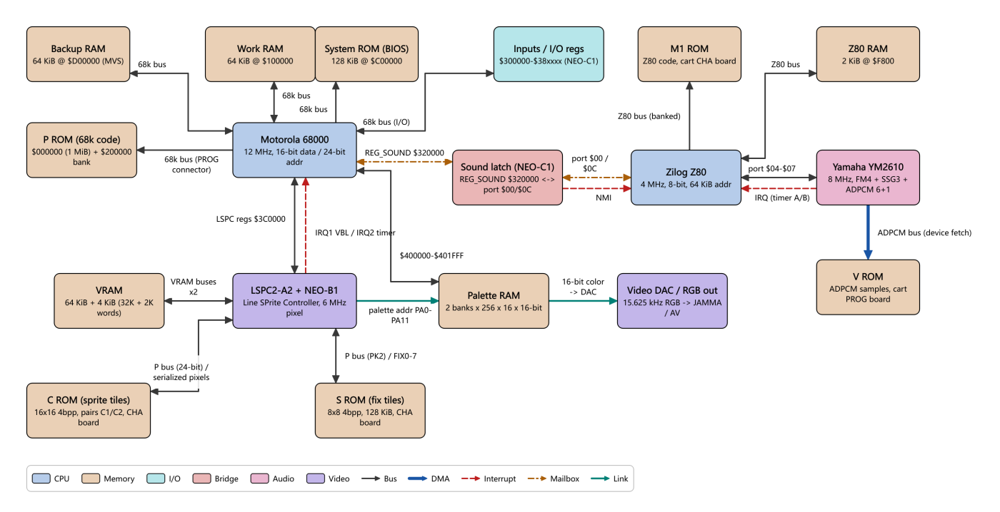
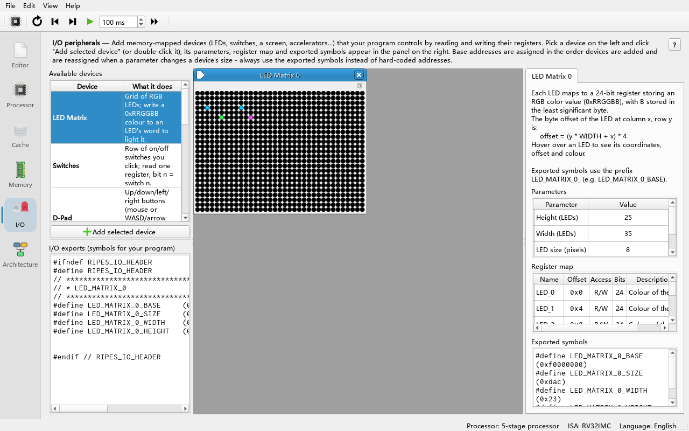

# 12 Neo Geo Tour: Three Buses, No Framebuffer and the Sound Latch

> **What you will learn**
>
> - Why the Neo Geo is a textbook "late-1980s arcade architecture" and what each of its three buses does;
> - The memory maps of the 68000 and the Z80, and why the 68000 cannot "see" graphics data;
> - How a frame is composed scanline by scanline when there is no framebuffer;
> - The only communication channel between the two CPUs: an 8-bit sound latch plus an NMI;
> - How to play the three built-in data flows step by step in the Architecture Explorer;
> - How to run `examples/assembly/neogeo_mailbox.s` in the RISC-V simulator and watch the mailbox protocol on the LED matrix.
>
> **Prerequisites**
>
> - You can use the **Architecture** tab (chapter 11);
> - You can load and run an assembly example and add a peripheral in the **I/O** tab (chapters 02 and 08);
> - You know what "interrupt" and "MMIO register" mean (chapter 08).
>
> Hardware figures in this chapter come from `docs/arch/neogeo.md` (based on the NeoGeo Development Wiki). A `$` prefix means hexadecimal.

---

## 12.1 Historical context

The Neo Geo was launched by SNK in 1990. The same hardware was sold as an arcade board, the **MVS** (Multi Video System), and as a home console, the **AES** (Advanced Entertainment System), and **the same cartridge runs on both**. At a time when home consoles were 8/16-bit machines, it brought "arcade-grade" large sprites and multi-channel sampled sound into the living room; series such as *The King of Fighters*, *Metal Slug* and *Samurai Shodown* were born on it. The two versions differ only in peripheral details: cabinet I/O, DIP switches, backup RAM and the on-board fix-graphics multiplexer.

Architecturally, the Neo Geo is a typical late-1980s arcade machine: **the main CPU (Motorola 68000) runs the game logic, the sound CPU (Zilog Z80) runs the sound driver independently, and the video chip fetches graphics directly from cartridge ROM**. It has no framebuffer, no DMA and no shared memory between the two CPUs; all of these "omissions" were deliberate trade-offs in 1990, when DRAM was expensive and ROM was cheap. Understanding it shows you what problems unified memory, DMA and doorbells in a modern SoC are actually solving.

## 12.2 Opening the Neo Geo in the Architecture Explorer

**Do**: switch to the **Architecture** tab, choose **SNK Neo Geo (MVS/AES)** in the **Topology** drop-down and press **Fit to view** in the toolbar.

**What you see**: 18 blocks and 21 buses. The rough layout is:

- Top row: Backup RAM, Work RAM, System ROM (BIOS), Inputs / I/O regs, and on the audio side M1 ROM and Z80 RAM;
- Middle row: P ROM, **Motorola 68000**, **Sound latch (NEO-C1)**, **Zilog Z80**, **Yamaha YM2610**;
- Lower row: VRAM, **LSPC2-A2 + NEO-B1**, Palette RAM, Video DAC, and V ROM;
- Bottom: C ROM (sprite graphics) and S ROM (fix graphics).



**Why**: the layout deliberately puts the three buses in three regions: around the 68000, around the Z80 and around the LSPC. Find these three "masters" first, then look at what each one is connected to.

## 12.3 Three buses that never meet

| Bus | Master | Connected parts | On the diagram |
|---|---|---|---|
| **68000 main bus** (16-bit data / 24-bit address) | Motorola 68000, 12 MHz | P ROM, Work RAM, BIOS, Backup RAM, I/O registers, Palette RAM, LSPC registers, sound latch | Dark grey solid lines around the 68000, labels `68k bus`, `$400000-$401FFF`, `LSPC regs $3C0000` |
| **Z80 audio bus** (8-bit) | Zilog Z80, 4 MHz | M1 ROM, Z80 RAM, YM2610 (ports), sound latch (ports) | Around the Z80, labels `Z80 bus`, `port $04-$07` |
| **LSPC graphics bus** | LSPC (Line SPrite Controller) | VRAM (two independent buses), C ROM, S ROM, palette RAM address | Around the LSPC, labels `VRAM buses x2`, `P bus ...`, `palette addr ...` |

In addition the YM2610 has its own **ADPCM bus** that reads V ROM directly (the thick blue line `ADPCM bus (device fetch)`): the only path in the whole machine where a peripheral fetches data by itself.

**Do**: click the **C ROM (sprite tiles)** block and read **Details** on the right.

**What you see**: the last sentence says the ROM is "completely invisible to the 68000".

**Why**: C ROM (sprite graphics), S ROM (fix graphics) and V ROM (samples) are not in the 68000's address space. The 68000 can only tell the LSPC *where to fetch* through **indices** in VRAM (tile numbers, palette numbers). Because the three buses are physically separate, the 68000 fetching code, the Z80 fetching code, the LSPC fetching graphics and the YM2610 fetching samples can all **run at the same time without contention**; the price is that the CPU cannot generate or modify graphics.

## 12.4 Memory maps

### 68000 address space (cartridge system)

| Start | End | Name | Notes |
|---|---|---|---|
| `$000000` | `$0FFFFF` | P ROM bank 1 | Vector table + fixed program area (cartridge PROG board) |
| `$100000` | `$10F2FF` | Work RAM | User work RAM (`$10F300`–`$10FFFF` reserved by the BIOS) |
| `$200000` | `$2FFFFF` | P ROM bank 2 / PORT | Second window; games > 2 MiB write here to bank-switch |
| `$300000` | `$3FFFFF` | I/O | Inputs, outputs, system registers, LSPC registers |
| `$400000` | `$401FFF` | Palette RAM | Current palette bank (8 KiB) |
| `$800000` | `$BFFFFF` | Memory card | Memory card |
| `$C00000` | `$C1FFFF` | System ROM | BIOS, 128 KiB |
| `$D00000` | `$D0FFFF` | Backup RAM | MVS only |

The registers used most in this chapter:

| Address | Name | Read | Write |
|---|---|---|---|
| `$300000` | REG_P1CNT | P1 joystick/buttons (active low) | — |
| `$300001` | REG_DIPSW | DIP switches | **Kick the watchdog** |
| `$320000` | REG_SOUND | **Reply byte from the Z80** | **Send a command to the Z80 (triggers NMI)** |
| `$3C0000` | REG_VRAMADDR | Read VRAM | Set VRAM address |
| `$3C0002` | REG_VRAMRW | Read VRAM | Write VRAM, then address += REG_VRAMMOD |
| `$3C0004` | REG_VRAMMOD | Read modulo | Set auto-increment |
| `$3C000C` | REG_IRQACK | — | Acknowledge VBL / timer / IRQ3 |

Note that **VRAM is not in the 68000's address space**: it is accessed only indirectly through the three LSPC registers starting at `$3C0000` ("set address, write data, auto-increment"). 68000 interrupts: IRQ1 = VBlank (vector `$64`), IRQ2 = LSPC timer (`$68`), IRQ3 = cold boot; all three come from the LSPC and must be acknowledged by writing REG_IRQACK.

### Z80 address space and ports

| Range | Content |
|---|---|
| `$0000`–`$7FFF` | Fixed part of M1 ROM (32 KiB) |
| `$8000`–`$BFFF` / `$C000`–`$DFFF` / `$E000`–`$EFFF` / `$F000`–`$F7FF` | Four bank windows (16/8/4/2 KiB) |
| `$F800`–`$FFFF` | Z80 work RAM (2 KiB) |

| Port | Read | Write |
|---|---|---|
| `$00` | Command written by the 68000, **also acknowledges the NMI** | Clear the command latch |
| `$04`–`$07` | YM2610 status/data | YM2610 address/data |
| `$08` | Set the bank of the `$F000` window | **Enable NMI** |
| `$09`–`$0B` | Set the other windows' banks | — |
| `$0C` | — | **Write the reply byte for the 68000** |
| `$18` | — | Disable NMI |

A curious detail: the Z80 switches banks by **reading** a port, not writing one. During `in a,(c)` the B register appears on the upper 8 address lines, and the NEO-ZMC chip captures the bank number from the address, saving data-bus pins.

**Do**: click **VRAM** and then **Zilog Z80** in the diagram and compare the properties tables with the two tables above.

## 12.5 No framebuffer: how a frame is drawn

A modern graphics card renders a whole frame of pixels into a framebuffer in video memory and then scans it out. The Neo Geo **has no framebuffer**: every scanline is **composed in real time** just before it is displayed.

### The three ingredients of a picture

- **Sprites**: each sprite is a **vertical strip 16 px wide and 1–32 tiles tall (up to 512 px)**; tiles are 16×16 at 4 bpp and live in C ROM. VRAM has 448 slots, the hardware processes 381 per frame and **at most 96 per scanline**; any further sprites are simply not drawn. There is no background tile-map layer: backgrounds are made of many adjacent sprite strips chained with the sticky bit so they scroll together. Sprites can only shrink, never grow.
- **Fix layer**: 40×32 tiles of 8×8 (28 rows visible) stored in S ROM, **always above every sprite**; used for scores, health bars and text.
- **Palette RAM**: 2 banks × 256 palettes × 16 colours × 16-bit. A pixel is only a 4-bit colour index; combined with the sprite's palette number it forms a 12-bit lookup address. Colour 0 of every palette is transparent.

VRAM (64 KiB + 4 KiB) holds **only attributes and indices**: SCB1 (tile number, palette, flip), SCB2 (shrink), SCB3 (Y, sticky, height), SCB4 (X), the fix map, and the active sprite lists written by the LSPC itself. **There is not a single pixel in VRAM.**

### The per-scanline pipeline

1. **During the previous line**: the LSPC scans every sprite's SCB3 in the "fast" VRAM and records the sprites whose Y range covers the next line in the active sprite list (at most 96).
2. **This line**: for every sprite in the list it computes which tile and which row inside the tile to fetch, reads SCB1 for the tile number and palette, and drives the C ROM address on the P bus; a pair of C ROMs returns 32 bits (8 pixels × 4 bitplanes), which NEO-ZMC2 serialises into pixels.
3. **NEO-B1** writes the opaque pixels into a **line buffer**; later sprites overwrite earlier ones (higher-numbered sprites are on top). The fix layer is written last, so it is always on top.
4. **Output**: line buffers alternate in pairs; while one is written, the other is read at 6 MHz, pixel by pixel, as palette addresses → Palette RAM → 16-bit colour → DAC → RGB. Uncovered pixels show the backdrop colour.

One scanline is 384 pixels = 1536 master clocks (64 µs); a frame is 264 lines (224 visible) ≈ 59.19 Hz. "96 sprites per line" can roughly be understood as a bandwidth limit: 1536 ÷ 96 = 16 master clocks per sprite (a rough estimate given in `docs/arch/neogeo.md`). When the limit is exceeded the hardware **drops sprites**, it does not drop frames.

**Why this design**: DRAM was expensive in 1990; a 320×224 framebuffer would have needed a lot of memory. Keeping graphics in ROM and buffering only a line or two let 4 KiB of fast VRAM drive 381 sprites. Tile-based rendering in modern mobile GPUs follows the same idea: compose small pieces and touch external memory as little as possible.

## 12.6 How the 68000 talks to the Z80: sound latch + NMI

The two CPUs **share no memory**. The only channel is two 8-bit latches in the NEO-C1 chip plus one NMI line:

```
   68000                       NEO-C1 (latch)                    Z80
     │  move.b #cmd, REG_SOUND     │                               │
     │────────────────────────────►│ cmd latch = cmd               │
     │                             │──────── /NMI ────────────────►│ (if port $08 enabled it)
     │                             │        in a,($00)             │ read cmd, also acks NMI
     │                             │◄──────────────────────────────│
     │                             │        out ($0C),a            │ reply after processing
     │                             │ reply latch = cmd | $80       │◄──
     │  move.b REG_SOUND, d0       │                               │
     │◄────────────────────────────│ (68000 can only poll)         │
```

Key points:

- **Asymmetric**: 68000→Z80 has an interrupt (NMI); Z80→68000 has none, so the 68000 must **poll** REG_SOUND.
- **One byte deep**: if the 68000 writes twice before the Z80 reads, the first command is **overwritten** and lost. Games therefore usually send one command per frame, or wait for the reply before sending the next.
- **The meaning of commands is defined by the cartridge's Z80 driver**; only three are fixed by the BIOS: `$01` prepare slot switch (must be answered, otherwise the MVS shows "Z80 ERROR"), `$02` play the eyecatcher music (no reply), `$03` Z80 soft reset (no reply). A common convention is that the Z80 echoes the command with bit 7 set (`cmd | $80`) as the ACK.

On the diagram this channel is the **Sound latch (NEO-C1)** block (`bridge`, red/pink) and three lines: `REG_SOUND $320000` on the 68000 side (dash-dot, mailbox), `port $00 / $0C` on the Z80 side (mailbox), and the red dashed `NMI` (irq).

## 12.7 The built-in data flows, step by step

The Neo Geo topology has three flows. The "Highlighted buses" column of each table gives the bus labels so you can match them with the screen. (Flow titles are quoted as they appear in the English UI.)

### Flow 1: "68000 -> Z80 sound command (sound latch + NMI + reply)", 7 steps

| Step | Highlighted blocks | Highlighted buses | What happens |
|---|---|---|---|
| 1 | 68000 | — | Game logic decides to play a sound; the 68000 prepares the command byte |
| 2 | 68000, Sound latch | `REG_SOUND $320000` | `move.b #cmd, REG_SOUND`; the command enters the 1-byte latch, overwriting an unread older one |
| 3 | Sound latch, Z80 | `NMI` | The latch write pulls /NMI low (if the Z80 enabled it with `out ($08)`); the Z80 jumps to `$0066` |
| 4 | Z80, Sound latch | `port $00 / $0C` | The NMI handler does `in a,($00)`, reading the command and acknowledging the NMI; optionally `out ($00)` clears the latch |
| 5 | Z80, M1 ROM, YM2610, V ROM | `Z80 bus (banked)`, `port $04-$07`, `ADPCM bus (device fetch)` | The Z80 looks up the command table in M1 ROM and writes YM2610 registers to start a sample or FM sequence; the YM2610 then reads the samples from V ROM over the ADPCM bus by itself |
| 6 | Z80, Sound latch | `port $00 / $0C` | `out ($0C),a` writes the reply `cmd | $80`; this does **not** interrupt the 68000 |
| 7 | 68000, Sound latch | `REG_SOUND $320000` | The 68000 polls REG_SOUND when it cares; for the BIOS command `$01` it must wait for the reply |

**Do**: at step 5 notice that the thick blue `ADPCM bus (device fetch)` line lights up too: the YM2610 moves the sample data itself, not the Z80. Then go back to step 3 and hover over the red dashed `NMI` line; the tooltip shows `Trigger: 68k write to REG_SOUND` and `Vector: $0066`.

### Flow 2: "Rendering a frame: VBL -> write VRAM -> LSPC per-scanline compositing -> DAC", 8 steps

| Step | Highlighted blocks | Highlighted buses | What happens |
|---|---|---|---|
| 1 | LSPC, 68000 | `IRQ1 VBL / IRQ2 timer` | VBlank starts and the LSPC raises IRQ1; the 68000 kicks the watchdog and writes REG_IRQACK |
| 2 | 68000, Inputs, Work RAM | `68k bus (I/O)`, `68k bus` | Read the inputs, run game logic in Work RAM, compute X/Y/tile/palette of every sprite |
| 3 | 68000, LSPC, VRAM | `LSPC regs $3C0000`, `VRAM buses x2` | Write SCB3, SCB4, SCB2, SCB1 word by word through REG_VRAMADDR/RW/MOD; **no DMA** |
| 4 | 68000, Palette RAM, Sound latch | `$400000-$401FFF`, `REG_SOUND $320000` | Update palettes (no glitches during VBlank), send this frame's sound command, leave the handler |
| 5 | LSPC, VRAM | `VRAM buses x2` | The visible area begins; the LSPC scans SCB3 and builds the active sprite list (≤ 96 per line) |
| 6 | LSPC, VRAM, C ROM | `VRAM buses x2`, `P bus (24-bit) / serialized pixels` | Read SCB1 for the tile number, fetch 32 bits from C ROM, NEO-ZMC2 serialises them into pixels |
| 7 | LSPC, VRAM, S ROM | `VRAM buses x2`, `P bus (PK2) / FIX0-7` | NEO-B1 writes sprite pixels into the line buffer; the LSPC then reads this line's fix map from VRAM and fetches fix tiles from S ROM, drawn on top |
| 8 | LSPC, Palette RAM, Video DAC | `palette addr PA0-PA11`, `16-bit color -> DAC` | The other line buffer outputs palette addresses at 6 MHz → colour → DAC → RGB; after 224 lines, back to step 1 |

**Do**: at step 3 click **VRAM** and note the property `Access: via $3C0000-$3C0004`; at step 6 read the LSPC details that the right panel shows automatically.

**Why**: steps 1–4 are **the CPU's work** (once per frame, inside VBlank); steps 5–8 are **the display hardware's work** (repeated every scanline). The two are decoupled by the "indices" in VRAM; this is the same idea as a GPU command buffer or an NPU descriptor ring: the CPU writes a description, the hardware works from it.

### Flow 3: "Cartridge ROM read paths: parallel buses of the PROG and CHA boards", 6 steps

| Step | Highlighted blocks | Highlighted buses | What happens |
|---|---|---|---|
| 1 | 68000, P ROM | `68k bus (PROG connector)` | The 68000 fetches code from `$000000`–`$0FFFFF` |
| 2 | 68000, P ROM | `68k bus (PROG connector)` | Accesses to `$200000`–`$2FFFFF`; big games write to the PORT area to bank-switch in 1 MiB units |
| 3 | Z80, M1 ROM | `Z80 bus (banked)` | Meanwhile the Z80 fetches from M1 ROM on the CHA board; NEO-ZMC builds the address from the captured bank number |
| 4 | YM2610, V ROM | `ADPCM bus (device fetch)` | The YM2610 reads samples from V ROM on the PROG board at its own pace; no CPU involved |
| 5 | LSPC, C ROM | `P bus (24-bit) / serialized pixels` | The LSPC outputs C ROM addresses every line, NEO-273 latches them, a pair of C ROMs delivers 32 bits in parallel |
| 6 | LSPC, S ROM | `P bus (PK2) / FIX0-7` | The same P bus is time-shared for S ROM addresses; fix pixels return over the 8-bit FIX bus |

**Why**: a cartridge contains two PCBs, the PROG board (P ROM, V ROM) and the CHA board (C ROM, S ROM, M1 ROM), each on its own connector and its own buses. The four "readers" (68000, Z80, YM2610, LSPC) each read their own ROMs, fully in parallel.

## 12.8 Hands-on: modelling the sound-latch protocol on RISC-V

The example `examples/assembly/neogeo_mailbox.s` (`neogeo_mailbox.s` in the **File → Load Example...** menu) models both CPUs and the NEO-C1 latch with **cooperative multitasking** on one RISC-V core.

### What it models

| In the program | Real hardware |
|---|---|
| `main_task` | 68000: sends commands from a script and polls for replies |
| `sound_task` | Z80: NMI handler (read command, clear latch, push into a software FIFO) + main loop (process commands, write replies) |
| `cmd_latch` / `reply_latch` | Command latch and reply latch in NEO-C1 |
| `nmi_line` / `nmi_enabled` | The Z80's /NMI line and the NMI enable set by `out ($08)` |
| `hw_write_reg_sound` | The hardware behaviour of "68000 writes REG_SOUND": overwrite the latch unconditionally, raise NMI if enabled |
| `fifo` (4 entries) | The command queue the Z80 driver keeps in its own RAM |

The `script` sends, in order: `$03` (soft reset, no wait), `$01` (prepare slot switch, wait for reply), `$20` (wait), `$21` (fire and forget), `$22` and `$23` **back to back** (burst, the CPU is not yielded in between), `$7F` (wait). The Z80 "processes" each command for 3 time slices; `$02` and `$03` get no reply, all others get `cmd | $80`. The 68000 gives up after 50 polls and prints "Z80 ERROR".

### How to run it

1. **Add the peripheral first**: switch to the **I/O** tab and double-click **LED Matrix** in the **Available devices** list. The default 35 columns × 25 rows is fine (the program needs at least 12 × 8). It must be added first because the program uses the symbols `LED_MATRIX_0_BASE` and `LED_MATRIX_0_WIDTH`; without the peripheral it does not assemble.
2. **Load the program**: **File → Load Example...**, choose `neogeo_mailbox.s`. The editor switches to Assembly mode and assembles automatically; no errors should be reported.
3. **Run**: click **Run** in the toolbar. The program exits via `ecall` after some tens of thousands to around a hundred thousand cycles (to be verified: the exact count depends on the processor model).
4. **Observe**: the protocol log appears in the Console; switch to the **I/O** tab to see the LED matrix. To watch the LEDs change frame by frame, run slowly with **Auto clock (F6)** (the toolbar button right after **Clock (F5)**; the box next to it sets the interval in ms), or reduce the `2000` in `delay` and single-step.



### What the console shows

`print_hex` uses Ripes' PrintIntHex system call (a7 = 34), which prints values like `0x0081`. Working through the code, the log should begin:

```
Z80 : boot, out ($08) -> NMI enabled
68k : move.b #$0x0003, REG_SOUND
Z80 : NMI -> in a,($00) = $0x0003
Z80 : processing $0x0003
68k : move.b #$0x0001, REG_SOUND
Z80 : NMI -> in a,($00) = $0x0001
Z80 : no reply for this command
Z80 : processing $0x0001
Z80 : out ($0C) <- $0x0081
68k : REG_SOUND == $0x0081 (ack)
...
```

(This was derived by reading the code line by line; check it against a real run.) Things worth noticing:

- **Command `$22` never appears in the Z80's log.** The log shows `68k : (burst, no yield)` and then the 68000 writes `$23` straight away, overwriting the latch; the next thing the Z80 reads is `$23`. That is the consequence of a one-byte-deep latch.
- After sending `$23` the 68000 waits for `$A3`, but the reply latch first holds `$A1` (the reply to the earlier `$21`). The 68000 keeps polling until it sees `$A3`. The reply latch is **never cleared automatically**, so the 68000 must compare the value rather than just check "is there something".
- When everything is done it prints `--- script finished ---` and exits.

### What the LED matrix shows

| Position | Colour | Meaning |
|---|---|---|
| Row 1, columns 2–9 | yellow | The 8 bits of `cmd_latch` (column 2 is bit 7) |
| Row 3, columns 2–9 | cyan | The 8 bits of `reply_latch` |
| Row 5, column 2 | red | NMI pending |
| Row 5, column 5 | green | NMI enabled |
| Row 5, column 8 | blue | Z80 busy (processing a command) |
| Row 5, column 11 | magenta | 68000 waiting for a reply |
| Row 7, columns 2–5 | white | Occupancy of the Z80's software FIFO |

(Rows and columns are counted from 0.)

**Why row 1 and the red LED are almost always dark**: each round of the main loop runs `main_task → sound_task → draw_leds`. After the 68000 writes the latch, the Z80 answers the NMI in the same round, reads the latch and clears it, so by the time `draw_leds` runs the latch is 0 again. You only see a command sitting in the latch when single-stepping (stopping outside `draw_leds`) or when the NMI is disabled. The reply value in row 3, by contrast, stays until the next reply overwrites it. The blue and magenta LEDs light up alternately, matching "the Z80 is busy, the 68000 is waiting".

## 12.9 Exercises

1. **Count buses**: in the "Rendering a frame" flow, which steps highlight `VRAM buses x2`? Why is VRAM both written by the 68000 and read by the LSPC within one frame, yet no DMA is needed?
2. **Find the asymmetry**: find every bus connected to the Sound latch in the topology and write down its kind and direction. How does the 68000 learn that the Z80 has finished a command?
3. **The lost command**: in `neogeo_mailbox.s` change the flags of the `$22` line from `2` to `1` (wait for reply) and run again. How does the log change, and why?
4. **Turn the NMI off**: in `sound_init` change `li t1, 1` to `li t1, 0` (as if the Z80 never executed `out ($08)`). Predict and verify: what does the console print? What happens to LED row 1?
5. **The cost of no framebuffer**: what happens if 120 sprites overlap on one scanline? How is that different from "the frame rate drops"?
6. **Compare with modern systems**: what do the Neo Geo sound latch and the NPU doorbell of chapter 10 (writing TAIL) have in common, and how do they differ?

### Answers

1. Steps 3, 5, 6 and 7. In step 3 the 68000 writes VRAM word by word **through the LSPC registers** (the CPU moves the data itself, so no DMA is needed, at the cost of CPU time and the 12/16-cycle spacing rules); in steps 5, 6 and 7 the LSPC reads VRAM itself (SCB3, SCB1 and the fix map). VRAM holds only a few KiB of attributes and indices, small enough to write word by word; the bulk data (pixels) stays in ROM and is never copied.
2. `REG_SOUND $320000` (mailbox, bidirectional, 68000↔latch), `port $00 / $0C` (mailbox, bidirectional, latch↔Z80), `NMI` (irq, latch→Z80, one-way). There is no interrupt line toward the 68000; it can only poll REG_SOUND until it reads the agreed `cmd | $80`.
3. After `$22` is sent the 68000 starts waiting instead of immediately sending `$23`; the Z80 reads `$22`, processes it and replies `$A2`, and only then is `$23` sent. Both commands are processed. Reason: waiting for the reply gives the Z80 a chance to read the latch, so the one-byte latch is no longer overwritten.
4. `hw_write_reg_sound` writes the latch but never raises the NMI, so the Z80 never reads a command. Every command that expects a reply is polled 50 times and then `68k : timeout waiting for reply -> Z80 ERROR` is printed; LED row 1 **stays lit** with the most recently written command (nobody clears it), and the green LED (row 5, column 5) is off. This is exactly the situation in which an MVS BIOS shows "Z80 ERROR" because the Z80 driver does not respond.
5. Only the first 96 sprites (in the order SCB3 is scanned) are drawn on that line; the other 24 **vanish** on that line (flicker or missing pieces), but the frame rate is unchanged. A framebuffer system that cannot finish a frame delays it (drops frames); the Neo Geo's timing is fixed, so it can only drop sprites.
6. In common: "one register write = submit + wake up", with a tiny amount of data. Differences: the sound latch is one byte, has no queue, carries the command itself, and has no interrupt in the reverse direction; the NPU doorbell is only a pointer, the real work is in descriptors in a ring in memory (many can be queued), and completion can raise an interrupt (IRQ_STATUS).

## 12.10 Summary

- The Neo Geo has three buses that never meet: the 68000 main bus, the Z80 audio bus and the LSPC graphics bus; graphics and sample data are invisible to the CPU;
- No framebuffer: every scanline the LSPC fetches tiles from C/S ROM and outputs them through NEO-B1 line buffers and Palette RAM; at most 96 sprites per line;
- No DMA: the 68000 writes VRAM word by word through three registers at `$3C0000`;
- 68000→Z80 communication is a one-byte sound latch plus an NMI; the reverse direction can only be polled;
- `neogeo_mailbox.s` reproduces this protocol on RISC-V, including the command lost by a burst write;
- The next chapter's PS3/Cell takes "mailbox + explicit data movement" to the opposite extreme.
