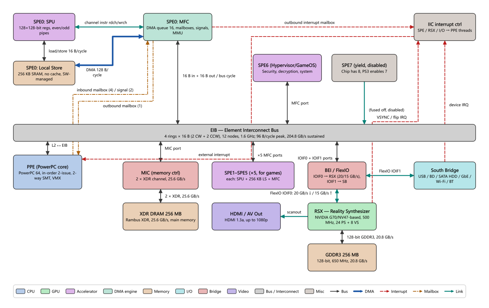

# 13 PS3 / Cell Tour: PPE, SPEs, Explicit DMA and Double Buffering

> **What you will learn**
>
> - The "1 general-purpose core + 8 co-processor cores" structure of the Cell Broadband Engine, and how work is split between the PPE and the SPEs;
> - Why an SPE's Local Store is not a cache, and how MFC DMA moves data and waits for completion with tags;
> - Two lightweight notification mechanisms: mailboxes and signal notification;
> - The EIB ring bus, XDR main memory, the RSX GPU and the FlexIO link, plus the asymmetry of "Cell reading video memory is extremely slow";
> - Why almost every SPE program uses double buffering;
> - How to step through the four data flows of the PS3 topology, and how to run `examples/C/spe_double_buffer.c` in Ripes.
>
> **Prerequisites**
>
> - You can use the **Architecture** tab (chapter 11); reading chapter 12 (the Neo Geo mailbox) first is recommended;
> - Running the C example requires a configured RISC-V C compiler (chapter 05);
> - Basic notions of cache, DMA and interrupts (chapters 07, 08, 10).
>
> Figures in this chapter come from `docs/arch/ps3_cell.md` (IBM Cell programming handbook, IBM JRD papers, Hot Chips slides, etc.). Numbers marked as second-hand in that document are marked the same way here.

---

## 13.1 Historical context

The PlayStation 3 went on sale in November 2006. At its heart is the **Cell Broadband Engine (Cell BE)**, developed from 2001 by Sony, Toshiba and IBM (the STI alliance) and clocked at 3.2 GHz. It was the first consumer product to bring a **heterogeneous multicore** design, "one general-purpose core + a group of vector co-processors with explicitly managed local memory", to the mass market; graphics are handled by **RSX**, a custom NVIDIA GPU derived from the G70/NV47.

Cell's design philosophy fits in three sentences: **separate control from computation** (the PPE schedules, the SPEs compute); **replace caches with a software-managed Local Store** (the programmer must DMA data in and out explicitly); **connect everything with a high-bandwidth ring bus, the EIB**. Its theoretical peak was very high, but it was notoriously hard to program, which is exactly why it is worth studying: today's GPU shared memory with asynchronous copies and the job systems of game engines can all be traced back to Cell.

| Item | Value |
|---|---|
| CPU | Cell BE, 3.2 GHz |
| General-purpose core | 1 × PPE (64-bit PowerPC, in-order dual issue, 2-way SMT) |
| Co-processor cores | 8 × SPE (physical); 7 enabled on PS3, 1 reserved by the system, **6 available to games** |
| On-chip interconnect | EIB, 4 rings of 16 B |
| Main memory | 256 MB XDR DRAM, 25.6 GB/s |
| GPU | RSX, 500 MHz |
| Video memory | 256 MB GDDR3, 128-bit, 20.8 GB/s |
| CPU↔GPU | FlexIO (IOIF0), Cell→RSX 20 GB/s, RSX→Cell 15 GB/s |

## 13.2 Opening the PS3 in the Architecture Explorer

**Do**: in the **Architecture** tab choose **Sony PlayStation 3 / Cell Broadband Engine** in the drop-down and press **Fit to view**.

**What you see**: 16 blocks and 21 buses, layered roughly as:

- Top: **SPE0** split into three blocks, `SPE0: SPU`, `SPE0: Local Store` and `SPE0: MFC`, to show an SPE's insides; on the right `SPE6 (Hypervisor/GameOS)`, `SPE7 (yield, disabled)` and `IIC interrupt ctrl`;
- Middle: a wide grey bar across the whole diagram, **EIB — Element Interconnect Bus** (`kind: bus`, a bus drawn as a block);
- Lower: `PPE`, `MIC`, `SPE1–SPE5 (×5, for games)`, `BEI / FlexIO`, `South Bridge`;
- Bottom: `XDR DRAM 256 MB`, `HDMI / AV Out`, `RSX`, `GDDR3 256 MB`.



**Why**: the real chip has 8 SPEs; drawing all of them would be very crowded. The topology expands only SPE0 to show its internals, merges the five game-usable SPEs into one block and draws the other two (system-reserved, fused off) separately to explain where "8 → 7 → 6" comes from.

## 13.3 PPE and SPE

**Do**: click `PPE — Power Processing Element` and then `SPE0: SPU`, and compare the properties tables.

| | PPE | SPE (SPU) |
|---|---|---|
| ISA | 64-bit PowerPC + VMX/AltiVec | Separate SPU ISA |
| Issue | In-order dual issue, ~23-stage pipeline, 2-way SMT | In-order dual issue: even pipeline (arithmetic) + odd pipeline (load/store, shuffle, branch, channel) |
| Registers | Usual PowerPC registers + VMX | **128 unified 128-bit registers** |
| Memory hierarchy | L1 32 KB I + 32 KB D, L2 512 KB | **No cache**, only a 256 KB Local Store |
| Branches | Predicted | **No branch predictor**; branch-hint instructions; mispredict ~18 cycles |
| fp32 peak | 25.6 GFLOPS (VMX) | 25.6 GFLOPS each (4-wide SIMD × FMA × 3.2 GHz) |
| Role | Runs the Hypervisor, GameOS and the game's main thread; dispatches work | Data-parallel computation: vertices, physics, audio, decoding, post-processing |

**Why**: the PPE's single-thread performance is mediocre. That was not a mistake: the area budget went to the 8 SPEs first. The developers' rule of thumb was "move everything that can be vectorised to the SPEs; keep only the inherently serial parts on the PPE".

Also note that an SPE is a **complete, independent core**: it has its own PC and its own program and can run for a long time on its own; the PPE only starts it and sends it messages. That is completely different from a GPU warp (32 lanes executing the same instruction in lockstep, see chapter 09).

**8 → 7 → 6**: click `SPE7` and `SPE6` and read their details. The chip physically has 8 SPEs; to improve yield on the 90 nm process the PS3 enables only 7 (so a chip with one defective SPE is still usable); one of those is owned by the Hypervisor and runs in isolation mode for security functions such as decryption and signature checks, invisible to games. That leaves 6 for games.

## 13.4 Local Store and MFC DMA

### The Local Store is not a cache

**Do**: click `SPE0: Local Store`.

All SPU load/store instructions **can only access the SPE's own 256 KB Local Store (LS)**; the SPU has no load/store instruction that reaches main memory at all. Code, data, stack and DMA buffers all share these 256 KB. The LS has:

- no tags, no misses, no automatic fills and no protection (out-of-range addresses wrap around);
- 16 B/cycle for SPU accesses and 128 B/cycle for DMA; a single port with priority DMA > load/store > instruction fetch;
- a mapping in the global effective-address space, so the PPE and other SPEs can DMA into it (direct LS→LS transfers).

### The MFC: an SPE's only door to the outside

**Do**: click `SPE0: MFC` (`kind: dma`, teal-green) and read the properties table.

| Resource | Specification |
|---|---|
| DMA command queues | 16 entries issued by the SPU + 8 proxy entries issued by the PPE via MMIO |
| One command | 1/2/4/8 B or a multiple of 16 B, **max 16 KB**; best performance when 128 B aligned |
| DMA list | `getl`/`putl`: one command carries up to 2048 elements for scatter/gather |
| Tag group | Each command carries a 5-bit tag (0–31); write a tag mask, then read the tag status to wait |
| MMU | The MFC has an SLB/TLB; DMA uses **effective (virtual) addresses** protected by the page table |

The SPU talks to the MFC with **channel instructions** (`rdch`/`wrch`/`rchcnt`); on the diagram this is the teal `link` line `channel instr rdch/wrch` between SPU and MFC. Between MFC and LS is the thick blue `DMA 128 B/cycle` line (`dma`).

A DMA in C (`spu_mfcio.h`):

```c
mfc_get(ls_buf, ea, size, tag, 0, 0);   /* main memory -> LS, returns immediately */
mfc_write_tag_mask(1 << tag);           /* choose which tag groups to wait for */
mfc_read_tag_status_all();              /* block until all commands of those tags are done */
```

**Why**: "issue the DMA and return, wait for the tag later" is the key point: between issuing and waiting, the SPU can keep computing something else, which is the basis of double buffering in section 13.7. DMA completion does **not** notify the SPU automatically; it must actively wait on the tag (or enable MFC events).

## 13.5 Mailboxes and signal notification

Bulk data goes by DMA; **small messages** go through hardware registers in the MFC:

| Mechanism | Direction | Depth | Use |
|---|---|---|---|
| SPU inbound mailbox | PPE → SPU | 4 × 32-bit | PPE writes via MMIO; SPU does `rdch SPU_RdInMbox`, which blocks while empty |
| SPU outbound mailbox | SPU → PPE | 1 entry | SPU writes, PPE polls |
| SPU outbound interrupt mailbox | SPU → PPE | 1 entry | SPU writes, and the PPE is interrupted (via the IIC) |
| Signal notification 1/2 | anyone → SPU | 2 × 32-bit registers | Overwrite or **OR** mode (several senders each set one bit) |

On the diagram: the dash-dot line `inbound mailbox (4) / signal (2)` from `PPE` to `SPE0: MFC`, the dash-dot `outbound mailbox (1)` from MFC to PPE, and the red dashed `outbound interrupt mailbox` (MFC → IIC) and `external interrupt` (IIC → PPE).

**Why**: compared with chapter 12's one-byte Neo Geo sound latch, Cell's mailboxes have **depth** (4 inbound entries) and a notification path in **both** directions (including interrupts), but the philosophy is the same: a mailbox carries only small things such as a pointer or an index; the real data travels through shared memory and DMA.

## 13.6 EIB, XDR, RSX and FlexIO: bandwidth and a famous asymmetry

### EIB (Element Interconnect Bus)

**Do**: click the wide grey bar `EIB — Element Interconnect Bus`.

- **Four unidirectional 16 B rings** (2 clockwise + 2 counter-clockwise) plus an address/command bus;
- **12 nodes**: PPE, 8 SPEs, MIC, and the two BEI ports (IOIF0/IOIF1); each node can send 16 B and receive 16 B per bus cycle;
- The bus clock is half the core clock (1.6 GHz); up to 3 non-overlapping transfers per ring, 12 chip-wide;
- Instantaneous peak 96 B/core cycle = 307.2 GB/s; IBM's **sustained peak is 204.8 GB/s**.

A common misconception: 204.8 GB/s is the **chip-wide aggregate**; a single SPE's port gives only about 25.6 GB/s per direction.

### XDR main memory and the MIC

The `MIC` drives two 32-bit Rambus XDR channels (3.2 Gbps/pin), **25.6 GB/s** in total. The 256 MB of XDR is "main memory": PPE code and data, the sources and destinations of SPE DMA, and usually the RSX command buffer live here (GameOS takes part of it, about 43–50 MB depending on firmware).

### RSX, GDDR3 and FlexIO

`RSX` is a separate chip (500 MHz, 24 pixel-shader pipelines, 8 vertex shaders, Shader Model 3.0) with its own 256 MB of GDDR3 (128-bit, 650 MHz, 20.8 GB/s; early public specs said 700 MHz / 22.4 GB/s). It is attached to Cell through IOIF0 of `BEI / FlexIO`: Cell→RSX 20 GB/s, RSX→Cell 15 GB/s (measured about 15.8 / 11.9 GB/s). IOIF1 goes to the south bridge at about 2.5 GB/s per direction; **this figure has only second-hand sources and is not confirmed by official Sony documentation**.

### The asymmetry: who can read whose memory

**Do**: hover over the `FlexIO IOIF0: 20 GB/s ↓ / 15 GB/s ↑` line, or click `GDDR3 256 MB` and find the property `Cell write / read`.

| Direction | Bandwidth |
|---|---|
| Cell read/write XDR | ~25 GB/s |
| RSX read GDDR3 (local) | 20.8 GB/s |
| RSX read XDR (via FlexIO) | ~15 GB/s |
| RSX write XDR | ~20 GB/s |
| Cell **write** GDDR3 | ~4 GB/s |
| Cell **read** GDDR3 | **~16 MB/s** (megabytes!) |

(This table is a public retelling of Sony's 2006 developer material; `docs/arch/ps3_cell.md` cites second-hand sources such as Wikipedia / psdevwiki.)

**Why**: when Cell reads GDDR3, the request travels over IOIF0 to RSX and takes RSX's **uncached, unpipelined** host-read path, which allows only one outstanding read; each read waits for the full round trip, so throughput is only 16 MB/s. Writes are posted and can be queued and pipelined, hence 4 GB/s.

Engineering consequence: **never let Cell read video memory**. When the CPU needs a GPU result, have RSX write it to XDR (~20 GB/s) and let Cell read it from XDR. This is also why many PS3 engines used the SPEs as "GPU pre-processors": the path SPE→XDR→RSX is open, the reverse is not.

## 13.7 Why double buffering matters

An SPE can only compute on its LS, so data must be DMA'd in first. Suppose each chunk is 16 KB, a DMA takes about 1200 cycles and computing a chunk takes about 2000 cycles (the example figures from section 4.5 of `docs/arch/ps3_cell.md`):

**Single buffering (serial)**:

```
cycle:  0        1200           3200       4400          6400
        |---get0--|---compute0---|---get1---|---compute1---|
                                  SPU idle 1200 cycles/chunk -> 62.5 % utilisation
```

**Double buffering (overlapped)**: **before** computing chunk i, issue the `get` for chunk i+1 into the other buffer. By the time chunk i is finished and chunk i+1 is needed, it has long arrived and the wait returns immediately. Apart from the first chunk the SPU is always computing; total time ≈ one DMA latency + N × max(compute, DMA).

There is one more subtle point: the `put` (write-back) of chunk i uses the same tag as the next `get` into that buffer. So the wait on that tag two iterations later **proves both that the new input has arrived and that the previous output has left the buffer**; two buffers suffice with no WAR (write-after-read) hazard.

Triple buffering (what Sony's SPURS jobs do) runs "write back i-1", "compute i" and "fetch i+1" fully in parallel, at the cost of three times the LS space.

## 13.8 The built-in data flows, step by step

The PS3 topology has four flows. Buses are given by their labels. (Flow titles are quoted as they appear in the English UI.)

### Flow 1: "PPE dispatches a task to an SPE via mailbox", 8 steps

| Step | Highlighted blocks | Highlighted buses | What happens |
|---|---|---|---|
| 1 | PPE, XDR | `L2 ↔ EIB`, `MIC port`, `2 × XDR, 25.6 GB/s` | The PPE writes a job descriptor `{in_ea, out_ea, n_bytes, op}` and the input data into XDR (128 B aligned) |
| 2 | PPE, SPE0: MFC | `inbound mailbox (4) / signal (2)` | The PPE writes the descriptor's 32-bit address into SPE0's inbound mailbox via MMIO (it must wait if full) |
| 3 | SPE0: SPU, MFC | `channel instr rdch/wrch` | The SPU does `rdch SPU_RdInMbox`, which blocks while empty, so an idle SPE waits for work without polling |
| 4 | MFC, EIB, MIC, XDR, LS | channel, `16 B in + 16 B out / bus cycle`, MIC port, XDR, `DMA 128 B/cycle` | First `mfc_get` the descriptor, then `mfc_get` the input it points to; the MFC's MMU translates addresses, data flows over the EIB into the LS |
| 5 | SPU, LS | `load/store 16 B/cycle` | Tag-wait until the DMA completes, then compute on the LS with 128-bit SIMD |
| 6 | MFC, EIB, MIC, XDR | DMA, EIB, MIC, XDR | `mfc_put` writes the result back to XDR; **it must wait for the write-back** before notifying the PPE |
| 7 | MFC, IIC | `outbound interrupt mailbox` | `wrch SPU_WrOutIntrMbox` writes a completion code; the MFC interrupts via the IIC |
| 8 | IIC, PPE | `external interrupt`, `outbound mailbox (1)` | The PPE (via Hypervisor → GameOS) receives the interrupt, reads the code and wakes the waiting thread |

**Why**: the mailbox carries only a 32-bit pointer; descriptor and data stay in XDR and the SPE fetches them **itself** by DMA. This is the same pattern as the NPU descriptor ring of chapter 10.

### Flow 2: "SPE double-buffered DMA streaming", 8 steps

| Step | Highlighted blocks | Highlighted buses | What happens |
|---|---|---|---|
| 1 | SPU, MFC | channel | Prime: `mfc_get(bufA, ea+0, CHUNK, tag=0)`; the command is queued and returns immediately |
| 2 | MFC, EIB, MIC, XDR, LS | EIB, MIC, XDR, DMA | The MFC splits 16 KB into 128 B EIB transactions; data flows into bufA (for the first chunk the SPU can only wait) |
| 3 | SPU, MFC | channel | Loop i=0: **first** issue `mfc_get(bufB, chunk 1, tag=1)` to prefetch, the key to double buffering |
| 4 | SPU, MFC | channel | Wait only for tag 0 (bufA's get); tag 1's DMA continues in the background |
| 5 | SPU, LS | `load/store 16 B/cycle` | Compute bufA; meanwhile the MFC is writing chunk 1 into bufB |
| 6 | MFC, EIB, MIC, XDR | DMA, EIB, MIC, XDR | `mfc_put(..., tag=0)`; still tag 0, so the wait on tag 0 two iterations later avoids WAR automatically |
| 7 | SPU, MFC, LS | channel, load/store | i=1: issue get for chunk 2 (tag 0), wait tag 1 (usually returns immediately), compute bufB, put (tag 1) |
| 8 | SPU, MFC | channel | After the loop: wait for the last two puts on tags 0 and 1, then notify the PPE through the mailbox |

### Flow 3: "PPE → RSX command buffer submission and frame output", 8 steps

| Step | Highlighted blocks | Highlighted buses | What happens |
|---|---|---|---|
| 1 | PPE, XDR | `L2 ↔ EIB`, MIC, XDR | The PPE (libgcm) writes this frame's command words into a command-buffer ring in XDR |
| 2 | PPE, BEI, RSX | `L2 ↔ EIB`, `IOIF0 + IOIF1 ports`, FlexIO IOIF0 | MMIO write of RSX's **PUT** register: the only "doorbell"; the commands themselves do not go over MMIO |
| 3 | RSX, BEI, EIB, MIC, XDR | FlexIO, BEI, MIC, XDR | RSX sees GET ≠ PUT, pulls the commands from XDR over FlexIO and advances GET |
| 4 | RSX, XDR, GDDR3 | FlexIO, `128-bit GDDR3, 20.8 GB/s` | Draw: read vertices/textures, write colour/depth into the back buffer in GDDR3 |
| 5 | RSX, XDR | FlexIO | When the CPU needs a GPU result, RSX **writes it to XDR**; Cell never reads GDDR3 |
| 6 | RSX | — | End-of-frame commands: write a reference (fence) value, then flip |
| 7 | RSX, GDDR3, HDMI | GDDR3, `scanout` | VSYNC: switch the front buffer and scan out from GDDR3 to HDMI/AV |
| 8 | RSX, IIC, PPE | `VSYNC / flip IRQ`, `external interrupt` | The flip/VSYNC interrupt goes IOIF0 → IIC → PPE, and the next frame starts |

### Flow 4: "Direct LS → LS DMA between SPEs", 5 steps

| Step | Highlighted blocks | Highlighted buses | What happens |
|---|---|---|---|
| 1 | PPE, SPU, SPE1–5 | inbound mailbox | The PPE tells SPE0 the effective address of the downstream SPE's LS through the mailbox |
| 2 | SPU, LS | load/store | SPE0 computes a block of results in its own LS |
| 3 | MFC, EIB, SPE1–5 | DMA, EIB, `×5 MFC ports` | `mfc_put` to the downstream LS address; data goes over the EIB straight into the other LS, **without touching MIC/XDR** |
| 4 | MFC, SPE1–5 | EIB, MFC ports | After the put completes, write a bit into the downstream signal notification register (OR mode) or its mailbox |
| 5 | SPE1–5 | — | The downstream SPE blocks on `rdch SPU_RdSigNotify1`, then processes the data in its own LS |

**Do**: stop at step 4 of Flow 1 and at step 3 of Flow 4 and compare the highlighted buses: the former goes through `MIC port` and XDR, the latter never touches main memory. That is why an SPE pipeline (SPE0 decodes → SPE1 post-processes) saves main-memory bandwidth.

## 13.9 Hands-on: spe_double_buffer.c

### What it models

`examples/C/spe_double_buffer.c` (`spe_double_buffer.c` in **File → Load Example...**) reproduces the loop skeleton of section 13.7 in pure software on one RISC-V core:

| In the program | On Cell |
|---|---|
| `xdr_in[256]` / `xdr_out[256]` | Input/output streams in XDR main memory |
| `ls_in[2][16]` / `ls_out[2][16]` | The two buffer pairs in the Local Store |
| `mfc_queue[16]` | The 16-entry SPU DMA command queue |
| `dma_get` / `dma_put` | `mfc_get` / `mfc_put`: enqueue only, return immediately |
| `wait_tag(mask)` | `mfc_write_tag_mask` + `mfc_read_tag_status_all`: only now does the "DMA engine" actually copy those tags' data |
| `compute_chunk` | The SPU's computation on the LS: `out = in * 3 + 1` |
| `mailbox_notify` | `spu_write_out_intr_mbox`: here it just prints |

The stream is 256 words, 16 words per chunk, 16 chunks; tag 0 belongs to buffer A, tag 1 to buffer B. Note that it **does not model time**: copying happens inside `wait_tag`, so what you observe is the order of commands and the meaning of tags, not the speed-up from overlap.

### How to run it

1. **Configure the compiler**: as in chapter 05, set the RISC-V C compiler path ("Compiler path:") in **Settings → Compiler**. Without a compiler this experiment cannot run.
2. **Load**: **File → Load Example...**, choose `spe_double_buffer.c`; the editor switches to C input mode.
3. **Compiler arguments**: the file header asks for `-O1 -nostdlib`. Make sure "Compiler arguments:" in **Settings → Compiler** contains both (`-nostdlib` matters: the program has no libc and its entry point is the few lines of inline assembly at the top of the file) (to be verified: whether loading the example sets these arguments automatically).
4. **Processor**: the program needs RV32IM (multiplication). If the current processor model lacks the M extension, choose one that supports RV32IM in the processor selection dialog (to be verified: ISA extensions of the default processor).
5. **Run**: click **Run** and read the console.

### What you should see

Derived by reading the code (not compiled and run in this environment; to be verified):

```
SPE double-buffer demo: 16 chunks x 16 words
[SPU->PPE outbound interrupt mailbox] 16
gets=16 puts=16 tag_waits=17 queue_full_stalls=0
OK: mismatches=0
```

- `gets=16 puts=16`: one get and one put per chunk;
- `tag_waits=17`: one wait per chunk in the loop (16) plus one final wait for both tags' write-backs (1);
- `queue_full_stalls=0`: at any moment only a few commands are outstanding, far fewer than 16;
- `OK: mismatches=0`: the PPE side checks that every output equals `i*3+1`.

### What to observe

- In the disassembly view on the right of the **Editor** tab, find `spu_stream_double_buffered`, set a breakpoint on `wait_tag` (click left of the line number, to be verified) and press **Run** repeatedly: each time it stops, look at `mfc_queue` in the **Memory** tab and count the commands with `pending = 1` and their tags (to be verified: how to locate a symbol in the Memory tab).
- Compare with Flow 2: at the first stop the queue should hold get(0, tag 0) and get(1, tag 1); `wait_tag(1<<0)` executes only the tag-0 command and the tag-1 one stays pending: that is "a DMA in flight in the background".

## 13.10 Exercises

1. **Count nodes**: how many nodes does the EIB have? How many buses connect directly to the EIB block in the diagram? Why are the two numbers different?
2. **Find the path**: in Flow 1, which buses does the input data cross from XDR to the SPU registers? Which one is of kind `dma`?
3. **Asymmetry**: a game wants to read a 1 MB occlusion-query result rendered by the GPU on the CPU. Using the table in 13.6, how long does it take if Cell reads GDDR3 directly? About how long if RSX writes it to XDR and Cell reads XDR (ignoring latency)?
4. **Make it single-buffered**: modify `spe_double_buffer.c` to use single buffering: remove the prefetch `dma_get` for i+1 at the top of the loop and instead `dma_get` the current chunk and `wait_tag` immediately. Do `gets` and `tag_waits` change? Is the result still correct? What would happen to performance on a real SPE?
5. **WAR hazard**: if `dma_put` used another tag that is never waited on (say 2), and the final `wait_tag` no longer covered it, what could go wrong on real hardware? Why might you not see it in the Ripes simulation?
6. **Compare with the NPU**: how do Cell's "PPE → mailbox → SPE does its own DMA" and chapter 10's "CPU writes descriptor → doorbell → NPU's DMA" resemble and differ from each other?

### Answers

1. 12 (PPE, 8 SPEs, MIC, IOIF0, IOIF1). Seven buses connect to the EIB block: `16 B in + 16 B out / bus cycle` (SPE0's MFC), `×5 MFC ports`, `MFC port` (SPE6), `(fused off, disabled)` (SPE7), `L2 ↔ EIB`, `MIC port`, `IOIF0 + IOIF1 ports`. SPE1–5 are merged into one block (5 nodes, one line) and the two BEI ports are drawn as one line.
2. `2 × XDR, 25.6 GB/s` → `MIC port` → `16 B in + 16 B out / bus cycle` → `DMA 128 B/cycle` (this one is `dma`) → into the LS; during computation the data then enters the SPU registers over `load/store 16 B/cycle`.
3. 1 MB ÷ 16 MB/s ≈ 62.5 ms, almost 4 frames at 60 Hz. RSX writing XDR ≈ 1 MB ÷ 20 GB/s ≈ 0.05 ms, Cell reading XDR ≈ 1 MB ÷ 25 GB/s ≈ 0.04 ms, about 0.1 ms in total: hundreds of times faster.
4. `gets=16`, `puts=16` and `tag_waits=17` are unchanged (still one get and one wait per chunk), and the result is still correct because the simulation copies at wait time. On a real SPE, however, every chunk first waits a full DMA latency before computing; the SPU idles during the DMA and, with the example in 13.7, utilisation drops from nearly 100 % to 62.5 %. This shows that the example checks **semantics**, not **performance**.
5. When the same output buffer is computed into again, the earlier put may not yet have read the data out, so the new result overwrites old results that were never written (a WAR hazard) and main memory receives wrong data; the PPE might also be notified before the write-back finishes. In the Ripes simulation `dma_put` only enqueues, and a command that is never waited for may not run until the queue fills (`stat_stalls`) or the program ends, showing up as missing output or completely different ordering: the simulation does not model real concurrent timing, so the symptoms differ from real hardware.
6. Same: "the job description lives in main memory, a small notification wakes the device, the device fetches the data by DMA itself, completion is signalled by interrupt or polling". Different: an SPE is a programmable general-purpose core, and the DMA is issued and managed by the program running on it (tags and double buffering are written by the programmer); the NPU's DMA and computation are performed by a fixed hardware state machine following the descriptor, and the programmer only fills in descriptors.

## 13.11 Summary

- Cell = 1 PPE (control) + 8 SPEs (computation, 6 usable by PS3 games), connected by the EIB ring bus;
- An SPE can only access its 256 KB Local Store; main-memory data must be moved explicitly with MFC DMA and waited for with tags;
- Mailboxes/signals carry small messages, DMA carries bulk data; Cell's mailbox is a "scaled-up" Neo Geo sound latch;
- EIB sustains 204.8 GB/s (chip-wide aggregate), XDR 25.6 GB/s, FlexIO 20/15 GB/s; Cell reads GDDR3 at only ~16 MB/s, so RSX should write results back to XDR;
- Double buffering: issue the next chunk's get before computing the current one, hiding DMA latency behind computation; sharing the tag also solves WAR;
- `spe_double_buffer.c` reproduces the skeleton in Ripes for observing command order and tag semantics.
