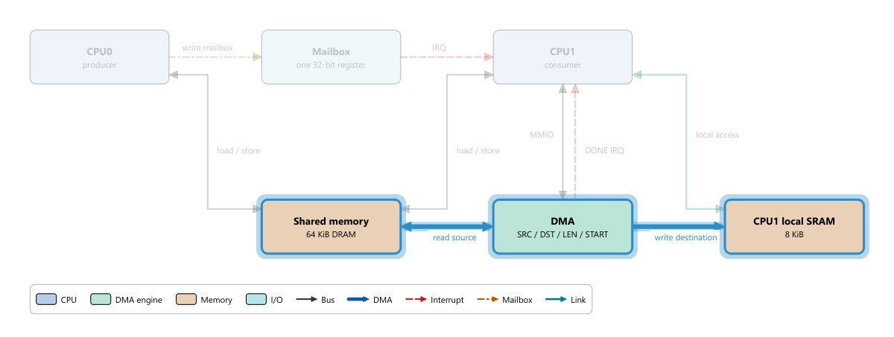

# 14 Authoring Your Own Topology JSON

> **What you will learn**
>
> - Every field of a topology JSON: top-level information, blocks, buses, flows and steps;
> - How to write bilingual (Chinese/English) fields;
> - How to choose coordinates so that buses and labels do not overlap;
> - How to validate a file with `tools/validate_arch_json.py` without building Ripes;
> - How to preview it in Ripes, how to package it as a built-in topology, and how to render a PNG with `tools/arch_render`;
> - A complete example you can paste: two CPUs + shared memory + DMA.
>
> **Prerequisites**
>
> - You can use the **Architecture** tab (chapter 11);
> - You can edit text files and know basic JSON syntax (objects `{}`, arrays `[]`, strings in double quotes);
> - The validator needs Python 3; the Windows user-space toolchain ships an interpreter at `P:\workspace\soc\toolchain\venv\Scripts\python.exe` (see chapter 01; elsewhere use your own `python3`).
>
> Authoritative sources: `docs/arch/arch_explorer.md` (schema and authoring guide), `src/archexplorer/archmodel.cpp` (loader), `tools/validate_arch_json.py` (validator).

---

## 14.1 Workflow overview

```
copy the template → sketch the layout → write blocks → write buses → write flows
   → validator → preview with Open in Ripes (Ctrl+R after edits) → (optional) check geometry with arch_render
   → (optional) register in resources/arch/arch.qrc and rebuild as a built-in topology
```

A topology is **pure data**: no C++ is needed. The loader (`ArchModel::fromJson`) and the Python validator perform exactly the same checks; any failure rejects the whole file with an error location such as `buses[2].to: references unknown block id 'foo'`.

## 14.2 Step one: start from the template

**Do**: copy the minimal template into a working directory of your own:

```bash
cp resources/arch/example_minimal.json my_arch/dual_cpu_dma.json
```

**What you see**: the template has 3 blocks (CPU, RAM, UART), 2 buses and 1 flow; select **Example: minimal system** in the **Architecture** tab to see how it looks (chapter 11, section 11.10).

**Why**: starting from a file that already passes validation and changing a little at a time makes errors easy to locate.

## 14.3 The schema, field by field

The file must be **strict JSON encoded as UTF-8**: no comments, no trailing commas. "Required" below means an error is reported if it is missing.

### Top-level object

| Field | Type | Required | Notes |
|---|---|---|---|
| `id` | string | yes | Non-empty unique identifier; best kept equal to the file name |
| `title` | text | yes | Non-empty; shown in the **Topology** drop-down |
| `subtitle` | text | no | Shown on the line below the title on the left |
| `description` | text | no | Shown in **Description** when no flow is selected; `\n` for a line break, `\n\n` for a paragraph |
| `blocks` | array | yes | At least one block |
| `buses` | array | no | May be omitted or empty |
| `flows` | array | no | May be omitted or empty |

"Text" means either a plain string or a bilingual object (section 14.4).

### Blocks `blocks[]`

| Field | Type | Required | Notes |
|---|---|---|---|
| `id` | string | yes | Unique within blocks; buses and steps refer to blocks by it |
| `label` | text | yes | Bold title inside the block; elided with "..." if too long |
| `sublabel` | text | no | Small text inside the block, word-wrapped |
| `kind` | string | yes | One of 12: `cpu` `gpu` `accel` `dma` `memory` `cache` `io` `bridge` `audio` `video` `bus` `misc`. Determines the fill colour and legend entry (colours in chapter 11, section 11.4) |
| `x`, `y` | number | yes | Top-left corner (logical pixels) |
| `w`, `h` | number | yes | Width and height, must be > 0 |
| `details` | text | no | Shown in **Details** on the right when the block is clicked |
| `props` | array or object | no | Property table, see "Two ways to write props" below |

#### Two ways to write props

- **Array (recommended; all built-in topologies use it)**: `"props": [{"key": "Clock", "value": "12 MHz"}, {"key": "Bits", "value": 32}]`. Shown **in the order written**; `key` and `value` may both be text (including bilingual objects), and `value` may also be a number or boolean.
- **Object**: `"props": {"Clock": "12 MHz", "Bits": 32}`. Shorter to write, but shown **sorted by key** (Qt's `QJsonObject` sorts keys), not in the order written.

### Buses `buses[]`

| Field | Type | Required | Notes |
|---|---|---|---|
| `id` | string | yes | Unique within buses |
| `from`, `to` | string | yes | Must be defined block ids |
| `kind` | string | yes | One of 5: `bus` `dma` `irq` `mailbox` `link` (line styles in chapter 11) |
| `label` | text | no | Drawn next to the middle of the line |
| `bidirectional` | boolean | no | Default `false`; `true` draws arrow heads at both ends |
| `props` | array or object | no | Same two forms as for blocks; shown in the mouse-hover tooltip and in the tooltip of the Connections table on the right |

Buses have **no coordinate fields**: the renderer computes the path from the positions of the two blocks (section 14.5).

### Flows `flows[]` and steps `steps[]`

| Field | Type | Required | Notes |
|---|---|---|---|
| `flows[].id` | string | yes | Unique within flows |
| `flows[].title` | text | yes | Shown in the **Data flow** drop-down |
| `flows[].description` | text | no | Shown when the flow is selected; also the list item's tooltip |
| `flows[].steps` | array | yes | At least one step |
| `steps[].text` | text | yes | Explanation of the step, shown in the bottom bar |
| `steps[].highlight` | array of strings | no | Block ids to highlight; each must exist |
| `steps[].buses` | array of strings | no | Bus ids to highlight; each must exist |

A step may highlight blocks without buses (e.g. "the component is computing internally"). If both `highlight` and `buses` are empty, nothing is highlighted and the step looks like step 0, so avoid that. **The right panel automatically shows the details of the first block in `highlight`**, so put the step's "main actor" first.

### Unknown fields

The loader ignores unknown fields; the Python validator prints `warning: ... unknown field (ignored by loader)`. A misspelt field name (e.g. `subLabel` instead of `sublabel`) is not an error, only a warning, so read the warnings.

## 14.4 Bilingual fields

Any user-facing text field may be written as an object with the keys `zh` and `en`:

```json
"title": {"zh": "练习：双 CPU + 共享内存 + DMA", "en": "Exercise: dual CPU + shared memory + DMA"}
```

On loading, Ripes picks by UI language: `zh` for the Chinese UI, otherwise `en`; if the matching language is missing it falls back to `en`, then `zh`. Plain strings remain valid (the same text in both languages), so language-neutral text such as `"label": "DMA"` can stay as it is.

Fields that may be bilingual: `title`, `subtitle`, `description`, `blocks[].label`, `blocks[].sublabel`, `blocks[].details`, `buses[].label`, `flows[].title`, `flows[].description`, `steps[].text`, and the keys and values of `props` (`key`/`value` in the array form, the values in the object form). For example:

```json
"props": [
  {"key": {"zh": "角色", "en": "Role"}, "value": {"zh": "生产者", "en": "producer"}},
  {"key": "ISA", "value": "RV32I"}
]
```

Fields that may not: every `id`, `kind`, `from`, `to`, `highlight`, `buses` (identifiers meant for the program) and the coordinates.

A bilingual object needs at least one of `zh` or `en`; if only one language is given the validator prints a warning such as `missing "en" text` (the file is still valid).

## 14.5 Coordinates and layout tips

Coordinate system: origin top-left, x to the right, y downwards, in logical pixels. Keep the canvas within roughly 1200 × 700; the legend is placed automatically 40 pixels below the lowest block.

**How buses are drawn** (`src/archexplorer/archscene.cpp`):

1. The two blocks overlap horizontally but not vertically → leave from the top/bottom edges and draw a **vertical** line;
2. They overlap vertically but not horizontally → leave from the left/right edges and draw a **horizontal** line;
3. No overlap → compare the horizontal and vertical distances between centres; the larger decides whether the route runs horizontally or vertically, as a "Z"-shaped polyline whose middle segment sits halfway between the blocks;
4. If the two anchors are almost aligned (≤ 8 pixels apart), a straight line is drawn;
5. Several buses on the same edge of a block get spread-out anchors (about 16 pixels apart), and several buses between the same pair of blocks get staggered middle segments;
6. The label goes at the middle of the longest segment: above a horizontal segment or to the right of a vertical one; labels above horizontal segments wrap to the segment length.

Practical rules that follow:

- **Join blocks in the same row with horizontal lines and blocks in the same column with vertical lines**; that is the tidiest;
- Leave at least **100–120 pixels** between blocks, or labels above horizontal lines will cover a block;
- **Never let a third block sit between two connected blocks**: buses do not route around blocks, they go straight through;
- A bus drawn as a block (a wide `kind: bus` bar such as PS3's EIB) is crossed by every vertical line; use it only when it really is the central interconnect;
- Make a block with many connections wider or taller to give its anchors room;
- Sketch a grid first (e.g. columns 300 apart, rows 220 apart), then fill in coordinates.

**Do**: the complete example in this chapter originally had 80-pixel gaps between CPU0, the mailbox and CPU1, and put "CPU1 local SRAM" directly below the DMA. The geometry check reported two problems: the label `write mailbox` covered CPU0, and the CPU1 → SRAM line went through the DMA. Widening the gaps to 120 and moving the SRAM to the right of the DMA fixed both (how to check: section 14.8).

## 14.6 Checking with the validator

**Do**: from the repository root run:

```bash
P:/workspace/soc/toolchain/venv/Scripts/python.exe -I tools/validate_arch_json.py my_arch/dual_cpu_dma.json
```

(Linux/macOS: `python3 -I tools/validate_arch_json.py my_arch/dual_cpu_dma.json`. Without arguments it checks every file in `resources/arch/`; a directory is accepted too.)

**What you see**: on success

```
[OK  ] my_arch/dual_cpu_dma.json: 6 blocks, 9 buses, 1 flows, 7 steps
1/1 files valid
```

On failure, e.g. when a bus's `to` names a non-existent `ramm`:

```
[FAIL] my_arch/dual_cpu_dma.json: buses[0].to: references unknown block id 'ramm'
0/1 files valid
```

Exit code 0 means all files passed, 1 means at least one failed, so it can be used in scripts or CI.

**Checking that the translation is complete**: add the `--bilingual` flag and the validator also lists, as warnings, text fields that are still plain strings (and props keys/values that contain Chinese):

```bash
P:/workspace/soc/toolchain/venv/Scripts/python.exe -I tools/validate_arch_json.py --bilingual my_arch/dual_cpu_dma.json
```

For this chapter's example it lists lines such as `blocks[0].label: plain string (not translated)`. Text that is the same in both languages, like `CPU0`, `DMA` or `IRQ`, needs no translation; the warnings are only a checklist to go through.

Common error messages:

| Message | Cause |
|---|---|
| `JSON parse error at line L col C: ...` | Syntax error: extra comma, missing quote, a comment |
| `blocks[3].kind: unknown block kind 'ram' (expected one of: ...)` | Misspelt kind; memory is `memory` |
| `blocks[1].id: duplicate block id 'cpu'` | Duplicate id |
| `blocks[0].w: must be > 0` | Width zero or negative |
| `flows[0].steps[2].highlight: references unknown block id 'dma0'` | A step refers to a block that does not exist |
| `flows[0].steps: must not be empty` | A flow without steps |
| `$.title: must be a string or a {"zh": ..., "en": ...} object` | A text field written as a number, array, etc. |
| `...: bilingual text object must contain "zh" and/or "en"` | Wrong key in a bilingual object (e.g. `"cn"`) |

The validator reports only the **first** error; fix it and run again until the file passes.

## 14.7 Previewing in Ripes, and where topologies come from

**Do**: switch to the **Architecture** tab, click **Open architecture JSON...** in the toolbar and choose your file.

**What you see**: a new entry appears in the topology drop-down with the file name after the title, e.g. `Exercise: dual CPU + shared memory + DMA (dual_cpu_dma.json)` (the Chinese title in the Chinese UI), and it becomes the current topology. If the file is invalid a "Failed to load ..." dialog appears with the same message the validator gives.

The explorer gets topologies from two places (`src/archexplorer/archexplorertab.cpp`, `archmodel.cpp`):

| Source | Mechanism | Lifetime |
|---|---|---|
| **Built-in** | At start-up it enumerates every `*.json` in the Qt resource directory `:/arch/`. These files are compiled into the program from `resources/arch/arch.qrc`; real machines are listed first, `example_minimal` last | Permanent |
| **File on disk** | Toolbar **Open architecture JSON...** | The path is remembered and the file is reloaded automatically at the next start (dropped if it was deleted or became invalid) |

Ripes **does not scan a directory on disk**, so a file placed in `resources/arch/` but not registered and rebuilt will not appear in the drop-down; open it once with Open instead.

**Edit–preview loop**: edit and save the JSON in your editor, go back to Ripes and press **Ctrl+R** (toolbar **Reload topology file**) to re-read the current topology. Opening the same file again (or another file with the same `id`) **replaces** its entry instead of adding a new one.

### Packaging as a built-in topology

1. Put the file in `resources/arch/`, preferably named `<id>.json`;
2. Add a line to `resources/arch/arch.qrc`:

   ```xml
   <file>dual_cpu_dma.json</file>
   ```

3. Rebuild Ripes (chapter 01). `test/tst_archmodel` automatically loads and checks every `:/arch/*.json`, so run it as well.

Do not also add `arch.qrc` to the top-level executable's resources: it is already compiled into `archexplorer_lib`, and adding it twice defines the resource initialiser twice.

## 14.8 Rendering PNGs and checking geometry with arch_render

`tools/arch_render` renders topologies off-screen with **exactly the same** `ArchScene` code as the tab, which makes it suitable for documentation figures and layout checks. It works on **any JSON file**; nothing needs to be packaged first.

**Build** (from the repository root in Git Bash; it uses the toolchain's MinGW + Qt directly, no CMake):

```bash
bash tools/arch_render/build.sh
```

The result is `build/arch_render/arch_render.exe` (plus the Chinese translation file `build/arch_render/archexplorer_zh_CN.qm`, used with `--qm` so that legend kind names appear in Chinese).

**Usage**:

```bash
export QT_QPA_PLATFORM=offscreen QT_QPA_FONTDIR="C:/Windows/Fonts"   # headless; the font dir keeps Chinese text from becoming boxes
export PATH="/p/workspace/soc/toolchain/Qt/6.8.3/mingw_64/bin:$PATH"
R=build/arch_render/arch_render.exe

$R --lang en my_arch/dual_cpu_dma.json dump                 # check the layout
$R --lang zh my_arch/dual_cpu_dma.json out.png              # render a PNG (Chinese text)
$R --lang en --step 0:5 my_arch/dual_cpu_dma.json step5.png # render flow 0, step 5 highlighted
$R --lang en all dump                                       # check every built-in topology
```

That is, `arch_render <file.json> <out.png>|dump [--step f:n] [--lang zh|en]`: `--lang` chooses which language of the bilingual text is used (default `zh`), and `--step f:n` means step n of flow f, with flows counted from 0 and steps counted from 1 (the same numbering as `Step n of N` in the tab), so `--step 0:5` is the fifth step of the first flow. More uses (dark palette, regenerating `docs/arch/images` in bulk) are in `tools/arch_render/README.md`.

The end of the `dump` output lists the findings:

| Line | Meaning |
|---|---|
| `OVERLAP label X x block Y` | Bus X's label covers block Y |
| `OVERLAP label X x label Z` | Two bus labels overlap |
| `OVERLAP label X x legend` | A label covers the legend |
| `THROUGH bus X segment N x block Y` | Segment N of bus X passes through block Y, which is not one of its ends |
| `ELIDED  block Y label` | Block Y's title does not fit and is elided with "..." |
| `CLIPPED block Y sublabel` | Block Y's wrapped sublabel is too tall and gets cut off |
| `note: label X crosses bus Z` | A label lies on another bus (a hint only, not counted as a problem) |

The last line is `<id>: N problem(s)`; the exit code is 0 when there are none. For this chapter's example the result is `dual_cpu_dma: 0 problem(s)`. Buses that cross a wide `kind: "bus"` bar (such as PS3's EIB) are also reported as `THROUGH`; whether that is acceptable is the author's call.



## 14.9 Complete example: two CPUs + shared memory + DMA

This topology describes a producer/consumer system: CPU0 writes data into shared memory and writes a mailbox to notify CPU1; on the interrupt CPU1 programs the DMA to copy the data into its local SRAM, waits for the DMA-done interrupt and computes locally. It condenses the common pattern of chapters 12 (mailbox), 13 (Local Store + DMA) and 10 (doorbell + DMA) into 6 blocks.

Save the following as `my_arch/dual_cpu_dma.json`:

```json
{
  "id": "dual_cpu_dma",
  "title": {"zh": "练习：双 CPU + 共享内存 + DMA", "en": "Exercise: dual CPU + shared memory + DMA"},
  "subtitle": {"zh": "生产者 / 消费者，经信箱通知、DMA 搬运", "en": "Producer / consumer with a mailbox and a DMA engine"},
  "description": {"zh": "CPU0 是生产者，把数据写入共享内存后敲信箱；CPU1 是消费者，收到中断后让 DMA 把数据搬进自己的本地 SRAM 再计算。\n\n这是 Cell（PPE + SPE）和 NPU（门铃 + DMA）共同的最小模型。", "en": "CPU0 is the producer: it writes data into shared memory and rings the mailbox. CPU1 is the consumer: on the interrupt it lets the DMA engine copy the data into its local SRAM and then computes.\n\nThis is the smallest model shared by Cell (PPE + SPE) and the NPU (doorbell + DMA)."},
  "blocks": [
    {"id": "cpu0", "kind": "cpu", "label": "CPU0", "sublabel": {"zh": "生产者", "en": "producer"},
     "x": 40, "y": 40, "w": 180, "h": 70,
     "details": {"zh": "把一块数据写进共享内存，然后写信箱寄存器通知 CPU1。", "en": "Writes a block of data into shared memory, then writes the mailbox register to notify CPU1."},
     "props": [{"key": "ISA", "value": "RV32I"}, {"key": "Role", "value": {"zh": "生产者", "en": "producer"}}]},
    {"id": "mbox", "kind": "io", "label": "Mailbox", "sublabel": {"zh": "1 个 32-bit 寄存器", "en": "one 32-bit register"},
     "x": 340, "y": 40, "w": 180, "h": 70,
     "details": {"zh": "CPU0 写入时向 CPU1 发中断；CPU1 读出后中断清除。", "en": "A write by CPU0 interrupts CPU1; reading it clears the interrupt."},
     "props": [{"key": "Depth", "value": 1}, {"key": "Width", "value": "32 bit"}]},
    {"id": "cpu1", "kind": "cpu", "label": "CPU1", "sublabel": {"zh": "消费者", "en": "consumer"},
     "x": 640, "y": 40, "w": 180, "h": 70,
     "details": {"zh": "收到信箱中断后配置 DMA，等待 DMA 完成中断，然后在本地 SRAM 上计算。", "en": "On the mailbox interrupt it programs the DMA, waits for the DMA-done interrupt and computes on its local SRAM."},
     "props": [{"key": "ISA", "value": "RV32IM"}, {"key": "Role", "value": {"zh": "消费者", "en": "consumer"}}]},
    {"id": "shmem", "kind": "memory", "label": {"zh": "共享内存", "en": "Shared memory"}, "sublabel": "64 KiB DRAM",
     "x": 340, "y": 260, "w": 180, "h": 70,
     "details": {"zh": "两颗 CPU 和 DMA 都能访问。", "en": "Accessible by both CPUs and the DMA engine."},
     "props": [{"key": "Size", "value": "64 KiB"}]},
    {"id": "dma", "kind": "dma", "label": "DMA", "sublabel": "SRC / DST / LEN / START",
     "x": 640, "y": 260, "w": 180, "h": 70,
     "details": {"zh": "CPU1 写 SRC、DST、LEN 后写 START；搬完后置 DONE 并发中断。", "en": "CPU1 writes SRC, DST, LEN and then START; when finished it sets DONE and raises an interrupt."},
     "props": [{"key": "Bandwidth", "value": "4 B / cycle"}]},
    {"id": "sram1", "kind": "memory", "label": {"zh": "CPU1 本地 SRAM", "en": "CPU1 local SRAM"}, "sublabel": "8 KiB",
     "x": 940, "y": 260, "w": 180, "h": 70,
     "details": {"zh": "只有 CPU1 和 DMA 能访问，类似 SPE 的 Local Store。", "en": "Only CPU1 and the DMA engine can access it, like an SPE Local Store."},
     "props": [{"key": "Size", "value": "8 KiB"}]}
  ],
  "buses": [
    {"id": "b_cpu0_mem", "from": "cpu0", "to": "shmem", "kind": "bus", "bidirectional": true, "label": "load / store"},
    {"id": "b_cpu1_mem", "from": "cpu1", "to": "shmem", "kind": "bus", "bidirectional": true, "label": "load / store"},
    {"id": "b_mbox_wr", "from": "cpu0", "to": "mbox", "kind": "mailbox", "label": {"zh": "写信箱", "en": "write mailbox"}},
    {"id": "b_mbox_irq", "from": "mbox", "to": "cpu1", "kind": "irq", "label": "IRQ"},
    {"id": "b_dma_cfg", "from": "cpu1", "to": "dma", "kind": "bus", "bidirectional": true, "label": "MMIO"},
    {"id": "b_dma_done", "from": "dma", "to": "cpu1", "kind": "irq", "label": "DONE IRQ"},
    {"id": "b_dma_rd", "from": "dma", "to": "shmem", "kind": "dma", "bidirectional": true, "label": {"zh": "读源数据", "en": "read source"}},
    {"id": "b_dma_wr", "from": "dma", "to": "sram1", "kind": "dma", "label": {"zh": "写目标", "en": "write destination"}},
    {"id": "b_cpu1_sram", "from": "cpu1", "to": "sram1", "kind": "link", "bidirectional": true, "label": {"zh": "本地访问", "en": "local access"}}
  ],
  "flows": [
    {"id": "handoff",
     "title": {"zh": "CPU0 把一块数据交给 CPU1", "en": "CPU0 hands a block of data to CPU1"},
     "description": {"zh": "信箱只传通知，数据由 DMA 搬运。", "en": "The mailbox carries only the notification; the DMA engine moves the data."},
     "steps": [
       {"highlight": ["cpu0", "shmem"], "buses": ["b_cpu0_mem"], "text": {"zh": "CPU0 把 1 KiB 数据写进共享内存。", "en": "CPU0 writes 1 KiB of data into shared memory."}},
       {"highlight": ["cpu0", "mbox"], "buses": ["b_mbox_wr"], "text": {"zh": "CPU0 把数据的地址写进信箱寄存器。", "en": "CPU0 writes the data's address into the mailbox register."}},
       {"highlight": ["mbox", "cpu1"], "buses": ["b_mbox_irq"], "text": {"zh": "信箱向 CPU1 发中断；CPU1 读出地址，中断清除。", "en": "The mailbox interrupts CPU1; CPU1 reads the address and the interrupt clears."}},
       {"highlight": ["cpu1", "dma"], "buses": ["b_dma_cfg"], "text": {"zh": "CPU1 写 DMA 的 SRC、DST、LEN，再写 START。", "en": "CPU1 writes the DMA's SRC, DST and LEN, then START."}},
       {"highlight": ["dma", "shmem", "sram1"], "buses": ["b_dma_rd", "b_dma_wr"], "text": {"zh": "DMA 从共享内存读、向本地 SRAM 写，CPU1 可以先做别的事。", "en": "The DMA reads shared memory and writes the local SRAM; CPU1 is free meanwhile."}},
       {"highlight": ["dma", "cpu1"], "buses": ["b_dma_done"], "text": {"zh": "搬运完成，DMA 置 DONE 并发中断。", "en": "Transfer complete: the DMA sets DONE and raises an interrupt."}},
       {"highlight": ["cpu1", "sram1"], "buses": ["b_cpu1_sram"], "text": {"zh": "CPU1 在本地 SRAM 上计算，不再访问共享内存。", "en": "CPU1 computes on its local SRAM without touching shared memory."}}
     ]}
  ]
}
```

Layout:

| Row | y | Blocks (x) |
|---|---|---|
| Top | 40 | CPU0 (40), Mailbox (340), CPU1 (640) |
| Bottom | 260 | Shared memory (340), DMA (640), CPU1 local SRAM (940) |

Columns are 300 apart and blocks are 180 wide, leaving 120 pixels between neighbours in a row for labels; the rows are 150 pixels apart. The CPU0 → shared memory, CPU1 → shared memory and CPU1 → SRAM buses become automatic Z-shaped polylines; all others are straight.

**Do**:

1. Save the file and validate it with the command from section 14.6 (add `--bilingual` to see which texts are still single-language);
2. Open it in the **Architecture** tab with **Open architecture JSON...**; click **CPU0** and check that the properties table shows `ISA`, `Role` in the order written;
3. Choose the flow "CPU0 hands a block of data to CPU1" and press → through all 7 steps.

**What you see**: the legend shows four block kinds (CPU, DMA engine, Memory, I/O) and five bus kinds (Bus, DMA, Interrupt, Mailbox, Link); at step 5 the DMA, shared memory and SRAM are highlighted together and both thick blue lines glow.

## 14.10 Exercises

1. **Add a flow**: add a second flow `cpu0_direct` to the example, "CPU0 writes its result directly into CPU1's local SRAM". Which bus must you add first? Write the new bus and 3 steps.
2. **Break it on purpose**: change `b_dma_rd`'s `kind` to `"DMA"` (upper case), run the validator and note the error; then change some step's `highlight` to `["cpu2"]` and note the error.
3. **Layout experiment**: put `sram1` back at `"x": 640, "y": 440` (directly below the DMA) and look with arch_render's `dump` or in Ripes: which bus has a problem, and why?
4. **Bilingual**: turn the label `"IRQ"` of `b_mbox_irq` into a bilingual object with the Chinese "信箱中断". Switch the Ripes UI language, restart, and check both languages.
5. **Your own system**: write a topology for the Ripes peripheral system used in chapter 08 (RISC-V core + memory + LED matrix + switches) with at least one flow, and make it pass the validator.

### Answers

1. A bus from `cpu0` to `sram1`, e.g.:

   ```json
   {"id": "b_cpu0_sram", "from": "cpu0", "to": "sram1", "kind": "bus", "label": "remote store"}
   ```

   Example steps: `{"highlight": ["cpu0"], "text": "CPU0 computes the result."}`, `{"highlight": ["cpu0", "sram1"], "buses": ["b_cpu0_sram"], "text": "CPU0 writes straight into CPU1's SRAM."}`, `{"highlight": ["cpu0", "mbox", "cpu1"], "buses": ["b_mbox_wr", "b_mbox_irq"], "text": "CPU0 writes the mailbox to tell CPU1 the data is ready."}`. But this bus causes trouble: `cpu0` (x 40..220) and `sram1` (x 940..1120) are much farther apart horizontally than vertically, so the renderer draws a horizontal Z-shaped line whose first horizontal segment crosses the Mailbox at y≈98 and whose last one crosses the DMA at y≈272. `dump` reports `THROUGH bus b_cpu0_sram segment 0 x block mbox`, `THROUGH bus b_cpu0_sram segment 2 x block dma` and others, 4 problems in all. Fixes: change the layout (e.g. move the SRAM to a third row), or express the path as "CPU0 → shared memory → DMA → SRAM" in the topology.
2. `buses[6].kind: unknown bus kind 'DMA' (expected one of: bus, dma, irq, mailbox, link)` (kinds are case-sensitive); `flows[0].steps[k].highlight: references unknown block id 'cpu2'`.
3. `dump` reports `THROUGH bus b_cpu1_sram segment 0 x block dma`: CPU1, DMA and SRAM are in one column, so the vertical CPU1 → SRAM line must pass through the DMA in the middle. Buses do not route around blocks; only the layout can fix it.
4. `"label": {"zh": "信箱中断", "en": "IRQ"}`. The Chinese UI shows "信箱中断", the English UI shows "IRQ".
5. Open-ended. Hint: the RISC-V core is `cpu`, memory is `memory`, the LED matrix and switches are `io`; model a "CPU reads switches → writes LEDs" flow on the "print_char" flow of `example_minimal.json`.

## 14.11 Summary

- Topology = top-level information + blocks + buses + flows; a missing required field, a misspelt kind, a duplicate id or a reference to an unknown id rejects the whole file;
- User-facing text (including props keys and values) may be a `{"zh", "en"}` bilingual object; ids, kinds and coordinates may not; a `{key, value}` props array keeps the order written;
- Bus paths are computed automatically: horizontal within a row, vertical within a column; leave enough space and never put a third block in the way;
- Validate with `tools/validate_arch_json.py` (`--bilingual` checks the translation), preview with **Open architecture JSON...** and reload with **Ctrl+R**; opened files are remembered; to make it built-in, register it in `resources/arch/arch.qrc` and rebuild;
- `tools/arch_render <file.json> <out.png>|dump` uses the same rendering code to render any topology and checks label overlaps, lines through blocks and truncated text.
