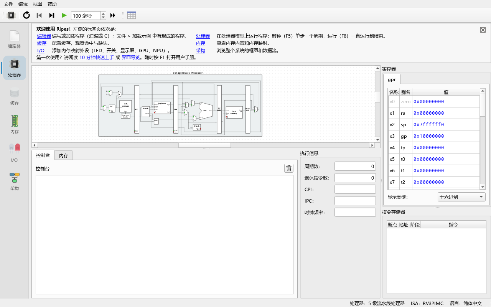

# 01 安装与构建

> **你将学到**
> - open-soc-explorer 有哪些获取方式：预编译程序与源码构建的区别
> - 在 Windows 上用"用户态工具链"（user-space toolchain）和驱动脚本 `build.ps1` 编译、运行测试
> - 在 Linux / macOS 上用通用的 CMake 步骤编译
> - 如何运行单元测试、如何在没有显示器的环境里（无头，headless）运行程序
> - 常见构建错误的原因与解决办法
>
> **前置条件**
> - 会打开命令行（Windows 的 PowerShell，或 Linux/macOS 的终端）
> - 大约 5 GB 空闲磁盘空间和 8 GB 以上内存（首次全量编译需要 10–20 分钟）
> - 如果只是使用老师已经编译好的程序，可以直接跳到[第 02 章](02-quickstart.md)

---

## 1. 两种获取方式

### 1.1 预编译程序

上游 Ripes 项目在 GitHub 的 Releases 页面提供 Windows / Linux（AppImage）/ macOS 的预编译程序，也有浏览器版（<https://ripes.dk/>）。**但这些上游版本不包含本项目新增的 SIMT GPU、Tensor Unit (NPU) 外设和 Architecture 标签页。**

open-soc-explorer 目前没有公开发布的预编译安装包（待核实）。在课堂环境中，通常由老师在一台机器上从源码编译出 `Ripes.exe`，再把整个 `build` 目录（连同 Qt 运行库）复制给学生。如果你拿到的是这样一个目录，直接双击其中的 `Ripes.exe` 即可，不需要本章其余内容。

> 程序的可执行文件仍然叫 `Ripes.exe`（Linux/macOS 上是 `Ripes`），窗口标题也是 "Ripes"。这是因为本项目是 Ripes 的分支（fork），保留了原来的程序名。

### 1.2 从源码构建

源码构建分三步：

1. 准备依赖：C++20 编译器、CMake、Ninja（或 make）、**Qt 6.8 以上**（必须包含 **Qt Charts** 和 **Qt Svg** 模块）。
2. 获取源码，包括三个 git 子模块（submodule）：`external/VSRTL`、`external/ELFIO`、`external/libelfin`。
3. 用 CMake 配置（configure）、编译（build），可选地运行测试。

为什么要 Qt 6.8？顶层 `CMakeLists.txt` 中写的是：

```cmake
find_package(Qt6 6.8 COMPONENTS Core Widgets Svg Charts REQUIRED)
```

版本低于 6.8 或缺少 Charts 模块时，CMake 配置阶段就会失败。

---

## 2. Windows：用户态工具链 + `build.ps1`

本项目在 Windows 上使用一套**完全装在用户目录下**的工具链，不需要管理员权限，也不修改系统 PATH。目录布局如下：

```text
P:\workspace\soc\
├── build.ps1                     驱动脚本：配置 + 编译 + 测试
├── open-soc-explorer\            源码（本仓库）
│   └── build\                    构建目录（Ripes.exe 在这里）
└── toolchain\
    ├── venv\Scripts\             Python 虚拟环境：cmake.exe、ninja.exe、aqtinstall
    ├── Qt\6.8.3\mingw_64\        Qt 6.8.3（含 Qt Charts）
    ├── Qt\Tools\mingw1310_64\    MinGW-w64 13.1 编译器（gcc/g++）
    └── cmake\mingw-bigobj-fixup.cmake   修正 MinGW 下 -mbig-obj 选项的 CMake 片段
```

这些组件是用 `pip install cmake ninja aqtinstall`（装进 `toolchain\venv`）和 `aqt install-qt windows desktop 6.8.3 win64_mingw -m qtcharts`、`aqt install-tool windows desktop tools_mingw...` 装进 `toolchain\` 的（见 `docs/arch/PLAN.md` 模块 F）。如果你的机器上已经有这个目录，就可以直接构建。

> **注意**：不要为了"下载更快"去关闭 TLS 证书校验，也不要安装系统级软件或修改系统 PATH。所有 PATH 修改都只在 `build.ps1` 的当前会话中生效。

### 2.1 第一次构建

**做一步**：打开 PowerShell，运行：

```powershell
powershell -ExecutionPolicy Bypass -File P:\workspace\soc\build.ps1
```

**看到什么**：屏幕上依次出现三类分段标题：

```text
=== configure ===
...（CMake 输出）
=== configure done in 25.3s ===

=== build ===
ninja jobs: 4
[1/900] Building CXX object ...
...
=== build done in 900.0s ===

=== test tst_accel_e2e ===
...
=== test summary ===
Test          Exit Status
----          ---- ------
tst_accel_e2e    0 PASS
...
all 10 tests passed
```

（数字只是示意，实际耗时取决于机器。）

**为什么**：`build.ps1` 做了这些事：

1. 检查工具链组件是否齐全（`cmake.exe`、`ninja.exe`、`gcc.exe`、`g++.exe`、fixup 文件、`Qt6Core.dll`），缺一个就报 `Toolchain component missing: ...` 并停止。
2. 只在当前会话里把 MinGW、Qt 的 `bin` 和 `venv\Scripts` 放到 PATH 最前面（让新的 g++ 盖过系统里可能存在的旧版 `C:\MinGW`），并设置 `CC`/`CXX`。
3. 如果构建目录 `<Repo>\build` 里还没有 `build.ninja`，就运行 CMake 配置，参数包括 `-G Ninja`、`-DCMAKE_BUILD_TYPE=Release`、`-DRIPES_BUILD_TESTS=ON`、`-DCMAKE_PREFIX_PATH=<Qt 目录>` 和 `-DCMAKE_PROJECT_INCLUDE=<fixup 文件>`。
4. 用 `cmake --build` 调用 Ninja 编译。
5. 运行 `build\test\` 下所有 `tst_*.exe`，最后打印汇总表；只要有一个失败，脚本以退出码 1 结束。

脚本还会在当前会话中设置 `QT_QPA_PLATFORM=offscreen`（如果你没有设置过），让需要创建窗口的测试在没有显示器时也能运行；并设置 `QT_LOGGING_TO_CONSOLE=1`，让 Qt 的测试输出写到控制台而不是 Windows 调试器通道。

构建完成后，程序位于：

```text
P:\workspace\soc\open-soc-explorer\build\Ripes.exe
```

### 2.2 `build.ps1` 参数一览

| 参数 | 作用 | 例子 |
|---|---|---|
| （无参数） | 需要时配置 → 编译全部目标 → 运行全部测试 | `.\build.ps1` |
| `-SkipTests` | 只编译，不跑测试 | `.\build.ps1 -SkipTests` |
| `-Configure` | 删除 `CMakeCache.txt` 并强制重新配置（改了 CMake 选项或换了 Qt 时用） | `.\build.ps1 -Configure` |
| `-Target <名字>` | 只编译一个目标。若目标名不以 `tst_` 开头，则自动跳过测试；若是 `tst_xxx`，编译后自动运行它 | `.\build.ps1 -Target Ripes` |
| `-Tests <名字,...>` | 只运行列出的测试（可以带或不带 `.exe`） | `.\build.ps1 -Target tst_gpu -Tests tst_gpu` |
| `-Jobs <n>` | 指定并行编译任务数；默认 0 表示自动 | `.\build.ps1 -Jobs 2` |
| `-Repo <路径>` | 构建另一份源码树，构建目录是 `<路径>\build` | `.\build.ps1 -Repo P:\workspace\soc\agents\gpu` |
| `-BuildType <类型>` | CMake 构建类型，默认 `Release` | `.\build.ps1 -Configure -BuildType Debug` |

关于 `-Jobs` 的自动值：脚本按"每 1.5 GB 空闲内存一个任务"计算，并限制在 2 到 8 之间、且不超过 CPU 核数。原因是处理器/ISA 相关的翻译单元模板很重，每个 `cc1plus` 进程可能占用约 1.5 GB 内存；Ninja 默认的"核数 + 2"个任务会把内存耗尽。

### 2.3 常用组合

```powershell
# 只重新编译主程序（改了 GUI 代码之后最常用）
powershell -ExecutionPolicy Bypass -File P:\workspace\soc\build.ps1 -Target Ripes

# 只编译并运行 GPU 单元测试
powershell -ExecutionPolicy Bypass -File P:\workspace\soc\build.ps1 -Target tst_gpu

# 编译全部但只跑两个测试
powershell -ExecutionPolicy Bypass -File P:\workspace\soc\build.ps1 -Tests tst_npu,tst_archmodel

# 在内存紧张的机器上构建另一份副本
powershell -ExecutionPolicy Bypass -File P:\workspace\soc\build.ps1 -Repo P:\workspace\soc\agents\core -Jobs 2 -Target Ripes
```

为什么用 `powershell -ExecutionPolicy Bypass -File ...` 而不是直接 `.\build.ps1`？因为很多 Windows 机器默认禁止运行未签名的脚本；`-ExecutionPolicy Bypass` 只对这一次调用生效，不会改变系统策略。

### 2.4 启动程序

**做一步**：在资源管理器中双击 `build\Ripes.exe`，或在 PowerShell 中：

```powershell
P:\workspace\soc\open-soc-explorer\build\Ripes.exe
```

**看到什么**：主窗口打开，左侧是一列竖排的标签（Editor、Processor、Cache、Memory、I/O、Architecture），默认停在 **Processor** 标签页，中间显示 5 级流水线处理器的电路图。第一次启动时窗口会最大化；之后会记住上次关闭时的位置和大小。

**为什么**：`build\Ripes.exe` 能直接运行，是因为它依赖的 Qt DLL 位于 `toolchain\Qt\6.8.3\mingw_64\bin`。如果双击后提示找不到 `Qt6Core.dll` 等文件，说明这个目录不在 PATH 上——见第 6 节"常见构建错误"。



---

## 3. Linux / macOS：通用 CMake 步骤

以下步骤不依赖本仓库的 Windows 脚本，适用于任何装有 Qt 6.8+ 的系统。

### 3.1 安装依赖

- **编译器**：支持 C++20 的 GCC / Clang。
- **CMake** ≥ 3.13（推荐较新的版本）、**Ninja** 或 make。
- **Qt 6.8 或更新版本**，必须包含 **Qt Charts** 与 **Qt Svg**。推荐用 Qt 官方安装器或 `aqtinstall` 装到用户目录，例如：

  ```bash
  python3 -m pip install --user aqtinstall
  python3 -m aqt install-qt linux desktop 6.8.3 linux_gcc_64 -m qtcharts -O ~/Qt
  ```

  （macOS 用 `mac desktop 6.8.3 clang_64`，待核实具体架构名。）
- **Linux 额外依赖**：上游 Ripes 的说明要求安装 EGL 开发包，例如 Ubuntu 上的 `libegl1-mesa-dev`。

### 3.2 获取源码

```bash
git clone --recursive <仓库地址> open-soc-explorer
cd open-soc-explorer
# 如果克隆时忘了 --recursive：
git submodule update --init --recursive
```

### 3.3 配置与编译

```bash
cmake -S . -B build -G Ninja \
      -DCMAKE_BUILD_TYPE=Release \
      -DRIPES_BUILD_TESTS=ON \
      -DCMAKE_PREFIX_PATH=$HOME/Qt/6.8.3/gcc_64
cmake --build build -j 4
```

**为什么**这样写：

- `-DCMAKE_PREFIX_PATH` 告诉 CMake 去哪里找 Qt；不设置时 CMake 只会找系统自带的 Qt，版本往往不够新。
- `-DRIPES_BUILD_TESTS=ON` 打开测试目标（默认是 `OFF`）。不需要测试可以省略。
- `-j 4` 限制并行任务数，理由同 2.2 节：每个编译进程可能占用约 1.5 GB 内存。

编译成功后，程序是 `build/Ripes`（macOS 上可能是 `build/Ripes.app`，待核实）。

---

## 4. 运行测试

打开 `RIPES_BUILD_TESTS=ON` 后，`test/CMakeLists.txt` 会创建以下 10 个 QTest 可执行程序（位于 `build/test/`）：

| 测试 | 覆盖内容 |
|---|---|
| `tst_riscv` | RISC-V 指令执行 |
| `tst_assembler` | 汇编器 |
| `tst_expreval` | 汇编器中的表达式求值 |
| `tst_cosimulate` | 各处理器模型与 ISA 模拟器的协同仿真对照 |
| `tst_reverse` | 反向执行（撤销时钟周期） |
| `tst_stall` | 流水线停顿 |
| `tst_gpu` | SIMT GPU 仿真核 |
| `tst_npu` | 张量处理器仿真核与外设 |
| `tst_archmodel` | 架构浏览器的拓扑 JSON 加载与校验 |
| `tst_accel_e2e` | GPU 外设端到端（RISC-V 主机程序 + GPU） |

Windows 上 `build.ps1` 默认会全部运行。手动运行单个测试：

```powershell
$env:QT_QPA_PLATFORM = "offscreen"
P:\workspace\soc\open-soc-explorer\build\test\tst_gpu.exe
```

Linux/macOS：

```bash
cd build/test
QT_QPA_PLATFORM=offscreen ./tst_gpu
# 一次性运行全部
for t in tst_*; do QT_QPA_PLATFORM=offscreen ./$t || echo "FAILED: $t"; done
```

`test/CMakeLists.txt` 里对每个测试调用了 `add_test`，但顶层 `CMakeLists.txt` 中没有 `enable_testing()`，所以 `ctest` 可能报告 "No tests were found"（待核实）。用上面的循环最可靠。

**看到什么**：QTest 的输出以 `Totals: N passed, 0 failed, 0 skipped` 结尾，退出码为 0 表示通过。

---

## 5. 无头运行（headless）

在没有显示器的服务器、CI 或远程终端上，Qt 程序默认会因为找不到显示而退出。设置环境变量 `QT_QPA_PLATFORM=offscreen` 可以让 Qt 在内存中"假装"有一个屏幕：

```powershell
# Windows PowerShell（只对当前会话生效）
$env:QT_QPA_PLATFORM = "offscreen"
$env:PATH = "P:\workspace\soc\toolchain\Qt\6.8.3\mingw_64\bin;" + $env:PATH
```

```bash
# Linux / macOS
export QT_QPA_PLATFORM=offscreen
```

典型用途：

- 运行单元测试（`build.ps1` 已自动设置）。
- 用命令行模式批量跑程序（见[第 15 章](15-cli.md)）。
- 截图工具（`tools/gui_shots/`，第二阶段计划中）用离屏渲染生成本手册的截图。

> 注意：在 `offscreen` 下，任何会弹出对话框的操作（例如 `--help` 在 Windows 上会弹出消息框）都会一直等待，看起来像"卡住"。详见[第 15 章](15-cli.md)和[第 16 章](16-faq.md)。

---

## 6. 常见构建错误

| 现象 | 原因 | 解决办法 |
|---|---|---|
| `Toolchain component missing: P:\workspace\soc\toolchain\...` | `build.ps1` 检查到工具链缺少某个组件 | 按 `docs/arch/PLAN.md` 模块 F 的步骤补装；不要改用系统级安装 |
| `Could not find a configuration file for package "Qt6" ... version 6.8` | Qt 版本低于 6.8，或 `CMAKE_PREFIX_PATH` 没指向 Qt | 安装 Qt 6.8+，并在配置时传 `-DCMAKE_PREFIX_PATH=<Qt>/<版本>/<编译器>` |
| `Could not find ... Qt6Charts` | Qt 安装时没有选 Charts 模块 | 用 `aqt install-qt ... -m qtcharts` 或在 Qt 安装器中勾选 Qt Charts |
| `external/VSRTL/...: No such file or directory`，或 CMake 提示子目录不存在 | 没有拉取 git 子模块 | `git submodule update --init --recursive` |
| 编译到一半 `cc1plus.exe: out of memory` 或机器卡死 | 并行任务太多，内存耗尽 | 用更小的 `-Jobs`（如 `-Jobs 2`），或 Linux 上 `cmake --build build -j 2` |
| `g++: error: unrecognized command-line option '-mbig-obj'` 或汇编器报 "too many sections" | MinGW 下顶层 `CMakeLists.txt` 的 `-mbig-obj` 写法需要修正 | 用 `build.ps1`（它通过 `-DCMAKE_PROJECT_INCLUDE` 引入 `mingw-bigobj-fixup.cmake`）；手动配置时加同样的参数 |
| 链接时出现奇怪的 `undefined reference` 或编译器版本是 4.9.3 | 系统里的旧版 `C:\MinGW` 被优先找到 | 用 `build.ps1`（它把 MinGW 13.1 放在 PATH 最前面并设置 `CC`/`CXX`）；手动构建时显式传 `-DCMAKE_C_COMPILER`/`-DCMAKE_CXX_COMPILER` |
| PowerShell 显示红色 `NativeCommandError`，但其实 CMake 没出错 | PowerShell 5.1 把原生程序写到 stderr 的文字当作错误 | 看 `$LASTEXITCODE` 而不是红字；`build.ps1` 已经这样处理 |
| `无法加载文件 build.ps1，因为在此系统上禁止运行脚本` | 执行策略（Execution Policy）限制 | 用 `powershell -ExecutionPolicy Bypass -File ...` 调用 |
| 改了 CMake 选项或换了 Qt 版本后仍然用旧设置 | `CMakeCache.txt` 缓存了旧值 | `build.ps1 -Configure`，或删除 `build/CMakeCache.txt` 后重新配置 |
| 双击 `Ripes.exe` 提示缺少 `Qt6Core.dll` / `Qt6Charts.dll` | Qt 的 `bin` 目录不在 PATH 上 | 在启动它的会话中把 `toolchain\Qt\6.8.3\mingw_64\bin` 加到 PATH；或用 Qt 的 `windeployqt` 把 DLL 复制到 `build` 目录（待核实） |
| 测试程序运行时报 `could not connect to display` / `no Qt platform plugin` | 没有显示器，或找不到平台插件 | 设置 `QT_QPA_PLATFORM=offscreen`；确认 Qt 的 `plugins/platforms` 可被找到 |
| 下载 Qt 或子模块时报 TLS/证书错误 | 网络代理或证书问题 | 配置正确的代理或证书；**不要**关闭 TLS 校验 |

---

## 练习

1. 运行一次 `build.ps1 -SkipTests`，记录 "build" 阶段用了多少秒。再运行一次，比较第二次的耗时——为什么增量构建快得多？
2. 用 `-Target tst_archmodel` 只编译并运行架构浏览器的测试，找到输出中的 `Totals:` 一行。
3. 打开 `P:\workspace\soc\build.ps1`，找到计算默认 `-Jobs` 的那几行代码。如果你的机器有 16 GB 空闲内存和 12 个核，默认会用几个任务？
4. （Linux/macOS）不带 `-DRIPES_BUILD_TESTS=ON` 配置一次，看看 `build/test/` 目录是否存在。

## 小结

- 本项目需要 Qt 6.8+（含 Charts 和 Svg）、C++20 编译器、CMake，以及三个 git 子模块。
- Windows 上用 `P:\workspace\soc\build.ps1` 驱动用户态工具链：它只在会话内修改 PATH，自动配置、编译、测试；常用参数是 `-SkipTests`、`-Configure`、`-Target`、`-Tests`、`-Jobs`、`-Repo`。
- Linux/macOS 上就是标准的 `cmake -S . -B build -DCMAKE_PREFIX_PATH=... -DRIPES_BUILD_TESTS=ON` + `cmake --build build`。
- 无头环境设置 `QT_QPA_PLATFORM=offscreen`。
- 构建失败时，先查第 6 节的表：大多数问题是 Qt 版本/模块、子模块、内存或 PATH 造成的。

下一章：[02 10 分钟上手](02-quickstart.md)。
