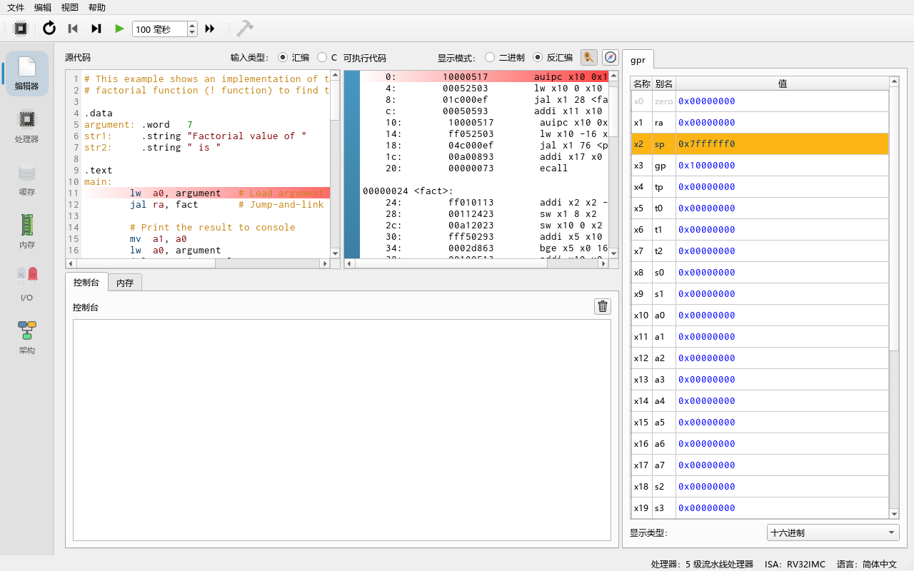
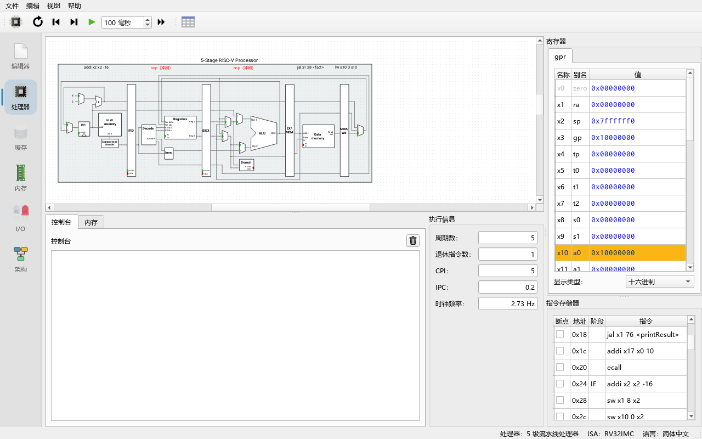
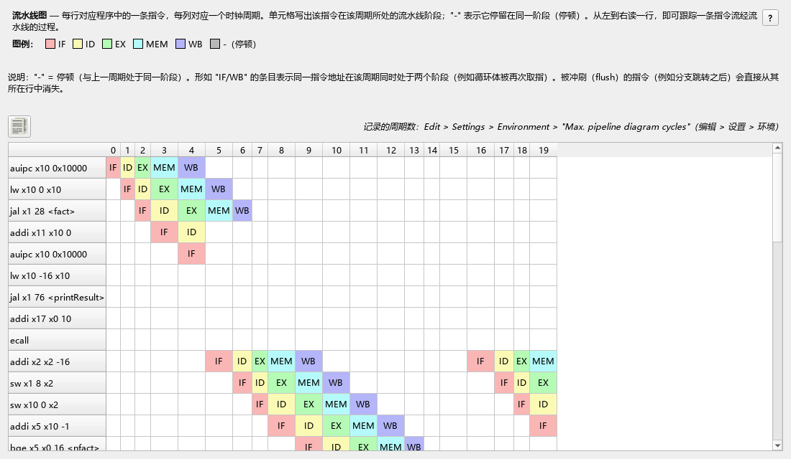

# 02 10 分钟上手

> **你将学到**
> - 从 **File → Load Example...**（文件 → 加载示例）打开一个示例程序
> - 程序是怎样被"汇编"（assemble）成机器码的
> - 用 **Clock**（时钟，F5）一个周期一个周期地执行，并观察流水线、寄存器和内存
> - 用 **Run**（运行，F8）一口气运行到结束，在控制台（Console）里看程序输出
> - 用 **Reset**（复位，F3）回到开头，用 **Reverse**（反向，F4）撤销周期
>
> **前置条件**
> - 已经能启动程序（见[第 01 章](01-install.md)）
> - 不需要任何 RISC-V 汇编知识；本章只要求你照着做、看现象。汇编语言本身在[第 04 章](04-riscv-assembly.md)讲解

我们用的示例是 `factorial.s`（文件 `examples/assembly/factorial.s`），它用递归计算 7 的阶乘（7! = 5040），并把结果打印到控制台。

---

## 第 1 步：打开示例程序

**做一步**：在菜单栏选择 **File → Load Example... → Assembly → factorial.s**（文件 → 加载示例 → 汇编 → factorial.s）。

**看到什么**：窗口切换到（或者你手动点击左侧的）**Editor** 标签页（编辑器）。它分成两栏：

- 左栏 **Source code**（源代码）：`factorial.s` 的文本，带语法高亮。上方的 **Input type:**（输入类型）选中的是 **Assembly**（汇编）。
- 右栏 **Executable code**（可执行代码）：程序被翻译成的机器指令。**View mode:**（显示方式）默认是 **Disassembled**（反汇编），每行一条指令，前面是地址；切到 **Binary**（二进制）会看到每条指令的 32 位编码。



**为什么**：Ripes 在你编辑汇编源码时会**自动汇编**——只要没有语法错误，每次改动后都会重新生成机器码并装进模拟器，所以不需要单独的"编译"按钮。如果某一行有错误，那一行会被标红，鼠标悬停可以看到错误信息（例如 `Unknown opcode 'xyz'`），此时右栏保持上一次成功汇编的结果。

> 小知识：右栏里的指令和左栏不完全一样。例如源码里的 `lw a0, argument` 变成了 `auipc x10 0x10000` 加 `lw x10 0 x10` 两条。这是因为 `lw a0, argument` 是一条**伪指令**（pseudo-instruction），汇编器把它展开成了真实指令；`a0` 是寄存器 `x10` 的别名（ABI name）。

---

## 第 2 步：认识 Processor 标签页

**做一步**：点击左侧的 **Processor** 标签页（处理器）。

**看到什么**：

- 中间大图：当前处理器的数据通路（datapath）。默认处理器是 **5-stage processor**（5 级流水线处理器，RV32），从左到右五个阶段 IF（取指）、ID（译码）、EX（执行）、MEM（访存）、WB（写回）。每个阶段上方有一个标签显示该阶段正在处理的指令，还没开始时显示 `-`。
- 右侧 **Registers**（寄存器）：寄存器表，列出 `x0`–`x31` 及其别名（`zero`、`ra`、`sp`…）和当前值。
- 右侧 **Instruction memory**（指令存储器）：程序的指令列表，列依次是断点（BP）、地址（Addr）、所在阶段（Stage）、指令（Instruction）。
- 下方左侧有两个小标签 **Console**（控制台）和 **Memory**（内存）；右侧 **Execution info**（执行信息）显示 **Cycles**（周期数）、**Instrs. retired**（已退休指令数）、**CPI**、**IPC** 和 **Clock rate**（时钟频率）。
- 窗口顶部的工具栏：**Select processor**（选择处理器）、**Reset (F3)**、**Reverse (F4)**、**Clock (F5)**、**Auto clock (F6)** 及其间隔框（单位 ms）、**Run (F8)**；以及 Processor 标签页专属的 **Show pipeline diagram**（显示流水线图）。
- 窗口底部状态栏右侧显示当前处理器、ISA 和界面语言，例如 `处理器：5 级流水线处理器    ISA：RV32IMC    语言：简体中文`（英文界面为 `Processor: 5-stage processor    ISA: RV32IMC    Language: English`；ISA 名字随启用的扩展变化）。



**为什么**：寄存器表里有两个寄存器一开始就不是 0：`sp`（`x2`）= `0x7ffffff0`，`gp`（`x3`）= `0x10000000`。这是处理器的默认寄存器初始值，每次复位都会重新写入：栈从高地址向下生长，`gp` 指向数据段的起点。

---

## 第 3 步：单步执行（Clock）

**做一步**：按一次 **Clock**（或按键盘 **F5**）。

**看到什么**：

- IF 阶段上方的标签变成第一条指令 `auipc x10 0x10000`。
- **Instruction memory** 中这一行的 **Stage** 列显示 `IF`。
- **Cycles** 从 0 变成 1。
- 电路图里一些连线短暂变成绿色（数值发生了变化），多路选择器（multiplexer）上的绿点表示当前选中的输入。

**做一步**：再按 4 次 F5（共 5 次）。

**看到什么**：第一条指令一路走到了 WB 阶段，后面的指令依次填满 IF、ID、EX、MEM。**Registers** 中 `a0`（`x10`）的值变为 `0x10000000`，并且这一行以高亮背景显示——高亮表示"最近被修改的寄存器"。

**为什么**：这就是**流水线**（pipeline）：每个周期每个阶段处理一条不同的指令，所以 5 个周期后五个阶段都满了。一条指令要到 WB 阶段写回寄存器后，寄存器表才会变化。你会注意到 **Instrs. retired** 比 **Cycles** 小——指令要走完全部阶段才算"退休"（retired）。

> 鼠标悬停在电路图的任意端口（port）上，可以看到端口名和当前值；按住 **Ctrl** 再滚动鼠标滚轮可以缩放电路图；点击一根连线会高亮整条线。

---

## 第 4 步：观察冒险（hazard）

**做一步**：继续按 F5，直到 `jal x1 28 <fact>` 进入 EX 阶段，再按一次。

**看到什么**：有阶段上方的标签变成红色的 `nop (flush)`。

**为什么**：`jal` 是跳转指令，处理器在 EX 阶段才确定要跳到 `fact`，之前已经按顺序取进来的指令是"走错路"的，必须被冲刷（flush）掉，替换成空操作（`nop`）。类似地，当一条指令需要的数据还没算出来时，你会看到 `nop (stall)`（停顿）。这些现象在[第 06 章](06-processors-pipelines.md)里详细讲解。

**做一步**：点击工具栏上的 **Show pipeline diagram**（表格图标）。

**看到什么**：弹出 **Pipeline diagram**（流水线图）窗口：每行一条指令，每列一个周期，格子里写着该指令在该周期处于哪个阶段。可以用 **Copy table to clipboard**（复制到剪贴板，表格左上方的图标按钮）把表格粘贴到电子表格里。



---

## 第 5 步：查看内存

**做一步**：在 Processor 标签页下方点击 **Memory** 小标签（或者点击左侧的 **Memory** 标签页，看到更大的内存视图）。在 **Go to section:**（跳到段）下拉框中选择 `.data`。

**看到什么**：视图跳到地址 `0x10000000`。第一个字（word）的值是 `7`（十六进制 `0x00000007`），后面是字符串 `"Factorial value of "` 和 `" is "` 的 ASCII 字节。

**为什么**：源码里的

```asm
.data
argument: .word   7
str1:     .string "Factorial value of "
```

告诉汇编器把这些数据放进数据段（data section）。数据段默认从 `0x10000000` 开始（可在 **Edit → Settings → Compiler** 的 **Assembler** 组里修改）。程序第一条有效指令 `lw a0, argument` 就是从这里把 7 读进 `a0`。

> **Go to register:**（跳到寄存器）下拉框可以把视图移动到某个寄存器的值所指向的地址。例如选择 `sp`，就能看到栈。程序运行到 `fact` 内部时，你会在栈上看到保存的返回地址和参数。
>
> 显示格式（十六进制、有符号/无符号十进制、ASCII 等）可以用视图上方的进制（radix）选择框切换。

---

## 第 6 步：一口气运行到结束（Run）

**做一步**：点击 **Run**（或按 **F8**）。

**看到什么**：几乎是瞬间，下方 **Console** 中出现：

```text
Factorial value of 7 is 5040
```

**Execution info** 中 **Cycles** 等数值更新；在默认的 5 级流水线处理器上，本程序从头运行完一共约 **189 个周期、125 条退休指令，CPI ≈ 1.51**（用命令行模式实测，见[第 15 章](15-cli.md)）。**Registers** 中 `a0` 和 `a1` 都是 `5040`（`0x000013b0`）。之后 **Clock**、**Auto clock**、**Run** 按钮都变成灰色（不可用）。

**为什么**：

- **Run** 模式下模拟器**不更新图形界面**，所以比单步快得多；它会在程序退出或遇到断点时停止。程序最后执行 `li a7, 10` + `ecall`，这是"退出"系统调用（exit），所以模拟结束、按钮变灰。
- 控制台里的文字来自 `ecall`：`a7 = 4` 打印字符串，`a7 = 1` 打印整数。完整的系统调用列表可在 **Help → System calls**（帮助 → 系统调用）中查看。
- CPI 大于 1，说明流水线中有不少停顿和冲刷。如果换成单周期处理器，CPI 会正好是 1，但每个周期要做的事情更多——这正是第 06 章要讨论的权衡。

---

## 第 7 步：复位（Reset）

**做一步**：点击 **Reset**（或按 **F3**）。

**看到什么**：**Cycles** 回到 0，所有阶段标签变回空白，寄存器恢复初始值（`sp`、`gp` 之外都是 0），控制台里多出一个空行，**Clock**/**Run** 按钮重新可用。

**为什么**：复位会把程序计数器（PC）设为程序入口，并把内存恢复到程序刚装载时的状态——运行过程中写入的内存都会被撤销。控制台的历史输出不会清除，复位只是加了一个换行把两次运行分开。

---

## 第 8 步：断点与自动时钟

**做一步**：在 **Editor** 标签页右栏（或 Processor 标签页 **Instruction memory** 的 **BP** 列）点击 `mul x10 x10 x6` 那一行左侧的空白处。

**看到什么**：出现一个红色圆点——这是**断点**（breakpoint）。

**做一步**：回到 Processor 标签页，把 **Auto clock** 旁边的间隔框设为 `100 ms`，然后点击 **Auto clock**（或 **F6**）。

**看到什么**：处理器每 100 ms 自动前进一个周期，电路图持续更新。当 `mul` 指令到达断点处时，自动时钟停止。**Auto clock** 按钮在运行时显示为暂停符号，再按一次也能手动停止。

**为什么**：**Auto clock** 介于 **Clock** 和 **Run** 之间：它像动画一样连续单步并刷新界面，适合课堂演示；**Run** 不刷新界面，适合跑完长程序。两者遇到断点都会停下。

---

## 第 9 步：反向执行（Reverse）简介

**做一步**：在断点停下后，按几次 **Reverse**（或 **F4**）。

**看到什么**：每按一次，处理器**倒退一个周期**：阶段标签、寄存器、内存、周期数都恢复为上一周期的状态。

**为什么**：Ripes 会保存最近若干个周期的电路状态，用于"撤销"。可撤销的最大周期数由 **Edit → Settings → Simulator → Max. undo cycles**（最大撤销周期数）决定，默认 **100**。超过这个数，或者在 **Run** 模式下跑过的周期，就不能再逐周期倒退了（**Reverse** 按钮会变灰）。

> **注意**：反向执行只倒退处理器和内存。I/O 标签页中的外设，尤其是本项目新增的 **SIMT GPU** 和 **Tensor Unit (NPU)** 加速器，可能不会跟着倒退（或在反向后被复位）——详见[第 06 章](06-processors-pipelines.md)、[第 16 章](16-faq.md)。

---

## 练习

1. 复位后用 F5 单步，数一数第一个 `nop (flush)` 出现在第几个周期。它对应哪条跳转指令？
2. 把 `factorial.s` 中的 `argument: .word 7` 改成 `5`。观察右栏是否立即更新；运行后控制台应打印什么？
3. 打开 **Select processor**（选择处理器），换成 **Single-cycle processor**（单周期处理器）后再运行同一程序，记录 Cycles 和 CPI。与 5 级流水线的 189 个周期比较。
4. 在 `fact` 标签处的第一条指令上设断点，用 Run 运行，每次停下时看 `a0` 的值。一共停了几次？为什么？
5. 在 **Memory** 视图中选择 **Go to register: sp**，在递归最深处观察栈上保存的值。

## 小结

- **File → Load Example...** 加载示例；汇编源码修改后**自动汇编**，右栏显示机器码。
- **Clock (F5)** 单步、**Auto clock (F6)** 连续单步、**Run (F8)** 不刷新界面快速运行、**Reset (F3)** 复位、**Reverse (F4)** 撤销一个周期。
- Processor 标签页中：数据通路图、阶段标签、Registers、Instruction memory、Console/Memory、Execution info（Cycles、Instrs. retired、CPI、IPC）。
- 断点在编辑器右栏或 Instruction memory 的 BP 列设置；Auto clock 和 Run 遇到断点都会停。
- 程序通过 `ecall` 打印输出和退出。

下一章：[03 GUI 总览](03-gui-tour.md)。
