# 03 GUI 总览

> **你将学到**
> - 主窗口由哪几部分组成：菜单栏、工具栏、左侧标签栏、状态栏
> - 六个标签页 **Editor / Processor / Cache / Memory / I/O / Architecture** 各自是做什么的、怎么看
> - 模拟控制工具栏每个按钮的作用，以及各标签页专属的工具栏
> - **Load Program**（加载程序）、**Save File**（保存文件）、**Select Processor**（选择处理器）三个对话框
> - **Settings**（设置）对话框的四个页面，以及如何把界面切换成中文 / 英文
> - 全部键盘快捷键和应用内帮助 **Help → User Guide / 用户手册**
>
> **前置条件**
> - 已完成[第 02 章](02-quickstart.md)的 10 分钟上手，知道 Clock、Run、Reset 的基本用法

本章是一份"地图"。不必一次记住所有内容，以后遇到某个按钮不知道是什么时，回来查这一章即可。

> 本手册按正在改进中的界面编写：每个标签页顶部将有"标题 + 一句话说明 + **?** 帮助按钮"，所有控件都有鼠标悬停提示（tooltip）和状态栏提示（status tip）。如果你的版本里还没有这些元素，或者名字略有不同，以实际界面为准；标"（待核实）"的地方尤其如此。

---

## 1. 主窗口布局

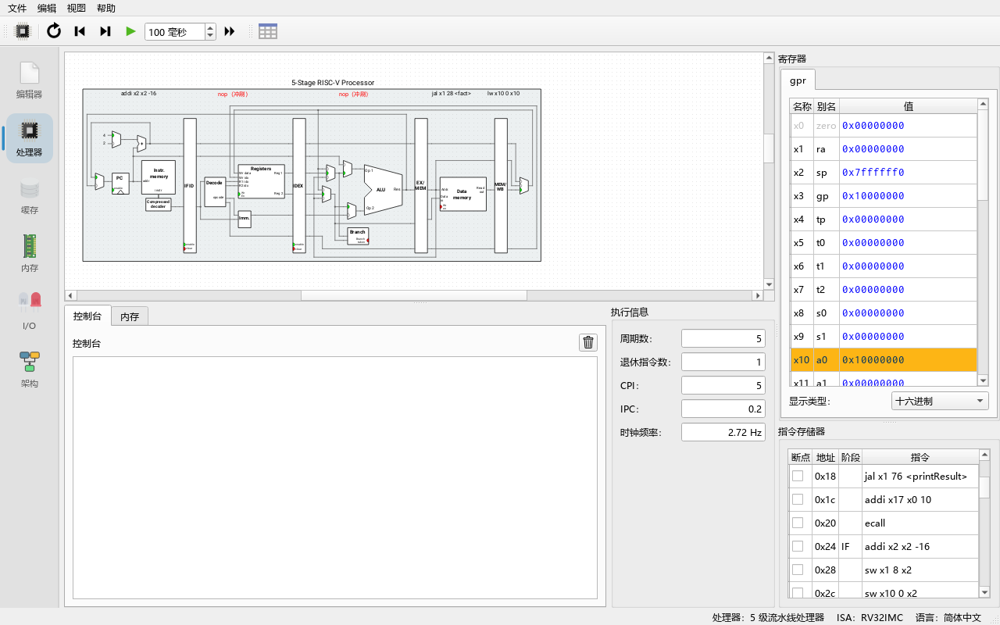

**做一步**：启动程序，先不要点任何东西，观察窗口的各个区域。

**看到什么**：从上到下、从左到右依次是：

| 区域 | 内容 |
|---|---|
| 菜单栏（menu bar） | **File**（文件）、**Edit**（编辑）、**View**（视图）、**Help**（帮助） |
| 模拟控制工具栏（Simulator control） | **Select processor**、**Reset**、**Reverse**、**Clock**、**Auto clock** + 间隔框、**Run**。**始终可见**，无论当前在哪个标签页 |
| 标签页专属工具栏 | 紧挨在模拟控制工具栏右边，内容随当前标签页变化（例如 Editor 的 **Compile C program**、Processor 的 **Show pipeline diagram**、Architecture 的步进/播放按钮） |
| 左侧标签栏（tab bar） | 竖排的六个大图标按钮：**Editor**、**Processor**、**Cache**、**Memory**、**I/O**、**Architecture** |
| 中央区域 | 当前标签页的内容 |
| 状态栏（status bar） | 左侧显示临时消息（例如保存文件、系统调用状态）；右侧固定显示 `处理器：<处理器名>    ISA：<ISA 名>    语言：<界面语言>`（英文界面为 `Processor: …    ISA: …    Language: …`） |

**为什么**：模拟控制工具栏始终可见，是为了让你在任何标签页里都能单步或运行——例如在 **I/O** 标签页里一边看外设一边按 F5，或者在 **Cache** 标签页里运行程序看命中率曲线。

> 状态栏右侧还会显示当前界面语言（`语言：简体中文` / `Language: English`）；左侧标签按钮有悬停提示，说明每个标签页的用途。

---

## 2. 菜单

### 2.1 File（文件）

| 菜单项 | 快捷键 | 作用 |
|---|---|---|
| **New Program**（新建程序） | Ctrl+N | 清空编辑器。如果当前程序还没保存，会询问 **Save program before creating new file?**（是否先保存） |
| **Load Program**（加载程序） | Ctrl+O | 打开 **Load program...** 对话框（见第 5.1 节），可加载源文件、平坦二进制（flat binary）或 ELF 可执行文件 |
| **Load Example...**（加载示例） | — | 子菜单 **Assembly**、**C**、**ELF (precompiled C)**，列出程序内置的示例 |
| **Save File**（保存文件） | Ctrl+S | 保存到上一次的位置；第一次保存时自动转为 Save File As |
| **Save File As...**（另存为） | Ctrl+Shift+S（另加平台的标准"另存为"键，如果有的话；Windows 上 Qt 没有定义，所以程序自己加了这个绑定） | 打开 **Save files...** 对话框（见第 5.2 节） |
| **Exit**（退出） | Ctrl+Q（另加平台的标准"退出"键，如果有的话；Windows 上只有 Ctrl+Q） | 关闭程序。如果编辑器里有内容，会询问 **Save current program before exiting?** |

**Load Example...** 中的示例（来自 `examples/` 目录，打包进程序）：

- **Assembly**：`complexMul.s`、`consolePrinting.s`、`consoleReading.s`、`exercise_gpu_divergence.s`、`exercise_gpu_saxpy.s`、`exercise_npu_batch.s`、`factorial.s`、`gpu_vecadd.s`、`leds.s`、`neogeo_mailbox.s`、`npu_matmul.s`
- **C**：`consoleInput.c`、`leds.c`、`matrixmul.c`、`npu_matmul.c`、`ranpi.c`、`spe_double_buffer.c`、`switchesAndLeds.c`（需要先配置 C 编译器，见[第 05 章](05-c-programs.md)）
- **ELF (precompiled C)**：`RanPi-RV32`、`RanPi-RV64`（预先编译好的 `ranpi.c`，不需要编译器）

> `exercise_*` 程序是第 09、10 章练习题的参考答案。这个菜单只是列出打包在 `examples/assembly` 下的全部文件，所以放进去的任何程序都会自动出现。

### 2.2 Edit（编辑）

| 菜单项 | 作用 |
|---|---|
| **Settings**（设置） | 打开设置对话框（见第 6 节） |

### 2.3 View（视图）

| 菜单项 | 作用 |
|---|---|
| **Show processor signal values**（显示处理器信号值） | 勾选后，Processor 标签页电路图中所有输出端口旁边都会显示当前数值。设置会被记住 |

### 2.4 Help（帮助）

| 菜单项 | 作用 |
|---|---|
| **User Guide**（用户手册，F1） | 打开应用内帮助窗口，按当前界面语言显示本手册（`docs/guide/zh/` 或 `docs/guide/en/`） |
| **Quick Start (10 minutes)**（快速上手） | 打开帮助窗口并直接跳到[第 02 章](02-quickstart.md) |
| **Show Welcome Panel**（显示欢迎面板） | 重新显示介绍六个标签页的欢迎面板（关闭过一次后它默认隐藏） |
| **System calls**（系统调用） | 打开 **Supported system calls** 窗口，列出所有 `ecall` 编号、参数和返回值 |
| **Online Documentation (upstream Ripes)**（在线文档） | 在浏览器中打开上游 Ripes 在 GitHub 上的文档 |
| **About Ripes...**（关于） | 弹出 **About Ripes** 窗口，显示版本号、Qt 版本、许可证和上游项目链接 |

各标签页和外设部件右上角的 **?** 按钮也会打开帮助窗口，并直接跳到相应章节，例如 GPU 外设的 **?** 打开[第 09 章](09-gpu.md)。

---

## 3. 模拟控制工具栏

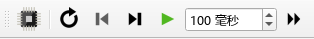

| 按钮 | 快捷键 | 作用 | 何时不可用 |
|---|---|---|---|
| **Select processor**（选择处理器，CPU 图标） | — | 打开处理器选择对话框（第 5.3 节） | 运行或自动时钟时 |
| **Reset**（复位，圆形箭头） | F3 | 把 PC 设回程序入口、内存恢复到刚加载时、寄存器恢复初始值、周期数清零 | 运行或自动时钟时 |
| **Reverse**（反向，带竖杠的左三角） | F4 | 撤销一个时钟周期 | 没有可撤销的周期时（已到撤销上限、刚复位、或刚用 Run 跑过） |
| **Clock**（时钟，带竖杠的右三角） | F5 | 让电路前进一个周期 | 程序已退出时 |
| **Auto clock**（自动时钟，绿色三角 / 暂停符号） | F6 | 按右侧间隔框设定的间隔（1–10000 ms，默认 100 ms）连续时钟，界面实时刷新；遇到断点停止。再按一次停止 | 程序已退出时 |
| 间隔框（` ms`） | — | 自动时钟的间隔，单位毫秒 | — |
| **Run**（运行，双三角） | F8 | 不刷新界面、尽可能快地执行，直到程序退出或遇到断点；再按一次暂停 | 程序已退出时 |

**为什么 Run 比 Auto clock 快这么多？** Auto clock 每个周期都要重绘电路图、寄存器表、指令表；Run 期间这些部件被禁用，只按 **Edit → Settings → Environment → Max. UI updates per second**（每秒最大界面刷新次数，默认 25）定期刷新统计数字。

工具栏图标会跟随浅色 / 深色主题自动改变颜色。

---

## 4. 六个标签页

### 4.1 Editor（编辑器）

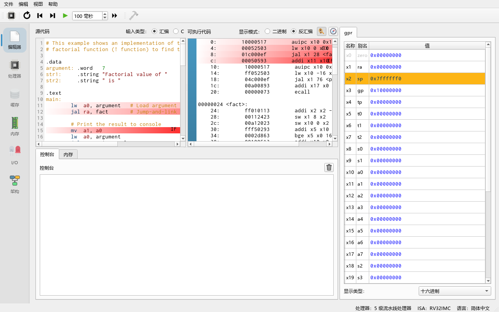

| 区域 | 说明 |
|---|---|
| **Source code**（源代码） | 可编辑的源代码。**Input type:** 选择 **Assembly**（汇编）或 **C**。汇编模式下改动会自动汇编；错误行标红，悬停看错误信息 |
| **Executable code**（可执行代码） | 只读的程序视图。**View mode:** 选 **Binary**（二进制机器码）或 **Disassembled**（反汇编）。点击左侧边栏设置/取消断点。当前在流水线中的指令会用颜色标出所在阶段 |
| 跟随按钮（**Follow program execution**） | 勾选后，反汇编视图会自动滚动，保证处理器第一级中的指令始终可见 |
| 指南针按钮（**Show symbol navigator**，符号导航） | 列出程序中的所有符号（标签），选中后跳转到对应地址 |
| 寄存器面板 | 编辑器右侧的寄存器视图（可在 Settings → Editor 中隐藏） |
| 控制台 | 编辑器下方的控制台（可在 Settings → Editor 中隐藏） |
| 工具栏 **Compile C program (Ctrl+B)** | 仅在 Input type = C 时可用，调用配置好的 RISC-V 编译器编译并加载 |

当你加载一个 ELF 或平坦二进制文件时，源代码区会被替换成一页提示：**Current input source:**（当前输入来源）、**File:**（文件路径）和 **Enable editor**（启用编辑器）按钮。点击该按钮会清除已加载的程序并回到可编辑状态。

### 4.2 Processor（处理器）

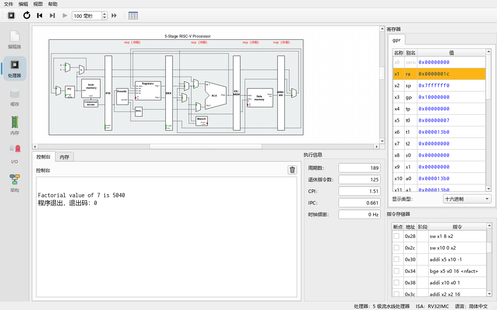

| 区域 | 说明 |
|---|---|
| 电路图（中央） | 当前处理器的数据通路。Ctrl+滚轮缩放；悬停端口看名字和值；点击连线高亮整条线；右键端口可显示数值标签并更改进制。1 位信号线绿色表示 1、灰色表示 0；多位信号变化时短暂闪绿 |
| 阶段标签 | 每个流水线阶段上方显示正在处理的指令；红色 `nop (flush)` / `nop (stall)` / `nop (way hazard)` / `nop (unused)` 表示冲刷、停顿等 |
| **Registers**（寄存器） | 所有寄存器（RV32 有 `x0`–`x31`）。点击数值可以**直接修改**寄存器；最近修改的寄存器高亮；可切换显示进制；右键菜单可复制数值或让内存视图跳到该地址 |
| **Instruction memory**（指令存储器） | 列：**BP**（断点，点击切换）、**Addr**（地址）、**Stage**（所在阶段）、**Instruction**（反汇编指令）。表格会自动滚动跟随第一级中的指令 |
| **Console**（控制台） | `ecall` 打印的输出；程序读取输入（如 `consoleReading.s`）时也在这里输入 |
| **Memory**（内存，小标签） | 一个紧凑的内存视图，与 Memory 标签页相同 |
| **Execution info**（执行信息） | **Cycles**（周期数）、**Instrs. retired**（已退休指令数）、**CPI**（每条指令周期数）、**IPC**（每周期指令数）、**Clock rate**（模拟器实际达到的时钟频率） |
| 工具栏 **Show pipeline diagram** | 打开流水线图（每行一条指令、每列一个周期）。注意：Run 模式下不记录阶段信息 |

### 4.3 Cache（缓存）

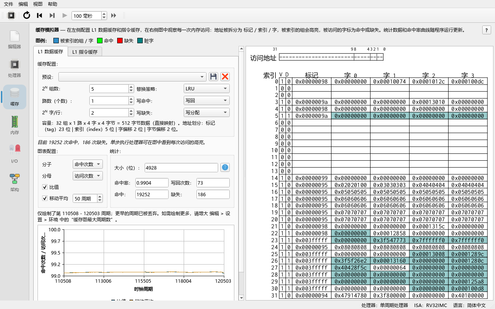

Cache 标签页有两个子标签 **L1 Data Cache**（一级数据缓存）和 **L1 Instr. Cache**（一级指令缓存）。每个子标签包含：

- **Cache configuration:**（缓存配置）：**Preset:**（预设）下拉框和保存/删除预设按钮（**Store cache preset** / **Delete cache preset**）；**2^N Sets:**（组数）、**Ways (count):**（路数）、**2^N Words/Line:**（每行字数）——注意组数和每行字数以 2 的幂次输入（5 表示 2^5 = 32 组），路数则直接输入个数；**Write hit:** / **Write miss:**（写命中 / 写缺失策略）；**Replacement:**（替换策略，LRU 或 Random）。下方的摘要行写出总容量以及地址的 tag / index / 字 / 字节偏移划分。
- 缓存表格：每行一个缓存路（way），列有 V（有效位）、D（脏位）、LRU、Tag 和各个字；悬停看地址，点击跳到内存视图。
- **Statistics:**（统计）：**Hits**、**Misses**、**Hit rate**、**Writebacks**、**Size (bits)**。
- 命中率曲线图：**Plot configuration:** 选择分子（Numerator）/ 分母（Denominator）、**Moving avg.**（移动平均窗口，单位周期）、**Ratio** 开关；右键菜单有 **Enable ratio crosshair**、**Enable moving average crosshair**、**Copy data to clipboard**、**Save plot to file**。

内置预设有三个：`32-entry 4-word direct-mapped`、`32-entry 4-word fully associative`、`32-entry 4-word 2-way set associative`。详细用法见[第 07 章](07-cache.md)。

### 4.4 Memory（内存）

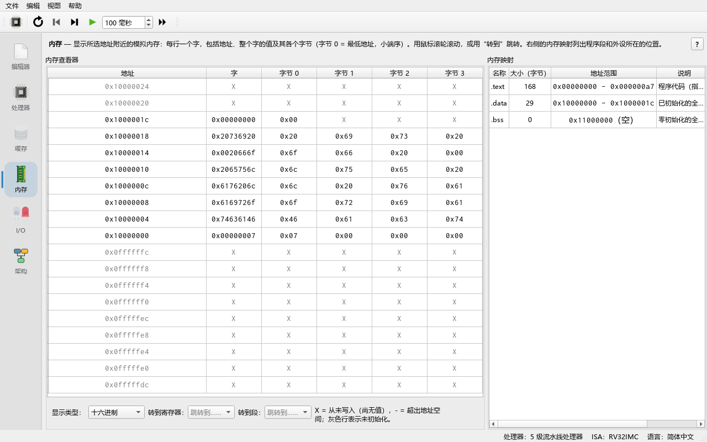

| 区域 | 说明 |
|---|---|
| **Memory viewer**（内存查看器） | 整个地址空间的逐字视图。**Go to register:** 跳到某寄存器的值所指地址；**Go to section:** 跳到 `.text`、`.data` 等段，或选 **Address...** 输入任意地址；进制选择框切换显示格式 |
| **Memory map**（内存映射） | 列出当前地址空间中的各个区域：程序段以及 I/O 外设所占的地址范围 |

复位时，程序运行过程中写入的内存都会恢复。

### 4.5 I/O（输入输出外设）

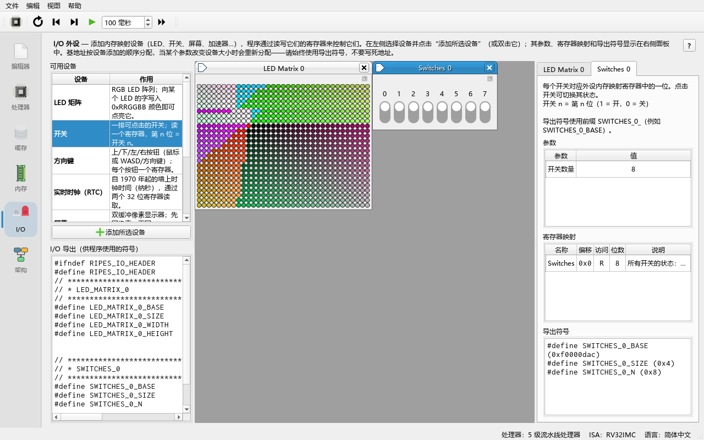

| 区域 | 说明 |
|---|---|
| **Available devices**（可用设备，左上） | 两列（**Device** 设备 / **What it does** 作用）的表：**LED Matrix**、**Switches**、**D-Pad**、**Real-time Clock (RTC)**、**Screen**、**SIMT GPU**、**Tensor Unit (NPU)**。选中一项后点列表下方的 **Add selected device**（添加所选设备），或直接**双击**它，即创建该外设 |
| **I/O exports**（I/O 导出符号，左下） | 所有已创建外设导出的符号（例如 `LED_MATRIX_0_BASE`），可以直接在汇编或 C（`#include "ripes_system.h"`）中使用 |
| 中央 MDI 区域 | 每个外设一个子窗口，显示它的可视化部件（LED、开关、GPU warp 网格、NPU 脉动阵列……）。子窗口可拖出主窗口，方便同时看其他标签页 |
| 右侧外设详情 | 每个外设一个标签：描述文字、**Parameters**（参数，可改，例如 LED 矩阵的宽高、GPU 的 SM 数）、**Register map**（寄存器映射：偏移、读写属性、位宽、含义）、**Exported symbols**（该外设导出的符号） |

外设从 **Edit → Settings → Simulator → I/O start address**（默认 `0xF0000000`）开始向上依次分配地址。运行期间不能新建或关闭外设，也不能修改参数。程序关闭时会记住已创建的外设及其参数，下次启动自动恢复。

外设用法见[第 08 章](08-mmio-peripherals.md)，GPU 与 NPU 见[第 09 章](09-gpu.md)、[第 10 章](10-npu.md)。

### 4.6 Architecture（架构浏览器）

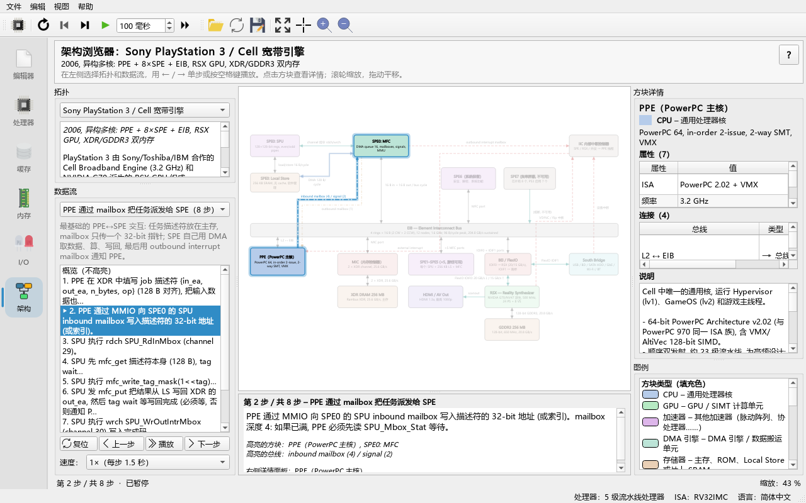

这是本项目新增的标签页，用框图和"数据流动画"讲解真实机器的体系结构，**与正在模拟的 RISC-V 程序无关**。

| 区域 | 说明 |
|---|---|
| 左侧 **Topology**（拓扑）下拉框 | 选择内置拓扑（Neo Geo、PS3/Cell、GPU 系统视图、NPU 系统视图、最小示例）；下方文本框是该拓扑的说明 |
| 左侧 **Data flow**（数据流） | 数据流下拉框、所选数据流的简短说明、可点击的步骤列表，以及 **Reset** / **Previous** / **Play** / **Next** 按钮和 **Speed**（速度）框；用这些按钮、工具栏或方向键单步 |
| 步骤说明（框图下方） | 当前步骤的标题和解释，以及被高亮的方块和总线 |
| 中央框图 | 滚轮缩放、拖动平移、点击方块看详情；图例说明颜色含义 |
| 右侧 **Block details**（方块详情） | 选中方块的名称、类型、**Properties**（属性表）、**Connections**（连接表）和 **Description**（说明）；其下方是方块类型与总线样式的 **Legend**（图例） |
| 底部状态行 | 当前步骤（例如 `第 2 步 / 共 8 步`，英文界面为 `Step 2 of 8`）、播放/暂停状态和缩放比例 |
| 工具栏 | **Open architecture JSON...**（从磁盘加载拓扑）、**Reset flow**、**Previous step**、**Next step**、**Play**/**Pause**（每 1.5 秒自动前进一步）、**Fit to view**、**Zoom in**、**Zoom out** |

详细用法见[第 11 章](11-arch-explorer.md)。

---

## 5. 三个常用对话框

### 5.1 Load Program（加载程序）

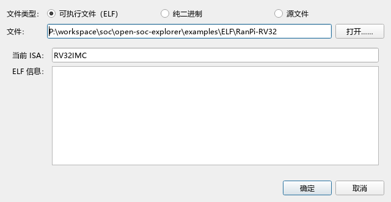

**File type:**（文件类型）三选一：

- **Source file**（源文件）：`.s`、`.as`、`.asm` 按汇编加载，`.c` 按 C 加载（需要编译器）。
- **Flat binary**（平坦二进制）：裸机器码文件。需要填 **Load at:**（装载地址）和 **Entry point:**（入口地址），均为十六进制。
- **Executable (ELF)**：RISC-V ELF 可执行文件。对话框显示 **Current ISA:**（当前处理器的 ISA），并检查文件是否兼容；不兼容时 **ELF info:** 显示原因（例如"Expected 32 bit executable, but input program is 64 bit"、"Only executable ELF files are supported"）。

**File:** 后面输入路径或点 **Open...** 浏览。路径不存在时输入框变红，**OK** 按钮不可用。

### 5.2 Save files（保存文件）

勾选要保存的内容：**source code**（源代码，保存为 `.s` 或 `.c`）和/或 **assembled/compiled binary**（汇编/编译得到的 `.text` 段二进制，保存为 `.bin`）。**File:** 填不带扩展名的路径，**Output:** 预览将要生成的文件名。

### 5.3 Select Processor（选择处理器）

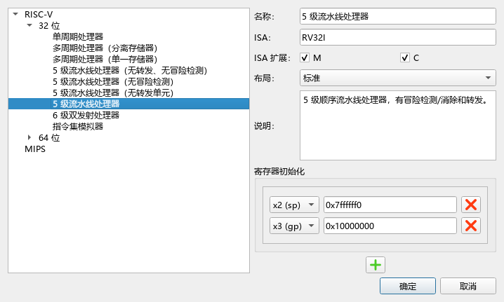

左边是树形列表：**RISC-V → 32-bit / 64-bit → 处理器**。当前使用的处理器以粗体显示。可选处理器（32 位和 64 位各一套）：

| 名称 | 命令行 ID（RV32 / RV64） |
|---|---|
| Single-cycle processor（单周期） | `RV32_SS` / `RV64_SS` |
| Multi-cycle processor with separate memories（多周期，指令/数据分离存储） | `RV32_5MC_2M` / `RV64_5MC` |
| Multi-cycle processor with one memory（多周期，单一存储） | `RV32_5MC_1M` / `RV64_5MC_1M` |
| 5-stage processor w/o forwarding or hazard detection（无转发无冒险检测） | `RV32_5S_NO_FW_HZ` / `RV64_5S_NO_FW_HZ` |
| 5-stage processor w/o hazard detection（无冒险检测） | `RV32_5S_NO_HZ` / `RV64_5S_NO_HZ` |
| 5-Stage processor w/o forwarding unit（无转发单元） | `RV32_5S_NO_FW` / `RV64_5S_NO_FW` |
| 5-stage processor（完整 5 级流水线，**默认**） | `RV32_5S` / `RV64_5S` |
| 6-stage dual-issue processor（6 级双发射） | `RV32_6S_DUAL` / `RV64_6S_DUAL` |
| ISA simulator（ISA 级模拟器，无电路图，最快） | `RV32_ISS` / `RV64_ISS` |

右边显示所选处理器的：

- **Name:**、**ISA:**、**Description:**（名称、ISA、描述）
- **ISA Exts.**（ISA 扩展）：每个扩展一个复选框（例如 `M` 乘除法、`C` 压缩指令），悬停可看说明。扩展决定汇编器接受哪些指令、C 编译器生成哪些指令。
- **Layout**（布局）：**Standard**（简化视图，省略控制信号）或 **Extended**（扩展视图，显示控制部件、信号和位宽）。布局只影响显示，不影响处理器行为。
- 寄存器初始化：可以指定复位时写入某些寄存器的值（默认 `sp = 0x7ffffff0`、`gp = 0x10000000`）。

双击处理器或点 **OK** 生效。如果新旧处理器的 ISA 相同，已加载的程序会保留。

---

## 6. Settings（设置）

**做一步**：**Edit → Settings**。

**看到什么**：左侧是页面列表，右侧是对应设置。所有修改**立即生效**并自动保存，只需点 **OK** 关闭（语言除外，需重启）。

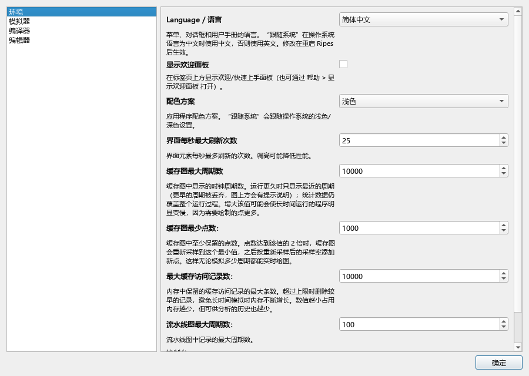

### 6.1 Environment（环境）

| 设置 | 说明 |
|---|---|
| **Color scheme**（配色方案） | **System**（跟随系统浅色/深色）、**Light**（浅色）、**Dark**（深色）。电路图、工具栏图标、I/O 背景都会立即跟随 |
| **Language / 语言** | **System default**（跟随系统）、**English**、**简体中文**。**重启后生效**。它是本页的第一项 |
| **Max. UI updates per second** | 每秒最多刷新界面几次（1–100，默认 25）。调大会更流畅但更慢 |
| **Max. cache plot cycles** | 缓存曲线最多绘制多少个周期（默认 10000）；运行更久时显示最近的周期。长程序可调小以免变慢 |
| **Min. cache plot points:** | 缓存曲线重采样后保留的最少点数 |
| **Max. cache access traces:** | 内存中最多保留多少条缓存访问记录 |
| **Max. pipeline diagram cycles:** | 流水线图最多记录多少个周期 |
| **Console → Echo console input:** | 在控制台回显用户输入 |
| **Show welcome panel**（显示欢迎面板） | 在标签页上方显示"欢迎 / 快速上手"面板（首次启动时显示；**Help → Show Welcome Panel** 也能重新打开） |

### 6.2 Simulator（模拟器）

| 设置 | 说明 |
|---|---|
| **Max. undo cycles:** | 最多能用 Reverse 撤销多少个周期（默认 100）。越大越耗内存 |
| **Clock rate averaging window (ms):** | Execution info 中 Clock rate 的平均窗口（默认 250 ms） |
| **I/O start address:** | 外设地址分配的起点（默认 `0xF0000000`） |
| **Enable simulation VCD traces:** / **VCD trace file:** | 把仿真信号写入 VCD 波形文件，可用 GTKWave 等工具查看（见[第 06 章](06-processors-pipelines.md)） |

### 6.3 Compiler（编译器）

| 设置 | 说明 |
|---|---|
| **RISC-V C/C++ Compiler** → **Compiler path:** + **Browse** | RISC-V 交叉编译器（例如 `riscv64-unknown-elf-gcc`）路径。有效时输入框变绿并显示 **Compile command:**（实际编译命令），无效时变红并显示 **Error:** |
| **Compiler arguments:** / **Linker arguments:** | 额外的编译和链接参数（例如 `-O1`、`-nostdlib`） |
| **Assembler** → **.text / .data / .bss section start address:** | 各段起始地址（默认 `0x0`、`0x10000000`、`0x11000000`） |

### 6.4 Editor（编辑器）

| 设置 | 说明 |
|---|---|
| **Indent size:** | Tab 缩进宽度（空格数） |
| **Show registers in editor tab** | 在 Editor 标签页显示寄存器面板 |
| **Show console in editor tab** | 在 Editor 标签页显示控制台 |
| **Highlight stages in source** | 在源代码中用颜色标出各流水线阶段正在执行的行 |
| **Formatter** → **clang-format path:**、**Format on save:**、**Formatter arguments:** | 用 clang-format 格式化 `.c` 文件 |

---

## 7. 切换界面语言

1. **Edit → Settings → Environment**。
2. **Language / 语言** 选择 **简体中文**（或 **English**、**System**）。
3. 会弹出提示说明需要重启；关闭并重新启动程序。

**看到什么**：重启后菜单、按钮、标签页名称、对话框、外设说明都变成中文；**Help → 用户手册** 打开中文版手册。

**为什么需要重启**：Qt 的翻译是在程序启动、创建窗口之前加载的（`main.cpp` 调用 `installTranslators`），已经创建的窗口不会自动换语言。选择 **System** 时，操作系统区域设置为中文则用中文，否则用英文。

> 本手册中每个界面元素都同时给出英文原文和中文译名，所以无论界面是哪种语言都能对照着用。

---

## 8. 键盘快捷键一览

| 快捷键 | 作用 | 生效范围 |
|---|---|---|
| Ctrl+N | New Program（新建程序） | 全局 |
| Ctrl+O | Load Program（加载程序） | 全局 |
| Ctrl+S | Save File（保存） | 全局 |
| Ctrl+Shift+S（另加平台"另存为"键，如果有） | Save File As...（另存为） | 全局 |
| Ctrl+Q（另加平台"退出"键，如果有） | Exit（退出） | 全局 |
| F3 | Reset（复位） | 全局 |
| F4 | Reverse（撤销一个周期） | 全局 |
| F5 | Clock（单步一个周期） | 全局 |
| F6 | Auto clock（自动时钟 开/关） | 全局 |
| F8 | Run（运行 / 暂停） | 全局 |
| Ctrl+B | Compile C program（编译 C 程序） | Editor，Input type = C |
| Ctrl+滚轮 | 缩放电路图 / 缓存表 / 编辑器字体 | Processor、Cache、Editor |
| → / ← | Next step / Previous step（数据流下一步 / 上一步） | Architecture 标签页 |
| Home | Reset flow（回到数据流第 0 步） | Architecture 标签页 |
| 空格 | Play / Pause（播放 / 暂停） | Architecture 标签页 |

> 注意：F6 是 **Auto clock**，**单步是 F5**。一些较早的文档把单步写成 F6，以本表为准。

---

## 9. 应用内帮助

**做一步**：**Help → User Guide / 用户手册**。

**看到什么**：一个帮助窗口，显示本手册的目录（README）。左侧是章节列表，顶部有后退 / 前进 / 目录按钮、一个在中文与 English 之间切换的按钮，以及 **在页面中查找** 输入框。点击链接可跳到各章节；窗口中的语言与界面语言一致。

**做一步**：切到 **I/O** 标签页，创建一个 **SIMT GPU** 外设，点击它部件右上角的 **?**。

**看到什么**：帮助窗口直接打开[第 09 章 SIMT GPU](09-gpu.md)。

**为什么**：每个标签页和外设都通过 `Ripes::showHelp("<章节名>")` 关联到对应章节，所以"不知道这是什么"时，先按 **?**。如果帮助窗口找不到手册文件，会提示手册位于仓库的 `docs/guide` 目录。

---

## 练习

1. 不看本章，说出模拟控制工具栏六个按钮从左到右的名字和快捷键，再对照第 3 节检查。
2. 在 **Select processor** 中切换到 **Extended** 布局，比较与 **Standard** 布局的区别。哪些部件是新出现的？
3. 把 **Color scheme** 改成 **Dark**，看 Processor 和 I/O 标签页如何变化；再改回 **System**。
4. 在 I/O 标签页创建一个 **LED Matrix**，在右侧 **Parameters** 中把宽度改成 8，观察 **Register map** 和 **Exported symbols** 如何变化。
5. 在 Architecture 标签页选择一个数据流，只用键盘（→、←、Home）把它从头走到尾。
6. 把界面语言切成另一种语言并重启，找到本章第 6 节表格中的三个设置项的译名。

## 小结

- 主窗口 = 菜单栏 + 常驻的模拟控制工具栏 + 随标签页变化的工具栏 + 左侧六个标签页 + 状态栏（右侧显示处理器与 ISA）。
- **Editor** 写/看程序，**Processor** 看电路与执行，**Cache** 看缓存，**Memory** 看内存，**I/O** 管外设（含 GPU/NPU），**Architecture** 看真实机器的框图与数据流。
- 三个对话框：**Load Program**（源码 / 平坦二进制 / ELF）、**Save files**、**Select Processor**（处理器、扩展、布局、寄存器初值）。
- **Settings** 有 Environment、Simulator、Compiler、Editor 四页；语言在 Environment 页，重启生效。
- 快捷键：F3 复位、F4 反向、F5 单步、F6 自动时钟、F8 运行、Ctrl+B 编译 C；Architecture 中 ←/→/Home。
- 不懂就按 **?** 或 **Help → User Guide / 用户手册**。

下一章：[04 RISC-V 汇编教程](04-riscv-assembly.md)。
