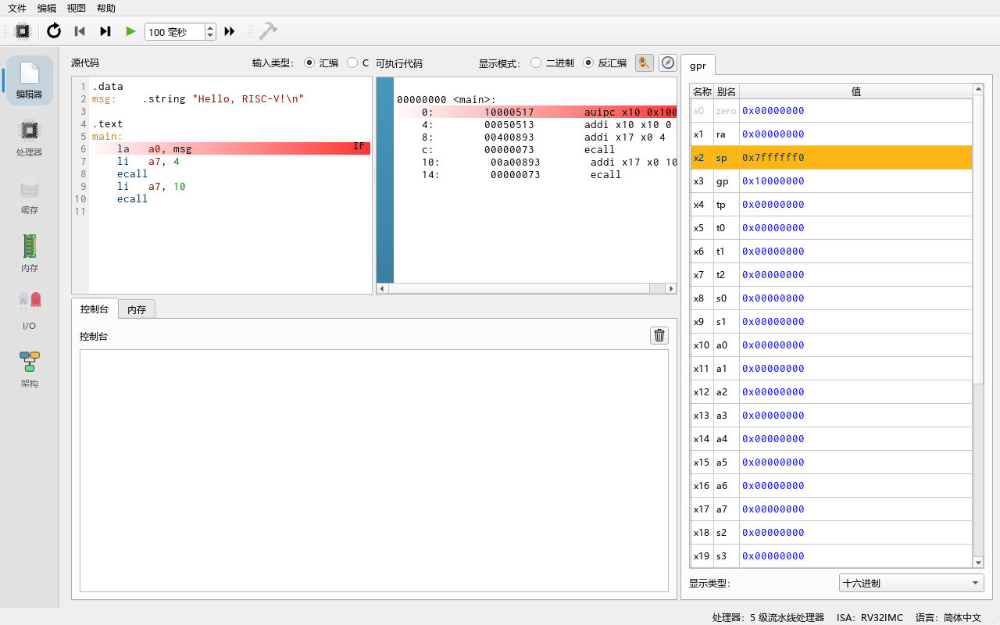
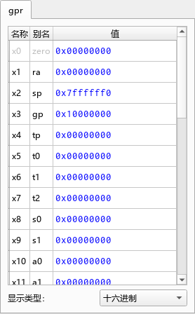
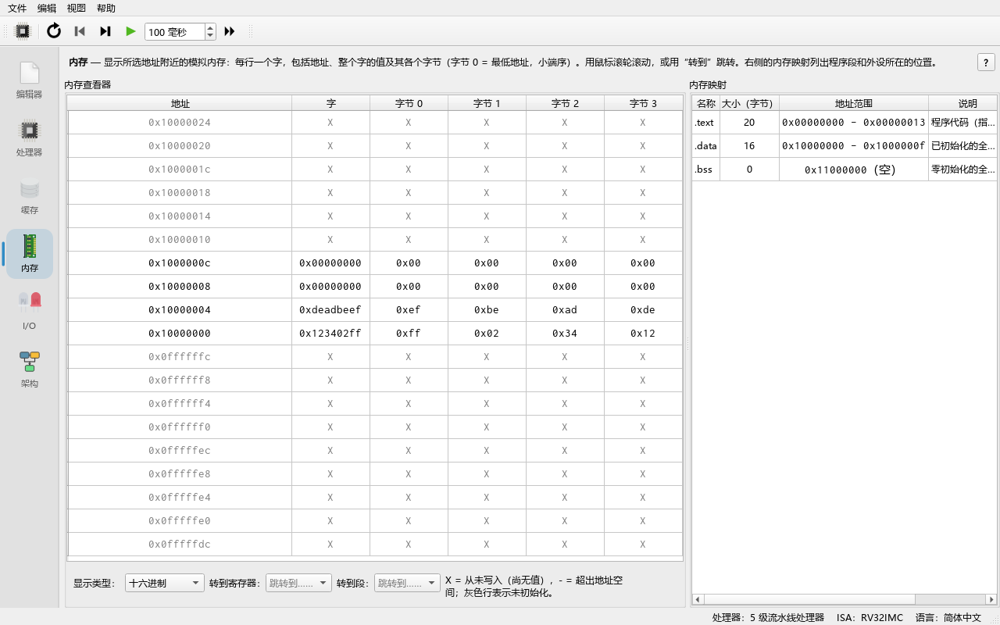
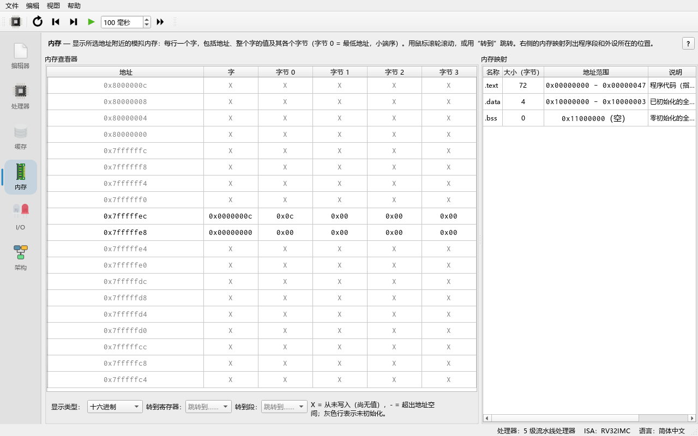
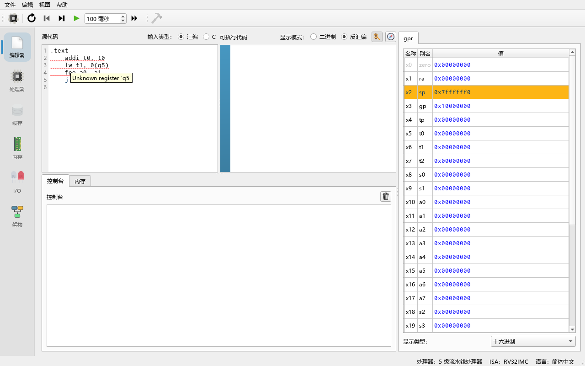

# 04 RISC-V 汇编教程

> **你将学到**
>
> - RISC-V 的 32 个通用寄存器以及它们的 ABI 名字（`a0`、`sp`、`ra`……）；
> - 指令的几大类：算术/逻辑、立即数、访存、分支、跳转，各写几个例子；
> - 伪指令（pseudo-instruction）是什么，汇编器把它们展开成哪些真实指令；
> - 用 `.data` / `.text` / `.word` / `.string` 等伪操作（directive）组织数据；
> - 写循环、写函数、用栈保存寄存器；
> - 用 `ecall` 打印整数、字符串并退出程序；
> - 看懂汇编错误信息，知道怎么改。
>
> **前置条件**
>
> - 已经能启动程序并认识 **Editor** 标签页（编辑器）和 **Processor** 标签页（处理器）（见第 02、03 章）。
> - 知道二进制和十六进制是什么。不需要任何汇编基础。

---

## 4.1 第一个程序

**做一步**：打开 **Editor** 标签页（编辑器），确认左上角 **Input type:**（输入类型）选的是 **Assembly**（汇编）。把左边 **Source code**（源代码）区域清空，输入：

```asm
.data
msg:    .string "Hello, RISC-V!\n"

.text
main:
    la   a0, msg        # a0 = 字符串地址
    li   a7, 4          # 4 号系统调用：打印字符串
    ecall
    li   a7, 10         # 10 号系统调用：退出
    ecall
```

**看到什么**：你一停止输入，程序就会被自动汇编（assemble）。右边 **Executable code**（可执行代码）区域出现了反汇编后的指令。注意第一行 `la a0, msg` 在右边变成了**两条**指令 `auipc` 和 `addi`——这就是伪指令展开，4.4 节会解释。



**做一步**：按工具栏的 **Run (F8)**（运行）。

**看到什么**：下方 **Console**（控制台）中出现：

```text
Hello, RISC-V!

Program exited with code: 0
```

**为什么**：`ecall`（environment call，环境调用）把控制权交给模拟器。模拟器看 `a7` 里的编号决定做什么：4 = 打印 `a0` 指向的以 0 结尾的字符串，10 = 结束程序并打印 "Program exited with code: 0"。

> **提示**：Ripes 不要求程序必须有 `main` 标签。程序从 `.text` 段的第一条指令开始执行（默认地址 `0x0`）。如果没有用 `ecall` 退出，执行完最后一条指令后程序也会自然结束。

## 4.2 寄存器与 ABI 名字

RV32I 有 32 个 32 位通用寄存器（general purpose register）`x0`–`x31`。汇编里既可以写 `x10`，也可以写它的 **ABI 名字**（应用二进制接口约定的别名）`a0`。在 **Processor** 标签页右侧的 **Registers**（寄存器）面板中，两种名字都会显示，鼠标悬停可以看到用途说明（来自 `src/isa/rvisainfo_common.cpp`）。

| 寄存器 | ABI 名字 | 用途 | 谁负责保存 |
|---|---|---|---|
| `x0` | `zero` | 恒为 0，写入无效 | — |
| `x1` | `ra` | 返回地址（return address） | 调用者（caller） |
| `x2` | `sp` | 栈指针（stack pointer） | 被调用者（callee） |
| `x3` | `gp` | 全局指针（global pointer） | — |
| `x4` | `tp` | 线程指针（thread pointer） | — |
| `x5`–`x7` | `t0`–`t2` | 临时寄存器（temporary） | 调用者 |
| `x8` | `s0`（`fp`） | 保存寄存器 / 帧指针 | 被调用者 |
| `x9` | `s1` | 保存寄存器（saved） | 被调用者 |
| `x10`–`x11` | `a0`–`a1` | 函数参数 / 返回值 | 调用者 |
| `x12`–`x17` | `a2`–`a7` | 函数参数（`a7` 也是系统调用号） | 调用者 |
| `x18`–`x27` | `s2`–`s11` | 保存寄存器 | 被调用者 |
| `x28`–`x31` | `t3`–`t6` | 临时寄存器 | 调用者 |

**做一步**：按 **Reset (F3)**（复位），切到 **Processor** 标签页，看 **Registers** 面板。

**看到什么**：大部分寄存器是 0，但 `sp` = `0x7ffffff0`，`gp` = `0x10000000`。

**为什么**：每个处理器模型都带有默认的寄存器初始化值（`src/processorregistry.cpp` 中的 `defRegVals`）：栈从高地址 `0x7ffffff0` 向下增长，`gp` 指向数据段起点。你可以在处理器选择对话框中修改这些初值（见第 06 章）。寄存器的值也可以在面板里直接点击修改。



## 4.3 指令分类

RISC-V 指令格式非常规整：大部分指令是"操作 目的, 源1, 源2/立即数"。Ripes 的汇编器接受用逗号或空格分隔操作数（`addi a0, a0, 1` 与 `addi a0 a0 1` 等价）。

### 4.3.1 寄存器-寄存器运算（R 型）

```asm
add  t0, t1, t2     # t0 = t1 + t2
sub  t0, t1, t2     # t0 = t1 - t2
and  t0, t1, t2     # 按位与
or   t0, t1, t2     # 按位或
xor  t0, t1, t2     # 按位异或
sll  t0, t1, t2     # 逻辑左移 t2 位
srl  t0, t1, t2     # 逻辑右移（高位补 0）
sra  t0, t1, t2     # 算术右移（高位补符号位）
slt  t0, t1, t2     # t0 = (t1 < t2) ? 1 : 0（有符号）
sltu t0, t1, t2     # 同上，但按无符号比较
```

### 4.3.2 立即数运算（I 型）

立即数（immediate）是写在指令里的常数，范围是 12 位有符号数，即 −2048 到 2047。

```asm
addi t0, t1, -5     # t0 = t1 - 5（没有 subi，用负的立即数）
andi t0, t1, 0xFF   # 取低 8 位
ori  t0, t1, 1
xori t0, t1, -1     # 按位取反
slli t0, t1, 2      # 左移 2 位 = 乘以 4
srli t0, t1, 1
srai t0, t1, 1
slti t0, t1, 10
```

需要更大的常数时，用 `lui`（load upper immediate，把 20 位立即数放到高 20 位）配合 `addi`，或者直接用伪指令 `li`：

```asm
lui  a0, 0x12345    # a0 = 0x12345000
```

### 4.3.3 乘除法（M 扩展）

`mul`、`mulh`、`mulhsu`、`mulhu`、`div`、`divu`、`rem`、`remu` 属于 **M 扩展**（整数乘除）。GUI 中处理器默认启用 M 扩展；如果你在处理器选择对话框中取消了 **ISA Exts.** 里的 M，这些指令会报 "Unknown opcode"。

```asm
mul  t0, t1, t2     # 低 32 位乘积
div  t0, t1, t2     # 有符号除法
rem  t0, t1, t2     # 余数
```

### 4.3.4 访存（load / store）

RISC-V 是 load/store 架构：只有访存指令能读写内存，运算只在寄存器之间进行。地址写成 `偏移(基址寄存器)`。

```asm
lw   t0, 0(a0)      # 读 4 字节（word）
lh   t0, 2(a0)      # 读 2 字节并符号扩展
lhu  t0, 2(a0)      # 读 2 字节并零扩展
lb   t0, 1(a0)      # 读 1 字节并符号扩展
lbu  t0, 1(a0)      # 读 1 字节并零扩展
sw   t0, 8(sp)      # 写 4 字节
sh   t0, 0(a0)      # 写 2 字节
sb   t0, 0(a0)      # 写 1 字节
```

RISC-V 是小端（little-endian）：一个字的最低字节存放在最低地址。

### 4.3.5 分支与跳转

```asm
beq  t0, t1, label  # 相等则跳
bne  t0, t1, label  # 不等则跳
blt  t0, t1, label  # 小于（有符号）
bge  t0, t1, label  # 大于等于（有符号）
bltu t0, t1, label  # 小于（无符号）
bgeu t0, t1, label  # 大于等于（无符号）
jal  ra, func       # 跳到 func，把返回地址（下一条指令地址）存进 ra
jalr x0, 0(ra)      # 跳到 ra 中的地址（即函数返回）
```

## 4.4 伪指令

伪指令不是真正的机器指令，而是汇编器提供的"简写"，会被展开成一到两条真实指令。下表列出 Ripes 支持的伪指令（来自 `src/isa/rv_i_ext.h`）：

| 伪指令 | 展开为 | 说明 |
|---|---|---|
| `nop` | `addi x0, x0, 0` | 空操作 |
| `li rd, imm` | `addi`，或 `lui` + `addi` | 装入任意 32 位常数 |
| `la rd, symbol` | `auipc rd, %pcrel_hi(symbol)` + `addi rd, rd, %pcrel_lo(...)` | 装入标签地址 |
| `mv rd, rs` | `addi rd, rs, 0` | 复制寄存器 |
| `not rd, rs` | `xori rd, rs, -1` | 按位取反 |
| `neg rd, rs` | `sub rd, x0, rs` | 取负 |
| `seqz` / `snez` / `sltz` / `sgtz` | `sltiu` / `sltu` / `slt` | 与 0 比较并置位 |
| `beqz` / `bnez` / `blez` / `bgez` / `bltz` / `bgtz` | 与 `x0` 比较的 `beq`/`bne`/`bge`/`blt` | 与 0 比较后跳转 |
| `bgt` / `ble` / `bgtu` / `bleu` | 交换操作数的 `blt` / `bge` / `bltu` / `bgeu` | 补齐的比较跳转 |
| `j label` | `jal x0, label` | 无条件跳转 |
| `jal label` | `jal x1, label` | 调用（省略 `ra`） |
| `jr rs` | `jalr x0, rs, 0` | 跳到寄存器中的地址 |
| `jalr rs` | `jalr x1, rs, 0` | 调用寄存器中的地址 |
| `ret` | `jalr x0, x1, 0` | 函数返回 |
| `call label` | `auipc x1, ...` + `jalr x1, x1, ...` | 远距离调用 |
| `tail label` | `auipc x6, ...` + `jalr x0, x6, ...` | 尾调用 |
| `lw rd, symbol`（`lb`/`lh`/`ld` 同理） | `auipc rd, ...` + `lw rd, ...(rd)` | 直接按标签读 |
| `sw rs, symbol, rt`（`sb`/`sh`/`sd` 同理） | `auipc rt, ...` + `sw rs, ...(rt)` | 按标签写，`rt` 作临时寄存器 |

**做一步**：在编辑器里写 `li a0, 0x12345678`，看右边的反汇编。

**看到什么**：变成了 `lui` + `addi` 两条指令。若写 `li a0, 5`，只有一条 `addi`。

**为什么**：12 位立即数放不下 `0x12345678`，所以汇编器先用 `lui` 放高 20 位，再用 `addi` 补低 12 位。

> **注意**：`li` 只接受数字或已定义的符号。像 `li a0, 'A'` 这样的字符字面量**不被支持**，而且报错信息是不直观的 "Unknown opcode 'li'"。请写成 ASCII 码 `li a0, 65`。

## 4.5 数据段与伪操作

一个程序通常分成几段：

- **`.text`**：代码段，默认起始地址 `0x0`；
- **`.data`**：已初始化数据段，默认起始地址 `0x10000000`；
- **`.bss`**：未初始化数据段，默认起始地址 `0x11000000`。

这三个地址可以在 **Edit → Settings**（编辑 → 设置）的 **Compiler** 页（编译器）中 **Assembler**（汇编器）分组里修改（`.text section start address:` 等）。

常用伪操作（directive，定义在 `src/assembler/gnudirectives.cpp`）：

| 伪操作 | 作用 | 例子 |
|---|---|---|
| `.word` / `.long` / `.4byte` | 放置 4 字节整数 | `nums: .word 3, 5, 7` |
| `.half` / `.short` / `.2byte` | 放置 2 字节整数 | `.half 0x1234` |
| `.byte` | 放置 1 字节 | `.byte 0xFF, 2` |
| `.dword` | 放置 8 字节 | `.dword 1` |
| `.string` / `.asciz` | 放置以 0 结尾的字符串（支持 `\n`） | `.string "abc"` |
| `.zero n` | 放置 n 个 0 字节 | `buf: .zero 64` |
| `.align n` | 对齐到 2ⁿ 字节 | `.align 2` |
| `.equ name, value` | 定义常量符号 | `.equ N, 10` |
| `.global` / `.globl` | 接受但忽略（兼容 GCC 输出） | `.globl main` |

下面的程序演示了这些伪操作，并用不同的 load 指令读同一个字节：

```asm
.equ COUNT, 3
.data
b:      .byte 0xFF, 2
        .align 2
h:      .half 0x1234
w:      .word 0xDEADBEEF
buf:    .zero 8
.text
    la   t0, b
    lb   a0, 0(t0)      # 符号扩展：-1
    li   a7, 1
    ecall
    li   a0, 32         # 空格
    li   a7, 11
    ecall
    lbu  a0, 0(t0)      # 零扩展：255
    li   a7, 1
    ecall
    li   a0, 32
    li   a7, 11
    ecall
    li   a0, COUNT      # .equ 常量：3
    li   a7, 1
    ecall
```

**看到什么**：控制台输出 `-1 255 3`。

**做一步**：切到 **Memory** 标签页（内存），在 **Go to section:**（跳转到段）中选择 `.data`。

**看到什么**：地址 `0x10000000` 处是字节 `ff 02`，接着因为 `.align 2` 补了两个 0 字节，然后是 `34 12`（小端存放的 `0x1234`）……

**为什么**：`.align 2` 让下一个数据从 4 的倍数地址开始；小端序让 `0x1234` 的低字节 `34` 放在前面。



## 4.6 分支与循环

循环的基本模式是"计数器 + 条件分支跳回"。下面的程序对数组求和：

```asm
.data
nums:   .word 3, 5, 7, 9
.text
main:
    la   t0, nums       # t0 = 当前元素地址
    li   t1, 4          # t1 = 剩余元素个数
    li   t2, 0          # t2 = 累加和
loop:
    lw   t3, 0(t0)
    add  t2, t2, t3
    addi t0, t0, 4      # 下一个字，地址 +4
    addi t1, t1, -1
    bnez t1, loop       # 还有元素就继续
    mv   a0, t2
    li   a7, 1          # 打印整数：24
    ecall
    li   a7, 10
    ecall
```

**做一步**：按 **Reset (F3)**，然后反复按 **Clock (F5)**（时钟，前进一个周期），同时观察 **Processor** 标签页右侧 **Instruction memory**（指令存储器）面板中的 **Stage** 列和寄存器 `t1`、`t2` 的变化。

**看到什么**：每次走到 `bnez` 时，如果 `t1` 不为 0，下一条取出的指令又回到 `loop`；最后一次 `t1` 变为 0，程序落到 `mv a0, t2`。控制台打印 `24`。

**为什么**：数组元素每个 4 字节，所以指针每次加 4。在流水线处理器上，跳回 `loop` 时已经取进流水线的后续指令会被冲刷（flush），这部分在第 06 章详细讲。

> **if / else 的写法**：把条件"取反"后跳过 then 分支。例如 `if (a < b) x = 1; else x = 2;`：
>
> ```asm
>     bge  a0, a1, else_   # 条件不成立就跳到 else
>     li   t0, 1
>     j    endif
> else_:
>     li   t0, 2
> endif:
> ```

## 4.7 函数调用与栈

RISC-V 调用约定（calling convention）：

1. 参数放在 `a0`–`a7`，返回值放在 `a0`（和 `a1`）；
2. 用 `jal ra, func`（或 `call func`）调用，函数用 `ret` 返回；
3. 被调用者如果要用 `s0`–`s11`，必须先把旧值存到栈上、返回前恢复；如果函数里还要调用别的函数，`ra` 也必须保存；
4. 栈向低地址增长；让 `sp` 保持 16 字节对齐是好习惯（Ripes 不强制）。

```asm
.data
n:  .word 5
.text
main:
    lw   a0, n              # 参数：5
    jal  ra, square_plus_one
    li   a7, 1              # 打印返回值 26
    ecall
    li   a0, 42
    li   a7, 93             # 93 号：带退出码退出
    ecall

# square_plus_one(a0) = a0*a0 + 1
square_plus_one:
    addi sp, sp, -8         # 开辟 8 字节栈帧
    sw   ra, 4(sp)          # 保存返回地址
    sw   s0, 0(sp)          # 保存 s0（被调用者保存）
    mv   s0, a0
    mul  a0, s0, s0
    addi a0, a0, 1
    lw   s0, 0(sp)          # 恢复
    lw   ra, 4(sp)
    addi sp, sp, 8          # 释放栈帧
    ret
```

**看到什么**：控制台打印 `26`，然后是 `Program exited with code: 42`。

**做一步**：在 `mv s0, a0` 这条指令上设置断点（在右边 **Executable code** 区域点击该指令左侧的蓝色边栏），按 **Run (F8)**，程序会停在断点处。到 **Memory** 标签页，在 **Go to register:**（跳转到寄存器）中选择 `sp`。

**看到什么**：栈顶 `0x7fffffe8` 处存着 `s0` 的旧值 0，`0x7fffffec` 处是 `ra` 的值（`jal` 下一条指令的地址）。



**为什么**：`addi sp, sp, -8` 先"占用"8 字节，`sw` 把寄存器存进去；返回前按相反顺序恢复。递归函数正是依靠每次调用各自的栈帧才不会互相覆盖。更完整的例子见 **File → Load Example... → Assembly → factorial.s**（`examples/assembly/factorial.s`，递归计算 7! = 5040）和 **complexMul.s**（`examples/assembly/complexMul.s`，复数乘法，演示多个参数和栈上的临时变量）。

## 4.8 系统调用（ecall）

`ecall` 前把调用号放在 `a7`，参数放在 `a0`–`a2`。全部系统调用定义在 `src/isa/rvisainfo_common.h`（`RVABI::SysCall`）和 `src/syscall/` 中；程序内也可以通过 **Help → System calls**（帮助 → 系统调用）查看列表。

| `a7` | 名字 | 参数 | 作用 |
|---|---|---|---|
| 1 | PrintInt | `a0` = 整数 | 按有符号十进制打印 |
| 2 | PrintFloat | `a0` = 单精度浮点数的位模式 | 打印浮点数 |
| 4 | PrintString | `a0` = 字符串地址 | 打印以 0 结尾的字符串 |
| 10 | Exit | — | 退出，退出码 0 |
| 11 | PrintChar | `a0` = 字符 | 打印一个 ASCII 字符（取最低字节） |
| 17 | GetCWD | 缓冲区地址、大小 | 取当前工作目录 |
| 30 | Time_msec | — | 返回自 1970 年以来的毫秒数（`a0` 低 32 位，`a1` 高 32 位） |
| 31 | Cycles | — | 返回程序开始以来的周期数（`a0` 低、`a1` 高） |
| 34 | PrintIntHex | `a0` = 整数 | 以十六进制打印（带 `0x`） |
| 35 | PrintIntBinary | `a0` = 整数 | 以二进制打印（带 `0b`，补满 32 位） |
| 36 | PrintIntUnsigned | `a0` = 整数 | 按无符号十进制打印 |
| 57 | Close | `a0` = 文件描述符 | 关闭文件 |
| 62 | LSeek | 描述符、偏移、基准 | 移动文件读写位置 |
| 63 | Read | `a0` = 描述符，`a1` = 缓冲区，`a2` = 最大字节数 | 读文件；描述符 0 是控制台输入 |
| 64 | Write | 描述符、缓冲区、字节数 | 写文件 |
| 80 | FStat | — | 文件状态 |
| 93 | Exit2 | `a0` = 退出码 | 带退出码退出 |
| 214 | brk | `a0` = 新的程序断点 | 调整堆末尾（C 库的 `malloc` 会用到） |
| 1024 | Open | `a0` = 路径，`a1` = 标志 | 打开文件 |

示例：**File → Load Example... → Assembly → consolePrinting.s**（`examples/assembly/consolePrinting.s`）演示了打印字符串、整数、浮点数和字符；**consoleReading.s**（`examples/assembly/consoleReading.s`）用 63 号调用从控制台读字符。

> **注意**：34 号 PrintIntHex 在 32 位处理器上只补零到 4 位十六进制数字（例如 255 打印成 `0x00ff`，而 `0x12345678` 完整打印为 `0x12345678`）。这是当前实现（`src/syscall/print.h`）的行为。

## 4.9 汇编错误与修正

Ripes 在你输入时就会汇编。如果有错误，编辑器中出错的文字下方会出现红色下划线，鼠标悬停在该行上可以看到错误信息（例如 `Unknown register 'q5'`）；此时右侧的反汇编区域不会更新，也无法运行新程序。



下面的程序故意包含 4 个错误：

```asm
.text
    addi t0, t0          # 少了立即数
    lw t1, 0(q5)         # 没有 q5 这个寄存器
    foo a0, a1           # 没有 foo 这条指令
    j nowhere            # 标签不存在
```

常见错误信息及含义（这些字符串来自 `src/assembler/` 和 `src/isa/instruction.h`）：

| 错误信息 | 含义 | 怎么改 |
|---|---|---|
| `Unknown opcode 'foo'` | 不认识的指令名 | 检查拼写；乘除指令需要启用 M 扩展 |
| `Required immediate with field index '2' not provided` | 少了操作数 | 按指令格式补全 |
| `Instruction 'add' expects 3 arguments, but got 4` | 操作数个数不对（完整措辞，例如写了 `add a0, a1, a2, a3`） | 对照 4.3 节的格式 |
| `Unknown register 'q5'` | 寄存器名写错 | 用 `x0`–`x31` 或 ABI 名字 |
| `Immediate value 'xxx' ...` | 立即数超出范围或不是数字 | 改用 `li` 或拆成 `lui` + `addi` |
| `Unknown symbol 'nowhere'` | 标签未定义 | 检查标签拼写，定义标签时后面要有冒号 |
| `Multiple definitions of symbol 'x'` | 同名标签定义了两次 | 改名 |
| `Unknown directive '.xyz'` | 不支持的伪操作 | 见 4.5 节的列表 |
| `Missing terminating '"' character.` | 字符串少了右引号 | 补上 `"` |

> **提示**：汇编器会先报告"语法类"错误（指令、寄存器、操作数），这些全部修好之后才会报告"符号类"错误（如 `Unknown symbol`）。所以修完一批错误后又出现新错误是正常的。上面的程序先报前三个错误，修好后才会报 `Unknown symbol 'nowhere'`。

## 4.10 练习

1. **数组最大值**：`.data` 中有 `arr: .word 12, -5, 40, 7, 33` 和 `len: .word 5`。写程序找出最大值并用 1 号调用打印。
2. **字符串长度**：写函数 `strlen`，参数 `a0` 是字符串地址，返回值 `a0` 是长度（不含结尾的 0）。对 `.string "pipeline"` 调用并打印结果。
3. **递归斐波那契**：写递归函数 `fib(n)`，`fib(0)=0`、`fib(1)=1`，打印 `fib(10)`。要求正确保存 `ra` 和用到的 `s` 寄存器。
4. **有符号与无符号**：`t1 = -3`、`t2 = 2`，分别执行 `slt a0, t1, t2` 和 `sltu a0, t1, t2`，结果各是多少？为什么？
5. **伪指令展开**：`la a0, msg` 展开成哪两条指令？为什么不能只用一条 `addi`？

### 参考答案

1. 程序如下，打印 `40`：
   ```asm
   .data
   arr:    .word 12, -5, 40, 7, 33
   len:    .word 5
   .text
   main:
       la   t0, arr
       lw   t1, len
       lw   a0, 0(t0)        # 当前最大值 = arr[0]
   next:
       addi t0, t0, 4
       addi t1, t1, -1
       beqz t1, done
       lw   t2, 0(t0)
       ble  t2, a0, next     # 不比当前最大值大就跳过
       mv   a0, t2
       j    next
   done:
       li   a7, 1
       ecall
       li   a7, 10
       ecall
   ```
2. 程序如下，打印 `8`：
   ```asm
   .data
   s:  .string "pipeline"
   .text
   main:
       la   a0, s
       jal  ra, strlen
       li   a7, 1
       ecall
       li   a7, 10
       ecall
   strlen:
       mv   t0, a0
       li   t1, 0
   sl_loop:
       lbu  t2, 0(t0)
       beqz t2, sl_done
       addi t1, t1, 1
       addi t0, t0, 1
       j    sl_loop
   sl_done:
       mv   a0, t1
       ret
   ```
   `strlen` 是叶子函数（不再调用别的函数），只用了 `t` 寄存器，所以不需要栈帧。
3. 程序如下，打印 `55`：
   ```asm
   .text
   main:
       li   a0, 10
       call fib
       li   a7, 1
       ecall
       li   a7, 10
       ecall
   fib:
       li   t0, 2
       blt  a0, t0, fib_base # n < 2 时直接返回 n
       addi sp, sp, -12
       sw   ra, 8(sp)
       sw   s0, 4(sp)
       sw   s1, 0(sp)
       mv   s0, a0
       addi a0, s0, -1
       call fib
       mv   s1, a0           # s1 = fib(n-1)
       addi a0, s0, -2
       call fib
       add  a0, a0, s1       # fib(n-2) + fib(n-1)
       lw   s1, 0(sp)
       lw   s0, 4(sp)
       lw   ra, 8(sp)
       addi sp, sp, 12
   fib_base:
       ret
   ```
   在单周期处理器上大约需要 2000 个周期，可以体会递归的开销。
4. `slt` 得 1（−3 < 2）；`sltu` 得 0，因为 −3 的位模式 `0xFFFFFFFD` 当作无符号数是 4294967293，比 2 大。
5. `auipc a0, %pcrel_hi(msg)` 和 `addi a0, a0, %pcrel_lo(...)`。`msg` 位于 `0x10000000` 附近，与代码地址的距离远超 12 位立即数的范围，所以要先用 `auipc` 把"当前 PC + 高 20 位偏移"放进寄存器，再用 `addi` 补低 12 位。

## 小结

- 32 个寄存器有 `xN` 和 ABI 两套名字；`a0`–`a7` 传参，`ra` 存返回地址，`sp` 是栈指针，`s` 寄存器由被调用者保存。
- 指令分为运算、立即数、访存、分支、跳转几类；乘除属于 M 扩展。
- 伪指令（`li`、`la`、`mv`、`j`、`ret`、`call`……）由汇编器展开，在右边的反汇编区能看到展开结果。
- 用 `.data` / `.text` 分段，用 `.word` / `.string` / `.zero` / `.equ` 等组织数据；数据段默认从 `0x10000000` 开始。
- `ecall` 用 `a7` 选择功能：1 打印整数、4 打印字符串、11 打印字符、10 / 93 退出。
- 汇编错误在输入时即时报告，先修语法错误再修符号错误。
- 下一步：第 05 章用 C 语言写程序，第 06 章看这些指令如何在流水线中执行。
