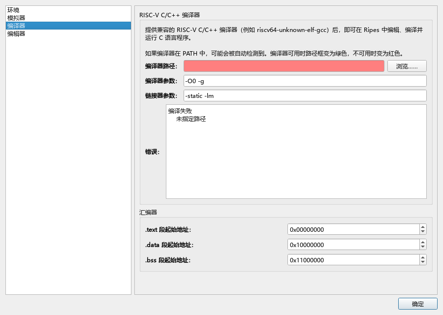
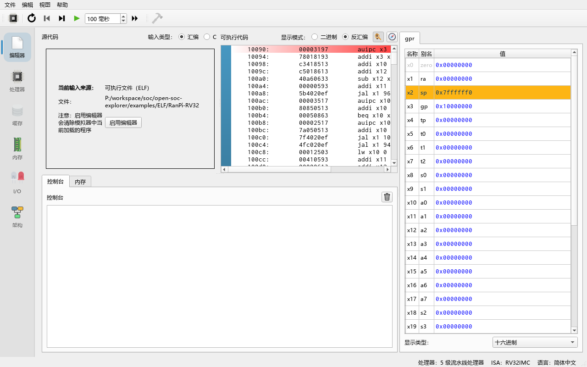
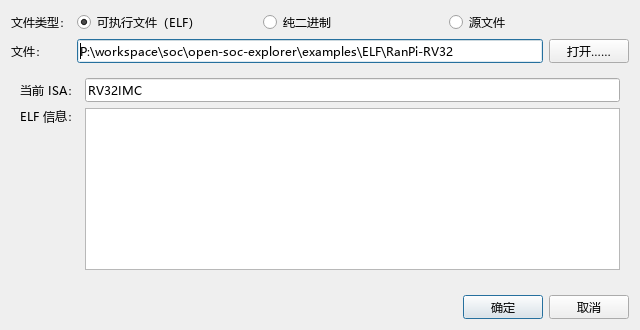

# 05 用 C 语言编程

> **你将学到**
>
> - 为什么需要一个"裸机"（bare-metal）RISC-V GCC 工具链，去哪里获取；
> - 在 **Edit → Settings → Compiler**（编辑 → 设置 → 编译器）中登记编译器、编译参数和链接参数；
> - Ripes 自动传给编译器的 `-march` / `-mabi` 是怎么由当前处理器决定的；
> - 在编辑器中编写、编译（Ctrl+B）、运行 C 程序的完整流程；
> - 用 `printf`（标准库）或自己写 `ecall` 包装函数（`-nostdlib`）输出；
> - 手动编译并用 **Load Program**（加载程序）载入 ELF 文件，以及如何检查 ELF；
> - 常见错误和解决办法。
>
> **前置条件**
>
> - 学完第 04 章，了解寄存器、`ecall`、函数调用约定。
> - 会写简单的 C 程序（变量、循环、函数、指针）。
> - 能在命令行运行程序（安装工具链时需要）。

---

## 5.1 为什么需要单独的编译器

Ripes 自带的是**汇编器**（assembler），不带 C 编译器。要运行 C 程序，需要一个能生成 RISC-V 机器码、并且不依赖操作系统的**裸机工具链**，三元组（tuple）是 `riscv64-unknown-elf-...`，例如 `riscv64-unknown-elf-gcc`。名字里的 `riscv64` 不要紧：这种工具链用 `-march=rv32...` 也能生成 32 位程序（前提是构建时启用了 multilib）。

获取方式（来自上游文档 `docs/c_programming.md`）：

- 下载预编译的工具链，例如 SiFive 的 `freedom-tools`（上游文档推荐 v2020.04.0 版本）；
- 或者按照 `riscv-gnu-toolchain` 仓库的说明自己构建 **newlib** 版本，构建时必须加 `--enable-multilib`。

> **注意**：Linux 发行版软件源里的 `gcc-riscv64-linux-gnu` 一类工具链（`linux-gnu` 而不是 `unknown-elf`）**不能**用：它们的启动文件里含有 C 扩展指令，并且面向 Linux 系统调用。

## 5.2 登记编译器

**做一步**：打开 **Edit → Settings**（编辑 → 设置），选择左侧的 **Compiler** 页（编译器）。

**看到什么**：页面上方有一段说明，下面是：

- **Compiler path:**（编译器路径）输入框和 **Browse**（浏览）按钮；
- **Compiler arguments:**（编译参数），默认 `-O0 -g`；
- **Linker arguments:**（链接参数），默认 `-static -lm`；
- 一个显示 **Compile command:**（编译命令）或 **Error:**（错误）的信息区；
- **Assembler**（汇编器）分组：`.text` / `.data` / `.bss` 段起始地址。



**做一步**：点 **Browse**，选择工具链 `bin` 目录下的 `riscv64-unknown-elf-gcc`（Windows 上是 `riscv64-unknown-elf-gcc.exe`）。

**看到什么**：如果编译器可用，路径框变成绿色，信息区显示完整的编译命令；如果不可用，路径框变红，信息区显示错误原因（例如 `'...' is not an executable file.`）。

**为什么**：Ripes 并不只是检查文件是否存在，它会真的用这个编译器编译一个测试程序 `int main() { return 0; }`，再检查生成的 ELF 文件是否适合当前处理器（`src/ccmanager.cpp` 的 `verifyCC`）。所以"路径变绿"意味着整条工具链（编译器、汇编器、链接器、C 库）都能工作。

> **自动检测**：第一次启动时，如果 `PATH` 中能找到 `riscv64-unknown-elf-gcc`、`riscv64-unknown-elf-g++` 或 `riscv64-unknown-elf-c++`，Ripes 会自动填入。

> **macOS 用户**：系统可能提示工具链中的程序"来自身份不明的开发者"。需要对每个被拦截的程序（编译器、汇编器、链接器……）在 Finder 中右键 → 打开一次，或在"安全性与隐私"中放行。

## 5.3 Ripes 实际执行的编译命令

编译命令由 `CCManager::createCompileCommand` 拼出来，顺序是：

```text
<编译器路径> -march=<由处理器决定> -mabi=<由处理器决定> <Compiler arguments> -x c <源文件> [ripes_system.h] -o <输出文件> <Linker arguments>
```

`-march` 和 `-mabi` **不需要**你自己写，它们来自当前处理器（第 06 章介绍如何切换）：

| 处理器位宽 | 启用的扩展（ISA Exts.） | `-march` | `-mabi` |
|---|---|---|---|
| 32 位 | 无 | `rv32i` | `ilp32` |
| 32 位 | M（默认） | `rv32im` | `ilp32` |
| 32 位 | M + C | `rv32imc` | `ilp32` |
| 64 位 | M（默认） | `rv64im` | `lp64` |
| 64 位 | M + C | `rv64imc` | `lp64` |

扩展字母按 RISC-V 规范的规范顺序拼接（`src/isa/rvisainfo_common.h` 中的 `_CCmarch`）。`ilp32` 表示 int、long、指针都是 32 位，参数通过整数寄存器和栈传递；Ripes 的处理器没有浮点单元，所以浮点运算由编译器用软件浮点（soft-float）库函数实现。

其他几点：

- `-x c` 强制按 C 语言编译，所以登记 `g++` 也可以，但代码仍按 C 处理；
- 如果你在 **I/O** 标签页添加了外设，Ripes 会生成 `ripes_system.h` 并一起传给编译器（第 08 章）；
- 编辑器里的代码先被写到系统临时目录下一个 `.c` 临时文件，输出也在临时目录。

## 5.4 第一个 C 程序

**做一步**：在 **Editor** 标签页把 **Input type:** 切换为 **C**。

**看到什么**：如果还没有登记有效的编译器，会弹出错误对话框 "No C compiler set."，输入类型自动退回 **Assembly**。登记成功后，工具栏上的 **Compile C program (Ctrl+B)**（编译 C 程序）按钮变为可用。

> **注意**：对话框指向 **Edit > Settings > Compiler**（编辑 > 设置 > 编译器），也就是设置编译器路径的页面。

**做一步**：输入下面的程序，按 **Ctrl+B**：

```c
#include <stdio.h>

int square(int x) { return x * x; }

int main() {
    int sum = 0;
    for (int i = 1; i <= 10; i++) {
        sum += square(i);
    }
    printf("sum of squares 1..10 = %d\n", sum);
    return 0;
}
```

**看到什么**：编译期间会出现 "Executing compiler..." 进度框（可以点 **Abort** 中止）。成功后，右侧 **Executable code** 区域出现反汇编代码——非常长，因为里面包含了 C 标准库的启动代码和 `printf` 的实现。按 **Run (F8)**，**Console** 打印：

```text
sum of squares 1..10 = 385
```



*截图说明：生成截图时本机没有 RISC-V 编译器，所以图中是预编译的 C 示例 `examples/ELF/RanPi-RV32`（用 **File → Load Program...** 以 **Executable (ELF)** 载入），而不是上面的程序。载入 ELF 文件时，源码区显示的是 **Current input source**（当前输入来源）页面，而不是 C 源码。*

**为什么**：编译生成的是一个完整的 ELF 可执行文件，Ripes 把它当作 **Executable (ELF)** 载入，入口点是 C 库的启动代码（`_start`），它设置好栈和全局数据后再调用 `main`。`printf` 最终调用 newlib 的 `write`，而 newlib 的系统调用桩代码用 `ecall` 发出 64 号 Write 调用，正好被 Ripes 的系统调用处理（第 04 章 4.8 节）。`main` 返回后，启动代码调用 `exit`，即 93 号 Exit2 调用（待核实：具体经由哪个系统调用退出取决于工具链的 newlib 版本）。

> **提示**：点击右侧代码区上方的 **Show symbol navigator**（指南针图标）可以列出所有符号，选择 `main` 就能跳过庞大的库代码直接看到你写的函数。

## 5.5 不用标准库：`-nostdlib`

链接标准库会让程序变得很大，单步时也很难找到自己的代码。如果不需要 `printf`、`malloc` 等函数，可以在 **Linker arguments:** 中加入 `-nostdlib`（或在 **Compiler arguments:** 中加）。这时：

1. 只有你写的函数会被链接；
2. 没有 C 启动代码，**程序入口是可执行文件中的第一条指令**，所以要么把入口函数写在文件最前面，要么像下面这样用内联汇编写一段启动代码；
3. 打印需要自己用 `ecall` 实现。

**File → Load Example... → C → matrixmul.c**（`examples/C/matrixmul.c`）就是这样写的：

```c
asm("li sp, 0x100000");  // 栈指针设为 1 MB
asm("jal main");         // 调用 main
asm("mv a1, a0");        // 保存返回值
asm("li a7, 10");        // 准备 exit
asm("ecall");            // 模拟器停止
```

自己实现打印函数的例子：

```c
asm("li sp, 0x100000");
asm("jal main");
asm("li a7, 10");
asm("ecall");

void print_str(const char *s) {   // s 通过 a0 传入
    asm volatile("li a7, 4\n ecall" : : "r"(s) : "a7");
}

void print_int(int v) {
    register int a0 asm("a0") = v;
    asm volatile("li a7, 1\n ecall" : : "r"(a0) : "a7");
}

int main() {
    print_str("6 * 7 = ");
    print_int(6 * 7);
    return 0;
}
```

预期输出 `6 * 7 = 42`（待核实：本章写作环境没有 RISC-V GCC，以上 C 示例未实际编译运行；`register ... asm("a0")` 的写法依赖 GCC 扩展）。

**为什么用 `register int a0 asm("a0")`**：按调用约定，函数的第一个参数本来就在 `a0` 里，但开启优化后编译器可能把它挪到别处；把变量绑定到 `a0` 可以保证 `ecall` 执行时 `a0` 里确实是要打印的值。`print_str` 中用 `"r"(s)` 约束不能保证寄存器是 `a0`，更稳妥的写法同样是先绑定到 `a0`。

> **注意**：上游文档 `docs/c_programming.md` 的 `-nostdlib` 例子依赖"参数恰好还在 `a0`"，在 `-O0` 下通常成立，但不保证；本手册推荐上面的写法。

## 5.6 在 C 中访问外设

外设的地址符号会写进自动生成的 `ripes_system.h`。只要先在 **I/O** 标签页添加外设，再在程序里 `#include "ripes_system.h"` 即可：

```c
#include "ripes_system.h"

unsigned *led_base = LED_MATRIX_0_BASE;

void main() {
    for (int i = 0; i < LED_MATRIX_0_WIDTH; i++)
        led_base[i] = 0xFF0000;   // 第一行全部点亮为红色
    while (1) {}
}
```

完整示例见 **File → Load Example... → C → leds.c**（`examples/C/leds.c`）和 **switchesAndLeds.c**（`examples/C/switchesAndLeds.c`），第 08 章详细讲解。

## 5.7 手动编译并载入 ELF

如果你更习惯在命令行编译，或者要编译多个源文件，可以手动编译后载入。

**做一步**：在命令行进入工具链的 `bin` 目录（或把它加入 `PATH`），执行：

```bash
riscv64-unknown-elf-gcc -march=rv32im -mabi=ilp32 -O1 -static foo.c -o foo.elf
```

`-march` 要和 Ripes 当前处理器的扩展一致（见 5.3 节的表）。可选加 `-s` 去掉符号表（但这样 Ripes 就无法显示函数名）。

**做一步**：检查 ELF 头：

```bash
riscv64-unknown-elf-readelf -h foo.elf
```

应当看到：

```text
  Class:                             ELF32
  Data:                              2's complement, little endian
  Type:                              EXEC (Executable file)
  Machine:                           RISC-V
  Flags:                             0x0
```

`Flags` 为 `0x0` 表示没有用 C 扩展、没有用硬件浮点 ABI；如果用了 `-march=rv32imc`，标志会包含 RVC 位，此时处理器也必须启用 C 扩展。

**做一步**：在 Ripes 中选择 **File → Load Program**（文件 → 加载程序，Ctrl+O），在对话框中 **File type:**（文件类型）选择 **Executable (ELF)**，点 **Open...** 选择 `foo.elf`。

**看到什么**：对话框下方显示 **ELF info:**（ELF 信息）和 **Current ISA:**（当前 ISA）。如果文件不兼容，会显示原因并且不能载入；兼容则点 **OK** 载入，**Editor** 标签页显示 "Current input source: Executable (ELF)"，编辑器变为只读，需要点 **Enable editor**（启用编辑器）才能重新编辑源码（这会清除已载入的程序）。



Ripes 对 ELF 的检查（`src/loaddialog.cpp` 的 `validateELFFile`）及对应错误：

| 检查 | 错误信息 | 原因 / 解决 |
|---|---|---|
| 是 ELF 文件 | `Not an ELF file` | 选错了文件 |
| 机器类型是 RISC-V | `Incompatible ELF machine type (ISA)...` | 用了 x86/ARM 编译器 |
| 位宽一致 | `Expected 32 bit executable, but input program is 64 bit.` | `-march`/`-mabi` 与处理器位宽不符，或换用 64 位处理器 |
| 是可执行文件 | `Only executable ELF files are supported...` | 只编译了 `.o`（用了 `-c`），或生成了动态链接文件；去掉 `-c`，加 `-static` |
| 标志受支持 | `ELF flag '0b...' unsupported` | 用了 C 扩展但处理器未启用 C，或用了硬件浮点 ABI |

此外，预编译好的例子 **File → Load Example... → ELF (precompiled C) → RanPi-RV32**（`examples/ELF/RanPi-RV32`）不需要编译器就能运行，它是一个用随机数估算 π 的 C 程序，包含软件浮点运算。若当前是 64 位处理器，请选 **RanPi-RV64**。

## 5.8 常见问题

| 现象 | 原因 | 解决 |
|---|---|---|
| 切换到 C 时提示 "No C compiler set." | 没有登记编译器或验证失败 | 按 5.2 节登记，确认路径框为绿色 |
| 编译器路径变红，错误里有 `cannot find crt0.o` / `-lc` | 工具链缺少 32 位 multilib | 换用带 multilib 的工具链 |
| "Compilation failed. Error output was:" 对话框 | C 语法错误或链接错误 | 阅读对话框中 GCC 的 stderr 输出，按行号修改 |
| 编译后提示 `ELF flag ... unsupported` | 工具链默认带 C 扩展 | 在处理器中启用 C 扩展，或确认 `-march` 不含 `c` |
| 运行后什么都不打印 | `-nostdlib` 下调用了 `printf`，或输出缓冲未刷新 | 用自己的 `ecall` 函数；或在 `printf` 后调用 `fflush(stdout)` |
| 程序"跑飞"，执行到奇怪的地址 | `-nostdlib` 时入口函数不在文件最前面 | 把启动代码 / 入口函数放在文件开头 |
| 单步时总在库函数里打转 | 链接了标准库 | 用断点 + **Run**，或用 `-nostdlib` |
| 使用外设符号时报 "undeclared" | 没先在 **I/O** 标签页添加外设，或没 `#include "ripes_system.h"` | 先添加外设再编译 |

> **CLI 模式**：命令行模式也支持 `-t c` 编译 C 源文件（见第 15 章），使用同样的编译器设置。CLI 模式下不能实例化外设，所以用到外设符号的 C 程序在 CLI 中无法编译。

## 5.9 练习

1. 在 **Compiler arguments:** 中分别使用 `-O0` 和 `-O2` 编译 5.4 节的程序（可以去掉 `printf`，改用 `-nostdlib` 版本的打印），在 **Processor** 标签页比较 **Cycles**（周期数）和 **Instrs. retired**（已退休指令数）。
2. 把处理器切换为 64 位的 5 级流水线处理器，重新编译同一程序，观察编译命令中的 `-march` / `-mabi` 变成了什么。
3. 写一个 `-nostdlib` 程序：计算 1 到 100 中所有能被 3 整除的数之和并打印。
4. 用 **File → Load Example... → C → matrixmul.c** 编译运行，用 symbol navigator 找到 `mmul`，在它的最内层循环中设置断点，数一数每次迭代执行了多少条指令。
5. 为什么上游的 `ranpi.c` 程序里有浮点运算，却能在没有浮点单元的处理器上运行？

### 参考答案

1. `-O2` 下变量放在寄存器里，循环可能被展开甚至在编译期算出结果，周期数和指令数都会大幅减少；`-O0` 下每个变量都在栈上，每次使用都要 `lw`/`sw`。具体数字取决于编译器版本。
2. 变为 `-march=rv64im -mabi=lp64`（默认启用 M 扩展时）。
3. 参考：
   ```c
   asm("li sp, 0x100000");
   asm("jal main");
   asm("li a7, 10");
   asm("ecall");

   void print_int(int v) {
       register int a0 asm("a0") = v;
       asm volatile("li a7, 1\n ecall" : : "r"(a0) : "a7");
   }

   int main() {
       int sum = 0;
       for (int i = 1; i <= 100; i++)
           if (i % 3 == 0) sum += i;
       print_int(sum);   // 1683
       return 0;
   }
   ```
4. 在 `-O0` 下，`c[row][col] += a[row][k] * b[k][col]` 需要先从栈上读出 `row`、`col`、`k` 和三个数组指针，计算地址，再 `lw`、`mul`、`add`、`sw`，通常有二三十条指令；`-O2` 下可以减少到不到十条。具体数字取决于编译器。
5. 因为编译时 `-march=rv32im` 中没有 F/D 扩展，编译器把浮点运算编译成对软件浮点库函数（如 `__adddf3`、`__muldf3`）的调用，这些函数只用整数指令实现浮点运算。

## 小结

- Ripes 需要一个 `riscv64-unknown-elf-gcc` 裸机工具链（带 multilib），在 **Edit → Settings → Compiler** 中登记，路径变绿表示验证通过。
- `-march` / `-mabi` 由当前处理器的位宽和扩展自动决定；默认额外参数是 `-O0 -g`，链接参数是 `-static -lm`。
- 编辑器选 **C** 输入类型，按 **Ctrl+B** 编译，成功后自动载入 ELF；标准库的 `printf` 通过 `ecall` 输出。
- `-nostdlib` 让程序小而易读，但需要自己写启动代码和 `ecall` 打印函数。
- 手动编译的 ELF 用 **File → Load Program** 载入；Ripes 会检查机器类型、位宽、文件类型和标志。
- 下一章：在不同的处理器模型上运行程序，观察流水线。
