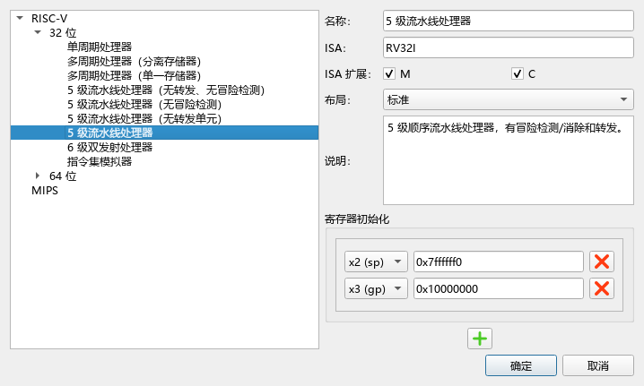
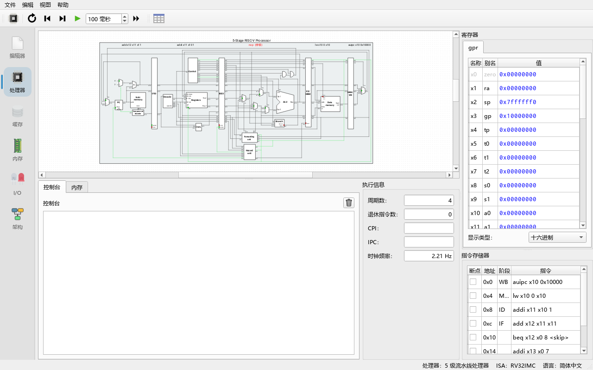
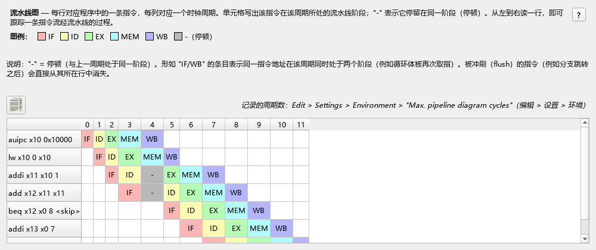
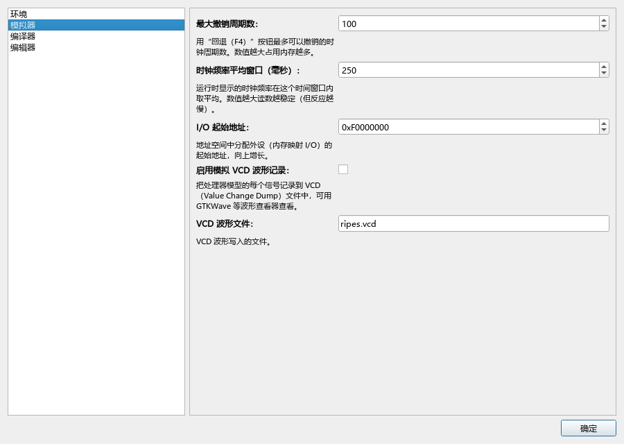

# 06 处理器模型与流水线

> **你将学到**
>
> - Ripes 提供哪些处理器模型：单周期、多周期、5 级流水线（四个变体）、6 级双发射、指令集模拟器，32 位与 64 位；
> - 如何在处理器选择对话框中切换处理器、布局（layout）、ISA 扩展和寄存器初值；
> - 如何读数据通路（datapath）视图：多路选择器、信号线颜色、悬停看信号值；
> - 什么是数据冒险（data hazard）、控制冒险（control hazard），转发（forwarding）和停顿（stall）怎样解决它们——用具体程序在不同模型上对比；
> - 如何用流水线图（pipeline diagram）看每条指令在每个周期处于哪一级；
> - 反向执行（reverse）和 VCD 波形跟踪。
>
> **前置条件**
>
> - 学完第 04 章，能读懂简单的 RISC-V 汇编。
> - 知道"时钟周期"的含义；听说过"流水线"更好，但不是必需。

---

## 6.1 处理器模型一览

**做一步**：在 **Processor** 标签页（处理器）的工具栏上点击 **Select processor**（选择处理器，CPU 图标）。

**看到什么**：弹出处理器选择对话框。左边是一棵树：**RISC-V** → **32-bit** / **64-bit** → 各个处理器。右边显示所选处理器的 **Name:**（名称）、**Description:**（描述）、**ISA:**、**ISA Exts.**（ISA 扩展复选框）、**Layout**（布局）和寄存器初始化表。



处理器模型（名称为对话框中的英文原文，定义在 `src/processorregistry.cpp`；括号中是命令行 `--proc` 使用的 ID）：

| 处理器 | 说明 | 级数 | 布局 |
|---|---|---|---|
| **Single-cycle processor**（`RV32_SS` / `RV64_SS`） | 单周期：每个周期完整执行一条指令 | 1 | Standard、Extended |
| **Multi-cycle processor with separate memories**（`RV32_5MC_2M` / `RV64_5MC`） | 多周期，类似 Harris & Harris 教材；每条指令用不同数量的周期，控制单元中显示当前状态；指令与数据存储器分开 | 5 个阶段 | Extended |
| **Multi-cycle processor with one memory**（`RV32_5MC_1M` / `RV64_5MC_1M`） | 同上，但利用"取指和访存不会在同一周期发生"共用一个存储器 | 5 个阶段 | Extended |
| **5-stage processor w/o forwarding or hazard detection**（`RV32_5S_NO_FW_HZ`） | 5 级流水线，没有转发也没有冒险检测 | 5 | Standard、Extended |
| **5-stage processor w/o hazard detection**（`RV32_5S_NO_HZ`） | 有转发，没有冒险检测 | 5 | Standard、Extended |
| **5-Stage processor w/o forwarding unit**（`RV32_5S_NO_FW`） | 有冒险检测（停顿），没有转发 | 5 | Standard、Extended |
| **5-stage processor**（`RV32_5S` / `RV64_5S`） | 有冒险检测和转发的完整 5 级流水线（**默认处理器**） | 5 | Standard、Extended |
| **6-stage dual-issue processor**（`RV32_6S_DUAL` / `RV64_6S_DUAL`） | 6 级顺序双发射：两条通路都能执行算术指令，通路 1 专门处理控制流和 `ecall`，通路 2 专门处理访存 | 6 | Extended |
| **ISA simulator**（`RV32_ISS` / `RV64_ISS`） | 指令集模拟器：用软件解释器每周期执行一条完整指令，速度快，作为参考模型 | — | Standard |

对没有冒险检测的两个 5 级模型，描述中有一条加粗的警告：**有冒险的程序会执行出错，除非你手工插入 `nop` 让流水线等待。**

5 级流水线的五级是 **IF**（取指）、**ID**（译码/读寄存器）、**EX**（执行）、**MEM**（访存）、**WB**（写回）。6 级双发射处理器多了一级 **II**（instruction issue，发射），顺序为 IF、ID、II、EX、MEM、WB。

### 选项说明

- **32-bit / 64-bit**：同一个模型有 RV32 和 RV64 两个版本。64 位版本寄存器为 64 位，支持 `ld`/`sd`/`addiw` 等 RV64 指令，C 编译时用 `-mabi=lp64`。
- **ISA Exts.**：可选 **M**（整数乘除，默认勾选）和 **C**（压缩指令，16 位编码）。扩展会影响汇编器接受哪些指令，以及 C 编译器的 `-march`（第 05 章）。
- **Layout**：同一个处理器的不同画法。**Standard** 是简化视图，省略控制部件和控制信号；**Extended** 显示控制部件、控制信号和线宽。布局**只影响显示，不影响处理器的行为**。
- **寄存器初始化**：每次复位时写入寄存器的值，默认 `sp`（x2）= `0x7ffffff0`，`gp`（x3）= `0x10000000`。

**做一步**：选择 **32-bit** 下的 **5-stage processor**，**Layout** 选 **Extended**，点 **OK**。

**看到什么**：**Processor** 标签页中央换成了完整的 5 级流水线数据通路，上方标有 IF、ID、EX、MEM、WB 五个级的名字。切换处理器会复位模拟器，但已载入的程序保留（会重新汇编）。

## 6.2 读数据通路视图



**Processor** 标签页的组成：

- 中央：处理器数据通路视图。**Ctrl + 滚轮**缩放，拖动平移。
- 右侧 **Registers**（寄存器）：最近被修改的寄存器高亮显示；点击数值可直接修改。
- 右侧 **Instruction memory**（指令存储器）：列 **BP**（断点，点击切换）、**Addr**（地址）、**Stage**（该指令当前所在的级）、**Instruction**（反汇编）。
- 下方 **Execution info**（执行信息）：**Cycles:**（周期数）、**Instrs. retired:**（已退休指令数，即离开最后一级的指令数）、**CPI:**（每条指令的周期数）、**IPC:**（每周期的指令数）、**Clock rate:**（模拟时钟频率）。
- 下方 **Console**（控制台）：`ecall` 输出。

数据通路中的视觉约定（来自上游 `docs/introduction.md`）：

- **多路选择器**（multiplexer）用一个绿点标出当前选中的输入；
- **1 位信号**：线为绿色表示 1，灰色表示 0；
- **多位信号**：值改变时线会短暂闪绿；
- 某些部件上有指示灯，表示寄存器被时钟触发、分支被采纳等。

**做一步**：把鼠标悬停在任意一个端口（port）上。

**看到什么**：提示框显示端口名和当前值。

**做一步**：点击工具栏的 **Show processor signal values**（显示处理器信号值），或在端口上右键选择 "show value"。

**看到什么**：所有输出端口旁边出现数值标签；右键数值标签可以切换进制（radix）。点击一根导线会高亮整根导线，便于追踪信号在复杂布局中的走向。

## 6.3 控制模拟

工具栏按钮（`src/processortab.cpp`）：

| 按钮 | 快捷键 | 作用 |
|---|---|---|
| **Reset** | F3 | 复位：PC 回到程序入口，内存恢复初始内容 |
| **Reverse** | F4 | 撤销一个时钟周期 |
| **Clock** | F5 | 前进一个时钟周期 |
| **Auto clock** | F6 | 按右侧的间隔（毫秒）自动连续时钟，遇到断点停止 |
| **Run** | F8 | 不刷新界面、全速运行，遇到断点或退出 `ecall` 停止 |
| **Show pipeline diagram** | — | 打开流水线图（6.5 节） |

> **注意**：**Run** 模式下不记录流水线图数据，界面也不实时刷新，要看逐周期行为请用 **Clock** 或 **Auto clock**。

## 6.4 冒险：用一个程序比较五个模型

下面这个小程序包含了典型的冒险：

```asm
.data
x: .word 10
.text
    lw   a0, x          # 伪指令：auipc a0, ... + lw a0, ...(a0)
    addi a1, a0, 1      # 用到刚 load 的 a0 —— load-use 冒险
    add  a2, a1, a1     # 用到上一条的 a1 —— 数据冒险
    beq  a2, zero, skip # 分支（这里不跳）
    addi a3, zero, 7
skip:
    addi a4, zero, 1
```

正确结果：`a0 = 10`、`a1 = 11`、`a2 = 22`、`a3 = 7`、`a4 = 1`。注意 `lw a0, x` 被展开成 `auipc` + `lw` 两条，所以一共 7 条指令。

**做一步**：把程序输入编辑器，依次切换到下表中的处理器，每次按 **Run (F8)**，记录 **Cycles** 和寄存器结果。

| 处理器 | 周期数 | 结果正确吗 |
|---|---|---|
| Single-cycle processor | 7 | 正确 |
| 5-stage processor w/o forwarding or hazard detection | 12 | **错误**（`a0`、`a1`、`a2`、`a3` 都不对） |
| 5-stage processor w/o hazard detection | 12 | **错误**（`a0` 对，但 `a1`、`a2` 错，分支走错导致 `a3` = 0） |
| 5-Stage processor w/o forwarding unit | 19 | 正确 |
| 5-stage processor | 12 | 正确 |
| 6-stage dual-issue processor | 13 | 正确 |
| Multi-cycle processor with separate memories | 28 | 正确 |

（以上数字是在本项目 `build/Ripes.exe` 的 CLI 模式下实测得到的，GUI 中结果相同。）

**为什么**：

- **单周期**：每条指令在一个周期内完成，后一条指令开始时前一条已经写回，没有冒险；7 条指令 7 个周期。但单周期的时钟周期必须足够长，能容纳最慢的指令（通常是 `lw`），所以真实频率低。
- **没有转发也没有冒险检测**：`addi a1, a0, 1` 在 ID 级读 `a0` 时，`lw` 还没走到 WB，读到的是旧值。连 `auipc a0` → `lw a0, ...(a0)` 之间的依赖都出错了。
- **只有转发**：EX 级可以从 MEM 级和 WB 级把刚算出的结果"转发"回来（`src/processors/RISC-V/rv5s/rv5s_forwardingunit.h`），解决了 `add` 依赖 `addi` 的问题；但 `lw` 的数据要到 MEM 级结束才有，紧跟其后的 `addi` 在 EX 级时数据还没出来，转发也来不及——这就是 **load-use 冒险**，必须停顿一个周期，而这个模型没有检测单元。
- **只有冒险检测**：遇到任何数据依赖都停顿，直到前一条指令写回寄存器堆，结果正确但多了 7 个周期。
- **完整 5 级**：转发解决大部分依赖，冒险检测单元（`rv5s_hazardunit.h`）只在 load-use 时插入 1 个周期的停顿：7 条指令 + 4 个填充周期 + 1 个停顿 = 12 个周期。
- **多周期**：每条指令依次占用多个阶段，不重叠，所以周期最多。

## 6.5 流水线图

**做一步**：切换回 **5-stage processor**，按 **Reset (F3)**，连续按 **Clock (F5)** 直到程序结束（约 12 次），然后点击工具栏的 **Show pipeline diagram**（显示流水线图，表格图标）。

**看到什么**：弹出 **Pipeline diagram** 窗口：每一行是一条指令，每一列是一个周期，单元格写着该指令在该周期所处的级：

```text
                     0   1   2   3   4   5   6   7   8   9   10  11
auipc x10 0x10000    IF  ID  EX  MEM WB
lw x10 0 x10             IF  ID  EX  MEM WB
addi x11 x10 1               IF  ID  -   EX  MEM WB
add x12 x11 x11                  IF  -   ID  EX  MEM WB
beq x12 x0 8 <skip>                      IF  ID  EX  MEM WB
addi x13 x0 7                                IF  ID  EX  MEM WB
addi x14 x0 1                                    IF  ID  EX  MEM WB
```



**为什么**：周期 4 中 `addi` 停在 ID 级不动（显示 `-`），它后面的 `add` 也停在 IF 级。等到周期 5，`lw` 已在 MEM 级取到数据，可以转发给 EX 级的 `addi`。`-` 表示该级在这个周期**停顿**（与上一周期是同一条指令）。

表格左上方的按钮可以把表格以制表符分隔的形式复制到剪贴板。表格上方的提示说明：记录的周期数可以在设置中修改——即 **Edit → Settings → Environment** 页的 **Max. pipeline diagram cycles:**（默认 100）。

### 控制冒险

把程序换成一个会跳转的循环：

```asm
.text
    li   t0, 2
loop:
    addi t0, t0, -1
    bnez t0, loop
    addi a0, zero, 1
    addi a1, zero, 2
```

**做一步**：在 **5-stage processor** 上复位、单步到结束，打开流水线图。

**看到什么**（13 个周期）：

```text
                   0   1   2   3   4   5      6      7   8   9   10  11  12
addi x5 x0 2       IF  ID  EX  MEM WB
addi x5 x5 -1          IF  ID  EX  MEM IF/WB  ID     EX  MEM WB
bne x5 x0 -4 <loop>        IF  ID  EX  MEM    IF/WB  ID  EX  MEM WB
addi x10 x0 1                  IF  ID                IF  ID  EX  MEM WB
addi x11 x0 2                      IF                    IF  ID  EX  MEM WB
```

**为什么**：分支在 **EX** 级才判定是否跳转（`rv5s.h` 中分支单元的结果与 ID/EX 寄存器的 `do_br` 相与后选择下一个 PC）。第一次执行 `bne` 时，它在周期 4 进入 EX 并判定"跳"，此时 `addi x10` 和 `addi x11` 已经被取进 IF、ID 级，只能被**冲刷**（flush）——在图中它们的那两格之后就没有了。所以每次被采纳的分支损失 2 个周期。第二次 `bne` 不跳，后面的指令正常流过。`IF/WB` 表示同一个地址的两次执行同时出现在两个级中。

### 6 级双发射

**做一步**：切换到 **6-stage dual-issue processor**（只有 Extended 布局），运行 6.4 节的程序，打开流水线图。

**看到什么**：数据通路分上下两条通路（way），每个级有两个位置；流水线图中可能出现两条指令同一周期处于同一级。

**为什么**：每周期最多取两条指令并同时发射；但通路 1 只能处理控制流和 `ecall`，通路 2 只能处理访存，而且两条相互依赖的指令不能同时发射，所以实际 IPC 通常低于 2。对这个依赖链很长的小程序，它甚至比 5 级流水线多一个周期。

## 6.6 手工插入 nop

在没有冒险检测的处理器上，可以手工插入 `nop` 来避免冒险：

```asm
.text
    addi a0, zero, 5
    addi a1, a0, 1      # 紧跟：在无转发无检测的处理器上读到旧值
    nop
    nop
    addi a2, a0, 1      # 隔两条 nop：读到正确的 a0
```

**做一步**：在 **5-stage processor w/o forwarding or hazard detection** 上运行。

**看到什么**：`a1` = 1（错误，读到的是 `a0` 的旧值 0），`a2` = 6（正确）。

**为什么**：`addi a2` 处于 ID 级时，`addi a0` 正好处于 WB 级；这个模型的寄存器堆在同一周期内先写后读，所以隔两条指令就够了。这正是早期 MIPS 等处理器把冒险处理交给编译器的思路。

## 6.7 反向执行

**做一步**：单步执行若干周期后，按 **Reverse (F4)**。

**看到什么**：处理器状态、寄存器、内存、流水线图、缓存状态都回到上一个周期。

**为什么**：模拟器为每个周期保存了可撤销的状态。可以撤销的最大周期数在 **Edit → Settings → Simulator** 页的 **Max. undo cycles:**（最大撤销周期数）中设置，默认 100。超出这个范围的历史无法回退；要从头再来，请用 **Reset**。

> **注意**：I/O 外设（例如 SIMT GPU、Tensor Unit）的反向执行行为见第 09、10 章。`ecall` 打印到控制台的内容不会因为反向执行而被删除（待核实）。

## 6.8 VCD 波形跟踪

VCD（Value Change Dump）是数字电路仿真常用的波形格式，可以用 GTKWave 等工具查看。

**做一步**：打开 **Edit → Settings → Simulator**，勾选 **Enable simulation VCD traces:**（启用仿真 VCD 跟踪），在 **VCD trace file:**（VCD 跟踪文件）中填入文件名（默认 `ripes.vcd`）。然后复位并运行程序。

**看到什么**：模拟时，处理器内部的信号变化被写入 VCD 文件。用 GTKWave 打开：

```bash
gtkwave ripes.vcd
```

可以看到 PC、各级流水线寄存器、控制信号随周期变化的波形。

> 相对路径相对于哪个目录（Ripes 的工作目录还是可执行文件目录）待核实；建议填写绝对路径。VCD 文件会随运行周期增长，长时间运行请注意磁盘空间。



## 6.9 练习

1. 用 6.4 节的程序，在 **5-stage processor** 上把 `addi a1, a0, 1` 和 `add a2, a1, a1` 之间插入一条与它们无关的指令（例如 `addi t0, zero, 3`），周期数会变吗？为什么？
2. 在 **5-Stage processor w/o forwarding unit** 上，6.4 节的程序比完整 5 级多了 7 个周期。打开流水线图，说出每个停顿是由哪一对指令引起的。
3. 写一个循环 10 次的程序（循环体内只有一条 `addi`），分别计算它在 5 级流水线和单周期处理器上的周期数，并解释差别中来自分支的部分。
4. 把 6.4 节程序中的 `lw a0, x` 换成 `li a0, 10`，在 **5-stage processor w/o hazard detection** 上结果还会错吗？为什么？
5. 在 **6-stage dual-issue processor** 上运行一段没有相互依赖的 8 条 `addi`（每条写不同的寄存器），IPC 是多少？再把它们改成首尾相依的链，IPC 变成多少？

### 参考答案

（以下周期数均在本项目 `build/Ripes.exe` 的 CLI 模式下实测。）

1. 要看插在哪里。插在 `lw` 与 `addi a1` 之间：共 8 条指令，周期数**仍是 12**——这条无关指令"填上"了 load-use 停顿的空位；插在 `addi a1` 与 `add a2` 之间：周期数变为 **13**，因为停顿还在，又多了一条指令。结论：**只有放在 load 与其使用者之间的无关指令才能消除 load-use 停顿**，这正是编译器做指令调度（instruction scheduling）的原因。
2. 打开流水线图可以看到 4 处依赖，每处停顿 2 个周期：`auipc a0` → `lw a0, ...(a0)`、`lw a0` → `addi a1`、`addi a1` → `add a2`、`add a2` → `beq`，合计 8 个停顿周期（7 条指令 + 4 个填充 + 8 = 19）。完整 5 级流水线只有 1 个 load-use 停顿，所以相差 7 个周期。没有转发时，后一条指令必须在 ID 级等到前一条进入 WB 级才能读到新值。
3. 程序：`li t0, 10` 后接 `loop: addi t0, t0, -1` / `bnez t0, loop`，共执行 21 条指令。单周期：21 个周期。5 级流水线：43 个周期 = 21 条指令 + 4 个填充周期 + 9 次被采纳的分支 × 2 个冲刷周期（最后一次不跳）。`addi` → `bnez` 的依赖由转发解决，不产生停顿。
4. 仍然**会错**：实测 `a0` = 10、`a1` = 11、`a2` = 22 都正确（ALU 结果可以转发），但 `a3` = 0，说明 `beq` 走错了方向，跳过了 `addi a3`。也就是说，除了 load-use，紧跟在计算指令之后的分支在这个模型上也会得到错误的比较结果（待核实：具体是分支比较器拿到了未转发的旧值）。在完整 5 级流水线上，同一程序 `a3` = 7。
5. 8 条互不相关的 `addi`：9 个周期；8 条首尾相依的 `addi`：13 个周期。无依赖时两条通路可以同时发射，每周期约完成 2 条；相依时每周期只能发射 1 条，和 5 级流水线一样。（CLI 报告的 IPC 受填充周期和退休计数影响，比较周期数更直观。）

## 小结

- Ripes 有单周期、多周期、四种 5 级流水线变体、6 级双发射和 ISA 模拟器，每种都有 32/64 位版本；默认是 32 位 **5-stage processor**，启用 M 扩展。
- 布局（Standard / Extended）只改变画法；ISA 扩展改变可用指令和 C 编译参数。
- 数据冒险靠转发解决，load-use 冒险必须停顿 1 个周期；分支在 EX 级判定，被采纳时冲刷 2 条指令。
- 没有冒险检测的模型会算错，用来体会冒险的后果；可以手工插入 `nop` 修正。
- **Show pipeline diagram** 显示每条指令在每个周期的级，`-` 表示停顿；**Run** 模式不记录。
- **Reverse (F4)** 撤销周期（默认最多 100 个），**Simulator** 设置页可以开启 VCD 波形跟踪。
- 下一章：缓存模拟。
