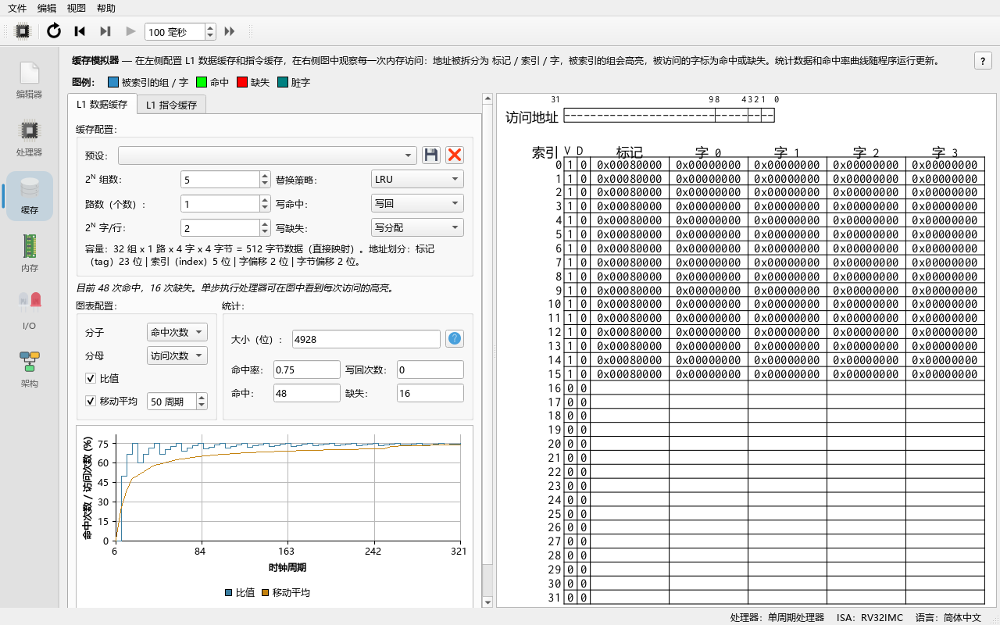
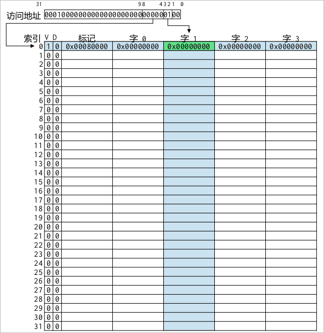
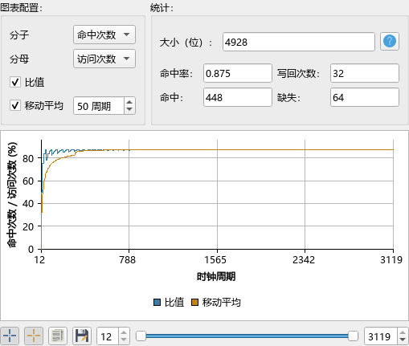

# 07 缓存模拟

> **你将学到**
>
> - Ripes 的缓存模拟器模拟什么、不模拟什么；
> - 缓存参数：组（set）、路（way）、每行字数（words per line），以及地址如何被切分成 tag / index / word / byte；
> - 命中（hit）、缺失（miss）、写回（writeback）是什么，替换策略（LRU / Random）和写策略（write-back / write-through、write allocate / no write allocate）有什么区别；
> - 如何使用预设（preset）、读懂缓存表格视图和命中率曲线；
> - 数据缓存与指令缓存的区别；
> - 两个实验：步长（stride）循环、矩阵按行/按列遍历。
>
> **前置条件**
>
> - 学完第 04 章，能写带循环的汇编程序；知道第 06 章中处理器的切换方法。
> - 知道 2 的幂和二进制地址的含义。

---

## 7.1 缓存模拟器做什么

内存比处理器慢得多，缓存（cache）是放在处理器和内存之间的小而快的存储器，保存最近用过的数据。Ripes 在 **Cache** 标签页（缓存）中模拟两个一级缓存：**L1 Data Cache**（一级数据缓存）和 **L1 Instr. Cache**（一级指令缓存）。

需要先了解的几点（来自上游 `docs/cache_sim.md`，并已对照 `src/cachesim/` 核实）：

- 缓存模拟器**不改变程序的执行**：处理器访问内存时并不经过缓存，而是缓存模拟器在每个周期"旁听"处理器的内存访问（`src/cachesim/l1cacheshim.cpp`），把这些访问当作一条访问轨迹（trace）来模拟。
- 因此 Ripes **不模拟缓存延迟**，周期数不会因为缺失而增加；它只告诉你命中率、缺失次数、写回次数等。
- 写回（write-back）模式下的"脏"数据实际上也已经写到了内存，所以 **Memory** 标签页总能看到最新的值。
- **建议用单周期处理器做缓存实验**。在流水线处理器上，如果正在访存的那一级被停顿，每个停顿周期都会被计为一次额外的访问；单周期处理器没有这个问题，而且运行更快。
- 访问按字（4 字节）对齐处理，字节和半字访问会被当作对它所在字的访问。

## 7.2 缓存参数

**做一步**：切换到 **Single-cycle processor**（第 06 章），然后打开 **Cache** 标签页，选择 **L1 Data Cache** 子标签。

**看到什么**：上方是 **Cache configuration:**（缓存配置）分组，下方是缓存表格视图，右侧（或下方）是 **Plot configuration:**（绘图配置）、**Statistics:**（统计）和命中率曲线。



配置项（`src/cachesim/cacheconfigwidget.ui`）：

| 控件 | 含义 | 取值 |
|---|---|---|
| **Preset:** | 预设，选择后自动填好下面所有参数 | 见 7.4 节 |
| **2ᴺ Sets:** | 组数的指数 N，组数 = 2ᴺ | 0–10 |
| **Ways (count):** | 相联度（每组几路），**直接填路数** | 1–1024 |
| **2ᴺ Words/Line:** | 每行（每块）字数的指数 N，字数 = 2ᴺ | 0–10 |
| **Replacement:** | 替换策略 | **LRU**、**Random** |
| **Write hit:** | 写命中策略 | **Write-back**、**Write-through** |
| **Write miss:** | 写缺失策略 | **Write allocate**、**No write allocate** |

> **注意**：上游文档说 **Ways** 也是 2 的幂的指数，但当前代码中 **Ways (count):** 直接是路数（`CacheSim::setWays`，预设"fully associative"就填了 32）。缓存总容量 = 组数 × 路数 × 每行字数 × 4 字节。

默认配置是 32 组、1 路、每行 4 字（即 **2ᴺ Sets** = 5，**Ways** = 1，**2ᴺ Words/Line** = 2），写回 + 写分配 + LRU，总容量 32 × 1 × 4 × 4 = 512 字节。

### 地址如何切分

对一个 32 位字节地址，缓存这样切分（`CacheSim::recalculateMasks`）：

```text
 31                     9 8       4 3    2 1    0
+------------------------+---------+------+------+
|          tag           |  index  | word | byte |
+------------------------+---------+------+------+
     其余高位 (23 位)       N_sets 位  N_words 位  2 位
```

- **byte**（2 位）：字内字节偏移，被忽略；
- **word**：选择行内的哪个字，位数 = **2ᴺ Words/Line** 的 N；
- **index**：选择哪一组，位数 = **2ᴺ Sets** 的 N；
- **tag**：剩下的高位，存在缓存里用来判断"这一行是不是我要的地址"。

上图是默认配置的情况：word 2 位、index 5 位、tag 32 − 2 − 2 − 5 = 23 位。

**做一步**：点 **Statistics:** 中 **Size (bits):**（容量，位）旁的 **...** 按钮。

**看到什么**：容量分解：Valid bits（有效位）32、Dirty bits（脏位）32、LRU bits 0（只有 1 路时不需要）、Tag bits 32 × 23 = 736、Data bits 32 × 4 × 32 = 4096，共 4896 位（`CacheSim::getCacheSize`）。这说明缓存除了数据本身，还要花额外的空间存标记和状态位。

## 7.3 命中、缺失与策略

每次访问时，缓存用 index 找到一组，再在这一组的各路里比较 tag：

- **命中（hit）**：某一路有效且 tag 相同，数据就在缓存里；
- **缺失（miss）**：没有匹配的路，需要从内存取一整行进来。如果这一组已满，就要按**替换策略**选一路踢出去（evict）。

替换策略（`CacheSim::locateEvictionWay`）：

- **LRU**（least recently used，最近最少使用）：踢出最久没被访问的一路。缓存视图中有 **LRU** 列，刚访问过的值为 0，即将被踢出的值最大。
- **Random**（随机）：在已满的组里随机选一路（有空的路时先用空的）。

写策略：

- **Write-back**（写回）：写命中时只改缓存，并把这一行标记为脏（dirty，**D** 列）；被踢出时才写回内存，计为一次 writeback。
- **Write-through**（写直达）：每次写都同时写内存，每次写都计为一次 writeback，不需要脏位。
- **Write allocate**（写分配）：写缺失时先把这一行取进缓存再写。
- **No write allocate**（非写分配）：写缺失时直接写内存，不把这一行放进缓存（计为一次 writeback）。

## 7.4 预设

**Preset:** 下拉框中默认有三个预设（`src/ripessettings.cpp`），三者容量相同（32 行 × 4 字 = 128 字 = 512 字节），都是写回 + 写分配 + LRU：

| 预设 | Sets | Ways | Words/Line |
|---|---|---|---|
| **32-entry 4-word direct-mapped** | 2⁵ = 32 | 1 | 2² = 4 |
| **32-entry 4-word fully associative** | 2⁰ = 1 | 32 | 4 |
| **32-entry 4-word 2-way set associative** | 2⁴ = 16 | 2 | 4 |

- 点击保存按钮（**Store cache preset**）可以把当前配置存为新的预设，输入名字即可；
- 点击删除按钮（**Delete cache preset**）删除当前预设（会要求确认）；
- 手动修改任何参数后，**Preset:** 显示为空，表示当前配置不是某个预设。

> 修改缓存配置会复位处理器。

## 7.5 读缓存视图

缓存被画成一张表（`src/cachesim/cachegraphic.cpp`）：

- 列：**Index**（组号）、**V**（有效位）、**D**（脏位，仅写回模式）、**LRU**（仅路数 > 1 且策略为 LRU 时）、**Tag**、**Word 0**、**Word 1**……（缓存的数据）；
- 行：组与组之间用**实线**分隔，同一组内的各路用**虚线**分隔。

访问时：

- 被索引的组（行）和字（列）用高亮色标出（取自系统调色板的 Highlight 颜色），交叉处就是可能存放该数据的单元；直接映射时只有 1 个单元，N 路组相联时有 N 个；
- **绿色**单元表示命中，**红色**表示缺失，**青色**（dark cyan）表示该字是脏的（写回模式）；
- 鼠标悬停在某个字上显示它的内存地址；点击会让 **Memory** 标签页跳到该地址；
- **Ctrl + 滚轮**缩放。



> 颜色在深色主题下会换成更柔和的绿/红/青色。

## 7.6 统计与曲线

**Statistics:** 中显示 **Hit rate:**（命中率）、**Hits:**（命中次数）、**Misses:**（缺失次数）、**Writebacks:**（写回次数）和 **Size (bits):**。

曲线部分可以绘制任意两个量之比随周期的变化。**Numerator**（分子）和 **Denominator**（分母）可选：**Writes**、**Reads**、**Hits**、**Misses**、**Writebacks**、**Access count**（访问次数 = 读 + 写）、**Was hit**、**Was miss**、**1**。默认是 **Hits** / **Access count**，即命中率曲线。

- **Ratio** 复选框：显示/隐藏比值曲线；
- **Moving avg.**（滑动平均）：再画一条按指定周期数（**cyc.**）滑动平均的曲线，便于看出程序的哪一段命中率发生变化；
- 下方的 **Min. cycle** / **Max. cycle** 滑块选择绘图范围；
- 范围滑块左侧的按钮：开启总曲线/滑动平均曲线的标记（marker）、把绘制的数据（每个周期一行）复制到剪贴板、把曲线存为图片。

曲线最多覆盖最近的 **Max. cache plot cycles**（缓存图最大周期数）个周期（**Edit → Settings → Environment**，默认 10000）。运行更久时显示最近的周期，并在曲线上方用一行提示说明绘制了哪些周期，例如"仅绘制了第 110508 - 120503 周期；更早的周期已被丢弃。如需绘制更多，请增大 编辑 > 设置 > 环境 中的"缓存图最大周期数"。"比值仍从第 0 周期开始累计，**Statistics** 中的统计覆盖整个运行过程。同一设置页的 **Max. cache access traces**（最大缓存访问记录数）限制保留多少次缓存访问；它丢弃较早的访问时也会出现同样的提示。

> 在 1280×800 下，左栏（配置、统计和曲线）可能比窗口高；滚动左栏即可看到曲线下方的控件。



## 7.7 指令缓存与数据缓存

- **L1 Data Cache** 只记录 `lw`/`sw` 等访存指令产生的数据访问（包括读和写）；
- **L1 Instr. Cache** 记录每次取指（只有读）。

两者是独立的缓存，可以分别配置。程序的指令通常是顺序执行的循环，所以指令缓存的命中率一般很高；数据缓存的命中率则取决于你的数据访问模式——下面的实验就是研究这一点。

## 7.8 实验一：步长循环

把下面的程序输入编辑器（下面的命中率是按默认配置手工推算的预期值）：

```asm
# 读取 N 个字，每次跳过 STRIDE 个字
.equ N, 64          # 访问次数
.equ STRIDE, 1      # 步长（以字为单位）：试试 1、2、4、8
.data
arr:    .zero 2048  # 512 个字
.text
main:
    la   t0, arr
    li   t1, N
    li   t2, STRIDE
    slli t2, t2, 2      # 步长换算成字节
    li   a0, 0
loop:
    lw   t3, 0(t0)
    add  a0, a0, t3
    add  t0, t0, t2
    addi t1, t1, -1
    bnez t1, loop
    li   a7, 10
    ecall
```

**做一步**：使用 **Single-cycle processor**，数据缓存选预设 **32-entry 4-word direct-mapped**，按 **Run (F8)**，记录 **L1 Data Cache** 的 **Hit rate**。然后把 `STRIDE` 依次改成 2、4、8，重复。

**看到什么**（预期）：

| STRIDE | 访问次数 | 缺失 | 命中率 |
|---|---|---|---|
| 1 | 64 | 16 | 0.75 |
| 2 | 64 | 32 | 0.5 |
| 4 | 64 | 64 | 0 |
| 8 | 64 | 64 | 0 |

**为什么**：每行有 4 个字。步长为 1 时，每读一行的第一个字缺失，后面 3 个字都命中——这就是**空间局部性**（spatial locality）带来的收益。步长为 2 时，每行只用到 2 个字；步长 ≥ 4 时，每次访问都落在新的一行，缓存完全帮不上忙。

**做一步**：把 **L1 Instr. Cache** 的命中率也看一下。

**看到什么**：接近 1。循环体只有 5 条指令，在缓存中只占两行，第一轮之后每次取指都命中——这是**时间局部性**（temporal locality）。

## 7.9 实验二：矩阵按行与按列遍历

C 语言的二维数组按行存放（row-major）：`m[i][j]` 的地址是 `base + (i*DIM + j)*4`。下面的程序对一个 16 × 16 的字矩阵每个元素做 `m += 1`，可以选择按行或按列遍历：

```asm
# 遍历 16x16 字矩阵：ROWMAJOR=1 按行，ROWMAJOR=0 按列
.equ DIM, 16
.equ ROWMAJOR, 1
.data
mat:    .zero 1024      # 16*16*4 字节
.text
main:
    la   s0, mat
    li   s1, DIM
    li   t0, 0              # i
outer:
    li   t1, 0              # j
inner:
    li   t4, ROWMAJOR
    beqz t4, colmajor
    mul  t2, t0, s1         # 按行：index = i*DIM + j
    add  t2, t2, t1
    j    access
colmajor:
    mul  t2, t1, s1         # 按列：index = j*DIM + i
    add  t2, t2, t0
access:
    slli t2, t2, 2
    add  t2, s0, t2
    lw   t3, 0(t2)
    addi t3, t3, 1
    sw   t3, 0(t2)
    addi t1, t1, 1
    blt  t1, s1, inner
    addi t0, t0, 1
    blt  t0, s1, outer
    li   a7, 10
    ecall
```

矩阵大小 1024 字节，是缓存容量（512 字节）的两倍。每个元素一次 `lw` 加一次 `sw`，共 512 次数据访问。

**做一步**：用 **Single-cycle processor**，依次在三个预设下分别运行 `ROWMAJOR=1` 和 `ROWMAJOR=0`，记录数据缓存命中率。

**看到什么**（按地址映射手工推算的预期值）：

| 预设 | 按行（ROWMAJOR=1） | 按列（ROWMAJOR=0） |
|---|---|---|
| 32-entry 4-word direct-mapped | 0.875 | 0.5 |
| 32-entry 4-word 2-way set associative | 0.875 | 0.5 |
| 32-entry 4-word fully associative | 0.875 | 0.875 |

**为什么**：

- **按行**：连续访问相邻的字，每行（4 个元素、8 次访问）只有第一次 `lw` 缺失：64 / 512 次缺失，命中率 0.875。`sw` 总是紧跟在同地址的 `lw` 之后，所以总命中。
- **按列、直接映射**：相邻两次访问相距一行矩阵 = 64 字节 = 4 个缓存行，组号 = (j × 4 + i/4) mod 32，于是第 j 行和第 j+8 行映射到同一组，互相踢出。下一列（i+1）本可以复用同一批缓存行，但它们已被踢掉，所以每次 `lw` 都缺失，只有 `sw` 命中：命中率 0.5。这种由映射冲突引起的缺失叫**冲突缺失**（conflict miss）。
- **按列、2 路组相联**：16 组，组号 = (j × 4 + i/4) mod 16，第 j、j+4、j+8、j+12 行映射到同一组——4 行争 2 路，LRU 下仍然全部缺失。
- **按列、全相联**：一列用到 16 个缓存行，全相联缓存能放下 32 行，同一组 4 列都能复用：每 4 列只缺失 16 次，命中率回到 0.875。

这个实验说明：**容量相同，组织方式（相联度）不同，命中率可以相差很大**；而改写程序的访问顺序（循环交换，loop interchange）往往比换硬件更有效。

> 上游文档 `docs/cache_sim.md` 中的例子也演示了同样的现象：步长为 512 字的两个地址在直接映射缓存中命中率约 0.01，换成 2 路组相联后约 0.99。

## 7.10 练习

1. 默认配置下（32 组、1 路、每行 4 字），地址 `0x10000124` 的 tag、index、word 各是多少？
2. 把实验一的 `STRIDE` 设为 1、`N` 设为 128，再在程序外层加一个循环让整个访问重复两遍。第二遍的命中率是多少？如果 `N` = 256 呢？
3. 在实验一中把 `lw` 改成 `sw`，分别用 **Write allocate** 和 **No write allocate** 运行（步长 1），**Writebacks** 和命中率各有什么不同？
4. 使用**全相联**、每行 4 字、LRU 的缓存（**2ᴺ Sets** = 0），要让实验二按列遍历的命中率达到 0.875，**Ways** 最少要设为多少？对应容量是多少字节？
5. 为什么建议用单周期处理器做缓存实验？

### 参考答案

1. 字节地址 `0x10000124` = 二进制 `...0001 0010 0100`。byte = 低 2 位 = 0；word = 位 3:2 = `01` = 1；index = 位 8:4 = `10010` = 18；tag = 地址右移 9 位 = `0x80000`。
2. `N` = 128、步长 1 时访问 128 个字 = 512 字节，正好等于缓存容量，第二遍全部命中；两遍合计命中率 = (96 + 128) / 256 = 0.875（第一遍 32 次缺失）。`N` = 256 时数据是缓存容量的两倍，第二遍开始时缓存里是数组的后半部分，前半部分全部缺失，第二遍和第一遍一样每行缺失一次，命中率仍是 0.75。
3. **Write allocate**：每行第一次写缺失后把行取进来，后 3 次写命中，命中率 0.75，写回次数要等脏行被踢出时才增加（程序结束时可能还留在缓存中）。**No write allocate**：写缺失不进缓存，所以每次写都缺失，命中率 0，每次写都计为一次 writeback（64 次）。
4. 16 路（16 行 × 4 字 × 4 字节 = 256 字节）。一列访问 16 个不同的缓存行，接下来的 3 列按同样的顺序访问同一批行；只要 16 行都能留在缓存里，后 3 列就全部命中。若只有 15 路，LRU 在这种循环访问顺序下每次都恰好踢掉下一个要用的行，`lw` 又会全部缺失（命中率 0.5）。
5. 流水线处理器中，访存级被停顿时每个停顿周期都会被缓存模拟器再计一次访问，歪曲统计结果；单周期处理器每条访存指令恰好产生一次访问，而且运行更快。

## 小结

- **Cache** 标签页模拟 L1 数据缓存和 L1 指令缓存；它旁听处理器的访存，不模拟延迟，不影响程序执行。
- 参数：**2ᴺ Sets**、**Ways**（直接是路数）、**2ᴺ Words/Line**，以及替换策略、写命中策略、写缺失策略；地址被切分为 tag / index / word / byte。
- 三个默认预设容量相同（512 字节），分别是直接映射、全相联、2 路组相联。
- 缓存视图中绿色 = 命中，红色 = 缺失，青色 = 脏；统计区给出命中率、命中/缺失/写回次数和容量分解；曲线可绘制任意比值和滑动平均。
- 做实验用单周期处理器；步长和遍历顺序决定空间局部性，相联度决定冲突缺失。
- 下一章：内存映射 I/O 外设。
