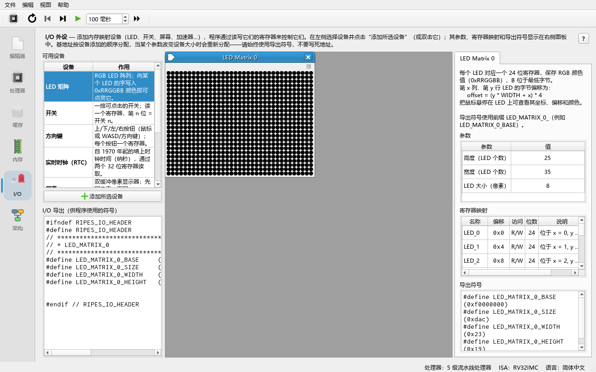
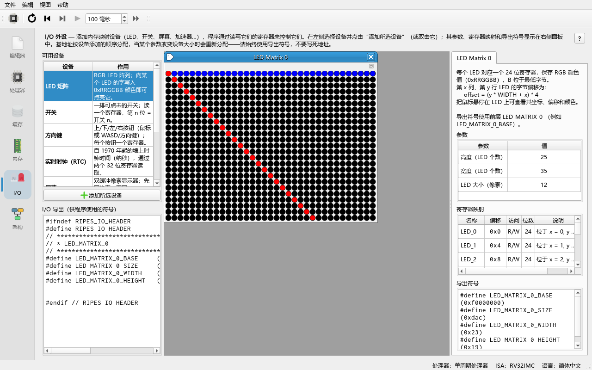
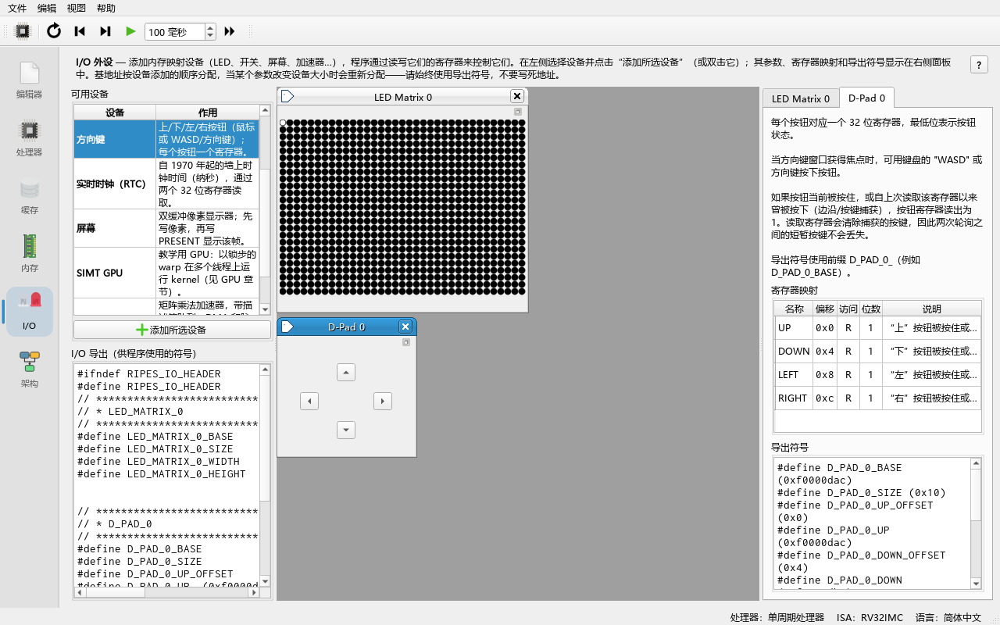
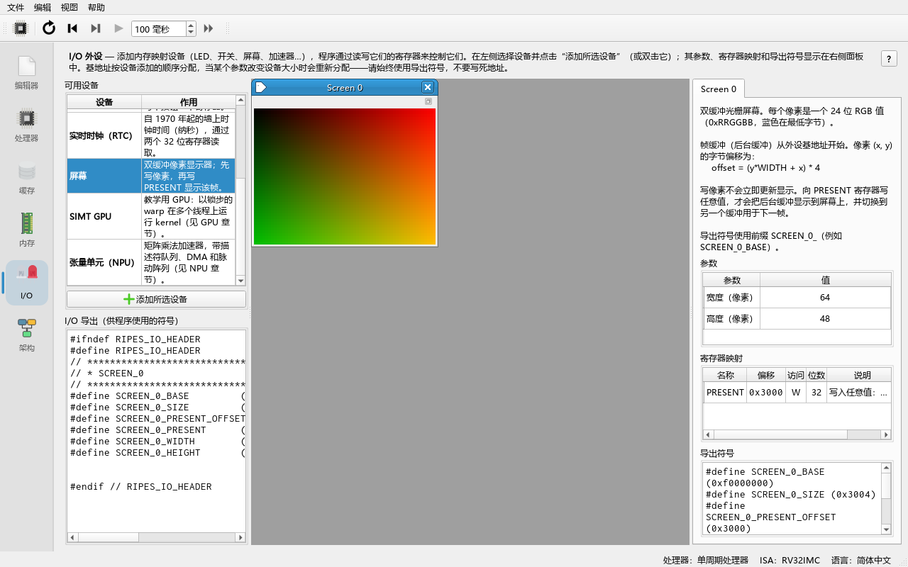

# 08 内存映射 I/O 外设

> **你将学到**
>
> - 什么是内存映射 I/O（memory-mapped I/O，MMIO）：用普通的 `lw`/`sw` 读写外设；
> - 外设起始地址设置，以及外设是如何被依次分配地址的；
> - 在 **I/O** 标签页添加、配置、弹出外设；
> - 外设导出的符号（如 `LED_MATRIX_0_BASE`）在汇编和 C 中的用法；
> - 每个内置外设（LED 矩阵、开关、方向键、实时时钟、屏幕）的寄存器和参数；
> - 一个完整的 LED 矩阵程序，以及开关/方向键轮询、读取 RTC、在屏幕上画图。
>
> **前置条件**
>
> - 学完第 04 章（汇编、循环、`lw`/`sw`）。用 C 访问外设还需要第 05 章的编译器设置。
> - 知道十六进制地址和 RGB 颜色的含义。

> SIMT GPU 和 Tensor Unit (NPU) 两个外设也在 **I/O** 标签页中添加，用法相同，但它们是可编程加速器，分别在第 09 章和第 10 章中专门讲解。

---

## 8.1 什么是内存映射 I/O

处理器只认识"读内存"和"写内存"两种访问。内存映射 I/O 的思路是：把一段地址分配给外设，处理器对这段地址的 `lw`/`sw` 不再去内存，而是交给外设处理——写一个字可以点亮一个 LED，读一个字可以得到开关的状态。

Ripes 中外设的地址空间从 **I/O start address:**（I/O 起始地址）开始，默认是 `0xF0000000`。这个值在 **Edit → Settings → Simulator**（编辑 → 设置 → 模拟器）页中设置。外设按添加顺序**紧挨着**依次排列：第一个外设从起始地址开始，下一个外设从上一个外设的末尾开始（`IOManager::nextPeripheralAddress`）。

## 8.2 添加外设

**做一步**：打开 **I/O** 标签页。

**看到什么**：左侧 **Available devices**（可用设备）列表列出可用的外设，每项带一句说明（**Device** 设备 / **What it does** 作用）：**LED Matrix**、**Switches**、**D-Pad**、**Real-time Clock (RTC)**、**Screen**、**SIMT GPU**、**Tensor Unit (NPU)**。鼠标悬停会提示可以双击（或选中后点添加）把该设备加入系统；列表下方的 **Add selected device**（添加所选设备）按钮与双击效果相同。下方 **I/O exports**（I/O 导出）区域列出所有已创建外设导出的符号。

**做一步**：双击 **LED Matrix**。

**看到什么**：

- 中间区域出现一个 LED 矩阵外设部件，标题为 **LED Matrix 0**；部件右上角有按钮可以把它"弹出"成独立窗口，这样切换到其他标签页时仍能看到它；
- 右侧出现该外设的详情：一段说明，**Parameters**（参数，可编辑）、**Register map**（寄存器映射：**Name**、**Offset**、**Access**、**Bits**、**Description** 列）和 **Exported symbols**（该外设导出的符号）；
- **I/O exports** 中出现 `LED_MATRIX_0_BASE`、`LED_MATRIX_0_SIZE`、`LED_MATRIX_0_WIDTH`、`LED_MATRIX_0_HEIGHT`。



**做一步**：再双击 **Switches**，然后切换到 **Memory** 标签页（内存），看右侧的 **Memory map**（内存映射）表。

**看到什么**：除了程序的段，还多了 `LED Matrix 0` 和 `Switches 0` 两项，**Address range**（地址范围）列分别是 `0xf0000000 - 0xf0000dab` 和 `0xf0000dac - 0xf0000daf`（首字节与末字节，均包含在内），**Size (bytes)**（大小）列分别是 3500 和 4。

**为什么**：默认 LED 矩阵是 35 × 25 = 875 个 LED，每个 LED 占 4 字节，共 3500 = `0xDAC` 字节；开关紧接其后。所以**外设的地址取决于添加顺序和参数**，程序里永远不要写死地址，而要用导出的符号。

> **改参数会移动地址**：修改外设参数（例如 LED 矩阵的尺寸）会改变它的大小，所有外设的基地址会被重新分配，导出符号随之更新，汇编程序会自动重新汇编。

> 外设的配置会被保存在设置里，下次启动 Ripes 时自动恢复（`RIPES_SETTING_PERIPHERAL_SETTINGS`）。

## 8.3 导出符号

每个外设导出的符号由 `IOManager::assemblerSymbolsForPeriph` 生成，命名规则是：

- 外设名（`LED Matrix 0`）转成大写、空格和 `-` 换成 `_` → 前缀 `LED_MATRIX_0`；
- `<前缀>_BASE`：基地址；`<前缀>_SIZE`：占用的字节数；
- 对每个"导出"的寄存器 `REG`：`<前缀>_REG` = 绝对地址，`<前缀>_REG_OFFSET` = 相对基地址的偏移；
- 外设的额外常量，例如 `<前缀>_WIDTH`、`<前缀>_HEIGHT`、`<前缀>_N`。

同一种外设可以添加多个，编号从 0 开始：`LED_MATRIX_0_...`、`LED_MATRIX_1_...`。

**在汇编中**：符号可以用在任何需要立即数的地方，最常见的是 `li`：

```asm
li a0, LED_MATRIX_0_BASE
```

**在 C 中**：`#include "ripes_system.h"`，符号是普通的 `#define`。Ripes 每次外设变化时都会在系统临时目录生成 `ripes_system.h`，内容形如：

```c
#ifndef RIPES_IO_HEADER
#define RIPES_IO_HEADER
// *****************************************************************************
// * LED_MATRIX_0
// *****************************************************************************
#define LED_MATRIX_0_BASE	(0xf0000000)
#define LED_MATRIX_0_SIZE	(0xdac)
#define LED_MATRIX_0_WIDTH	(0x23)
#define LED_MATRIX_0_HEIGHT	(0x19)
...
#endif // RIPES_IO_HEADER
```

> **CLI 模式的限制**：命令行模式（`--mode cli`，第 15 章）不能创建外设，因此使用外设符号的程序在 CLI 中无法汇编。报错信息是误导性的 `Unknown opcode 'li'`（实际原因是符号未定义）。请在 GUI 中运行本章的程序。

## 8.4 LED 矩阵（LED Matrix）

| 项目 | 内容 |
|---|---|
| 参数 | **Height**（高，默认 25，1–256）、**Width**（宽，默认 35，1–256）、**LED size**（LED 显示大小，默认 8，1–100，只影响显示） |
| 寄存器 | `LED_0` … `LED_{W*H-1}`，每个 LED 一个 32 位字（只用低 24 位），可读写，**不单独导出** |
| 颜色格式 | `0x00RRGGBB`：红在位 23:16，绿在位 15:8，蓝在最低字节 |
| 地址 | 坐标 (x, y) 的 LED 偏移 = `(y * WIDTH + x) * 4`（按行排列） |
| 导出符号 | `LED_MATRIX_0_BASE`、`_SIZE`、`_WIDTH`、`_HEIGHT` |

> 外设自带的说明文字中写的公式是 `offset = (y + x*N_LEDS_ROW) * 4`，但绘制代码（`IOLedMatrix::paintEvent`）用的是 `y * width + x`，即按行排列；上表以绘制代码为准。

### 完整示例：画一条对角线和一行

**做一步**：在 **I/O** 标签页创建一个 **LED Matrix**（保持默认参数），切换到 **Single-cycle processor**（运行更快），在编辑器中输入：

```asm
# 把 LED 矩阵的对角线点成红色，再把第一行其余部分点成蓝色
.text
main:
    li   s0, LED_MATRIX_0_BASE
    li   s1, LED_MATRIX_0_WIDTH
    li   s2, LED_MATRIX_0_HEIGHT
    li   t0, 0
diag:
    bge  t0, s1, row        # 超出宽或高就结束
    bge  t0, s2, row
    mul  t1, t0, s1         # 偏移 = (y*WIDTH + x) * 4，这里 x = y = t0
    add  t1, t1, t0
    slli t1, t1, 2
    add  t1, s0, t1
    li   t2, 0xFF0000       # 红色
    sw   t2, 0(t1)
    addi t0, t0, 1
    j    diag
row:
    li   t0, 1
row_loop:
    bge  t0, s1, end
    slli t1, t0, 2          # 第 0 行：偏移 = x * 4
    add  t1, s0, t1
    li   t2, 0x0000FF       # 蓝色
    sw   t2, 0(t1)
    addi t0, t0, 1
    j    row_loop
end:
    li   a7, 10
    ecall
```

**做一步**：回到 **I/O** 标签页，按 **Run (F8)**。

**看到什么**：从左上角开始的一条红色对角线（25 个 LED，因为高度只有 25），以及第一行其余的蓝色 LED。



**为什么**：每次 `sw` 写入 LED 矩阵地址范围时，模拟器调用该外设的 `ioWrite`，外设记下颜色并请求重绘。把 **LED size** 调大可以看得更清楚；改变 **Width**/**Height** 后不需要改程序，因为程序用的是导出符号。

**另一个示例**：**File → Load Example... → Assembly → leds.s**（`examples/assembly/leds.s`）在整个矩阵上画一个不断变化的彩色渐变动画；C 版本是 **C → leds.c**（`examples/C/leds.c`）。运行前同样要先创建一个 LED Matrix。用 **Run** 全速运行动画最流畅。

## 8.5 开关（Switches）

| 项目 | 内容 |
|---|---|
| 参数 | **# Switches**（开关个数，默认 8，1–32） |
| 寄存器 | 一个只读寄存器 `Switches`，位于偏移 0：开关 n 对应第 n 位（1 = 打开）；不单独导出，直接用基地址 |
| 大小 | 4 字节 |
| 导出符号 | `SWITCHES_0_BASE`、`SWITCHES_0_SIZE`、`SWITCHES_0_N`（开关个数） |

### 轮询示例：把开关映射到 LED

**做一步**：创建一个 **LED Matrix** 和一个 **Switches**，输入下面的程序，按 **Run (F8)**，然后点击开关。

```asm
# 把开关状态显示在 LED 矩阵第一行上
.text
main:
    li   s0, SWITCHES_0_BASE
    li   s1, LED_MATRIX_0_BASE
    li   s2, SWITCHES_0_N
poll:
    lw   t0, 0(s0)          # 一次读出所有开关
    li   t1, 0              # 位号
bit:
    srl  t2, t0, t1
    andi t2, t2, 1          # t2 = 第 t1 个开关的状态
    slli t3, t1, 2
    add  t3, s1, t3         # 第 t1 个 LED 的地址
    beqz t2, off
    li   t4, 0x00FF00       # 绿色
    sw   t4, 0(t3)
    j    next
off:
    sw   zero, 0(t3)
next:
    addi t1, t1, 1
    blt  t1, s2, bit
    j    poll               # 永远循环
```

**看到什么**：打开第 n 个开关，第一行第 n 个 LED 变绿；关闭则熄灭。

**为什么**：这叫**轮询**（polling）：程序不停地读开关寄存器、检查每一位。这个程序永远不会结束，按 **Reset (F3)** 或再按一次运行按钮停止（待核实：运行中停止的按钮名称）。C 版本见 **File → Load Example... → C → switchesAndLeds.c**（`examples/C/switchesAndLeds.c`）。

> **试一试**：不按 **Run**，改用 **Clock (F5)** 单步或较慢的 **Auto clock**，再拨动开关，你会发现 LED 要过很久才反应——因为轮询循环一次要执行很多条指令。上游文档建议：使用外设时选单周期处理器，并在 **Edit → Settings → Environment** 中减小 **Max. cache plot cycles**，以减少模拟器其他部分的开销。

## 8.6 方向键（D-Pad）

| 项目 | 内容 |
|---|---|
| 参数 | 无 |
| 寄存器 | `UP`（偏移 0）、`DOWN`（4）、`LEFT`（8）、`RIGHT`（12），各 32 位只读，最低位表示按键状态；**全部导出** |
| 大小 | 16 字节 |
| 导出符号 | `D_PAD_0_BASE`、`D_PAD_0_SIZE`、`D_PAD_0_UP`、`D_PAD_0_UP_OFFSET`、`D_PAD_0_DOWN`、`D_PAD_0_DOWN_OFFSET`、`D_PAD_0_LEFT`、`D_PAD_0_LEFT_OFFSET`、`D_PAD_0_RIGHT`、`D_PAD_0_RIGHT_OFFSET` |

注意前缀是 `D_PAD_0`：外设名 "D-Pad 0" 中的 `-` 被换成了 `_`。

按键读数规则（`IODPad::description`）：

- 按键按住时读到 1；
- 即使按键已经松开，只要从上次读取以来按下过，也读到 1（**按下捕获**，edge/press capture）；
- **读取会清除**捕获的按下，所以两次轮询之间的短暂点击不会丢失，也不会被重复计数。

可以用鼠标点击按钮，也可以先点击方向键部件使其获得焦点，然后用键盘 **W/A/S/D** 或**方向键**。

### 轮询示例：用方向键移动一个点

**做一步**：创建 **LED Matrix** 和 **D-Pad**，运行：

```asm
# 用方向键在 LED 矩阵上移动一个白点
.text
main:
    li   s0, LED_MATRIX_0_BASE
    li   s1, LED_MATRIX_0_WIDTH
    li   s2, LED_MATRIX_0_HEIGHT
    li   s3, 0              # x
    li   s4, 0              # y
    li   s5, 0xFFFFFF       # 白色
draw:
    mul  t0, s4, s1         # 偏移 = (y*WIDTH + x) * 4
    add  t0, t0, s3
    slli t0, t0, 2
    add  s6, s0, t0         # s6 = 点的地址
    sw   s5, 0(s6)
poll:
    li   t1, D_PAD_0_UP
    lw   t2, 0(t1)
    bnez t2, up
    li   t1, D_PAD_0_DOWN
    lw   t2, 0(t1)
    bnez t2, down
    li   t1, D_PAD_0_LEFT
    lw   t2, 0(t1)
    bnez t2, left
    li   t1, D_PAD_0_RIGHT
    lw   t2, 0(t1)
    bnez t2, right
    j    poll
up:
    beqz s4, poll           # 已在最上边
    addi s4, s4, -1
    j    move
down:
    addi t3, s2, -1
    bge  s4, t3, poll
    addi s4, s4, 1
    j    move
left:
    beqz s3, poll
    addi s3, s3, -1
    j    move
right:
    addi t3, s1, -1
    bge  s3, t3, poll
    addi s3, s3, 1
move:
    sw   zero, 0(s6)        # 擦掉旧的点
    j    draw
```

**看到什么**：左上角有一个白点；每按一次方向键，白点移动一格。按住不放时白点会连续移动。



**为什么**：每次读一个方向寄存器都会清除它的按下捕获，所以一次短按只移动一格；按住时寄存器一直为 1，每轮轮询都移动。

## 8.7 实时时钟（Real-time Clock）

在 **Available devices** 列表中叫 **Real-time Clock (RTC)**，创建后的外设名是 **RTC 0**。

| 项目 | 内容 |
|---|---|
| 参数 | 无 |
| 寄存器 | `TIME_LO`（偏移 0，低 32 位）、`TIME_HI`（偏移 4，高 32 位），只读，**导出** |
| 含义 | 主机的墙上时间，单位纳秒，自 1970-01-01（Unix epoch）起，共 64 位 |
| 大小 | 8 字节 |
| 导出符号 | `RTC_0_BASE`、`RTC_0_SIZE`、`RTC_0_TIME_LO`、`RTC_0_TIME_LO_OFFSET`、`RTC_0_TIME_HI`、`RTC_0_TIME_HI_OFFSET` |

**读取顺序很重要**：读 `TIME_LO` 时，外设采样完整的 64 位时间，返回低 32 位，并把高 32 位"锁存"（latch）起来；随后读 `TIME_HI` 返回的就是锁存的高位。所以**先读 `TIME_LO`，再读 `TIME_HI`**，两者才属于同一时刻，不会因为两次读之间低位进位而"撕裂"。在 64 位处理器上可以用一次 8 字节的 `ld` 在偏移 0 读出完整的 64 位值。

```asm
# 读两次 RTC 时间并打印
.text
main:
    li   s0, RTC_0_TIME_LO
    li   s1, RTC_0_TIME_HI
    li   s2, 2
again:
    lw   t0, 0(s0)          # 先读 TIME_LO：同时锁存 TIME_HI
    lw   t1, 0(s1)
    mv   a0, t1
    li   a7, 34             # 以十六进制打印高 32 位
    ecall
    li   a0, 32
    li   a7, 11
    ecall
    mv   a0, t0
    li   a7, 36             # 以无符号十进制打印低 32 位
    ecall
    li   a0, 10
    li   a7, 11
    ecall
    addi s2, s2, -1
    bnez s2, again
    li   a7, 10
    ecall
```

**看到什么**：两行输出，高位相同（或相差 1），低位递增。外设部件上也实时显示 "Epoch: ... ns" 和可读的日期时间。

**为什么**：RTC 返回的是**真实时间**而不是模拟周期数，所以同一段程序在不同电脑上、用 **Clock** 单步和用 **Run** 运行，测得的时间差完全不同。要测量模拟周期，请用 31 号系统调用 `Cycles`（第 04 章）。

## 8.8 屏幕（Screen）

| 项目 | 内容 |
|---|---|
| 参数 | **Width**（宽，默认 64，1–1024）、**Height**（高，默认 48，1–1024） |
| 帧缓冲 | 从基地址开始，每个像素一个字 `0x00RRGGBB`，像素 (x, y) 的偏移 = `(y * WIDTH + x) * 4` |
| 寄存器 | `PRESENT`（偏移 = 像素数 × 4），只写，**导出** |
| 大小 | (像素数 + 1) × 4 字节 |
| 导出符号 | `SCREEN_0_BASE`、`SCREEN_0_SIZE`、`SCREEN_0_WIDTH`、`SCREEN_0_HEIGHT`、`SCREEN_0_PRESENT`、`SCREEN_0_PRESENT_OFFSET` |

屏幕是**双缓冲**（double-buffered）的：程序写的是"后台缓冲"（back buffer），写像素**不会**立即改变显示；向 `PRESENT` 写任意值时，后台缓冲被显示出来，然后切换到另一块缓冲供下一帧绘制。这样动画不会出现画到一半的帧。

```asm
# 在屏幕上画颜色渐变并显示
.text
main:
    li   s0, SCREEN_0_BASE
    li   s1, SCREEN_0_WIDTH
    li   s2, SCREEN_0_HEIGHT
    li   t0, 0              # y
row:
    li   t1, 0              # x
col:
    slli t2, t1, 18         # 红 = x * 4（位 23:16）
    slli t3, t0, 10         # 绿 = y * 4（位 15:8）
    or   t2, t2, t3
    mul  t4, t0, s1         # 偏移 = (y*WIDTH + x) * 4
    add  t4, t4, t1
    slli t4, t4, 2
    add  t4, s0, t4
    sw   t2, 0(t4)
    addi t1, t1, 1
    blt  t1, s1, col
    addi t0, t0, 1
    blt  t0, s2, row
    li   t5, SCREEN_0_PRESENT
    sw   zero, 0(t5)        # 写 PRESENT：显示这一帧
    li   a7, 10
    ecall
```

**看到什么**：程序运行期间屏幕一直是黑的，直到最后写 `PRESENT`，整幅渐变（左下偏黄、右上偏红）一次性出现。



**为什么**：如果去掉最后的 `sw` 到 `PRESENT`，什么都不会显示——这是初学者最常见的错误。注意 x 最大 63，`x * 4` 不超过 252，正好放进 8 位颜色分量。

> 屏幕的帧缓冲很大（默认 3073 个字），**Memory** 标签页中可以直接看到写进去的值。

## 8.9 常见问题

| 现象 | 原因 | 解决 |
|---|---|---|
| 汇编报 `Unknown symbol` 或 `Unknown opcode 'li'` | 没有创建对应外设，或名称编号不对（例如创建的是第二个，编号为 1） | 在 **I/O** 标签页创建外设，对照 **I/O exports** 中的名字 |
| 在 CLI 中汇编失败 | CLI 不能创建外设 | 在 GUI 中运行 |
| LED/屏幕没有反应 | 写错了地址或颜色格式；屏幕忘了写 `PRESENT` | 用导出的符号；颜色用 `0xRRGGBB` |
| 改了外设参数后程序行为变了 | 基地址被重新分配 | 始终用符号，不要写死地址 |
| 外设反应很慢 | 用 **Clock**/慢速 **Auto clock**，或流水线处理器较慢 | 用 **Run** 和单周期处理器 |

## 8.10 练习

1. 先添加 **Switches** 再添加 **LED Matrix**（默认参数），`LED_MATRIX_0_BASE` 是多少？如果顺序反过来呢？
2. 把 LED 矩阵的 **Width** 改成 8、**Height** 改成 1，修改 8.5 节的程序，让打开的开关显示红色，关闭的开关显示暗灰色 `0x202020`。
3. 修改 8.6 节的程序：按 **UP** 键时让点的颜色在红、绿、蓝之间循环，而不是向上移动。
4. 用 RTC 和 31 号 `Cycles` 系统调用，测量一个循环 100000 次的空循环（`addi` + `bnez`）用了多少纳秒和多少周期，算出"模拟频率"。用 **Run** 和用 **Auto clock** 分别测一次，比较。
5. 修改 8.8 节的程序，画两帧：第一帧全红，写 `PRESENT`；第二帧全蓝，再写 `PRESENT`。用 **Clock** 单步观察：第二帧画到一半时屏幕显示什么？

### 参考答案

1. 先添加开关时，开关占 `0xF0000000`–`0xF0000003`，LED 矩阵从 `0xF0000004` 开始，所以 `LED_MATRIX_0_BASE` = `0xF0000004`。顺序反过来时 `LED_MATRIX_0_BASE` = `0xF0000000`，`SWITCHES_0_BASE` = `0xF0000DAC`。
2. 把 `beqz t2, off` 之后的颜色改为 `0xFF0000`，并把 `off:` 分支中的 `sw zero, 0(t3)` 改为：
   ```asm
   off:
       li   t4, 0x202020
       sw   t4, 0(t3)
   ```
   因为第一行就是全部 8 个 LED，程序其他部分不用改。
3. 用一个寄存器（例如 `s7`）保存颜色编号 0/1/2，`up:` 分支改为：
   ```asm
   up:
       addi s7, s7, 1
       li   t3, 3
       blt  s7, t3, pick
       li   s7, 0
   pick:
       li   s5, 0xFF0000
       beqz s7, move
       li   s5, 0x00FF00
       li   t3, 1
       beq  s7, t3, move
       li   s5, 0x0000FF
       j    move
   ```
   并在 `main` 开头加 `li s7, 0`。（`move` 会擦掉旧点再按新颜色画。）
4. 在循环前后各读一次 RTC（先 `TIME_LO` 再 `TIME_HI`）并调用一次 `Cycles`（`li a7, 31` + `ecall`，结果在 `a0`/`a1`），两次相减。周期数大约 200000，与运行方式无关；纳秒数在 **Auto clock** 下大得多。模拟频率 = 周期数 / 秒数，它反映的是模拟器的速度，不是被模拟处理器的"真实"频率。
5. 屏幕一直显示第一帧（全红），直到第二次写 `PRESENT` 才整体变蓝——双缓冲保证了不会显示画到一半的帧。

## 小结

- MMIO 用普通的 `lw`/`sw` 访问外设；外设从 **I/O start address:**（默认 `0xF0000000`）开始按添加顺序紧挨着排列。
- 在 **I/O** 标签页双击 **Available devices** 中的条目创建外设，右侧显示参数、寄存器映射和导出符号；部件可以弹出成独立窗口。
- 导出符号命名为 `<外设名大写>_<编号>_BASE / _SIZE / _<寄存器> / _<寄存器>_OFFSET / _<常量>`；汇编中当立即数用，C 中 `#include "ripes_system.h"`。始终用符号，不要写死地址。
- LED 矩阵：每 LED 一个字 `0xRRGGBB`，偏移 `(y*WIDTH + x)*4`；开关：一个寄存器，第 n 位 = 开关 n；方向键：4 个寄存器，带按下捕获、读后清除；RTC：先读 `TIME_LO` 再读 `TIME_HI`；屏幕：双缓冲，写 `PRESENT` 才显示。
- CLI 模式不能创建外设，使用外设符号的程序只能在 GUI 中运行。
- 下一章：SIMT GPU（第 09 章）和 Tensor Unit / NPU（第 10 章）。
