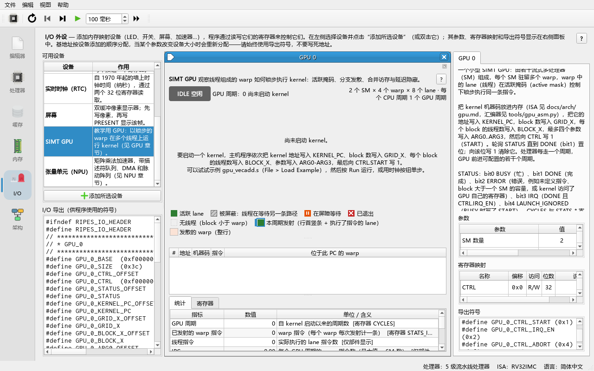
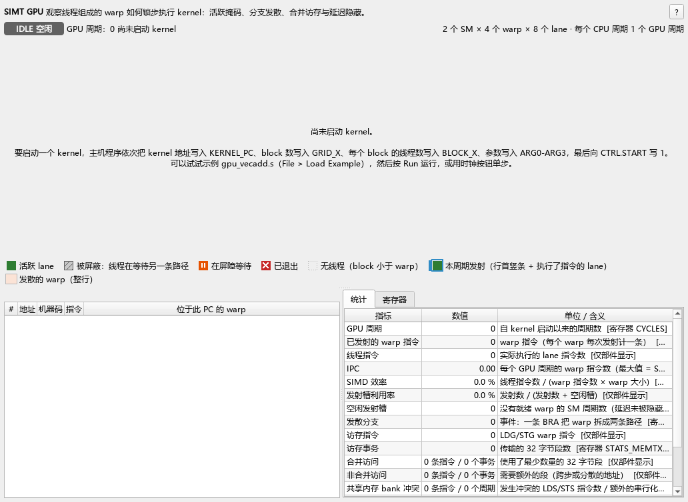
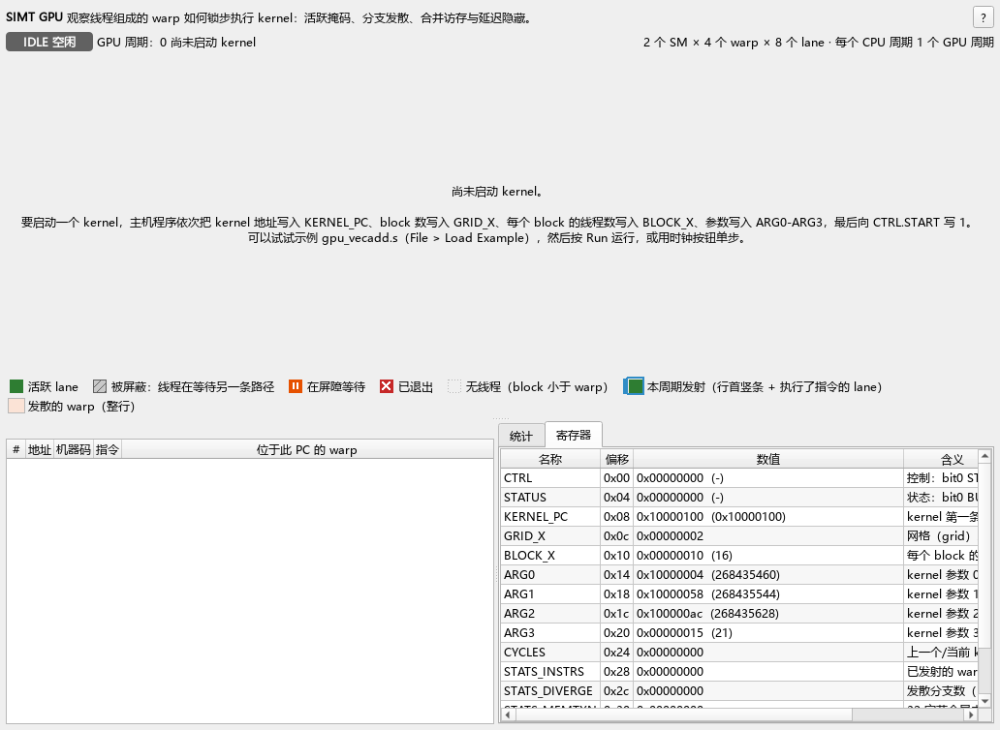
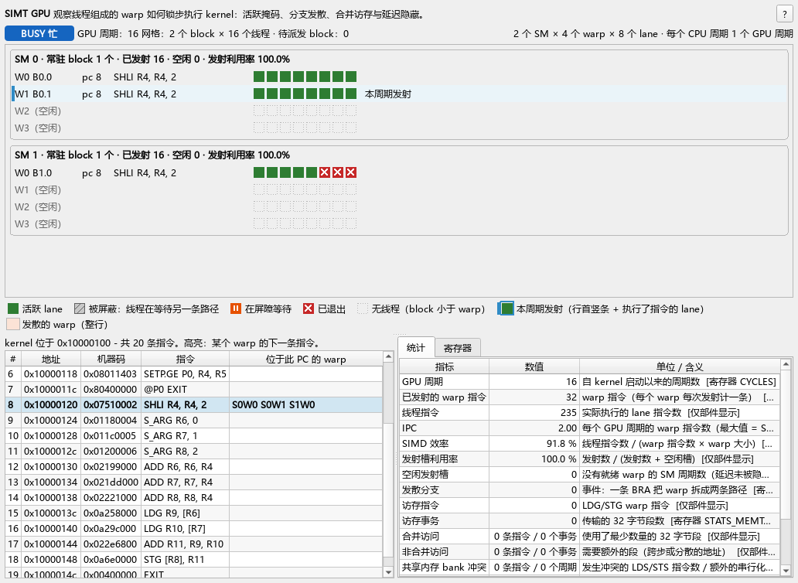
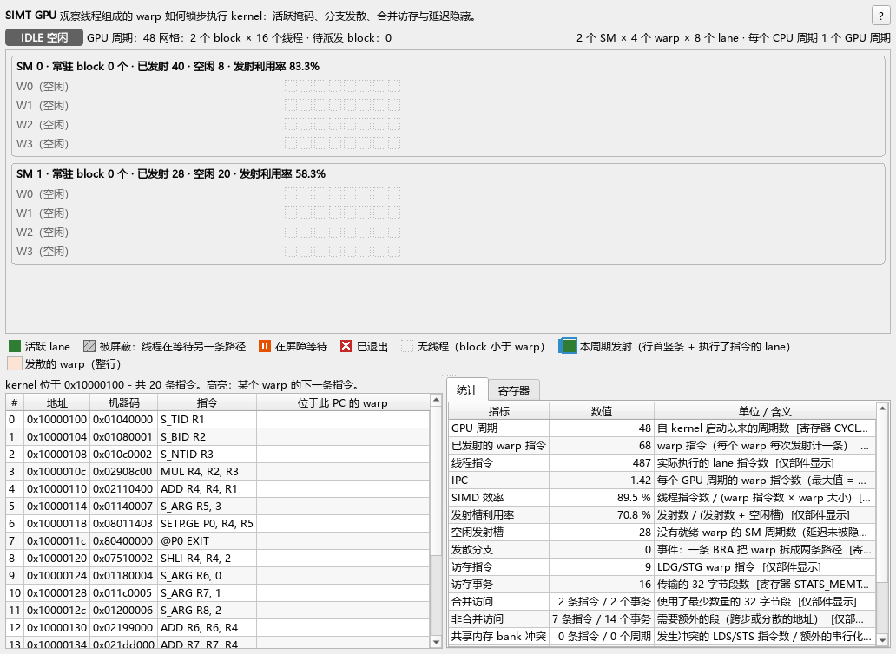
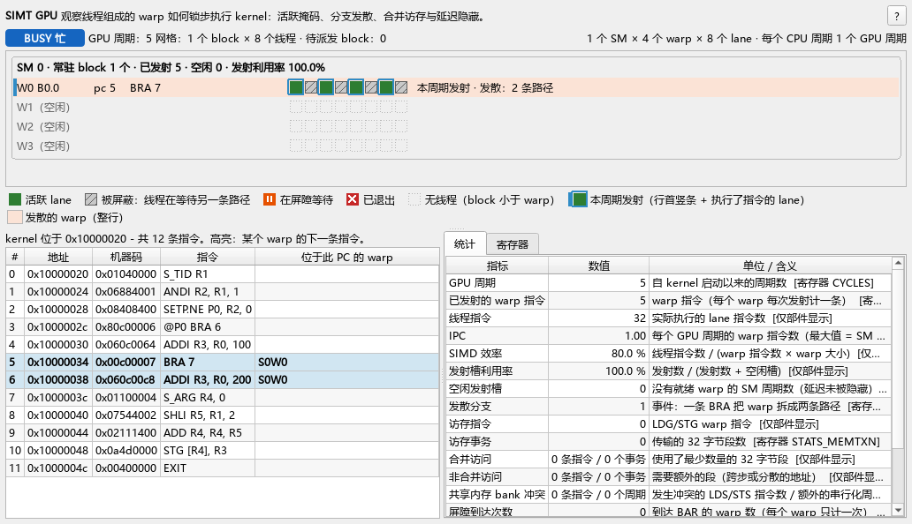

# 09 SIMT GPU 教程

> **你将学到**
>
> - GPU 为什么能"同时跑成千上万个线程"：CPU 多线程、SIMD 与 SIMT 三种并行方式的区别；
> - 模拟器里的 **SIMT GPU** 外设由哪些部分组成（SM、warp、lane、调度器、内存接口）；
> - 如何在 **I/O** 标签页添加 GPU、调整参数，以及每一个寄存器的含义；
> - kernel 指令集（ISA）的全部操作码、编码格式，以及如何用 `tools/gpu_asm.py` 汇编 kernel；
> - 逐步运行向量加法示例 `gpu_vecadd.s`，读懂部件上的每一个格子和每一个统计数；
> - 四个实验：分支发散与重汇聚、合并访存、shared memory bank 冲突、barrier；
> - 模型的局限（不能反向执行加速器、命令行模式不能实例化外设）。
>
> **前置条件**
>
> - 会启动 Ripes、加载示例、汇编并运行程序（第 02 章）；
> - 读得懂简单的 RISC-V 汇编：`li`、`la`、`lw`、`sw`、循环（第 04 章）；
> - 知道 MMIO 外设是"映射到地址空间里的一组寄存器"，会在 **I/O** 标签页添加外设（第 08 章）。
> - 不需要任何 GPU 编程经验。

---

## 09.1 为什么需要 GPU

假设要计算 `C[i] = A[i] + B[i]`，数组长 100 万。在 CPU 上，即使有 8 个核，每个核也要一条一条地取指、译码、执行；大部分晶体管花在了"让一条指令流跑快"（分支预测、乱序执行、大 cache）上。GPU 的想法相反：**让极多的简单线程一起跑，用并行度换吞吐量**。

三种并行方式的对比：

| | CPU 多线程（multicore） | SIMD（向量指令） | SIMT（GPU） |
|---|---|---|---|
| 一条指令驱动 | 1 个线程 | 1 个向量寄存器（如 8 个 int） | 1 个 **warp**（如 32 个线程） |
| 程序员写的是 | 线程函数 | "把 8 个数一起加" 的向量代码 | **标量**代码："把*我那个*元素加起来" |
| 分支 | 每个线程独立 | 程序员自己用掩码处理 | 硬件自动维护 **active mask**（活跃掩码） |
| 典型规模 | 4–64 核 | 128–512 bit | 32 lane × 几十 warp × 几十 SM |

- **SIMD**（Single Instruction, Multiple Data）把向量宽度暴露给程序员。
- **SIMT**（Single Instruction, Multiple Threads）让程序员写一个线程的标量代码，硬件把若干线程打包成一个 **warp**，用**同一条指令**驱动，每个线程（叫做一个 **lane**）有自己的寄存器和地址。
- 当同一 warp 里的线程走向不同分支时，硬件用 active mask 关掉一部分 lane，分别执行两条路径，再合并回来。这叫**分支发散（branch divergence）**——对程序员透明，但会浪费算力。本章 09.9 节会亲眼看到它。

## 09.2 模拟器里的 GPU 长什么样

open-soc-explorer 的 GPU 是一个**教学用的极简 GPU**（模型代码在 `src/accel/gpu/simtgpu.*`，外设在 `src/io/iogpu.*`，设计文档 `docs/arch/gpu.md`）。它省略了 cache、纹理单元等细节，但保留了理解 GPU 的核心机制。

```
                RISC-V CPU（Ripes 处理器）
                  │  lw / sw  (MMIO)
                  ▼
   ┌───────────── SIMT GPU 外设 (GPU_0_*) ──────────────┐
   │  寄存器: CTRL STATUS KERNEL_PC GRID_X BLOCK_X ARG0-3 │
   │          CYCLES STATS_* CONFIG                       │
   │                      │ CTRL.START                    │
   │                      ▼                               │
   │              block 调度器（轮流派发 block）            │
   │          ┌───────────┴────────────┐                  │
   │      ┌───▼────┐               ┌───▼────┐             │
   │      │  SM0   │               │  SM1   │  ...        │
   │      │ warp 槽0 ── lane0..7   │ warp 槽0 │            │
   │      │ warp 槽1 ── lane0..7   │ warp 槽1 │            │
   │      │ warp 槽2               │ ...      │            │
   │      │ warp 槽3               │          │            │
   │      │ warp 调度器: 每周期发射 1 条 warp 指令          │
   │      │ shared memory: 每 block 1 KiB, 8 个 bank       │
   │      └───┬────┘               └───┬────┘             │
   │          └──────── LDG/STG ───────┘                  │
   └──────────────────────┼───────────────────────────────┘
                          ▼
              Ripes 主存（与 CPU 共享，kernel 代码也在这里）
```

执行层次：

| 概念 | 含义 | 在本模型中 |
|---|---|---|
| **lane / thread**（线程） | 一个标量线程；有 16 个 32 位寄存器 R0–R15（R0 恒为 0）和 4 个谓词位 P0–P3 | `S_TID` 读出线程号 threadIdx.x |
| **warp** | 调度的最小单位：`warp size` 个 lane 锁步执行同一条指令 | 参数 *Warp size (lanes)*，默认 8（真实 NVIDIA GPU 为 32） |
| **block**（线程块，CTA） | 可以用 shared memory 和 `BAR` 协作的一组线程；必须整个放在**同一个 SM** 上 | 寄存器 `BLOCK_X`（每块线程数） |
| **grid** | 一次 kernel 启动的全部 block | 寄存器 `GRID_X`（block 数） |
| **SM**（Streaming Multiprocessor，流式多处理器） | 有若干 warp 槽、寄存器、shared memory 和一个 warp 调度器 | 参数 *SMs*、*Warps per SM* |

几条规则（来自 `simtgpu.cpp`，以后的实验都会用到）：

1. 一个 block 需要 `ceil(BLOCK_X / warpSize)` 个 warp 槽。某个 SM 的空闲槽足够时，调度器才把下一个 block 派发给它；每个 SM 每周期最多接收一个 block。
2. 每个 SM 每周期最多**发射一条** warp 指令。调度器是"宽松轮转"（loose round-robin）：从上次发射的下一个 warp 开始找第一个**就绪**的 warp（没有在等内存、没有在等 barrier）。找不到就记一个**空闲发射槽**（idle issue slot）。
3. `LDG`（读全局内存）让发射它的 warp 停顿 `memLatency + (事务数 − 1)` 个周期；`STG` 停顿 `事务数 − 1` 个周期。停顿期间其它 warp 可以发射——这就是 GPU 的**延迟隐藏**。
4. GPU 由 CPU 时钟驱动：CPU 每走一个周期，GPU 前进 *GPU cycles per CPU cycle* 个周期。所以 CPU 轮询 `STATUS` 的循环真的在和 GPU 并行。

## 09.3 添加 SIMT GPU 外设

**做一步**：点击左侧标签栏的 **I/O** 标签页（输入/输出）。在左上的 **Available devices** 列表（可用设备）里双击 **SIMT GPU**（或选中后点 **Add selected device**）。

**看到什么**：中间区域出现一个名为 **GPU 0** 的部件窗口；右侧面板显示该外设的说明、**Parameters**（参数）、**Register map**（寄存器映射）和 **Exported symbols**（导出符号）；左下 **I/O exports**（I/O 导出）文本框里多出一批 `GPU_0_*` 符号。GPU 部件约 1000 像素宽，在 1280 × 800 的窗口里中间区域放不下它的子窗口；可以放大主窗口、拖窄两侧面板，或把子窗口最大化。



**为什么**：外设一旦创建，Ripes 就给它分配一段地址（`GPU_0_BASE` 开始的 0x3C 字节），并把寄存器地址、位掩码作为符号导出给汇编器和 C 编译器（C 程序 `#include "ripes_system.h"`）。所以程序里写 `GPU_0_CTRL_OFFSET` 而不是写死数字。

参数（右侧 **Parameters** 表）：

| 参数（屏幕原文） | 默认 | 范围 | 含义 |
|---|---|---|---|
| SMs | 2 | 1–8 | SM 数量 |
| Warps per SM | 4 | 1–16 | 每个 SM 的 warp 槽数 |
| Warp size (lanes) | 8 | 1–32 | 每个 warp 的 lane 数 |
| Global memory latency (cycles) | 4 | 0–64 | `LDG` 之后 warp 至少停顿的周期数 |
| GPU cycles per CPU cycle | 1 | 1–64 | 每个 CPU 周期 GPU 前进几个周期（时钟比） |

> 注意：修改 SMs / Warps per SM / Warp size / latency 会**重建 GPU 模型并中止正在运行的 kernel**。请在运行程序之前调好参数。shared memory 的大小（每 block 1024 字节）和 bank 数（8）是模型常量，GUI 中不能改。

GPU 部件：

| 区域 | 内容 |
|---|---|
| 顶部标题栏 | "SIMT GPU" + 一句话说明，右侧 "?" 按钮打开本章 |
| 状态行 | 状态徽标 `IDLE` / `BUSY` / `DONE` / `ERROR`（颜色 + 文字）、`GPU 周期`、网格大小与待派发 block 数、出错原因；右侧是配置（`2 个 SM × 4 个 warp × 8 个 lane · 每个 CPU 周期 1 个 GPU 周期`） |
| SM / warp / lane 视图 | 每个 SM 一个框（`SM 0 · 常驻 block 1 个 · 已发射 … · 空闲 … · 发射利用率 …`），每个 warp 槽一行：`W<槽> B<block>.<warp>  pc <n>` + 下一条指令的反汇编 + 每个 lane 一个方块；空槽显示 `W<槽>（空闲）`。第一次启动 kernel 之前，这里显示提示"尚未启动 kernel。"。下方是图例 |
| kernel 反汇编 | `#`、**地址**、**机器码**、**指令**、**位于此 PC 的 warp**（各 warp 的下一条指令高亮） |
| **统计**（Statistics）标签 | **指标** / **数值** / **单位 / 含义**：GPU 周期、已发射的 warp 指令、线程指令、IPC、SIMD 效率、发射槽利用率、空闲发射槽、发散分支、访存指令/事务、合并/非合并访问、共享内存 bank 冲突…… |
| **寄存器**（Registers）标签 | **名称** + **偏移** + **数值** + **含义** |

lane 方块的含义（SM 视图下方的图例使用同样的符号）：

| 外观 | 含义 |
|---|---|
| 绿色实心 | **活跃 lane**（active）：这个 lane 在当前路径上，会执行下一条指令 |
| 灰色斜线 | **被屏蔽**（masked off）：线程在等另一条分支路径 |
| 橙色带暂停符号 | **在屏障等待**（waiting at barrier） |
| 红底白叉 | **已退出**（exited）：这个线程已经执行了 `EXIT` |
| 虚线框 | 无线程（block 不满一个 warp 时的多余 lane） |
| 蓝色外框（行首另有蓝色竖条） | **本周期发射**（issued this cycle）：这个 lane 在上一个 GPU 周期执行了该 warp 的指令 |
| 浅橙色行底 | **发散的 warp**（diverged warp） |

行尾标记：`本周期发射`（issued this cycle）、`stall n` = 还要等 n 个周期内存、`waiting at BAR` = 在 barrier 等待、`发散：k 条路径`（diverged: k paths）= 该 warp 被拆成 k 条控制流路径。

## 09.4 寄存器表

基址由 I/O 标签页分配（符号 `GPU_0_BASE`）。每个寄存器 32 位；符号 `GPU_0_<名字>` 是绝对地址，`GPU_0_<名字>_OFFSET` 是偏移。

| 偏移 | 名称 | 读写 | 位 | 含义 |
|---|---|---|---|---|
| 0x00 | `CTRL` | RW | bit0 `START` | 写 1 启动 kernel（门铃，doorbell）；读回为 0 |
| | | | bit1 `IRQ_EN` | 中断使能；**每次写 CTRL 都会重写这一位** |
| | | | bit2 `ABORT` | 写 1 中止正在运行的 kernel（随后 `DONE` 置位） |
| 0x04 | `STATUS` | RW | bit0 `BUSY` | kernel 正在运行 |
| | | | bit1 `DONE` | kernel 结束（粘滞位）；**写 1 清零**（W1C） |
| | | | bit2 `ERROR` | 出错（粘滞位）；写 1 清零 |
| | | | bit3 `IRQ` | `DONE & IRQ_EN`（只读，随 DONE 清除） |
| 0x08 | `KERNEL_PC` | RW | 31:0 | kernel 第一条指令的**字节地址**（须 4 字节对齐） |
| 0x0C | `GRID_X` | RW | 31:0 | block 个数（≥1） |
| 0x10 | `BLOCK_X` | RW | 31:0 | 每个 block 的线程数（≥1，且 `ceil(BLOCK_X/warpSize) ≤ Warps per SM`） |
| 0x14 | `ARG0` | RW | 31:0 | kernel 参数 0，kernel 里用 `S_ARG rd, 0` 读取 |
| 0x18 | `ARG1` | RW | 31:0 | kernel 参数 1 |
| 0x1C | `ARG2` | RW | 31:0 | kernel 参数 2 |
| 0x20 | `ARG3` | RW | 31:0 | kernel 参数 3 |
| 0x24 | `CYCLES` | R | 31:0 | 本次（或上次）kernel 用了多少 **GPU 周期** |
| 0x28 | `STATS_INSTRS` | R | 31:0 | 发射的 **warp 指令**数（所有 SM 合计） |
| 0x2C | `STATS_DIVERGE` | R | 31:0 | 发散分支次数（一个 warp 被分成两条路径） |
| 0x30 | `STATS_MEMTXN` | R | 31:0 | 全局内存 32 字节事务数 |
| 0x34 | `STATS_IDLE` | R | 31:0 | 空闲发射槽数（某 SM 某周期什么也没发射） |
| 0x38 | `CONFIG` | R | 7:0 / 15:8 / 23:16 | warp size / warps per SM / SM 数 |

额外导出的常量符号：`GPU_0_CTRL_START`(1)、`GPU_0_CTRL_IRQ_EN`(2)、`GPU_0_CTRL_ABORT`(4)、`GPU_0_STATUS_BUSY`(1)、`GPU_0_STATUS_DONE`(2)、`GPU_0_STATUS_ERROR`(4)、`GPU_0_STATUS_IRQ`(8)、`GPU_0_NUM_SMS`、`GPU_0_WARPS_PER_SM`、`GPU_0_WARP_SIZE`（后三个随参数变化）。

> **易错点**：`CTRL` 的 `IRQ_EN` 不是"置位后保持"，而是每次写 `CTRL` 时按写入值的 bit1 重新设置。想开中断启动，要一次写 `GPU_0_CTRL_START | GPU_0_CTRL_IRQ_EN`（= 3）。`STATS_*` 只在 kernel 启动时清零；bank 冲突周期没有寄存器，只能在部件的统计面板里看到。

什么情况会置 `ERROR`：`GRID_X` 或 `BLOCK_X` 为 0；一个 block 需要的 warp 数超过 *Warps per SM*；`KERNEL_PC` 不是 4 的倍数；执行到未定义的指令字（错误信息会给出 kernel pc、block 和 warp）。kernel 运行中再写 `START` 的行为正在修订（第一阶段会错误地把正在跑的 kernel 标记为 ERROR；修复后应当忽略这次启动，待核实）。

## 09.5 CPU 侧的启动协议

真实系统中 CPU 通过驱动把 kernel 和参数放到显存、写命令队列、敲门铃，GPU 完成后通知 CPU。本外设把这条路径压缩成几次 `sw`：

```asm
li   s0, GPU_0_BASE
la   t0, kernel                       # 1. kernel 机器码已在内存（.data 中的 .word）
sw   t0, GPU_0_KERNEL_PC_OFFSET(s0)
li   t0, 2
sw   t0, GPU_0_GRID_X_OFFSET(s0)      # 2. grid / block 尺寸
li   t0, 16
sw   t0, GPU_0_BLOCK_X_OFFSET(s0)
la   t0, A
sw   t0, GPU_0_ARG0_OFFSET(s0)        # 3. 参数：指针或数值
li   t0, GPU_0_CTRL_START
sw   t0, GPU_0_CTRL_OFFSET(s0)        # 4. 门铃
li   t1, GPU_0_STATUS_DONE
wait:
lw   t0, GPU_0_STATUS_OFFSET(s0)      # 5. 轮询 DONE
and  t2, t0, t1
beqz t2, wait
sw   t1, GPU_0_STATUS_OFFSET(s0)      # 6. 写 1 清除 DONE（W1C）
```

第 6 步不能省：`DONE` 是粘滞位，不清的话下一次启动前读到的还是上一次的 `DONE`。

## 09.6 Kernel 指令集（ISA）

### 09.6.1 执行模型

- 每个 lane 16 个 32 位整数寄存器 **R0–R15**，**R0 恒为 0**（写入被忽略，类似 RISC-V 的 x0）；4 个谓词位 **P0–P3**。
- PC 是**指令序号**（相对 `KERNEL_PC` 的字下标），不是字节地址；`BRA` 的目标也是绝对序号。
- 所有运算都是 32 位整数（没有浮点）。
- 任何指令前都可以加守卫 `@Pn` 或 `@!Pn`：只有谓词为真（或为假）的 lane 执行，其他 lane 跳过。守卫不满足的 lane 一个都没有时，这条指令仍占用一个发射槽。

### 09.6.2 编码格式（32 位定长）

```
 bit  31  30  29..28  27..22  21..18  17..14  13..10  9..6   5..0
     +---+---+-------+-------+-------+-------+-------+------+------+
R:   |GE |GN | GP    |opcode |  rd   |  rs1  |  rs2  | rs3  |funct |
I:   |GE |GN | GP    |opcode |  rd   |  rs1  |         imm14        |
P:   |GE |GN | GP    |opcode | pidx  |  rs1  | cond  |    imm10     |
B:   |GE |GN | GP    |opcode |              target22               |
```

- **守卫（bit 31–28）**：`GE` = 使能，`GN` = 取反，`GP` = 谓词号。`@P0` → 高 4 位 `0x8`；`@!P0` → `0xC`；`@P1` → `0x9`；无守卫 → `0x0`。
- `imm14`、`imm10` 为有符号数（符号扩展），范围分别是 −8192…8191、−512…511；`target22` 为绝对指令序号。
- `STG`/`STS` 的 `rd` 字段放**被存储的数据寄存器**。
- `SETP` 寄存器形式的条件码放在 `funct`；立即数形式（P 型）的条件码在 bit 13–10。

### 09.6.3 操作码表

| 操作码 | 助记符 | 型 | 语义 |
|---|---|---|---|
| 0 | `NOP` | – | 空操作 |
| 1 | `EXIT` | – | 执行它的 lane 结束；所有 lane 结束后 warp 退出 |
| 2 | `BAR` | – | block 内 barrier：warp 等到本 block 所有存活 warp 都到达 |
| 3 | `BRA target` | B | 通过守卫的 lane 跳到 `target`，其余 lane 顺序执行（可能发散） |
| 4 | `MOVS rd, id` | I | 读特殊寄存器（见下表） |
| 8 | `ADD rd, rs1, rs2` | R | rd = rs1 + rs2 |
| 9 | `SUB rd, rs1, rs2` | R | rd = rs1 − rs2 |
| 10 | `MUL rd, rs1, rs2` | R | 乘积的低 32 位 |
| 11 | `FMA rd, rs1, rs2, rs3` | R | rd = rs1 × rs2 + rs3 |
| 12 | `AND rd, rs1, rs2` | R | 按位与 |
| 13 | `OR rd, rs1, rs2` | R | 按位或 |
| 14 | `XOR rd, rs1, rs2` | R | 按位异或 |
| 15 | `SHL rd, rs1, rs2` | R | 左移（移位量取 rs2 低 5 位） |
| 16 | `SHR rd, rs1, rs2` | R | 逻辑右移 |
| 17 | `SRA rd, rs1, rs2` | R | 算术右移 |
| 24 | `ADDI rd, rs1, imm` | I | rd = rs1 + imm |
| 25 | `MULI rd, rs1, imm` | I | rd = rs1 × imm |
| 26 | `ANDI rd, rs1, imm` | I | 按位与立即数 |
| 27 | `ORI rd, rs1, imm` | I | 按位或立即数 |
| 28 | `XORI rd, rs1, imm` | I | 按位异或立即数 |
| 29 | `SHLI rd, rs1, imm` | I | 左移立即数 |
| 30 | `SHRI rd, rs1, imm` | I | 逻辑右移立即数 |
| 31 | `SRAI rd, rs1, imm` | I | 算术右移立即数 |
| 32 | `SETP.cond pd, rs1, rs2` | R | pd = (rs1 cond rs2) |
| 33 | `SETP.cond pd, rs1, imm` | P | pd = (rs1 cond imm10) |
| 40 | `LDG rd, [rs1+imm]` | I | 读全局内存（32 位） |
| 41 | `STG [rs1+imm], rd` | I | 写全局内存 |
| 42 | `LDS rd, [rs1+imm]` | I | 读本 block 的 shared memory（字节偏移，越界读出 0） |
| 43 | `STS [rs1+imm], rd` | I | 写 shared memory（越界写被忽略） |

其它操作码值（5–7、18–23、34–39、44–63）未定义，执行到会置 `ERROR`。

条件码 `cond`：0 `EQ`、1 `NE`、2 `LT`、3 `GE`、4 `LTU`、5 `GEU`、6 `LE`、7 `GT`（`LT/GE/LE/GT` 有符号，`LTU/GEU` 无符号）。

特殊寄存器（`MOVS` 的 id）：

| id | 名称 | 伪指令 | 值 |
|---|---|---|---|
| 0 | TID | `S_TID rd` | 块内线程号 threadIdx.x = warpInBlock × warpSize + lane |
| 1 | BID | `S_BID rd` | block 号 blockIdx.x |
| 2 | NTID | `S_NTID rd` | 每块线程数 blockDim.x（= `BLOCK_X`） |
| 3 | NBID | `S_NBID rd` | block 数 gridDim.x（= `GRID_X`） |
| 4–7 | ARG0–ARG3 | `S_ARG rd, k` | 寄存器 `ARG0`–`ARG3` |
| 8 | LANEID | `S_LANE rd` | warp 内的 lane 号 |
| 9 | WARPID | `S_WARP rd` | block 内的 warp 号 |
| 10 | SMID | `S_SMID rd` | 所在 SM 号 |

### 09.6.4 汇编语法

- 每行一条指令；`#`、`//`、`;` 开始注释；`label:` 定义标签（可以和指令同一行）。
- 寄存器 `R0..R15`、谓词 `P0..P3`；立即数支持十进制、负数、`0x` 十六进制。
- 内存操作数：`[R4]`、`[R4+8]`、`[R4-4]`。`STG`/`STS` 两种操作数顺序都接受（`STG [R8], R11` 或 `STG R11, [R8]`）。
- 第三个操作数是立即数时自动换成 I 型：`ADD R1, R2, 5` → `ADDI`；`SHL R4, R4, 2` → `SHLI`；`SUB R1, R2, 5` → `ADDI R1, R2, -5`。
- 伪指令：`MOV rd, rs`（= `ADD rd, rs, R0`）、`MOV rd, imm`（= `ADDI rd, R0, imm`）、`S_TID/S_BID/S_NTID/S_NBID/S_LANE/S_WARP/S_SMID rd`、`S_ARG rd, k`。
- `SETP` 必须带条件后缀，如 `SETP.GE P0, R4, R5`。

手工编码示例（与 `test/tst_gpu.cpp` 的 `tst_encoding` 一致）：

| 指令 | 字段 | 机器码 |
|---|---|---|
| `S_TID R1` | op=4, rd=1, imm=0 | `0x01040000` |
| `MUL R4, R2, R3` | op=10, rd=4, rs1=2, rs2=3 | `0x02908C00` |
| `SETP.GE P0, R4, R5` | op=32, pd=0, rs1=4, rs2=5, funct=3 | `0x08011403` |
| `@P0 EXIT` | guard=0x8, op=1 | `0x80400000` |
| `SETP.LT P0, R1, 4` | op=33, pidx=0, rs1=1, cond=2, imm=4 | `0x08404804` |
| `@P0 BRA 4` | guard=0x8, op=3, target=4 | `0x80C00004` |
| `MOV R2, -5` | op=24, rd=2, rs1=0, imm=−5（`0x3FFB`） | `0x06083FFB` |

以 `MUL R4, R2, R3` 为例：`10<<22 = 0x02800000`，`4<<18 = 0x00100000`，`2<<14 = 0x8000`，`3<<10 = 0xC00`，相加得 `0x02908C00`。

## 09.7 用 `tools/gpu_asm.py` 汇编 kernel

Ripes 的 RISC-V 汇编器不认识 GPU 指令，所以 kernel 要先用 Python 工具变成 `.word`，再粘贴进主机程序的 `.data` 段。

**做一步**：把 kernel 源码存成文件（例如 `vecadd.gpu`），然后运行：

```sh
python tools/gpu_asm.py vecadd.gpu            # 输出 .word 行（默认）
python tools/gpu_asm.py vecadd.gpu -f hex     # 每行一个十六进制字
python tools/gpu_asm.py vecadd.gpu -f c       # C 数组初始化器
python tools/gpu_asm.py -d 0x02908c00 0x80c00004   # 反汇编
python tools/gpu_asm.py --selftest            # 与 C++ 汇编器交叉校验
```

在本仓库的 Windows 工具链里，Python 是 `P:\workspace\soc\toolchain\venv\Scripts\python.exe`；其它环境用任意 Python 3 即可。

**看到什么**：默认格式每行一条，注释里是反汇编，可以直接粘贴：

```
    .word 0x02908c00    #  3: MUL R4, R2, R3
    .word 0x80c00004    #  ..: @P0 BRA 4
```

`--selftest` 打印 `selftest OK (20 words)`。汇编出错时会给出行号，例如 `error: line 3: ADD expects 3 operand(s), got 2`。

**为什么**：仓库里有两套编码一致的实现：C++ 的 `Ripes::gpu::assembleKernel()`（测试和部件反汇编用）和 `tools/gpu_asm.py`。两者都由 `test/tst_gpu.cpp` 和 `--selftest` 用同一份参考机器码校验。

> 注意：kernel 字必须放在内存里（通常是 `.data` 段），`KERNEL_PC` 写的是它的地址。kernel 内的 `BRA` 目标是**序号**，所以 kernel 放在哪里都不用改机器码。

## 09.8 逐步运行向量加法 `gpu_vecadd.s`

示例：Examples 菜单 **File → Load Example... → Assembly → gpu_vecadd.s**（文件 `examples/assembly/gpu_vecadd.s`）。它计算 `C[i] = A[i] + B[i]`，N = 21，每 block 16 线程，所以 grid = ceil(21/16) = 2。

kernel 源码（示例文件注释中也有）：

```
 0  S_TID   R1            # threadIdx
 1  S_BID   R2            # blockIdx
 2  S_NTID  R3            # blockDim
 3  MUL     R4, R2, R3
 4  ADD     R4, R4, R1    # i = blockIdx*blockDim + threadIdx
 5  S_ARG   R5, 3         # N
 6  SETP.GE P0, R4, R5    # P0 = (i >= N)
 7  @P0 EXIT              # 越界线程退出（谓词，不产生分支）
 8  SHL     R4, R4, 2     # 字节偏移
 9  S_ARG   R6, 0         # &A
10  S_ARG   R7, 1         # &B
11  S_ARG   R8, 2         # &C
12  ADD     R6, R6, R4
13  ADD     R7, R7, R4
14  ADD     R8, R8, R4
15  LDG     R9, [R6]      # A[i]
16  LDG     R10, [R7]     # B[i]
17  ADD     R11, R9, R10
18  STG     [R8], R11     # C[i] = A[i] + B[i]
19  EXIT
```

### 步骤 1：准备

**做一步**：在 **I/O** 标签页添加 **SIMT GPU**（默认参数 2 SM × 4 warp × 8 lane）。加载示例，在 **Editor** 标签页（编辑器）确认汇编无错误。

**看到什么**：GPU 部件处于 `IDLE`，显示 `GPU 周期：0 尚未启动 kernel`；统计全为 0。warp 槽的位置显示提示"尚未启动 kernel。要启动一个 kernel，主机程序依次把 kernel 地址写入 KERNEL_PC……最后向 CTRL.START 写 1。"



**为什么**：如果忘了添加外设，汇编会报 `GPU_0_BASE` 等符号未定义——符号是外设导出的。

### 步骤 2：单步执行到门铃之前

**做一步**：切到 **I/O** 标签页（这样能同时看到部件），用工具栏的 **Clock**（时钟，F5）逐周期执行，或在 **Editor** 中在 `sw t0, GPU_0_CTRL_OFFSET(s0)` 处设置断点后 **Run**（F8）。

**看到什么**：每执行一条 `sw`，寄存器表中对应寄存器的值随之改变：`KERNEL_PC` = kernel 地址，`BLOCK_X` = 16，`GRID_X` = 2，`ARG0..2` = A/B/C 的地址，`ARG3` = 21。GPU 仍是 `IDLE`。



**为什么**：写这些寄存器只是"填命令"，不会启动任何东西。只有写 `CTRL.START` 才是门铃。

### 步骤 3：敲门铃

**做一步**：再执行一个 `sw`（写 `GPU_0_CTRL_START`），然后继续单步。

**看到什么**：状态变为 `BUSY`（第一阶段部件上显示 `RUNNING`）。下一个周期：block 0 派发到 SM0 的 warp 槽 0、1（显示 `B0.0`、`B0.1`），block 1 派发到 SM1 的 warp 槽 0、1（`B1.0`、`B1.1`）。每个 SM 每周期只有一个 warp 的 lane 带蓝框——那是本周期被发射的 warp。

**为什么**：调度器每周期为每个 SM 尝试派发一个 block；两个 SM 各收到一个。每个 SM 每周期只能发射一条 warp 指令，所以同一 SM 上的两个 warp 轮流前进。

### 步骤 4：观察谓词退出

**做一步**：继续单步，直到 SM1 的两个 warp 执行到 pc 7（`@P0 EXIT`）。

**看到什么**：block 1 有线程 16–31。warp `B1.0` 是线程 16–23：lane 0–4（i = 16..20 < 21）保持绿色，lane 5–7 变红。warp `B1.1` 是线程 24–31，全部 i ≥ 21，8 个 lane 全红，这个 warp 结束，槽位变回空闲。SM0 上的两个 warp 执行 `@P0 EXIT` 时没有 lane 满足条件，全部保持绿色（但仍花了一个发射槽）。



**为什么**：`@P0 EXIT` 是谓词执行，不是分支，所以 `STATS_DIVERGE` 保持 0。被谓词关掉的 lane 之后不再工作，`B1.0` 只剩 5/8 个 lane 有效——这就是"尾部 block 浪费 SIMD 效率"。

### 步骤 5：访存停顿与延迟隐藏

**做一步**：继续单步到 pc 15/16（`LDG`）。

**看到什么**：执行 `LDG` 的 warp 行尾出现 `[stall n]`，n 每周期减 1。此时同一 SM 的另一个 warp 被发射。若两个 warp 都在停顿，该 SM 本周期没有发射，空闲槽计数加 1。

**为什么**：`LDG` 的停顿 = `memLatency + 事务数 − 1`。每个 SM 只有 2 个 warp，不足以完全掩盖 4 周期的延迟，所以会出现空闲槽。

### 步骤 6：完成

**做一步**：按 **Run**（F8）让程序跑完。

**看到什么**：控制台输出（数值来自 `test/tst_accel_e2e.cpp` 在 RV32_5S + M 处理器上的实测）：

```
Launching vecadd kernel: grid=2 block=16
waiting for GPU
GPU done in 48 GPU cycles, 68 warp instructions, 16 memory transactions
Result OK: C[i] = A[i] + B[i] for all i
```

整个程序从开始到 `ecall` 退出共 489 个 CPU 周期；状态变为 `DONE`，程序写 1 清除后又回到空闲。



**为什么这些数是这样**：

- **68 条 warp 指令**：block 0 的两个 warp 各执行 20 条（40）；`B1.0` 执行 20 条；`B1.1` 执行到 pc 7 就全部退出（8 条）。40 + 20 + 8 = 68。
- **9 条访存指令却有 16 个事务**：3 个有效 warp × (2×LDG + 1×STG) = 9 条访存指令。如果每个 warp 的 8 个连续字都恰好落在一个 32 字节段里，应该是 9 个事务（`tst_gpu` 的 `tst_vecadd` 用对齐地址，结果正是 9）。但示例里 `.data` 段先放了 `N`（4 字节），所以 `A` 从 32 字节边界后 4 字节开始；B、C 也没有对齐。于是大多数 warp 的 8 个字横跨**两个**段：6 + 6 + 4 = 16 个事务。这正是"合并访存不仅要连续，还要对齐"。
- **48 个 GPU 周期**：SM0 要发射 40 条指令，再加上 `LDG` 停顿时两个 warp 都在等待产生的空闲槽。GPU 每个 CPU 周期走 1 步，所以 489 个 CPU 周期中只有约 48 个周期 GPU 在忙，其它时间花在打印和 CPU 验证上。

> 对照：`tst_accel_e2e` 的寄存器级测试（N = 13，block = 8，grid = 2）记录 `DONE after 31 CPU cycles, 31 GPU cycles, 40 warp instructions, 11 memory transactions`。

## 09.9 实验 A：分支发散与重汇聚

本模型用 **min-PC 规则**处理发散：每个 warp 维护一个"路径集合" `{(pc, mask)}`。

1. 平时只有一条路径，它的 mask 就是 active mask；
2. 发散的分支把当前路径拆成两条：`(target, 跳转的 lane)` 和 `(pc+1, 不跳的 lane)`，`STATS_DIVERGE` 加 1；
3. **总是先执行 pc 最小的路径**；
4. 两条路径的 pc 相同时，把 mask 按位或合并——这就是**重汇聚（reconvergence）**；
5. `EXIT` 把执行它的 lane 从路径中移除；路径集合为空时 warp 结束。

对 if/else 和循环这样的结构化代码，汇合点的 pc 比两条分支体都大，所以先跑的路径总会在汇合点"等"另一条追上来。

**做一步**：用 `gpu_asm.py` 汇编下面这个 kernel（就是 `test/tst_gpu.cpp` 的 `tst_divergenceReconvergence`），按照 09.5 的协议以 `GRID_X = 1`、`BLOCK_X = 8`、`ARG0` = 一个 8 字数组的地址启动，SMs 设为 1，然后逐周期单步。

```
 0  S_TID R1
 1  ANDI R2, R1, 1
 2  SETP.NE P0, R2, 0
 3  @P0 BRA odd          # 奇数 lane 跳走
 4  MOV R3, 100          # 偶数路径
 5  BRA join
 6  odd:  MOV R3, 200    # 奇数路径
 7  join: S_ARG R4, 0
 8  SHL R5, R1, 2
 9  ADD R4, R4, R5
10  STG [R4], R3
11  EXIT
```

**看到什么**：warp 0 每周期执行的 (pc : exec mask，最低位 = lane 0)：

```
0:FF 1:FF 2:FF 3:AA | 4:55 5:55 | 6:AA | 7:FF 8:FF 9:FF 10:FF 11:FF
```

- pc 3 之后，部件上奇数 lane 变灰（斜线）、偶数 lane 绿色，该行底色变成浅橙色，行尾显示 `发散：2 条路径`（diverged: 2 paths）；
- pc 6 时反过来：奇数 lane 绿、偶数 lane 灰；
- pc 7 时全部变回绿色——重汇聚。
- 结果：数组 = 100, 200, 100, 200, …；`STATS_DIVERGE = 1`，`STATS_INSTRS = 12`。



**为什么**：pc 3 拆出 `(4, 0x55)` 和 `(6, 0xAA)`。min-PC 先跑 pc 4、5（偶数路径）；`BRA join` 让它变成 `(7, 0x55)`，此时 `(6, 0xAA)` 的 pc 更小，于是切到奇数路径；pc 6 执行完也到了 7，两条路径 pc 相等，合并成 `(7, 0xFF)`。发散的代价：pc 4–6 这 3 条指令每条只有一半 lane 在工作。

**循环中的发散**：`tst_loopDivergence` 让线程 t 计算 1+2+…+t，每个 lane 循环次数不同。lane 一个接一个地离开循环，共 7 次发散；离开的 lane 在循环出口"等"，最后 8 个 lane 一起执行 `STG`。

> 真实 GPU：Volta 之前用编译器标注重汇聚点的 **SIMT 栈**；Volta 之后有每线程 PC（Independent Thread Scheduling）。min-PC 是两者的教学简化，对结构化代码行为一致。

## 09.10 实验 B：合并访存（memory coalescing）

一个 warp 执行一条 `LDG`/`STG` 时，模型统计所有执行 lane 的地址落在多少个**不同的 32 字节段**里，每个段算一个**事务（transaction）**。

**做一步**：汇编以下 kernel，`STRIDE` 分别取 4（每 lane 相隔 1 个字）和 32（相隔 8 个字），`ARG0` 指向一个 32 字节对齐的大数组，`BLOCK_X = 8`、`GRID_X = 1`：

```
S_TID R1
MULI  R2, R1, STRIDE     # 把 STRIDE 换成 4 或 32
S_ARG R3, 0
ADD   R3, R3, R2
LDG   R4, [R3]
EXIT
```

**看到什么**（与 `tst_coalescing` 一致）：

| 步长 | 8 个 lane 的地址范围 | `STATS_MEMTXN` | `LDG` 停顿（latency = 4） |
|---|---|---|---|
| 4 字节（连续） | 32 字节，1 个段 | 1 | 4 周期 |
| 32 字节（跨步） | 每个 lane 各占一个段 | 8 | 4 + 7 = 11 周期 |

跨步版本的 `CYCLES` 明显更大。

**为什么**：总线按段传输，连续访问时一次事务就满足整个 warp；跨步访问时每个 lane 一个事务，带宽利用率只有 1/8。再回看 09.8：即使连续，**不对齐**也会让一个 warp 跨两个段。

## 09.11 实验 C：shared memory 与 bank 冲突

每个 block 有 1024 字节 shared memory，由 8 个 4 字节宽的 **bank** 组成：字地址 `w`（= 字节地址/4）落在 bank `w % 8`。同一条 `LDS`/`STS` 中，若多个**不同**的字落在同一个 bank，就必须串行，额外花 `(同一 bank 的最大不同字数 − 1)` 个周期；多个 lane 读**同一个字**不算冲突（广播）。

**做一步**：

```
S_TID R1
MULI  R2, R1, STRIDE     # 4、8 或 32
STS   [R2], R1
EXIT
```

**看到什么**（按规则计算；"bank-conflict cycles" 只显示在部件的统计面板中，没有寄存器）：

| 步长 | 每个 lane 的字地址 | bank 分布 | 额外周期 |
|---|---|---|---|
| 4 字节 | 0,1,…,7 | 8 个 bank 各 1 | 0 |
| 8 字节 | 0,2,4,…,14 | bank 0,2,4,6 各 2 | 1 |
| 32 字节 | 0,8,16,…,56 | 全在 bank 0 | 7 |

**为什么**：bank 的意义是让 8 个 lane 同时访问 8 个不同的存储体。步长是 bank 数的倍数时所有 lane 撞在同一个 bank 上，效果等于串行。常见解决办法是"填充"（padding）：把二维数组每行多留一个字，使步长变成奇数。

## 09.12 实验 D：barrier（`BAR`）

`BAR` 让 warp 停下，直到**本 block 所有存活的 warp** 都到达 `BAR`，然后一起放行；部件上等待的 warp 显示 `[BAR]`。它只在 block 内有效——不同 block 之间没有同步。

**做一步**：参考 `test/tst_gpu.cpp` 的 `tst_barrier`：`BLOCK_X = 16`（同一 block 两个 warp），warp 1 先做几次慢速 `LDG`（*Global memory latency* 设为 20），再把 `tid*10` 写入 `shared[tid]` 并执行 `BAR`；warp 0 一开始就执行 `BAR`，之后读 `shared[15 − tid]` 写到全局内存。

**看到什么**：warp 0 很早就显示 `[BAR]` 并一直等待；warp 1 执行完 `STS` 到达 `BAR` 的那个周期，两个 warp 同时被放行。结果数组 = 150, 140, …, 80。统计中 barriers = 2。

**为什么**：没有 `BAR`，warp 0 会在 warp 1 写入之前读 shared memory，读到 0。barrier 保证"写完之后才读"。

> 注意：不要在发散的分支里使用 `BAR`（只有一部分 lane 执行 `BAR`）。第一阶段的模型在这种情况下可能提前放行；修复后会按 warp 计数或报错（PLAN2 §6(4)，具体行为待核实）。

## 09.13 实验 E：延迟隐藏与占用率（occupancy）

**做一步**：把 *SMs* 设为 1、*Warps per SM* 设为 8、*Global memory latency* 设为 10，用一个连续做 3 次 `LDG` 的 kernel，先以 `BLOCK_X = 8`（1 个 warp）运行，再以 `BLOCK_X = 32`（4 个 warp）运行，比较 IPC = `STATS_INSTRS / CYCLES` 和 `STATS_IDLE`。

**看到什么**：4 个 warp 时 IPC 明显更高，空闲槽少于 1 个 warp 时的 4 倍（`tst_latencyHiding` 断言了这两点）。

**为什么**：一个 warp 等内存时调度器可以发射别的 warp。**占用率（occupancy）** = 驻留 warp 数 / warp 槽数，越高延迟隐藏越好。GPU 不靠大 cache 和乱序执行，而靠"永远有别的 warp 可以干活"。

## 09.14 读懂统计数

| 统计 | 来源 | 怎么用 |
|---|---|---|
| cycles | `CYCLES` | kernel 总时间（GPU 周期） |
| instrs | `STATS_INSTRS` | 发射的 warp 指令数 |
| IPC | instrs / cycles | 所有 SM 合计；上限 = SM 数 |
| issue util | instrs / (instrs + idle) | 发射槽利用率 |
| idle slots | `STATS_IDLE` | 每个 SM 每周期没发射就加 1；满足 `instrs + idle = cycles × SM 数` |
| divergences | `STATS_DIVERGE` | 发散分支次数 |
| mem instrs / mem transactions | 部件 / `STATS_MEMTXN` | 两者之比 = 每条访存指令平均事务数，理想值 1 |
| bank-conflict cycles | 仅部件 | shared memory 冲突带来的额外周期 |
| blocks launched / completed | 仅部件 | 派发/完成的 block 数 |
| thread instrs | 仅部件 | 所有指令实际执行的 lane 数之和；**SIMD 效率** = thread instrs / (instrs × warp size) |

## 09.15 局限

- **不能反向执行加速器**：处理器的 **Reverse**（反向，F4）只会倒退 CPU；第一阶段的 GPU 不响应反向，状态不会回退。按 PLAN2 §6(9) 的修复，反向后 GPU 要么回到快照、要么复位到"启动前"并在部件上提示"反向执行后加速器已复位"（采用哪种待核实）。实验时如需重来，请用 **Reset**（复位，F3）。
- **命令行模式不能实例化外设**：`Ripes --mode cli` 没有 I/O 标签页，GPU 示例只能在 GUI（或 QTest 测试）中运行。
- **CPU 收不到中断**：Ripes 的处理器模型没有外部中断输入，`STATUS.IRQ` 只能被读出来观察，不会打断 CPU。
- 只有整数运算；没有 cache、原子操作、跨 block 同步；kernel 只能通过 `ARG0–3` 和内存与 CPU 交换数据。
- 参数改动会中止运行中的 kernel。

## 09.16 常见问题

| 现象 | 原因与解决 |
|---|---|
| 汇编报 `GPU_0_BASE` 未定义 | 没有在 I/O 标签页添加 SIMT GPU |
| `STATUS` 一直不出现 `DONE` | 处理器没有运行（GPU 只在 CPU 走时钟时前进）；或 kernel 有死循环 |
| `ERROR`，信息说 block 需要 N 个 warp | `BLOCK_X` 太大：`ceil(BLOCK_X / Warp size)` 必须 ≤ *Warps per SM* |
| `ERROR: undefined instruction` | `KERNEL_PC` 指错了位置，或机器码抄错；用 `gpu_asm.py -d` 反汇编检查 |
| 第二次启动后立即读到 `DONE` | 上一次没有写 1 清除 `DONE` |
| 开了 `IRQ_EN`，`STATUS.IRQ` 却是 0 | 后来又单独写了 `CTRL_START`，把 `IRQ_EN` 覆盖成 0 |

## 09.17 练习

**练习 1（SAXPY）**：写一个 kernel 计算 `Y[i] = a × X[i] + Y[i]`，`a` 通过 `ARG2` 按值传入，`N` 通过 `ARG3` 传入。

<details><summary>答案</summary>

完整程序见 `examples/assembly/exercise_gpu_saxpy.s`（Examples 菜单中名为 `exercise_gpu_saxpy.s`，待加入资源文件）。关键是 `FMA`：

```
    S_TID R1
    S_BID R2
    S_NTID R3
    MUL R4, R2, R3
    ADD R4, R4, R1
    S_ARG R5, 3
    SETP.GE P0, R4, R5
    @P0 EXIT
    SHL R4, R4, 2
    S_ARG R6, 0            # &X
    S_ARG R7, 1            # &Y
    S_ARG R8, 2            # a（数值）
    ADD R6, R6, R4
    ADD R7, R7, R4
    LDG R9, [R6]
    LDG R10, [R7]
    FMA R11, R8, R9, R10   # 机器码 0x02ee2680
    STG [R7], R11
    EXIT
```

N = 10、block = 8 时 grid = 2；第二个 block 只有 2 个线程有效，6 个 lane 在 pc 7 变红。程序输出 `Result OK: Y[i] = 3*X[i] + 1000`。

</details>

**练习 2（手工编码）**：写出 `@!P1 ADDI R3, R2, -1` 和 `STG [R8+4], R11` 的机器码，再用 `gpu_asm.py -d` 验证。

<details><summary>答案</summary>

- `@!P1 ADDI R3, R2, -1`：guard = GE|GN|P1 = `0xD`；op = 24 → `24<<22 = 0x06000000`；rd = 3 → `0xC0000`；rs1 = 2 → `0x8000`；imm14 = −1 → `0x3FFF`。合计 `0xD60CBFFF`。
- `STG [R8+4], R11`：op = 41 → `0x0A400000`；rd（数据）= 11 → `0x2C0000`；rs1 = 8 → `0x20000`；imm = 4。合计 `0x0A6E0004`。

</details>

**练习 3（分支 vs 谓词）**：用两种方法实现 `X[i] = |X[i]|`：一种用 `BRA`，一种用带守卫的 `SUB`。数据为 `5, -3, 7, -1, 0, -8, 2, -6`（一个 warp）。比较 `STATS_DIVERGE` 和 `STATS_INSTRS`。

<details><summary>答案</summary>

程序见 `examples/assembly/exercise_gpu_divergence.s`，它依次启动两个 kernel 并打印统计。

```
# 分支版本                          # 谓词版本
SETP.LT P0, R9, 0                   SETP.LT P0, R9, 0
@!P0 BRA store                      @P0 SUB R9, R0, R9
SUB R9, R0, R9                      STG [R6], R9
store: STG [R6], R9                 EXIT
EXIT
```

按模型规则：分支版本发散 1 次（负数 lane 走 pc 7，非负 lane 直接到 pc 8 等待，然后合并），发射 10 条 warp 指令；谓词版本 0 次发散，9 条指令（运行结果请在 GUI 中核对，待核实）。短小的 if 用谓词更便宜——编译器的 if-conversion 就是这样做的。

</details>

**练习 4（对齐）**：修改 `gpu_vecadd.s` 的数据段，使 `STATS_MEMTXN` 从 16 降到 9。

<details><summary>答案</summary>

让 A、B、C 都从 32 字节边界开始：把 `N` 放到数组之后（或在 `N` 后加 `.zero 28`），并把每个数组补到 24 个字（96 字节 = 3 × 32）。这样每个 warp 的 8 个字正好落在一个段里，9 条访存指令 = 9 个事务（与对齐地址的 `tst_vecadd` 相同；GUI 中的结果待核实）。

</details>

**练习 5（bank 冲突）**：一个 block 有 8 个线程，执行 `STS [R2], R1`，其中 `R2 = tid × 12`。会有多少额外周期？

<details><summary>答案</summary>

字地址 = tid × 3 = 0, 3, 6, 9, 12, 15, 18, 21，bank = 0, 3, 6, 1, 4, 7, 2, 5——8 个不同的 bank，0 个额外周期。步长（以字计）为奇数时与 8 互质，永远不冲突。

</details>

**练习 6（资源）**：默认参数（2 SM × 4 warp × 8 lane）下，`BLOCK_X = 24`、`GRID_X = 5` 能启动吗？第一个周期派发几个 block？`BLOCK_X = 40` 呢？

<details><summary>答案</summary>

`BLOCK_X = 24` 需要 3 个 warp ≤ 4，可以启动。每个 SM 只能容纳一个这样的 block（剩 1 个槽不够），所以第一个周期 SM0、SM1 各派发 1 个，其余 3 个 block 等前面的完成后再派发。`BLOCK_X = 40` 需要 5 个 warp > 4，启动失败，`STATUS` 置 `DONE | ERROR`。

</details>

**练习 7（延迟）**：在练习 1 的程序中把 *Global memory latency* 从 4 改成 20，`CYCLES` 怎么变？再把 *Warps per SM* 改为 8、`BLOCK_X` 改为 16，又怎么变？说明原因。

<details><summary>答案</summary>

延迟变大后 `CYCLES` 和 `STATS_IDLE` 都增加，因为驻留的 warp 太少，没法用别的 warp 填补等待。增加每块线程数会让每个 SM 上有更多 warp，可以互相掩盖延迟，空闲槽减少（但这里 N 只有 10，大部分 lane 会立即退出，效果有限——试着把 N 加大到 64 再比较）。具体数字请在 GUI 中测量。

</details>

## 09.18 小结

- SIMT = 写标量线程代码，硬件把线程打包成 warp 锁步执行；分支发散靠 active mask 串行处理各路径，再在汇合点合并。
- CPU 与 GPU 的交互就是几次 MMIO 写（`KERNEL_PC`、`GRID_X`、`BLOCK_X`、`ARG0–3`、`CTRL.START`），然后轮询 `STATUS.DONE` 并写 1 清除。
- 性能的三大要素：**合并且对齐的访存**（看 `STATS_MEMTXN`）、**少发散**（看 `STATS_DIVERGE`、SIMD 效率）、**足够的 warp 隐藏延迟**（看 `STATS_IDLE`、IPC）。
- shared memory 要避开 bank 冲突；`BAR` 只同步一个 block。
- 加速器状态不能反向执行；命令行模式不能实例化外设。

下一章（10）介绍另一种加速器——用描述符环和 DMA 驱动的张量处理器（NPU）。术语见第 17 章。
