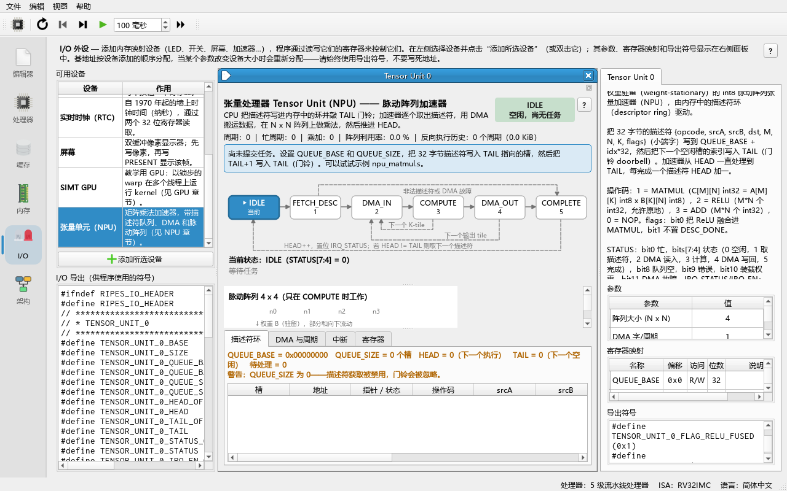
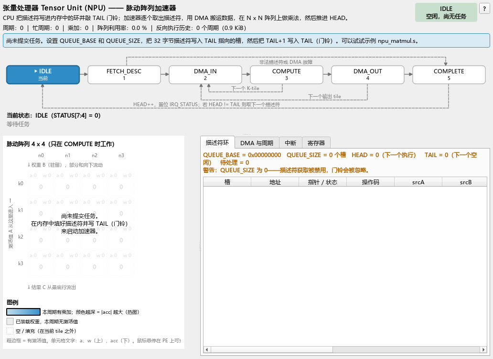
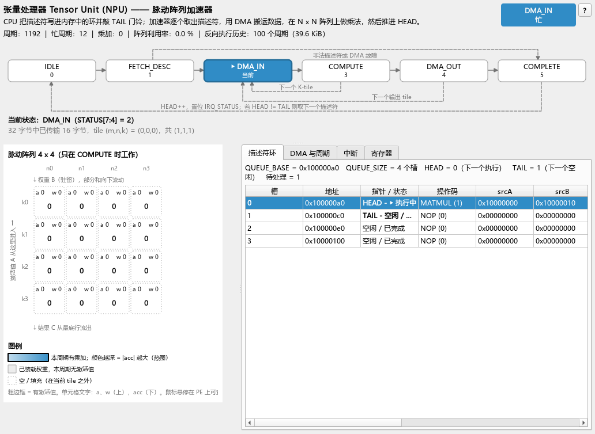
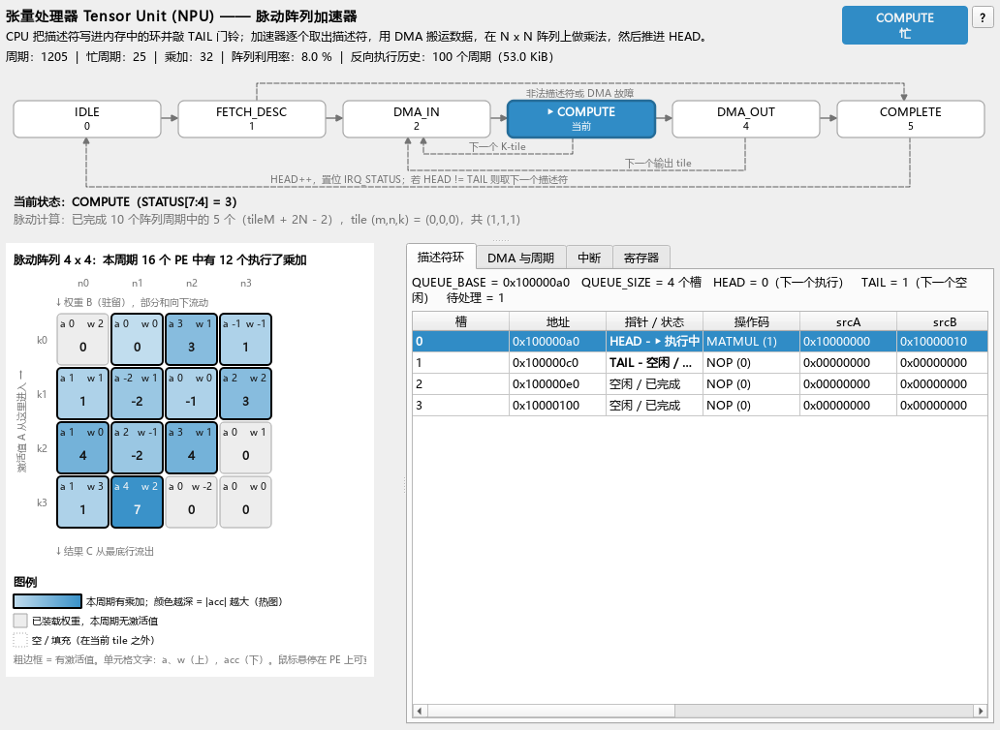
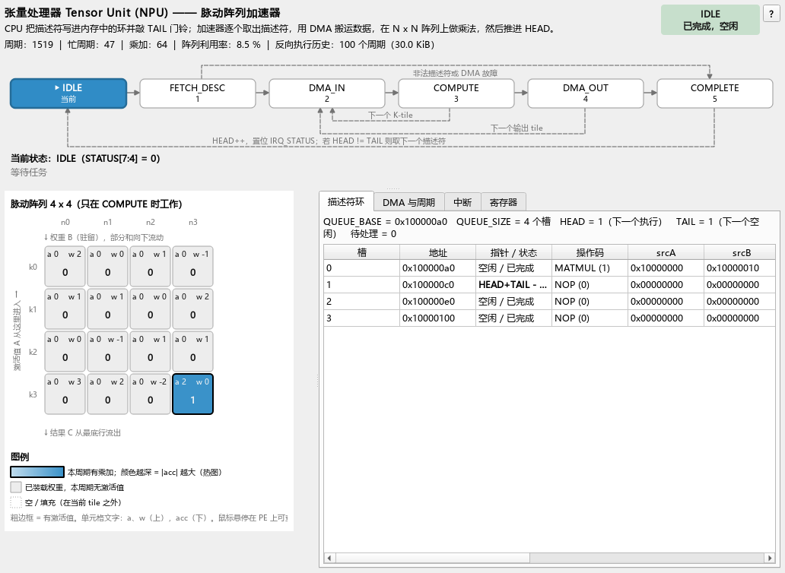

# 10 张量处理器（NPU）与 CPU 的交互

> **你将学到**
>
> - 为什么要把矩阵乘法交给一个独立的加速器（offload），以及什么时候不值得；
> - CPU 如何通过内存中的**描述符环**（descriptor ring）、**门铃**（doorbell）寄存器把任务交给加速器；
> - 加速器的 **DMA** 引擎如何搬数据，内部**状态机**每一步做什么、花多少周期；
> - 中断寄存器 `IRQ_EN` / `IRQ_STATUS`（写 1 清零）的用法，以及"Ripes 的 CPU 没有外部中断输入"这一限制；
> - int8 **脉动阵列**（systolic array）和 **weight-stationary** 数据流，并用 4×4 的真实数据逐周期推演；
> - 逐步运行 `npu_matmul.s`（汇编版）和 `npu_matmul.c`（C 版），读懂 CPU 周期与 NPU 周期的对比。
>
> **前置条件**
>
> - 会加载示例、汇编、单步与运行（第 02 章）；能读 RISC-V 汇编里的 `lw`/`sw`/循环（第 04 章）；
> - 会在 **I/O** 标签页添加外设并使用导出符号（第 08 章）；
> - 最好读过第 09 章（GPU），本章会对比两种加速器；
> - 知道矩阵乘法 `C[m][n] = Σ_k A[m][k]·B[k][n]` 的定义即可，不需要机器学习背景。

---

## 10.1 为什么需要一个独立的加速器

矩阵乘法 `C[M][N] = A[M][K] × B[K][N]` 需要 `M·N·K` 次乘加（MAC，multiply-accumulate）。在 CPU 上，每一次乘加都要经过取指、译码、两次 load、一次乘、一次加、地址计算和循环判断——本章示例里一个 4×4×4 的矩阵乘（64 次乘加）在 5 级流水线 CPU 上花了 **1129 个周期**，平均每次乘加约 17.6 个周期。

**加速器**（accelerator）的思路是：用一大片并排的乘法器同时计算，并让数据在乘法器之间直接传递、反复复用，不再经过寄存器和指令。本模块的 Tensor Unit（又叫 **NPU**，Neural Processing Unit，神经网络处理器）默认有 4×4 = 16 个乘法器，每周期最多 16 次乘加。

但加速器不是免费的：CPU 要**描述**任务、加速器要用 **DMA** 自己把数据搬进来再搬回去、完成后还要**通知** CPU。这些固定开销决定了"多大的任务才值得 offload（卸载给加速器）"——本章最后会用实测数字回答这个问题。

**算术强度**（arithmetic intensity）= 每搬 1 字节数据做多少次运算。n×n×n 的 int8 矩阵乘做 n³ 次乘加，搬 2n² 字节输入、4n² 字节输出，算术强度约 n/6。矩阵越大越值得用专用硬件；矩阵很小时，时间主要花在搬数据上（**memory-bound**，受内存带宽限制）。

## 10.2 外设总览

```
   RISC-V CPU                          Tensor Unit (NPU) 外设  TENSOR_UNIT_0_*
   ──────────                          ───────────────────────────────────────
   sw 描述符 → 主存中的环形队列          寄存器: QUEUE_BASE QUEUE_SIZE HEAD TAIL
   sw TAIL（门铃） ───────────────────►  STATUS IRQ_EN IRQ_STATUS CYCLES ...
   lw HEAD / IRQ_STATUS（轮询）◄──────         │
                                              ▼
                                    ┌──────────────────────┐
                                    │ 状态机 IDLE→FETCH_DESC│
                                    │ →DMA_IN→COMPUTE→      │
                                    │ DMA_OUT→COMPLETE      │
                                    └───┬──────────┬───────┘
                                        │          │
                              ┌─────────▼──┐   ┌───▼─────────────────┐
         主存 ◄──────────────►│ DMA 引擎    │──►│ 片上 tile 缓冲 A/B/C  │
   (描述符、A、B、C)  W 字/周期 └────────────┘   │ N×N 脉动阵列 (int8)  │
                                                └─────────────────────┘
```

源码：模型 `src/accel/npu/tensorunit.*`（不依赖 Qt 的周期级模型），外设 `src/io/iotensorunit.*`，设计文档 `docs/arch/tensor_cpu.md`，测试 `test/tst_npu.cpp`、`test/tst_accel_e2e.cpp`。

和 GPU 一样，NPU 由 CPU 时钟驱动：**CPU 每走一个周期，NPU 走一个周期**。所以 CPU 轮询时，NPU 真的在并行工作。

## 10.3 添加外设与参数

**做一步**：打开 **I/O** 标签页（输入/输出），在 **Available devices** 列表（可用设备）中双击 **Tensor Unit (NPU)**。

**看到什么**：出现名为 **Tensor Unit 0** 的部件；右侧 **Parameters**（参数）、**Register map**（寄存器映射）、**Exported symbols**（导出符号）面板列出它的信息；**I/O exports** 中多出 `TENSOR_UNIT_0_*` 符号。与 GPU 部件一样，它比 1280 × 800 窗口的中间区域更宽。



**为什么**：和所有 MMIO 外设一样，创建即分配地址并导出符号；程序中写 `TENSOR_UNIT_0_TAIL` 这样的名字。

| 参数（屏幕原文） | 默认 | 范围 | 含义 |
|---|---|---|---|
| Array size (N x N) | 4 | 1–32 | 脉动阵列边长 N（N×N 个乘法器） |
| DMA words/cycle | 1 | 1–64 | DMA 每周期搬几个 32 位字（带宽 W） |
| PE cell size | 56 | 24–160 | 部件中每个 PE 方格的绘制大小（像素），只影响显示 |

> 改 Array size 或 DMA words/cycle 会重新配置并复位模型。初学建议先用 N = 4（或 2，更便于逐格观察）。

NPU 部件：

| 区域 | 内容 |
|---|---|
| 顶部 | "张量处理器 Tensor Unit (NPU) —— 脉动阵列加速器" 标题 + 一句话说明；计数行 `周期 | 忙周期 | 乘加 | 阵列利用率 | 反向执行历史`；右侧是状态徽标（例如 `IDLE` / `空闲，尚无任务`、`DMA_IN` / `忙`）和 "?"（打开本章） |
| 状态机图 | IDLE → FETCH_DESC → DMA_IN → COMPUTE → DMA_OUT → COMPLETE，当前状态高亮；下方是 `当前状态：<状态>（STATUS[7:4] = n）` 和一行进度说明，例如"32 字节中已传输 16 字节，tile (m,n,k) = (0,0,0)，共 (1,1,1)"、"装载权重：已移入 4 行中的 k 行"或"脉动计算：已完成 n 个阵列周期中的 k 个" |
| 脉动阵列 | `脉动阵列 4 x 4`，N×N 方格，每格显示 `a`、`w`、`acc`；下方有图例 |
| **描述符环**（Descriptor ring）标签 | `QUEUE_BASE`、`QUEUE_SIZE`、`HEAD`、`TAIL`、待处理数；每个槽一行（**槽**、**地址**、**指针 / 状态**、**操作码**、**srcA**、**srcB**……），描述符各字段解码 |
| **DMA 与周期**（DMA & cycles）标签 | DMA 方向与进度条、累计 DMA 字节和周期计数 |
| **中断**（Interrupts）标签 | `IRQ_EN` / `IRQ_STATUS` 各位的含义与当前值 |
| **寄存器**（Registers）标签 | 名字 + 偏移 + 当前值 + 含义 |

PE 方格：上排是 `a` 和 `w`，下面是粗体 `acc`。粗边框 = 本周期持有 activation；蓝色填充 = 本周期做了一次乘加（越深表示 |acc| 越大，即热图）；浅灰 = 已装载权重、本周期无 activation；虚线 = 当前 tile 之外的填充。

## 10.4 寄存器表

基址由 I/O 标签页分配。`TENSOR_UNIT_0_<名字>` 为绝对地址，`TENSOR_UNIT_0_<名字>_OFFSET` 为偏移。

| 偏移 | 名称 | 读写 | 位 | 含义 |
|---|---|---|---|---|
| 0x00 | `QUEUE_BASE` | RW | 31:0 | 描述符环在主存中的字节地址 |
| 0x04 | `QUEUE_SIZE` | RW | 31:0 | 环的槽数（每槽 32 字节）；为 0 时不取描述符。写入时 HEAD/TAIL 按新大小取模（写 0 则清零） |
| 0x08 | `HEAD` | R | 31:0 | 加速器下一个要处理的槽；每完成一个描述符加 1（模 `QUEUE_SIZE`） |
| 0x0C | `TAIL` | RW | 31:0 | CPU 填好的最后一个槽之后的第一个空槽；**写入即门铃**；写入值自动按 `QUEUE_SIZE` 取模 |
| 0x10 | `STATUS` | R | bit0 `BUSY` | 状态不是 IDLE |
| | | | bits 7:4 | 状态：0 IDLE、1 FETCH_DESC、2 DMA_IN、3 COMPUTE、4 DMA_OUT、5 COMPLETE |
| | | | bit8 `QUEUE_EMPTY` | HEAD == TAIL |
| | | | bit9 `ERROR` | 上一个描述符被拒绝（取下一个描述符时清除） |
| | | | bit10 `WEIGHT_LOAD` | COMPUTE 中正在装载权重 |
| 0x14 | `IRQ_EN` | RW | 2:0 | 中断使能，位定义同 `IRQ_STATUS` |
| 0x18 | `IRQ_STATUS` | RW (W1C) | bit0 `DESC_DONE` | 一个描述符完成（`NO_IRQ` 时不置） |
| | | | bit1 `QUEUE_EMPTY` | 完成后队列变空 |
| | | | bit2 `ERROR` | 一个描述符被拒绝 |
| | | | | **写 1 清除对应位，写 0 无效果** |
| 0x1C | `CYCLES` | R | 31:0 | 复位以来的总周期数（忙闲都计数，可当作免费计时器） |
| 0x20 | `DMA_BYTES` | R | 31:0 | DMA 搬运的字节数（含描述符本身、输入、输出） |
| 0x24 | `MACS` | R | 31:0 | 有效 int8 乘加次数（不含填充的 0） |
| 0x28 | `ARRAY_N` | R | 31:0 | 阵列维度 N |
| 0x2C | `BUSY_CYCLES` | R | 31:0 | 状态不是 IDLE 的周期数 |
| 0x30 | `CTRL` | W | bit0 `SOFT_RESET` | 中止当前任务，HEAD = TAIL = 0，清 `IRQ_STATUS`；保留 `QUEUE_*`、`IRQ_EN` 和计数器 |
| | | | bit1 `CLEAR_COUNTERS` | 计数器清零 |

额外导出的常量符号（C 程序 `#include "ripes_system.h"` 后可用）：

| 符号 | 值 | 用途 |
|---|---|---|
| `TENSOR_UNIT_0_N` | N | 阵列维度 |
| `TENSOR_UNIT_0_DESC_SIZE` | 32 | 描述符字节数 |
| `_DESC_OPCODE/_SRCA/_SRCB/_DST/_M/_N/_K/_FLAGS` | 0/4/8/12/16/20/24/28 | 描述符字段偏移 |
| `_OP_NOP/_OP_MATMUL/_OP_RELU/_OP_ADD` | 0/1/2/3 | 操作码 |
| `_FLAG_RELU_FUSED/_FLAG_NO_IRQ` | 1/2 | 描述符标志 |
| `_STATUS_BUSY/_STATUS_QUEUE_EMPTY/_STATUS_ERROR` | 0x1/0x100/0x200 | STATUS 位 |
| `_IRQ_DESC_DONE/_IRQ_QUEUE_EMPTY/_IRQ_ERROR` | 1/2/4 | IRQ 位 |
| `_CTRL_SOFT_RESET/_CTRL_CLEAR_COUNTERS` | 1/2 | CTRL 位 |

（表中省略了前缀 `TENSOR_UNIT_0`。）

## 10.5 描述符：一个任务的 32 字节说明书

为什么不直接做 `SRCA`、`DST`、`M`… 这些寄存器？因为那样 CPU 每提交一个任务都要等上一个结束。把任务写成主存里的**描述符**（descriptor），加速器自己去取，CPU 就能一次排好多个任务然后去做别的事——这也是真实网卡、GPU、NPU 驱动的做法。

每个描述符 8 个小端（little-endian）32 位字，位于 `QUEUE_BASE + 槽号 × 32`：

| 偏移 | 字段 | MATMUL | RELU | ADD |
|---|---|---|---|---|
| +0 | `opcode` | 1 | 2 | 3（0 = NOP，立即完成） |
| +4 | `srcA` | A 的地址：M×K 个 int8，行优先 | 输入：M·N 个 int32 | 输入 0：M·N 个 int32 |
| +8 | `srcB` | B 的地址：K×N 个 int8，行优先 | 忽略 | 输入 1：M·N 个 int32 |
| +12 | `dst` | C 的地址：M×N 个 int32，行优先 | 输出（可等于 srcA，原地） | 输出 |
| +16 | `M` | A、C 的行数 | M·N = 元素个数 | 同左 |
| +20 | `N` | B、C 的列数 | | |
| +24 | `K` | A 的列数 = B 的行数 | 忽略 | 忽略 |
| +28 | `flags` | bit0 `RELU_FUSED`：写回前做 ReLU；bit1 `NO_IRQ`：完成时不置 `DESC_DONE` | | |

校验：opcode 必须是 0–3；MATMUL 要求 M、N、K 都在 [1, 4096]；RELU/ADD 要求 M、N 在 [1, 4096]。不合格的描述符被**拒绝**：`STATUS.ERROR` 和 `IRQ_STATUS.ERROR` 置位，但 `HEAD` 照常前进——坏描述符不会卡死队列（`tst_invalidDescriptor`）。

## 10.6 描述符环、HEAD/TAIL 与门铃

```
            QUEUE_BASE
            ┌──────┬──────┬──────┬──────┐      QUEUE_SIZE = 4
            │ slot0│ slot1│ slot2│ slot3│
            └──────┴──────┴──────┴──────┘
                      ▲             ▲
                    HEAD          TAIL
              (设备下一个要处理)  (CPU 下一个要填)
```

- **空**：`HEAD == TAIL`。待处理任务数 = `(TAIL − HEAD) mod SIZE`。
- **提交**：CPU 把描述符写进 `slot[TAIL]`（普通 `sw`），然后写 `TAIL = (TAIL + 1) mod SIZE`。这次写入就是**门铃**——它不传数据，只是"敲门"：有新工作了。设备空闲时在下一个周期离开 IDLE。
- **满**：经典的"留一个空槽"规则——`(TAIL + 1) mod SIZE == HEAD` 时不能再提交。否则填满全部 4 个槽后 TAIL 又等于 HEAD，设备会以为队列是空的。**硬件不检查这一点**，由软件负责。
- **回绕**：`tst_ringWraparound` 先在 3 槽的环里提交槽 0、1（TAIL = 2），再提交槽 2 和槽 0（TAIL 写 1）——HEAD 依次 0→1→2→0→1。

## 10.7 状态机

```
                 doorbell (HEAD != TAIL)
        ┌───────┐─────────────────────►┌────────────┐
        │ IDLE  │                      │ FETCH_DESC │  读 8 个字：ceil(8/W) 周期
        └───────┘◄───┐                 └─────┬──────┘
                     │                       │ 校验；失败 → COMPLETE（置 ERROR）
                     │                       ▼
                     │                 ┌──────────┐   A/B tile（int8）
                     │            ┌───►│  DMA_IN  │   或 int32 块
                     │            │    └────┬─────┘
                     │            │         ▼
                     │            │    ┌──────────┐   装权重 N 周期 + 阵列 tileM+2N−2 周期
                     │  下一个 K tile   │ COMPUTE  │   （RELU/ADD：ceil(块大小/N) 周期）
                     │            └────┴────┬─────┘
                     │                      ▼ 该输出 tile 的 K 全部算完
                     │                 ┌──────────┐
                     │  下一个输出 tile │ DMA_OUT  │   写回 C tile（int32）
                     │     → DMA_IN    └────┬─────┘
                     │                      ▼ 全部完成
                     │                 ┌──────────┐
                     └─────────────────│ COMPLETE │   1 周期：HEAD++，置 IRQ_STATUS
                                       └──────────┘
```

每个状态一个周期一个周期地前进（数字来自 `tensorunit.cpp`，W = DMA words/cycle）：

| 状态 | 做什么 | 周期数 |
|---|---|---|
| IDLE | 看到 `HEAD != TAIL` 就转入 FETCH_DESC；这一个周期不计入 `BUSY_CYCLES` | — |
| FETCH_DESC | 从 `QUEUE_BASE + HEAD×32` 读 8 个字（DMA 32 字节），校验 | ceil(8 / W) |
| DMA_IN | 搬入一个 A tile 和一个 B tile（int8，每个字 4 个元素） | ceil(字节数 / (4W)) |
| COMPUTE | 先把 B tile 逐行移入阵列（N 周期），再让 A 斜向流过（tileM + 2N − 2 周期） | N + tileM + 2N − 2 |
| DMA_OUT | 写回 C tile（int32，每元素 1 个字），可融合 ReLU | ceil(元素数 / W) |
| COMPLETE | `HEAD = (HEAD+1) mod SIZE`，置 `DESC_DONE`/`ERROR`，队列空则置 `QUEUE_EMPTY` | 1 |

**Tiling（分块）**：阵列只有 N×N，大矩阵按 tile 处理：对每个输出 tile `(mt, nt)`，依次处理所有 K tile（每个 K tile 一次 DMA_IN + 一次 COMPUTE，结果累加在片上），最后一次 DMA_OUT。边缘不足 N 的部分补 0，补的 0 不计入 `MACS`。部件上 `tile(m,n,k)=(…) of (…)` 显示当前位置。

## 10.8 DMA 引擎

加速器**不能**使用 CPU 的 load/store。它有自己的 DMA（Direct Memory Access，直接内存访问）引擎，在总线上直接读写主存（在 Ripes 中即外设的 `memRead/memWrite`）。本模型的 DMA 每周期最多搬 `W` 个 32 位字：

- 描述符：8 个字；
- int8 矩阵元素：每个字 4 个（A、B）；
- int32 元素：每个字 1 个（C、RELU/ADD 的输入输出）。

4×4×4 矩阵乘的数据量：描述符 32 B + A 16 B + B 16 B + C 64 B = **128 B**（`DMA_BYTES`，`tst_accel_e2e` 实测）。

DMA_IN、COMPUTE、DMA_OUT 是**串行**的（没有双缓冲），所以小矩阵的时间大部分花在搬数据上。真实加速器会用**双缓冲**（double buffering）让下一个 tile 的搬运与当前 tile 的计算重叠——第 13 章 PS3 的 SPE 双缓冲是同一个思路。

> 内存一致性：真实 SoC 中，CPU 写的描述符和矩阵可能还在 cache 里，敲门铃前要 flush 并执行 fence；读结果前要 invalidate。Ripes 的 cache 模拟只是统计模型，下面是单一一致的内存，所以这里不需要这些操作（示例中的注释标出了真实 SoC 需要做的位置）。

## 10.9 完成通知：轮询与中断

**轮询（polling）**：CPU 在循环里反复读寄存器，直到任务完成。可读的条件有：

| 读什么 | 条件 | 评价 |
|---|---|---|
| `HEAD` | `HEAD == 我写入的 TAIL` | 推荐：精确表示"我提交的都完成了"（示例程序用这个） |
| `IRQ_STATUS` | `DESC_DONE` 位为 1 | 可以，但要记得写 1 清除 |
| `STATUS` | `BUSY` 为 0 | 有陷阱：门铃之后设备要到下一个周期才离开 IDLE，过早读到 `BUSY = 0` 会误判为"已完成"；多个描述符之间也有 IDLE 周期 |

**中断（interrupt）**：CPU 把 `IRQ_EN` 的相应位置 1 后去做别的事；完成时 `IRQ_STATUS` 置位，若 `IRQ_STATUS & IRQ_EN != 0`，中断线有效，CPU 跳进中断服务程序（ISR）。ISR 必须**写 1 清除**它处理过的位（W1C，write-1-to-clear），否则中断线一直有效，退出 ISR 后会立刻再次进入（"中断风暴"）。写 1 清零的好处是 ISR 只清自己处理过的位，不会误清同时到达的其他事件。

`IRQ_STATUS` 是"电平"语义：即使 `IRQ_EN` 为 0，完成事件也会被记录下来；之后再打开 `IRQ_EN`，挂起的中断立即生效（`tst_irqW1C` 验证了这一点）。

> **重要限制**：Ripes 的 RISC-V 处理器模型**没有外部中断输入**，所以 NPU 的中断**不会真的打断 CPU**。中断线的状态只显示在部件上（`[IRQ PENDING]` / "IRQ pending"），程序可以通过读 `IRQ_STATUS` 来"模拟"ISR。示例程序的结尾就演示了读出 `IRQ_STATUS` = 3 再写 1 清除。

```c
/* 如果 CPU 有中断：一个典型的 ISR */
void npu_isr(void) {
    unsigned st = REG(TENSOR_UNIT_0_IRQ_STATUS);
    if (st & TENSOR_UNIT_0_IRQ_DESC_DONE) {
        REG(TENSOR_UNIT_0_IRQ_STATUS) = TENSOR_UNIT_0_IRQ_DESC_DONE;  /* 只清这一位 */
        done_count++;
    }
    if (st & TENSOR_UNIT_0_IRQ_ERROR) {
        REG(TENSOR_UNIT_0_IRQ_STATUS) = TENSOR_UNIT_0_IRQ_ERROR;
        handle_error();
    }
}
```

**中断合并（interrupt coalescing）**：一次提交多个描述符时，给前面的描述符置 `NO_IRQ`，只让最后一个产生 `DESC_DONE`，减少中断次数。练习 2 会做这个实验。

## 10.10 脉动阵列与 weight-stationary 数据流

### 10.10.1 结构

```
            n0        n1        n2        n3        ← 列（输出 C 的列）
         ┌───────┐ ┌───────┐ ┌───────┐ ┌───────┐
 a[m][0]→│PE(0,0)│→│PE(0,1)│→│PE(0,2)│→│PE(0,3)│   行 k0（持有 B[0][*]）
         └───┬───┘ └───┬───┘ └───┬───┘ └───┬───┘
             ↓psum     ↓         ↓         ↓
         ┌───────┐ ┌───────┐ ┌───────┐ ┌───────┐
 a[m][1]→│PE(1,0)│→│PE(1,1)│→│PE(1,2)│→│PE(1,3)│   行 k1（持有 B[1][*]）
         └───┬───┘ └───┬───┘ └───┬───┘ └───┬───┘
             ↓         ↓         ↓         ↓
                     …（行 k2、k3）…
             ↓         ↓         ↓         ↓
          C[m][0]   C[m][1]   C[m][2]   C[m][3]      ← 结果从底部流出
```

每个 PE（processing element，处理单元）每周期做一次：`acc = psum_in + a × w`，其中

| 值 | 含义 |
|---|---|
| `w` | **固定不动的权重**：B 的一个元素 `B[k][n]`，算一个 K tile 期间不变 |
| `a` | 本周期流经该 PE 的 activation（A 的一个元素），下一周期传给右边 |
| `acc` | 本周期的部分和（partial sum）：上方 PE 上一周期的 `acc` 加上 `a × w`，下一周期传给下方 |

"**weight-stationary**（权重驻留）"：权重先装进阵列并停住，activation 从左往右流，部分和从上往下流。一个权重被 M 行 activation 复用 M 次而不用重新读内存——数据复用就是加速器省带宽的来源。

**装载权重**：COMPUTE 的前 N 个周期，B tile 从阵列顶部一行一行"推"进去并向下移动：第 0 周期把 B 的第 N−1 行放到顶部，下一周期它下移一行、顶部放第 N−2 行……N 个周期后 PE(k, n) 持有 B[k][n]。部件上能看到 `w` 一行行往下落；STATUS 的 `WEIGHT_LOAD` 位为 1。

**斜向注入**：`A[m][k]` 在第 `t = m + k` 个周期进入第 k 行的左端，在 `t = m + k + n` 到达 PE(k, n)；列 n 底部在 `t = m + (N−1) + n` 输出 `C[m][n]`。为什么要斜着送：psum 从 PE(k−1,n) 下移到 PE(k,n) 要一个周期，所以 `A[m][k]` 必须比 `A[m][k−1]` 晚一个周期到达同一列。一个 tile 从第一个 activation 进入到最后一个结果流出共 `tileM + 2N − 2` 个周期。

### 10.10.2 用示例数据推演一个 4×4 矩阵乘

`npu_matmul.s` 中的数据：

```
A = [ 1  2  3  4 ]      B = [ 2  0  1 -1 ]
    [-1  0  2  1 ]          [ 1  1  0  2 ]
    [ 3 -2  1  0 ]          [ 0 -1  1  1 ]
    [ 0  1 -1  2 ]          [ 3  2 -2  0 ]
```

结果（手算，可用示例程序的 CPU 版本核对）：

```
C = [ 16  7 -4  6 ]
    [  1  0 -1  3 ]
    [  4 -3  4 -6 ]
    [  7  6 -5  1 ]
```

**跟踪 C[0][0] 沿第 0 列往下走**（t 从 COMPUTE 装完权重后开始计）：

| t | 发生在 | 计算 | acc |
|---|---|---|---|
| 0 | PE(0,0)，a = A[0][0] = 1，w = B[0][0] = 2 | 0 + 1×2 | 2 |
| 1 | PE(1,0)，a = A[0][1] = 2，w = B[1][0] = 1 | 2 + 2×1 | 4 |
| 2 | PE(2,0)，a = A[0][2] = 3，w = B[2][0] = 0 | 4 + 3×0 | 4 |
| 3 | PE(3,0)，a = A[0][3] = 4，w = B[3][0] = 3 | 4 + 4×3 | **16** = C[0][0]，从底部输出 |

**所有结果离开阵列的时刻**（`t = m + 3 + n`）：

| t | 本周期从底部输出的元素 |
|---|---|
| 3 | C[0][0] |
| 4 | C[1][0]、C[0][1] |
| 5 | C[2][0]、C[1][1]、C[0][2] |
| 6 | C[3][0]、C[2][1]、C[1][2]、C[0][3] |
| 7 | C[3][1]、C[2][2]、C[1][3] |
| 8 | C[3][2]、C[2][3] |
| 9 | C[3][3] |

共 10 个周期（= 4 + 2×4 − 2），加上 4 个周期装权重，COMPUTE 一共 14 个周期，完成 64 次乘加。理想情况下 16 个 PE 每周期 16 次乘加只要 4 个周期——"填满"和"排空"阵列的斜坡时间就是脉动阵列在小矩阵上利用率不高的原因。

> 想看得更清楚：把 **Array size** 设为 2，自己写一个 2×2×2 的描述符（或参考 `docs/arch/tensor_cpu.md` §2.3 的 2×2 逐周期演示），单步观察每个格子。

## 10.11 逐步运行 `npu_matmul.s`（汇编版）

示例：**File → Load Example... → Assembly → npu_matmul.s**（`examples/assembly/npu_matmul.s`）。它先用 CPU 算一遍 4×4×4 矩阵乘（用 NPU 的 `CYCLES` 计时），再交给 NPU，最后比较两者结果。

### 步骤 1：准备

**做一步**：在 **I/O** 标签页添加 **Tensor Unit (NPU)**（默认 N = 4、W = 1），加载示例并汇编。

**看到什么**：部件显示 `当前状态：IDLE（STATUS[7:4] = 0）`，徽标为 `IDLE` / `空闲，尚无任务`；**描述符环** 标签显示 `QUEUE_BASE = 0x00000000  QUEUE_SIZE = 0 个槽  HEAD = 0  TAIL = 0`，并警告 QUEUE_SIZE 为 0；阵列区域显示提示"尚未提交任务。"



### 步骤 2：CPU 参考计算

**做一步**：用 **Run**（F8）运行到 `la t0, ring`（第 2 节"Configure the descriptor ring"）处的断点。

**看到什么**：`cycles=` 一直在增长，`busy=0`。

**为什么**：`CYCLES` 每个 CPU 周期加 1，与 NPU 忙不忙无关，所以程序用它给 CPU 代码计时：`s2 = CYCLES(结束) − CYCLES(开始)`。

### 步骤 3：配置环、填描述符

**做一步**：单步（**Clock**，F5）执行配置和填描述符的 `sw`。

**看到什么**：寄存器表中 `QUEUE_BASE` = `ring` 的地址，`QUEUE_SIZE` = 4，`IRQ_EN` = 0。随后的 8 个 `sw` 写的是**主存**中的 `ring`（可以在 **Memory** 标签页看到这 32 字节），NPU 寄存器不变，状态仍是 IDLE。

**为什么**：描述符在普通内存里，NPU 此时还不知道它存在。只有门铃告诉它。

### 步骤 4：门铃

**做一步**：执行 `sw t2, 0(t1)`（`TAIL = 1`），再单步几个周期。

**看到什么**：`TAIL = 1`；下一个周期状态变成 `FETCH_DESC`；8 个周期后 **描述符环** 标签的槽 0 显示解码后的描述符（`HEAD - 执行中`、操作码 `MATMUL (1)`、`srcA`、`srcB`……），状态进入 `DMA_IN`，进度行一直数到"32 字节中已传输 32 字节，tile (m,n,k) = (0,0,0)，共 (1,1,1)"（**DMA 与周期** 标签用进度条显示同样的进度，蓝色 = 搬入）。



**为什么**：W = 1 时取 8 个字的描述符要 8 个周期；A、B 各 16 字节 int8 = 8 个字 = 8 个周期。

### 步骤 5：装权重与计算

**做一步**：继续单步。

**看到什么**：状态为 `COMPUTE`，进度行是"装载权重：已移入 4 行中的 k 行"：B 的行从上往下落入阵列（浅灰格子 = 已装载权重）。4 个周期后显示"脉动计算：已完成 10 个阵列周期中的 k 个"：`a` 值从左往右斜着流动（粗边框；本周期做了乘加的 PE 填成蓝色），`acc` 从上往下累加；第 0 列底部的 `acc` 依次出现 16、1、4、7——正是 C 的第 0 列。



**为什么**：参见 10.10。部件中"已完成 10 个阵列周期中的 k 个"数的是已经完成的阵列周期，所以 k 比上表中的 t 大 1。

### 步骤 6：写回与完成

**做一步**：继续单步，或直接 **Run**（F8）。

**看到什么**：`DMA_OUT` 阶段进度条变成橙色（片上 → 主存），`0 / 64 B` 增长到 `64 / 64 B`，共 16 个周期；然后 `COMPLETE` 一个周期，`head=1`，回到 `IDLE`；`IRQ_STATUS=0x3`（DESC_DONE | QUEUE_EMPTY）。由于 `IRQ_EN = 0`，不显示 IRQ pending。CPU 的轮询循环看到 `HEAD == 1` 退出。

控制台输出（`test/tst_accel_e2e.cpp` 在 RV32_5S + M 处理器上的实测）：

```
Tensor Unit matmul demo (4x4x4 int8)
CPU matmul cycles: 1129
NPU wall cycles:   60
NPU busy cycles:   47
NPU DMA bytes:     128
NPU MACs:          64
Result: OK
```

整个程序共运行 1520 个 CPU 周期。



**为什么 busy = 47**：

| 阶段 | 周期 | 计算 |
|---|---|---|
| FETCH_DESC | 8 | 32 B / 4 B 每周期 |
| DMA_IN | 8 | (16 + 16) B / 4 B |
| COMPUTE | 14 | 4（装权重）+ 4 + 2×4 − 2 |
| DMA_OUT | 16 | 16 个 int32 / 1 字每周期 |
| COMPLETE | 1 | |
| **合计** | **47** | |

**wall = 60** 是 CPU 从门铃前读 `CYCLES` 到发现 `HEAD == 1` 后再读 `CYCLES` 的时间：47 个忙周期，加上门铃前后的几条指令、门铃后 IDLE 的 1 个周期、以及轮询循环发现 HEAD 变化的延迟。

## 10.12 C 版本 `npu_matmul.c`

示例：**File → Load Example... → C → npu_matmul.c**（`examples/C/npu_matmul.c`）。需要先在 **Edit → Settings → Compiler** 配置 RISC-V GCC，并在编译参数里加 `-nostdlib`（见第 05 章）。它计算 6×5 乘 5×4（M = 6，K = 5，N = 4）。

关键代码：

```c
#define REG(addr) (*(volatile unsigned *)(addr))

static unsigned submit(unsigned tail, unsigned opcode, const void *srcA,
                       const void *srcB, void *dst, unsigned m, unsigned n,
                       unsigned k, unsigned flags) {
    volatile unsigned *d = ring[tail];
    d[D_OPCODE] = opcode;  d[D_SRCA] = (unsigned)srcA;
    d[D_SRCB] = (unsigned)srcB;  d[D_DST] = (unsigned)dst;
    d[D_M] = m;  d[D_N] = n;  d[D_K] = k;  d[D_FLAGS] = flags;
    tail = (tail + 1) % RING_SLOTS;
    REG(TENSOR_UNIT_0_TAIL) = tail;      /* 门铃 */
    return tail;
}

static unsigned wait_head(unsigned tail) {
    unsigned polls = 0;
    while (REG(TENSOR_UNIT_0_HEAD) != tail) polls++;   /* 轮询 */
    return polls;
}
```

`volatile` 的作用：阻止**编译器**把描述符的写入重排到门铃之后、或把轮询循环里的读优化掉。（真实 CPU 还需要 fence 防止**硬件**重排；Ripes 的处理器是顺序执行的。）

程序做两件事：

1. 提交一个 MATMUL 描述符，轮询完成，打印 `NPU wall cycles`、`NPU busy cycles`、`NPU DMA bytes`、`NPU MACs`、`CPU polls`，并与 CPU 结果比较；
2. 再提交一个 **RELU** 描述符，原地（`srcA == dst`）把结果中的负数变成 0——这就是"把两层串起来"。

按模型计算（`docs/arch/tensor_cpu.md` §4.1，N = 4、W = 1）：6×4×5 的 MATMUL 需要 2 个 M tile × 2 个 K tile，忙周期 103（FETCH 8 + DMA_IN 18 + COMPUTE 52 + DMA_OUT 24 + COMPLETE 1），DMA 198 字节，MACs 120。CPU 周期数取决于编译器版本与优化级别（待核实）。

## 10.13 CPU 周期与 NPU 周期：offload 告诉我们什么

4×4×4 的实测：

| | 周期 | 说明 |
|---|---|---|
| CPU 三重循环 | 1129 | 64 次乘加，每次约 17.6 周期 |
| NPU 墙钟（含提交与轮询） | 60 | 约快 18.8 倍 |
| NPU 忙周期 | 47 | 其中真正在阵列上计算的只有 14 |
| 阵列利用率 | 64 / (47 × 16) ≈ 8.5% | |

模型在其它配置下的忙周期（来自 `docs/arch/tensor_cpu.md` §4.1，由同一模型计算）：

| 配置 | FETCH | DMA_IN | COMPUTE | DMA_OUT | COMPLETE | 合计 | 利用率 |
|---|---|---|---|---|---|---|---|
| N=4, W=1, 4×4×4 | 8 | 8 | 14 | 16 | 1 | 47 | 8.5% |
| N=4, W=4, 4×4×4 | 2 | 2 | 14 | 4 | 1 | 23 | 17.4% |
| N=4, W=1, 8×8×8 | 8 | 64 | 112 | 64 | 1 | 249 | 12.9% |
| N=8, W=1, 8×8×8 | 8 | 32 | 30 | 64 | 1 | 135 | 5.9% |
| N=8, W=4, 8×8×8 | 2 | 8 | 30 | 16 | 1 | 57 | 14.0% |

从这些数字能学到：

1. **搬数据比算更贵**：4×4×4 的 47 个周期里 33 个在取描述符和搬数据。DMA 带宽从 1 提到 4 字/周期，总时间从 47 降到 23，计算部分一个周期没少——典型的 memory-bound。
2. **Amdahl 定律**：8×8×8 从 4×4 阵列换成 8×8 阵列，算力 4 倍，COMPUTE 从 112 降到 30，但总时间只从 249 降到 135，因为 DMA 没变快。
3. **大阵列喂不饱**：8×8 阵列算 8×8×8 的利用率（5.9%）比 4×4 阵列（12.9%）还低。这就是推理框架要做"算子融合"、把小算子拼成大算子的原因。
4. **固定开销决定最小 offload 规模**：提交描述符（CPU 写 8 个字 + 门铃）、取描述符（8 周期）、装权重和阵列斜坡时间、轮询延迟，这些与矩阵大小无关。矩阵很小时（例如 2×2，8 次乘加，CPU 只要约一两百周期），offload 几乎没有收益。
5. **CPU 可以同时做别的事**：墙钟 60 周期里 CPU 只是在轮询。如果改为"提交 → 做别的工作 → 再检查"，加速器的时间可以完全被隐藏。

## 10.14 局限

- **CPU 没有外部中断输入**：中断只能被观察（部件显示、读 `IRQ_STATUS`），不会打断 CPU。
- **不能反向执行加速器**：处理器的 **Reverse**（F4）不会倒退 NPU 的状态。按 PLAN2 §6(9) 的修复，反向后要么恢复快照、要么复位到"启动前"并在部件上提示（具体采用哪种待核实）。重来请用 **Reset**（F3）——处理器复位会把 NPU 全部复位（含计数器）。
- **命令行模式不能实例化外设**：NPU 示例只能在 GUI（或 QTest 测试）里运行。
- 寄存器与描述符都是 32 位；在 RV64 处理器上，地址必须在低 4 GB。
- DMA_IN / COMPUTE / DMA_OUT 串行，没有双缓冲；没有 requantize（结果是 int32）。
- 描述符或 `QUEUE_BASE` 指向 NPU 自己的寄存器区会导致问题（第一阶段可能死锁，修复中，PLAN2 §6(2)）——不要这样做。

## 10.15 常见问题

| 现象 | 原因与解决 |
|---|---|
| 写了 TAIL 但状态一直是 IDLE | `QUEUE_SIZE` 为 0；或 TAIL 写成了 HEAD 的值（例如填满全部槽，TAIL 回绕成 HEAD） |
| `STATUS.ERROR` / `IRQ_STATUS.ERROR` 置位 | opcode 不是 0–3，或 M/N/K 为 0 或超过 4096 |
| 结果全错但没报错 | `srcA/srcB` 指错（例如 A 不是 int8 行优先）；C 的 `dst` 与输入重叠（MATMUL 不支持原地） |
| 轮询 `STATUS.BUSY` 立刻退出 | 门铃后设备在下一周期才离开 IDLE；改为轮询 `HEAD` |
| `IRQ_STATUS` 一直不清零 | 写的是 0；必须对要清的位写 1 |
| 第二次运行计数器不是从 0 开始 | 计数器只在复位或 `CTRL.CLEAR_COUNTERS` 时清零；程序应像示例那样取差值 |

## 10.16 练习

**练习 1（读状态）**：门铃之后第 1、第 5、第 12、第 25 个忙周期时，`STATUS` 的值是多少？（N = 4，W = 1，4×4×4。）

<details><summary>答案</summary>

忙周期 1–8 是 FETCH_DESC（状态 1），9–16 是 DMA_IN（2），17–30 是 COMPUTE（3，其中 17–20 装权重），31–46 是 DMA_OUT（4），47 是 COMPLETE。各状态下 `BUSY` = 1，`QUEUE_EMPTY` = 0（HEAD 0 ≠ TAIL 1）。

- 第 1、5 个周期：FETCH_DESC → `0x1 | (1<<4)` = `0x11`；
- 第 12 个周期：DMA_IN → `0x21`；
- 第 25 个周期：COMPUTE、权重已装完 → `0x31`（装权重期间是 `0x431`）。

（这里的"第 k 个周期"指读取时状态机已经走过的忙周期数，具体读到哪一个取决于 lw 的时刻。）

</details>

**练习 2（批量提交 + 中断合并）**：一次门铃提交两个描述符：槽 0 是 MATMUL（`flags = NO_IRQ`），槽 1 是对结果原地做 RELU。最后 `IRQ_STATUS` 是多少？忙周期大约多少？

<details><summary>答案</summary>

完整程序：`examples/assembly/exercise_npu_batch.s`（Examples 菜单名 `exercise_npu_batch.s`，待加入资源文件）。要点：

```asm
        li   t1, TENSOR_UNIT_0_FLAG_NO_IRQ
        sw   t1, TENSOR_UNIT_0_DESC_FLAGS(t0)    # 槽 0：不产生 DESC_DONE
        ...                                       # 槽 1：RELU，srcA = dst = C，M = N = 4
        li   t1, TENSOR_UNIT_0_TAIL
        li   t2, 2
        sw   t2, 0(t1)                            # 一次门铃，两个任务
        li   t1, TENSOR_UNIT_0_HEAD
poll:   lw   t4, 0(t1)
        bne  t4, t2, poll                         # 等到 HEAD == 2
```

- 槽 0 完成时：`NO_IRQ` → 不置 `DESC_DONE`；HEAD = 1 ≠ TAIL = 2 → 不置 `QUEUE_EMPTY`。
- 槽 1 完成时：置 `DESC_DONE`，HEAD = TAIL = 2 → 置 `QUEUE_EMPTY`。
- 所以 `IRQ_STATUS = 3`，整个批次只有一次"中断"。
- 忙周期（按模型推算，待在 GUI 中核实）：MATMUL 47 + RELU（FETCH 8 + DMA_IN 16 个字 16 + COMPUTE ceil(16/4) = 4 + DMA_OUT 16 + COMPLETE 1 = 45）= 92。两个描述符之间有 1 个 IDLE 周期，不计入忙周期。
- 结果：`relu(C)` = 16 7 0 6 / 1 0 0 3 / 4 0 4 0 / 7 6 0 1，程序与表 `EXP` 比较后打印 `Result: OK`。

</details>

**练习 3（串联层，一个描述符完成）**：练习 2 用两个描述符实现 `relu(A × B)`。怎样只用一个描述符？好处是什么？

<details><summary>答案</summary>

在 MATMUL 描述符里置 `flags = TENSOR_UNIT_0_FLAG_RELU_FUSED`（1）。ReLU 在 DMA_OUT 写回时完成，省掉第二次取描述符（8 周期）、把 C 搬入（16 周期）、计算（4 周期）和再写回（16 周期）——忙周期从 92 降到 47。这就是"算子融合"：把逐元素操作塞进写回路径，免去一次内存往返。

</details>

**练习 4（环满）**：`QUEUE_SIZE = 4`、HEAD = TAIL = 0。如果 CPU 填满 4 个槽后写 `TAIL = 4`，会发生什么？最多能连续提交几个？

<details><summary>答案</summary>

`TAIL` 按 `QUEUE_SIZE` 取模，`4 mod 4 = 0`，于是 HEAD == TAIL，设备认为队列为空，一个任务也不做。最多只能提交 3 个（留一个空槽），即 `(TAIL + 1) mod SIZE == HEAD` 时就要停下来等待。

</details>

**练习 5（坏描述符）**：把描述符的 opcode 写成 9，敲门铃。观察什么？队列会卡住吗？

<details><summary>答案</summary>

FETCH_DESC 8 个周期后校验失败，直接进入 COMPLETE：`STATUS.ERROR`（bit9）和 `IRQ_STATUS.ERROR`（bit2）置位，`DESC_DONE` 不置；HEAD 照常加 1，所以队列不会卡住，后面的描述符正常执行。`MACS` 不变。

</details>

**练习 6（带宽）**：把 **DMA words/cycle** 改成 4，重新运行 `npu_matmul.s`。预测 `NPU busy cycles`。

<details><summary>答案</summary>

FETCH ceil(8/4) = 2，DMA_IN 32 B / 16 B = 2，COMPUTE 仍为 14，DMA_OUT 16 / 4 = 4，COMPLETE 1，合计 **23**（与 `docs/arch/tensor_cpu.md` 表格一致）。CPU 周期 1129 不变；墙钟周期相应减少。

</details>

**练习 7（什么时候不值得 offload）**：用 4×4 阵列、W = 1 计算一个 1×1×1 的 MATMUL，忙周期是多少？CPU 做一次乘加大约多少周期？结论是什么？

<details><summary>答案</summary>

FETCH 8 + DMA_IN ceil(2 B / 4 B) = 1 + COMPUTE 4 + (1 + 8 − 2) = 11 + DMA_OUT 1 + COMPLETE 1 = **22** 个忙周期，再加上 CPU 写 8 个字的描述符、门铃和轮询。而 CPU 自己做一次乘加只要十几个周期（参考 4×4×4 平均 17.6 周期/MAC）。结论：固定开销远大于计算本身，小任务应留在 CPU 上做。

</details>

## 10.17 小结

- CPU 把任务写成 32 字节描述符放在内存的环形队列里，写 `TAIL` 敲门铃；加速器取描述符、DMA 搬入、计算、DMA 写回、`HEAD++`。
- 完成通知可以轮询（推荐轮询 `HEAD`）或用中断（`IRQ_EN` + 写 1 清零的 `IRQ_STATUS`）；Ripes 的 CPU 没有外部中断输入，中断只能观察。
- weight-stationary 脉动阵列：权重驻留、activation 向右流、部分和向下流；斜向注入让每列在正确的时刻累加；小矩阵受填充/排空时间限制。
- 4×4×4 示例：CPU 1129 周期 vs NPU 墙钟 60 周期（忙 47 周期，其中计算只有 14）。搬数据和固定开销主导小任务；带宽、算子融合、批量提交是优化方向。

术语见第 17 章；PS3 的 SPE 双缓冲（第 13 章）展示了把 DMA 与计算重叠的另一种做法。
