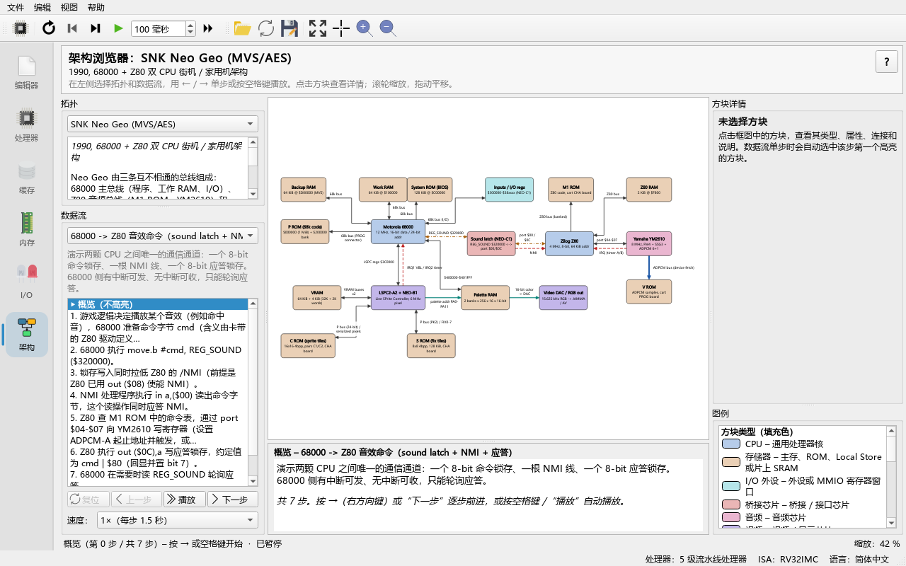
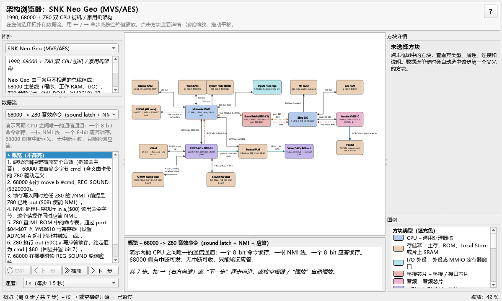
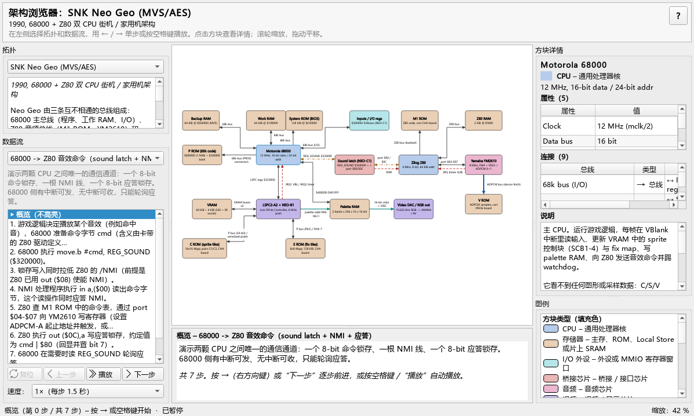
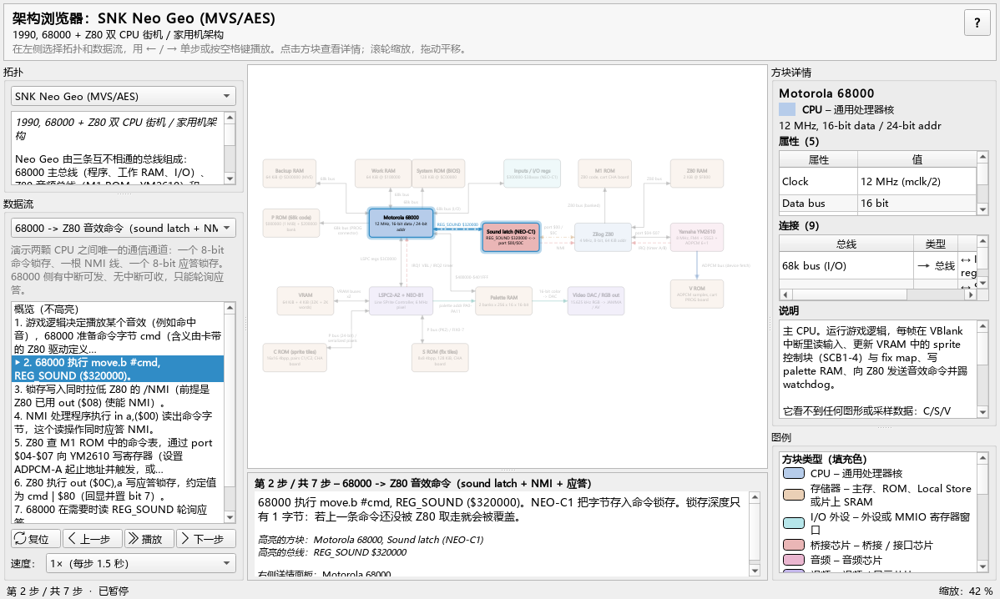

# 11 架构浏览器（Architecture Explorer）

> **你将学到**
>
> - 什么是"拓扑"（topology），以及架构浏览器和 Ripes 的处理器模拟有什么不同；
> - 如何选择内置拓扑、读懂方块（block）和连线（bus）的颜色与线型；
> - 如何单步/播放一条数据流（flow），每一步界面上会发生什么变化；
> - 如何缩放、平移、适配窗口、查看方块详情和连接、导出图片；
> - 四个内置拓扑分别对应本手册的哪些章节。
>
> **前置条件**
>
> - 已能启动 Ripes（见第 01、02 章）；了解主窗口左侧的标签栏（见第 03 章）。
> - 不需要会写汇编：本章只用鼠标和键盘浏览图。

---

## 11.1 架构浏览器是什么

Ripes 的 **Processor** 标签页（处理器）模拟的是一颗真正执行指令的 RISC-V 核：每个时钟周期、每根信号线都是"算"出来的。**Architecture** 标签页（架构浏览器）则不同，它不执行任何程序，而是一个**由 JSON 文件驱动的框图与数据流演示器**：

- 一个**拓扑（topology）**就是一个 JSON 文件，描述一台机器由哪些**方块（block）**组成（CPU、内存、DMA、GPU……）、方块之间有哪些**连线（bus）**；
- 拓扑里还可以写若干条**数据流（flow）**。一条 flow 由若干**步骤（step）**组成，每一步说明"谁把什么数据通过哪条线交给了谁"，并高亮相关的方块和连线。

所以你可以把它理解为"会动的教科书插图"：先看全局结构，再一步一步跟着数据走。数据流的文字和高亮都是作者写好的，不是模拟出来的，因此它适合讲解**整机级**的结构（总线、DMA、中断、信箱），而周期级的细节仍然要回到 Processor 标签页和 I/O 外设里观察。

拓扑里的文字是中英双语的：界面语言为中文时显示中文标题和说明，英文界面显示英文。

## 11.2 打开标签页

**做一步**：在主窗口左侧的标签栏里点击最下面的 **Architecture**（架构）图标。

**看到什么**：

| 区域 | 内容 |
|---|---|
| 顶部标题栏 | 当前拓扑的标题（大号粗体）、副标题，以及一句操作提示；最右侧的 **?** 按钮打开本章 |
| 左栏上部 **Topology**（拓扑） | 拓扑下拉框；下方是拓扑的总体介绍 |
| 左栏下部 **Data flow**（数据流） | 数据流下拉框；**步骤列表**；**Reset / Previous / Play / Next** 四个按钮；**Speed:**（速度）下拉框 |
| 中间 | 上方是框图；下方是**当前步骤面板**（步骤标题 + 说明） |
| 右栏上部 **Block details**（方块详情） | 选中方块的标题、种类、**Properties**（属性）表、**Connections**（连接）表、**Description**（说明） |
| 右栏下部 **Legend**（图例） | 本拓扑用到的方块种类、连线种类和高亮样式 |
| 最底部状态行 | 当前拓扑 / flow / 步骤 / 播放状态，右侧是缩放比例（`Zoom: 100 %`） |

工具栏（只在 Architecture 标签页激活时显示）提供打开、重新加载、导出、缩放和步进按钮，见 11.6–11.8 节。

**为什么**：左边负责"选什么看"，中间负责"看"和"讲解"，右边负责"看细节"和"查颜色含义"。各区域之间是可拖动的分隔条（splitter），窗口变小时框图优先保留空间；你调整过的分隔条位置会被记住。

## 11.3 选择一个内置拓扑

**做一步**：点击左栏 **Topology** 下的下拉框。把鼠标停在某一项上，会显示它的副标题。

**看到什么**：五个内置拓扑，真实机器排在前面，模板排在最后：

| 下拉框中的标题（英文界面） | 文件 | 规模 | 内容 |
|---|---|---|---|
| Sony PlayStation 3 / Cell Broadband Engine | `resources/arch/ps3.json` | 16 块 / 21 线 / 4 flow | 异构多核 Cell + RSX（第 13 章） |
| SNK Neo Geo (MVS/AES) | `resources/arch/neogeo.json` | 18 / 21 / 3 | 1990 年的双 CPU 街机（第 12 章） |
| Host CPU + SIMT GPU (system view) | `resources/arch/gpu_system.json` | 11 / 13 / 2 | 主机 + SIMT GPU 的系统视图（对应第 09 章） |
| Host CPU + tensor unit (...) | `resources/arch/npu_system.json` | 10 / 14 / 2 | 主机 + 脉动阵列 NPU（对应第 10 章） |
| Example: minimal system | `resources/arch/example_minimal.json` | 3 / 2 / 1 | 写拓扑用的最小模板（第 14 章） |

中文界面下标题显示为中文（例如"示例：最小系统"）。用 **Open architecture JSON...** 打开的文件排在后面，标题后带文件名（第 14 章）。

选择一项后：

1. 框图换成新的拓扑，并自动适配窗口；
2. 顶部标题栏显示拓扑标题和副标题，左栏显示总体介绍（以及"N 个方块、N 条连线、N 条数据流"的统计）；
3. **Data flow** 下拉框换成这个拓扑的数据流，并**自动选中第一条**，步骤列表停在第 0 行"概览"；
4. 右栏方块详情清空，图例换成本拓扑用到的种类。

Ripes 会记住你最后选择的拓扑，下次打开时直接显示它。

**为什么**：切换拓扑会停止播放并清空所有高亮，避免旧拓扑的状态残留在新图上。

## 11.4 读懂方块与连线：图例

**做一步**：选择 **SNK Neo Geo (MVS/AES)**，看右栏下部的 **Legend**（图例）面板。

**看到什么**：图例分三组：**Block kinds (fill color)**（方块种类，看填充色）、**Connection kinds (line style)**（连线种类，看线型）、**Flow highlighting**（高亮样式：Highlighted 参与本步、Faded 未参与）。每一项是"色块/线样 + 名称 – 一句说明"。图例固定在右栏，不会随框图缩放或平移而移出视野；它只列出**本拓扑实际用到的**种类。方块的填充色由 `kind`（种类）决定；浅色主题下是粉彩色，深色主题下是较深的同色系，文字颜色跟随主题。

| 方块 kind | 图例名称（英文界面） | 大致颜色（浅色主题） | 典型用途 |
|---|---|---|---|
| `cpu` | CPU | 蓝 | 通用处理器核：68000、Z80、PPE、RISC-V 主机 |
| `gpu` | GPU | 绿 | GPU、SM、命令处理器、RSX |
| `accel` | Accelerator | 紫 | 加速器：SPE、脉动阵列、NPU 控制器 |
| `dma` | DMA engine | 青绿 | DMA 引擎、Cell 的 MFC |
| `memory` | Memory | 橙/米色 | DRAM、ROM、VRAM、Local Store |
| `cache` | Cache | 黄 | cache、片上 buffer |
| `io` | I/O | 青 | 外设、MMIO 寄存器窗口 |
| `bridge` | Bridge | 红/粉 | 桥接芯片：sound latch、MIC、FlexIO |
| `audio` | Audio | 粉红 | 音频芯片（YM2610） |
| `video` | Video | 蓝紫 | 视频芯片（LSPC）、显示输出 |
| `bus` | Bus / Interconnect | 灰 | 画成方块的总线（EIB、System bus） |
| `misc` | Misc | 灰褐 | 其他（被熔断的 SPE、中断控制器） |

连线的样式由连线的 `kind` 决定：

| 连线 kind | 图例名称（英文界面） | 画法 | 含义 |
|---|---|---|---|
| `bus` | Bus | 深灰实线，2 px | 普通地址/数据总线、MMIO 访问 |
| `dma` | DMA | 蓝色粗实线，4.5 px | DMA 或"设备主动取数据"的大块搬运 |
| `irq` | Interrupt | 红色虚线 | 中断线 |
| `mailbox` | Mailbox | 橙褐色点划线 | 信箱、门铃、sound latch 这类"通知"机制 |
| `link` | Link | 青色实线，2.5 px | 点对点链路或控制路径（FlexIO、像素流） |

（中文界面下图例名称是中文。）箭头表示方向：单向连线只在终点画箭头；`bidirectional: true` 的连线两端都有箭头。连线旁边的小字是它的 `label`。

**为什么**：颜色只是第一层提示，同时还有线型（实线/虚线/点划线）和线宽区分，即使在黑白打印或色弱时也能区分中断线与总线。

**做一步**：把鼠标停在一条连线上。

**看到什么**：出现提示框（tooltip），内容依次是：连线标签、`类型: 起点 → 终点`（双向时为 `↔`）、以及该连线的属性（例如 `Width: 16 bit`）。

## 11.5 查看方块详情与连接

**做一步**：在 Neo Geo 图中单击 **Motorola 68000** 方块。

**看到什么**：

- 方块边框变成主题的强调色（选中状态）；
- 右栏 **Block details** 标题变为 `Motorola 68000`，下一行是种类色块和"**CPU** – 一句种类说明"，再下一行是 sublabel `12 MHz, 16-bit data / 24-bit addr`；
- **Properties** 表按作者书写的顺序列出 `Clock`、`Data bus`、`Address bus`、`Interrupts`、`Watchdog kick`；
- **Connections** 表列出连到这个方块的所有连线：**Bus**（连线标签）、**Kind**（种类）、**Other end**（另一端的方块，前面的 → 表示从本方块发出、← 表示进入本方块、↔ 表示双向）；
- **Description** 区显示一段较长的说明文字。

**做一步**：在 **Connections** 表中双击 `REG_SOUND $320000` 那一行。

**看到什么**：选中状态跳到另一端的 **Sound latch (NEO-C1)**，右栏换成它的详情。用这个方法可以沿着连线在图中"走"，不需要在框图里找方块。

**为什么**：方块上只放得下一行标题和一两行小字，详细的寄存器地址、时钟、容量都放在属性表和说明里；连接表则把"这个部件和谁相连、怎么连"列成清单。

单击框图空白处会取消选择，右栏回到未选中状态。鼠标悬停在方块上也会出现 tooltip（标题 + sublabel），方块标题太长被省略号截断时可以用它看全名。

## 11.6 单步浏览一条数据流

### 选择 flow

**做一步**：在左栏 **Data flow** 下拉框中选择 "68000 -> Z80 音效命令（sound latch + NMI + 应答）"（每一项后面括号里是步数，这条是 7 步）。

**看到什么**：

- **步骤列表**第 0 行是"Overview (nothing highlighted)"（概览，无高亮），下面是 `1.` 到 `7.` 各步的简短摘要；当前行前面有 **▶** 并加粗；
- 中间下方的步骤面板标题为"Overview – <flow 标题>"，正文是 flow 的说明和操作提示；
- 图上还没有任何高亮。

### 前进与后退

**做一步**：按键盘 **→**（或 **Next** 按钮/工具栏按钮）。

**看到什么**：

- 步骤列表中 **▶** 移到第 1 行；
- 步骤面板标题变为"Step 1 of 7 – <flow 标题>"，正文是本步说明，下面用小字列出 **Highlighted blocks**（高亮方块）和 **Highlighted buses**（高亮连线），最后一行"Details panel (right): ..."告诉你右栏正在显示哪个方块；
- 本步的方块与连线**加粗并带光晕**（主题强调色），其余元素**变暗**；
- 右栏**自动显示本步第一个高亮方块的详情**。

| 操作 | 按钮 | 快捷键 |
|---|---|---|
| 下一步 | **Next** | **→** |
| 上一步 | **Previous** | **←** |
| 回到概览（第 0 行） | **Reset** | **Home** |
| 播放 / 暂停 | **Play** / **Pause** | **空格** |
| 跳到任意一步 | 单击步骤列表中的那一行 | — |

到最后一步时 **Next** 变灰；在第 0 行时 **Previous** 和 **Reset** 变灰。这些快捷键在整个标签页内都有效（焦点在左栏控件上时也可以用）。

**为什么**：每一步只高亮"真正参与"的部件，让你把注意力集中在数据路径上。变暗而不是隐藏其他部件，是为了让你始终知道这一步在整机里的位置。步骤列表让你先通读全部步骤摘要，再挑感兴趣的一步跳过去。

## 11.7 自动播放与速度

**做一步**：按 **空格**（或 **Play** 按钮）。

**看到什么**：浏览器自动逐步前进，按钮文字变为 **Pause**；到最后一步自动停止。在最后一步再按 **Play** 会从第 1 步重新开始。再按一次空格暂停。

**Speed:** 下拉框决定每步停留多久：

| 选项 | 每步时间 |
|---|---|
| 0.5× | 3 秒 |
| 1×（默认） | 1.5 秒 |
| 2× | 0.75 秒 |
| 4× | 0.4 秒 |

切换拓扑、切换 flow、按 **Reset** 都会停止播放。

**为什么**：播放适合课堂演示（0.5× 留出讲解时间）；自己学习时建议用 → 单步，并在每一步停下来读步骤面板和右栏详情。

## 11.8 缩放、平移、适配与导出

| 操作 | 工具栏按钮 | 快捷键 / 鼠标 |
|---|---|---|
| 缩放 | **Zoom in** / **Zoom out** | 鼠标滚轮（以鼠标位置为中心）；**Ctrl++** / **Ctrl+-** |
| 平移 | — | 在空白处按住鼠标左键拖动 |
| 适配窗口 | **Fit to view** | **F** |
| 原始大小（100 %） | **Reset zoom (100 %)** | **Ctrl+0** |
| 导出图片 | **Export PNG...** | — |
| 打开磁盘上的拓扑 | **Open architecture JSON...** | — |
| 重新读取当前拓扑文件 | **Reload topology file** | **Ctrl+R** |

当前缩放比例显示在最底部状态行右侧（`Zoom: 100 %`）。

**做一步**：放大到能看清 Neo Geo 的 "P bus (24-bit) / serialized pixels" 标签，然后按 **F** 回到全图。

**为什么**：大拓扑（PS3 有 16 个方块、21 条连线）在小窗口里文字很小。习惯做法是：先按 F 看全局 → 滚轮放大到感兴趣的局部 → 再按 F 回来。

**做一步**：在某一步停下，点击 **Export PNG...**。

**看到什么**：保存对话框建议的文件名形如 `neogeo_sound_cmd_step2.png`（拓扑 id + flow id + 步号；不在某一步时只有拓扑 id）。导出的图片包含**当前的高亮状态**，并在图下方附上图例，以 2 倍分辨率渲染，适合放进实验报告。如果你需要批量、可重复地生成图片，请用第 14 章介绍的命令行工具 `tools/arch_render`。

## 11.9 浅色与深色主题

方块填充色、连线颜色、画布背景和图例色块都从当前调色板（palette）读取。切换 Ripes 的主题后，图会自动重绘：浅色主题是粉彩方块配深色文字，深色主题是深色方块配浅色文字。高亮颜色就是主题的"强调色"（Highlight）。

## 11.10 五分钟上手：用最小模板走一遍

最小模板只有 3 个方块，非常适合第一次熟悉操作：

1. 在 **Topology** 下拉框选 **Example: minimal system**（中文界面为"示例：最小系统"，在列表最后）。画布上出现 `CPU`（蓝）、`RAM`（橙）、`UART`（青）三个方块，CPU 与 RAM 之间是一条双向的 `load / store` 总线，CPU 到 UART 是单向的 MMIO 写。
2. 单击 `UART`：右栏显示种类 **I/O** 和 sublabel `MMIO 0x1000_0000`，属性表有 `Base`、`Regs` 两行；**Connections** 表只有一行：MMIO 写连线，Other end 为 `← CPU`。
3. 唯一的 flow（"CPU 通过 UART 发送一个字符"）已经自动选中，步骤列表显示概览加 3 步。
4. 按 → 三次，依次看到：CPU 与 RAM 高亮（取指并读字符）→ CPU 与 UART 高亮（`sw` 写 TX 寄存器）→ 只有 UART 高亮且没有连线高亮（串行发送）。
5. 按 Home 回到概览，再按空格观看自动播放。

第 3 步"只高亮方块、不高亮连线"是合法的：flow 的一步可以只描述某个部件内部发生的事。这个模板也是第 14 章编写拓扑的起点。

## 11.11 四个内置拓扑和其他章节的关系

| 拓扑 | 建议配合阅读 | 怎么用 |
|---|---|---|
| Host CPU + SIMT GPU | 第 09 章（SIMT GPU） | flow "启动一个 kernel（vecadd）" 对应 `examples/assembly/gpu_vecadd.s` 的整个过程：主机写 MMIO → 分派 warp → 合并访存 → 完成中断。flow "warp 调度与延迟隐藏" 解释 GPU 为什么需要很多 warp |
| Host CPU + tensor unit | 第 10 章（NPU） | flow "把一次 MATMUL 卸载到 NPU" 对应 `examples/C/npu_matmul.c`：描述符环 → 门铃 → DMA → 脉动阵列 → 写回 → 中断。flow "完成通知：轮询 vs 中断" 对应第 10 章的轮询/中断实验 |
| SNK Neo Geo | 第 12 章 | 三条总线、无帧缓冲、sound latch；配合 `examples/assembly/neogeo_mailbox.s` |
| PS3 / Cell | 第 13 章 | PPE/SPE、MFC DMA、EIB、RSX；配合 `examples/C/spe_double_buffer.c` |

推荐的学习顺序是：先在 I/O 标签页里**真正运行** GPU/NPU 示例（第 09/10 章），再到这里用系统视图回顾"刚才的数据走了哪条路"。两个系统视图里也说明了 Ripes 模型和真实硬件的差别，例如 GPU 视图里的 "Device memory (HBM)" 在 Ripes 中其实就是主机 DRAM（统一内存）。

## 11.12 常见问题

- **数据流下拉框显示"此拓扑没有数据流"**：当前拓扑只有方块和连线，没有写 flow；仍然可以单击方块查看详情和连接。
- **某个方块没有说明**：作者没有写 `details`，右栏 Description 为空。
- **我打开的 JSON 文件**：用 **Open architecture JSON...** 打开的文件会被记住，下次启动仍在列表里（文件被删除或损坏时会被自动去掉）。修改文件后按 **Ctrl+R** 重新读取；再次打开同一个文件会**替换**原来的条目，而不是新增一项。
- **加载失败的对话框**：说明 JSON 不合法，错误消息形如 `buses[2].to: references unknown block id 'foo'`，按第 14 章用校验器定位。

---

## 练习

1. **认识图例**：分别打开四个内置拓扑，记录每个拓扑的图例中出现了哪些方块种类和连线种类。哪些拓扑用到了全部 5 种连线？哪些方块种类只在一个拓扑里出现？
2. **跟踪一帧**：选择 Neo Geo 的 flow "一帧的渲染：VBL -> 写 VRAM -> LSPC 逐扫描线合成 -> DAC"，逐步前进，从步骤面板的 "Highlighted buses" 一行抄下每一步高亮的**连线标签**，最后列出这一帧经过的全部总线（去重）。哪些是 68000 发起的？哪些是 LSPC 发起的？
3. **方向**：在 PS3 拓扑里把鼠标停在 "FlexIO IOIF0: 20 GB/s ↓ / 15 GB/s ↑" 上，读出 tooltip 中 "Cell read GDDR3" 的数值。为什么这个数比另外两个小三个数量级？（提示：第 13 章 13.6 节）
4. **对照**：在 GPU 系统视图的 "启动一个 kernel" 和 NPU 系统视图的 "把一次 MATMUL 卸载到 NPU" 中，分别找出"CPU 通知设备开始工作"的那一步。两者分别写了哪个寄存器？连线种类相同吗？
5. **沿连线走**：在 Neo Geo 中从 **Motorola 68000** 出发，只用 **Connections** 表的双击，走到 **Yamaha YM2610 (OPNB)**。最少需要双击几次？经过了哪些方块？
6. **课堂演示**：选一条 flow，把 Speed 设为 0.5×，按空格播放并口头解释每一步；再导出你认为最关键那一步的 PNG。

### 参考答案

1. GPU 视图：方块 cpu、io、bus、gpu、cache、memory；连线 bus、link、dma、irq（**没有 mailbox**）。NPU 视图：方块 cpu、io、bus、accel、dma、memory、cache；连线 5 种全有。Neo Geo：方块 cpu、io、bridge、memory、audio、video；连线 5 种全有。PS3：方块 accel、misc、memory、dma、bus、cpu、bridge、io、gpu、video；连线 5 种全有。所以 NPU、Neo Geo、PS3 三个拓扑用到了全部 5 种连线。只在一个拓扑里出现的方块种类：`audio`（Neo Geo 的 YM2610）和 `misc`（PS3 的熔断 SPE 与 IIC）。四个拓扑合起来恰好用到了全部 12 种方块种类。
2. 按步骤：①`IRQ1 VBL / IRQ2 timer`；②`68k bus (I/O)`、`68k bus`（Work RAM）；③`LSPC regs $3C0000`、`VRAM buses x2`；④`$400000-$401FFF`、`REG_SOUND $320000`；⑤`VRAM buses x2`；⑥`VRAM buses x2`、`P bus (24-bit) / serialized pixels`；⑦`VRAM buses x2`、`P bus (PK2) / FIX0-7`；⑧`palette addr PA0-PA11`、`16-bit color -> DAC`。去重后共 11 条。68000 发起：68k bus (I/O)、68k bus、LSPC regs、$400000-$401FFF、REG_SOUND；LSPC 发起：IRQ1、VRAM buses、P bus ×2、palette addr；palette RAM → DAC 是像素流。注意 VRAM 在第 ③ 步由 68000 **经 LSPC 间接**写入，第 ⑦ 步 LSPC 读的是 VRAM 中的 fix map。
3. 约 16 MB/s。因为 Cell 读 GDDR3 走的是 RSX 内部非流水的 host 读路径，一次只能有一个未完成的读，每次都要等完整往返延迟；写是 posted write，可以流水，所以有约 4 GB/s。
4. GPU：第 3 步写 `CTRL.start = 1`（连线 `launch(...)` 是 `link`；第 2 步写 KERNEL_PC 等参数走 `MMIO` 总线）。NPU：第 4 步写 `TAIL`（门铃），走 `MMIO (ioRead / ioWrite)` 总线，第 5 步的 `doorbell (TAIL) / HEAD, STATUS` 是 `mailbox` 种类。两者都是"一次 MMIO 写启动设备"，但 NPU 的任务内容放在内存里的描述符中，GPU 的参数直接写在寄存器里。
5. 至少 3 次：68000 →（`REG_SOUND $320000`）Sound latch →（`port $00 / $0C` 或 `NMI`）Zilog Z80 →（`port $04-$07`）YM2610。这条路径正好说明：68000 与音源芯片之间没有直接连线，只能经 sound latch 和 Z80 间接控制。
6. 开放题。导出的文件名形如 `neogeo_frame_render_step6.png`。

## 小结

- 架构浏览器显示的是 JSON 描述的**框图 + 数据流**，不执行程序；文字随界面语言显示中文或英文；
- 方块颜色看 `kind`，连线线型看连线 `kind`；右栏的图例只列出本图用到的种类；
- 选拓扑后第一条 flow 自动选中；→/← 单步、空格播放、Home 回概览，步骤列表用 ▶ 标出当前步、可单击跳转；Speed 调节播放速度；
- 右栏显示方块属性和连接，双击连接可跳到另一端；
- 滚轮/Ctrl++/Ctrl+- 缩放，拖动平移，F 适配，Ctrl+0 回到 100 %；Export PNG 导出带高亮的图；
- GPU/NPU 系统视图配合第 09/10 章，Neo Geo 与 PS3 分别在第 12、13 章详细讲解；自己写拓扑见第 14 章。
