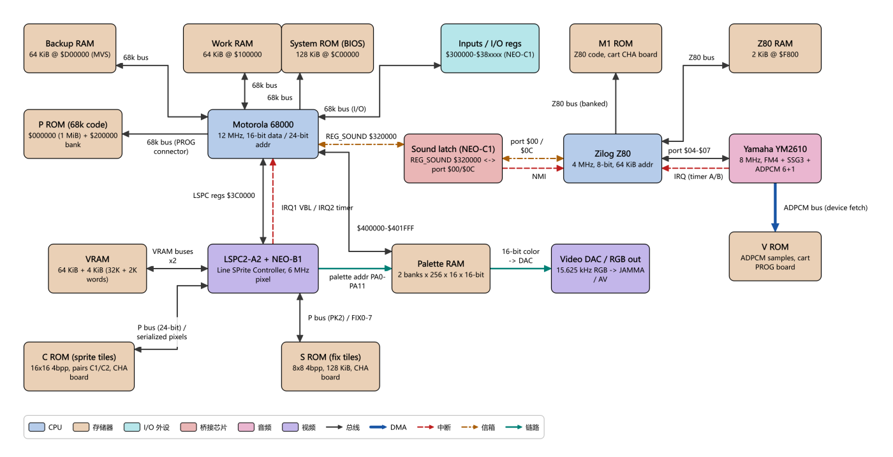
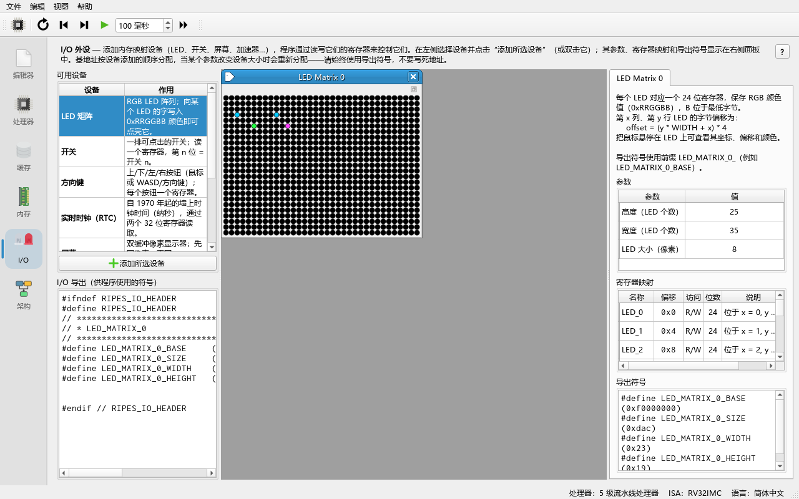

# 12 Neo Geo 导览：三条总线、无帧缓冲与 sound latch

> **你将学到**
>
> - Neo Geo 为什么是"80 年代末街机架构"的代表，它的三条总线各管什么；
> - 68000 与 Z80 各自的内存映射，以及为什么 68000"看不到"图形数据；
> - 没有帧缓冲（framebuffer）时，一帧画面是怎样逐扫描线合成出来的；
> - 两颗 CPU 之间唯一的通信通道：8-bit sound latch + NMI；
> - 如何在架构浏览器里逐步播放三条内置数据流；
> - 如何在 RISC-V 模拟器里运行 `examples/assembly/neogeo_mailbox.s`，用 LED 矩阵观察信箱协议。
>
> **前置条件**
>
> - 会使用 **Architecture** 标签页（第 11 章）；
> - 会加载并运行一个汇编示例、会在 **I/O** 标签页添加外设（第 02、08 章）；
> - 了解"中断""MMIO 寄存器"的基本含义（第 08 章）。
>
> 本章的硬件数据来自 `docs/arch/neogeo.md`（以 NeoGeo Development Wiki 为准）。文中 `$` 前缀表示十六进制。

---

## 12.1 历史背景

Neo Geo 是 SNK 在 1990 年推出的平台，同一套硬件既做成街机基板 **MVS**（Multi Video System），也做成家用机 **AES**（Advanced Entertainment System），**同一块卡带可以插在两者上运行**。在家用机普遍只有 8/16-bit 能力的年代，它把"街机级"的大 sprite、多声道采样音效直接带进了客厅，《拳皇》《合金弹头》《侍魂》等系列都在这台机器上诞生。两者的区别只在机柜 I/O、DIP 开关、backup RAM 和板载 fix 图形复用器等外围部分。

从体系结构角度看，Neo Geo 是一台典型的"80 年代末街机"：**主 CPU（Motorola 68000）负责游戏逻辑，音频 CPU（Zilog Z80）独立跑音效驱动，显示芯片直接从卡带 ROM 取图形**。它没有帧缓冲、没有 DMA、两颗 CPU 之间也没有共享内存——所有这些"缺失"都是在 1990 年 DRAM 昂贵、ROM 便宜的条件下有意做出的取舍。理解它，可以帮你看清现代 SoC 里统一内存、DMA、门铃这些机制分别在解决什么问题。

## 12.2 在架构浏览器里打开 Neo Geo

**做一步**：切到 **Architecture** 标签页（架构），在 **Topology**（拓扑）下拉框中选择 **SNK Neo Geo (MVS/AES)**，然后按工具栏 **Fit to view**（适配窗口）。

**看到什么**：18 个方块、21 条连线。大致布局是：

- 上排：Backup RAM、Work RAM、System ROM (BIOS)、Inputs / I/O regs，以及右侧音频部分的 M1 ROM、Z80 RAM；
- 中排：P ROM、**Motorola 68000**、**Sound latch (NEO-C1)**、**Zilog Z80**、**Yamaha YM2610**；
- 下排：VRAM、**LSPC2-A2 + NEO-B1**、Palette RAM、Video DAC，以及 V ROM；
- 最下：C ROM（sprite 图形）、S ROM（fix 图形）。



**为什么**：这个布局刻意把三条总线分在三个区域：68000 周围、Z80 周围、LSPC 周围。看图时先找到这三颗"主控"芯片，再看它们各自连着什么。

## 12.3 三条互不相通的总线

| 总线 | 主控 | 连着的部件 | 在图上 |
|---|---|---|---|
| **68000 主总线**（16-bit 数据 / 24-bit 地址） | Motorola 68000，12 MHz | P ROM、Work RAM、BIOS、Backup RAM、I/O 寄存器、Palette RAM、LSPC 寄存器、sound latch | 68000 周围的深灰实线，标签 `68k bus`、`$400000-$401FFF`、`LSPC regs $3C0000` |
| **Z80 音频总线**（8-bit） | Zilog Z80，4 MHz | M1 ROM、Z80 RAM、YM2610（端口）、sound latch（端口） | Z80 周围，标签 `Z80 bus`、`port $04-$07` |
| **LSPC 图形总线** | LSPC（Line SPrite Controller） | VRAM（两条独立总线）、C ROM、S ROM、Palette RAM 地址 | LSPC 周围，标签 `VRAM buses x2`、`P bus ...`、`palette addr ...` |

另外 YM2610 还有一条自己的 **ADPCM 总线**直接读 V ROM（图中蓝色粗线 `ADPCM bus (device fetch)`），这是整台机器里唯一"由外设主动取数据"的通路。

**做一步**：单击 **C ROM (sprite tiles)** 方块，读右侧 **Details**。

**看到什么**：说明的最后一句是"68000 完全不可见"。

**为什么**：C ROM（sprite 图形）、S ROM（fix 图形）、V ROM（采样）都不在 68000 的地址空间里。68000 只能通过 VRAM 中的**索引**（tile 编号、palette 编号）告诉 LSPC "去哪里取"。三条总线物理分离，所以 68000 取指、Z80 取指、LSPC 取图形、YM2610 取采样可以**同时进行，互不争用**；代价是 CPU 无法生成或修改图形。

## 12.4 内存映射

### 68000 地址空间（卡带系统）

| 起始 | 结束 | 名称 | 说明 |
|---|---|---|---|
| `$000000` | `$0FFFFF` | P ROM bank 1 | 向量表 + 程序固定段（卡带 PROG board） |
| `$100000` | `$10F2FF` | Work RAM | 用户工作 RAM（`$10F300`–`$10FFFF` 由 BIOS 保留） |
| `$200000` | `$2FFFFF` | P ROM bank 2 / PORT | 第二窗口；>2 MiB 的游戏在此写入做 bankswitch |
| `$300000` | `$3FFFFF` | I/O | 输入、输出、系统寄存器、LSPC 寄存器 |
| `$400000` | `$401FFF` | Palette RAM | 当前 bank 的调色板（8 KiB） |
| `$800000` | `$BFFFFF` | Memory card | 记忆卡 |
| `$C00000` | `$C1FFFF` | System ROM | BIOS，128 KiB |
| `$D00000` | `$D0FFFF` | Backup RAM | 仅 MVS |

本章最常用的几个寄存器：

| 地址 | 名称 | 读 | 写 |
|---|---|---|---|
| `$300000` | REG_P1CNT | P1 摇杆/按键（低有效） | — |
| `$300001` | REG_DIPSW | DIP 开关 | **踢 watchdog** |
| `$320000` | REG_SOUND | **Z80 的应答字节** | **发命令给 Z80（触发 NMI）** |
| `$3C0000` | REG_VRAMADDR | 读 VRAM | 设置 VRAM 地址 |
| `$3C0002` | REG_VRAMRW | 读 VRAM | 写 VRAM，写后地址 += REG_VRAMMOD |
| `$3C0004` | REG_VRAMMOD | 读模数 | 设置自动增量 |
| `$3C000C` | REG_IRQACK | — | 应答 VBL / timer / IRQ3 |

注意 **VRAM 不在 68000 地址空间里**：只能通过 `$3C0000` 起的三个 LSPC 寄存器"设地址、写数据、自动增量"间接访问。68000 的中断：IRQ1 = VBlank（向量 `$64`），IRQ2 = LSPC 定时器（`$68`），IRQ3 = 冷启动；三者都由 LSPC 产生，必须写 REG_IRQACK 应答。

### Z80 地址空间与端口

| 范围 | 内容 |
|---|---|
| `$0000`–`$7FFF` | M1 ROM 固定段（32 KiB） |
| `$8000`–`$BFFF` / `$C000`–`$DFFF` / `$E000`–`$EFFF` / `$F000`–`$F7FF` | 四个 bank 窗口（16/8/4/2 KiB） |
| `$F800`–`$FFFF` | Z80 工作 RAM（2 KiB） |

| 端口 | 读 | 写 |
|---|---|---|
| `$00` | 读 68000 写入的命令，**同时应答 NMI** | 把命令锁存清零 |
| `$04`–`$07` | YM2610 状态/数据 | 写 YM2610 地址/数据 |
| `$08` | 设置 `$F000` 窗口 bank | **使能 NMI** |
| `$09`–`$0B` | 设置其余窗口 bank | — |
| `$0C` | — | **写应答字节给 68000** |
| `$18` | — | 禁止 NMI |

一个有趣的细节：Z80 切 bank 靠"**读**端口"而不是写端口——`in a,(c)` 时 B 寄存器出现在地址总线高 8 位，NEO-ZMC 芯片从地址里捕获 bank 号，省掉了数据线引脚。

**做一步**：在图中单击 **VRAM**，再单击 **Zilog Z80**，对照右侧属性表与上面两张表。

## 12.5 没有帧缓冲：一帧是怎样画出来的

现代显卡把整帧像素画进显存里的帧缓冲，再扫描输出。Neo Geo **没有帧缓冲**：每条扫描线都是在显示前一瞬间**实时合成**的。

### 构成画面的三样东西

- **Sprite（精灵）**：每个 sprite 是 **16 px 宽、1–32 个 tile 高（最高 512 px）的竖条**，tile 为 16×16、4 bpp，存在 C ROM 里。VRAM 中有 448 个槽，硬件每帧处理 381 个，**每条扫描线最多 96 个**，超出的直接不画。Neo Geo 没有背景 tile map 层，背景也是由许多相邻 sprite 竖条拼成，通过 sticky bit 链在一起整体滚动。sprite 只能缩小（shrink），不能放大。
- **Fix layer**：40×32 个 8×8 的 tile（可见 28 行），存在 S ROM 里，**永远在所有 sprite 之上**，用来画分数、血条、文字。
- **Palette RAM**：2 个 bank × 256 个调色板 × 16 色 × 16-bit。像素本身只是 4-bit 颜色索引，加上 sprite 的 palette 号组成 12-bit 地址查表；每个调色板的颜色 0 是透明。

VRAM（64 KiB + 4 KiB）里**只存属性和索引**：SCB1（tile 编号、palette、翻转）、SCB2（shrink）、SCB3（Y、sticky、高度）、SCB4（X）、fix map，以及 LSPC 自己写的 active sprite list。**VRAM 里没有一个像素。**

### 逐扫描线流水

1. **前一行期间**：LSPC 在"快"VRAM 中扫描所有 sprite 的 SCB3，把 Y 范围覆盖下一行的 sprite 编号记入 active sprite list（最多 96 个）。
2. **本行**：对 list 中每个 sprite，算出要取的 tile 和 tile 内行号，读 SCB1 得到 tile 编号与 palette，在 P bus 上给出 C ROM 地址；一对 C ROM 返回 32 bit（8 像素 × 4 bitplane），NEO-ZMC2 串行化成像素。
3. **NEO-B1** 把不透明像素写进**行缓冲（line buffer）**，后画的覆盖先画的（编号大的 sprite 在上）；最后写 fix layer，所以 fix 永远在最上层。
4. **输出**：行缓冲成对交替，一个在写，另一个以 6 MHz 逐像素读出 palette 地址 → Palette RAM → 16-bit 颜色 → DAC → RGB。没被覆盖的像素显示 backdrop 色。

一条扫描线 384 像素 = 1536 个主时钟（64 µs），一帧 264 行（224 行可见）≈ 59.19 Hz。"每行 96 个 sprite"可以粗略理解为带宽上限：1536 ÷ 96 = 16 个主时钟/sprite（这是 `docs/arch/neogeo.md` 给出的粗略估算）。超出时硬件**丢 sprite** 而不是掉帧。

**为什么这样设计**：1990 年 DRAM 很贵，一帧 320×224 的帧缓冲要占大量内存；把图形留在 ROM 里、只缓存一两行，就能用 4 KiB 的快 VRAM 驱动 381 个 sprite。现代移动 GPU 的 tile-based 渲染也是"按小块合成、少访问外部内存"的同一思路。

## 12.6 68000 与 Z80 怎样对话：sound latch + NMI

两颗 CPU 之间**没有共享内存**。唯一的通道是 NEO-C1 芯片里的两个 8-bit 锁存器和一根 NMI 线：

```
   68000                       NEO-C1 (latch)                    Z80
     │  move.b #cmd, REG_SOUND     │                               │
     │────────────────────────────►│ cmd latch = cmd               │
     │                             │──────── /NMI ────────────────►│ (若 port $08 已使能)
     │                             │        in a,($00)             │ 读命令，同时应答 NMI
     │                             │◄──────────────────────────────│
     │                             │        out ($0C),a            │ 处理后写应答
     │                             │ reply latch = cmd | $80       │◄──
     │  move.b REG_SOUND, d0       │                               │
     │◄────────────────────────────│ (68000 只能轮询，没有中断)     │
```

要点：

- **方向不对称**：68000→Z80 有中断（NMI），Z80→68000 没有，68000 只能**轮询** REG_SOUND。
- **深度只有 1 字节**：68000 连续写两次而 Z80 还没读，第一条命令就被**覆盖**丢失。所以游戏通常每帧只发一条命令，或等到应答再发下一条。
- **命令的含义由卡带的 Z80 驱动定义**，只有三条由 BIOS 约定：`$01` 准备切换卡槽（必须应答，否则 MVS 显示 "Z80 ERROR"）、`$02` 播放 eyecatcher 音乐（不应答）、`$03` Z80 软复位（不应答）。常见约定是 Z80 回显命令并置 bit 7（`cmd | $80`）作为 ACK。

在图上，这条通道由 **Sound latch (NEO-C1)** 方块（`bridge`，红/粉色）和三条线组成：68000 侧的 `REG_SOUND $320000`（点划线，mailbox）、Z80 侧的 `port $00 / $0C`（mailbox）、以及红色虚线 `NMI`（irq）。

## 12.7 内置数据流逐步讲解

Neo Geo 拓扑有三条 flow。下面每张表的"高亮连线"一列给的是连线标签，方便你和屏幕对照。

### Flow 1：68000 -> Z80 音效命令（sound latch + NMI + 应答），7 步

| 步 | 高亮方块 | 高亮连线 | 发生了什么 |
|---|---|---|---|
| 1 | 68000 | — | 游戏逻辑决定播放音效，68000 准备命令字节 |
| 2 | 68000、Sound latch | `REG_SOUND $320000` | `move.b #cmd, REG_SOUND`；命令进入 1 字节锁存，旧命令若未取走会被覆盖 |
| 3 | Sound latch、Z80 | `NMI` | 锁存写入拉低 /NMI（前提：Z80 已 `out ($08)` 使能），Z80 跳到 `$0066` |
| 4 | Z80、Sound latch | `port $00 / $0C` | NMI 处理程序 `in a,($00)` 取命令并应答 NMI；可选 `out ($00)` 清锁存 |
| 5 | Z80、M1 ROM、YM2610、V ROM | `Z80 bus (banked)`、`port $04-$07`、`ADPCM bus (device fetch)` | Z80 查 M1 ROM 里的命令表，写 YM2610 寄存器触发采样或 FM 音序；YM2610 随后自己经 ADPCM 总线从 V ROM 读采样 |
| 6 | Z80、Sound latch | `port $00 / $0C` | `out ($0C),a` 写应答 `cmd | $80`，**不会**中断 68000 |
| 7 | 68000、Sound latch | `REG_SOUND $320000` | 68000 需要时轮询 REG_SOUND；BIOS 的 `$01` 必须等到应答 |

**做一步**：在第 5 步注意蓝色粗线 `ADPCM bus (device fetch)` 也亮了——数据搬运由 YM2610 自己完成，不经过 Z80。再回到第 3 步，把鼠标放在红色虚线 `NMI` 上，tooltip 显示 `Trigger: 68k write to REG_SOUND`、`Vector: $0066`。

### Flow 2：一帧的渲染：VBL -> 写 VRAM -> LSPC 逐扫描线合成 -> DAC，8 步

| 步 | 高亮方块 | 高亮连线 | 发生了什么 |
|---|---|---|---|
| 1 | LSPC、68000 | `IRQ1 VBL / IRQ2 timer` | 进入 VBlank，LSPC 发 IRQ1；68000 踢 watchdog、写 REG_IRQACK |
| 2 | 68000、Inputs、Work RAM | `68k bus (I/O)`、`68k bus` | 读输入，在 Work RAM 中跑游戏逻辑，算出每个 sprite 的 X/Y/tile/palette |
| 3 | 68000、LSPC、VRAM | `LSPC regs $3C0000`、`VRAM buses x2` | 经 REG_VRAMADDR/RW/MOD 逐 word 写 SCB3、SCB4、SCB2、SCB1；**没有 DMA** |
| 4 | 68000、Palette RAM、Sound latch | `$400000-$401FFF`、`REG_SOUND $320000` | 更新调色板（VBlank 内写不会闪烁），发本帧音效命令，退出中断 |
| 5 | LSPC、VRAM | `VRAM buses x2` | 可见区开始；LSPC 扫描 SCB3，建立每行 ≤96 个的 active sprite list |
| 6 | LSPC、VRAM、C ROM | `VRAM buses x2`、`P bus (24-bit) / serialized pixels` | 读 SCB1 得到 tile 号，从 C ROM 取 32 bit，NEO-ZMC2 串行化成像素 |
| 7 | LSPC、VRAM、S ROM | `VRAM buses x2`、`P bus (PK2) / FIX0-7` | NEO-B1 把 sprite 像素写进行缓冲；LSPC 再读 VRAM 中该行的 fix map，从 S ROM 取 fix tile 覆盖在最上层 |
| 8 | LSPC、Palette RAM、Video DAC | `palette addr PA0-PA11`、`16-bit color -> DAC` | 另一个行缓冲以 6 MHz 输出 palette 地址 → 颜色 → DAC → RGB；224 行后回到第 1 步 |

**做一步**：在第 3 步单击 **VRAM**，看属性 `Access: via $3C0000-$3C0004`；再看第 6 步时右侧自动显示的 LSPC 详情。

**为什么**：第 1–4 步是 **CPU 的工作**（每帧一次，在 VBlank 里），第 5–8 步是**显示硬件的工作**（每条扫描线重复一次）。两者通过 VRAM 中的"索引"解耦——这和 GPU 的命令缓冲、NPU 的描述符环是同一种思想：CPU 写描述，硬件按描述干活。

### Flow 3：卡带 ROM 读取路径：PROG board 与 CHA board 的并行总线，6 步

| 步 | 高亮方块 | 高亮连线 | 发生了什么 |
|---|---|---|---|
| 1 | 68000、P ROM | `68k bus (PROG connector)` | 68000 从 `$000000`–`$0FFFFF` 取指 |
| 2 | 68000、P ROM | `68k bus (PROG connector)` | 访问 `$200000`–`$2FFFFF`；大游戏写 PORT 区做 1 MiB 为单位的 bankswitch |
| 3 | Z80、M1 ROM | `Z80 bus (banked)` | 同时 Z80 从 CHA board 的 M1 ROM 取指，NEO-ZMC 用捕获的 bank 号拼地址 |
| 4 | YM2610、V ROM | `ADPCM bus (device fetch)` | YM2610 按自己的节奏从 PROG board 的 V ROM 读采样，CPU 不参与 |
| 5 | LSPC、C ROM | `P bus (24-bit) / serialized pixels` | LSPC 每行输出 C ROM 地址，NEO-273 锁存，一对 C ROM 并行出 32 bit |
| 6 | LSPC、S ROM | `P bus (PK2) / FIX0-7` | 同一 P bus 分时输出 S ROM 地址，经 8-bit FIX 总线返回 fix 像素 |

**为什么**：卡带有两块 PCB：PROG board（P ROM、V ROM）和 CHA board（C ROM、S ROM、M1 ROM），通过独立连接器挂在不同总线上。四个"读者"（68000、Z80、YM2610、LSPC）各读各的 ROM，可以完全并行。

## 12.8 动手实验：在 RISC-V 上模拟 sound latch 协议

示例程序 `examples/assembly/neogeo_mailbox.s`（**File → Load Example...** 菜单中的 `neogeo_mailbox.s`）用一颗 RISC-V 核**协作式多任务**地模拟两颗 CPU 和 NEO-C1 锁存器。

### 它模拟了什么

| 程序里的东西 | 对应的真实硬件 |
|---|---|
| `main_task` | 68000：按脚本发送命令、轮询应答 |
| `sound_task` | Z80：NMI 处理程序（读命令、清锁存、推入软件 FIFO）+ 主循环（处理命令、写应答） |
| `cmd_latch` / `reply_latch` | NEO-C1 中的命令锁存、应答锁存 |
| `nmi_line` / `nmi_enabled` | Z80 的 /NMI 线、`out ($08)` 设置的 NMI 使能 |
| `hw_write_reg_sound` | "68000 写 REG_SOUND"这一硬件行为：无条件覆盖锁存，若使能则拉 NMI |
| `fifo`（4 项） | Z80 驱动在自己 RAM 里维护的命令队列 |

脚本 `script` 依次发送：`$03`（软复位，不等应答）、`$01`（准备切槽，等应答）、`$20`（等应答）、`$21`（发出不管）、`$22` 与 `$23` **连发**（burst，中间不让出 CPU）、`$7F`（等应答）。Z80 每条命令"处理"3 个时间片；`$02`、`$03` 不应答，其余应答 `cmd | $80`。68000 等待应答的超时是 50 次轮询，超时打印 "Z80 ERROR"。

### 怎样运行

1. **先添加外设**：切到 **I/O** 标签页，在 **Available devices**（可用设备）列表中双击 **LED Matrix**（LED 矩阵）。默认 35 列 × 25 行即可（程序至少需要 12 列 × 8 行）。必须先添加，因为程序用到了 `LED_MATRIX_0_BASE`、`LED_MATRIX_0_WIDTH` 两个符号，没有这个外设就汇编不过。
2. **加载程序**：**File → Load Example...**，选择 `neogeo_mailbox.s`。编辑器切到 Assembly 模式并自动汇编；左下没有报错即可。
3. **运行**：在工具栏点击 **Run**（运行）。在默认的 5 级流水线处理器上，程序约在 24.9 万个周期后执行 `ecall` 退出（实测：249,017 周期、128,732 条指令、CPI 1.93；具体周期数取决于处理器模型）。
4. **观察**：控制台（Console）里出现协议日志；切到 **I/O** 标签页看 LED 矩阵。想看 LED 一帧一帧变化，可以用 **Auto clock (F6)**（自动时钟，工具栏上紧跟在 **Clock (F5)** 之后的按钮；旁边的输入框设置间隔，单位毫秒）慢速运行，或把 `delay` 中的 `2000` 改小后单步。



### 控制台里看到什么

`print_hex` 使用 Ripes 的 PrintIntHex 系统调用（a7 = 34），输出形如 `0x0081`。根据代码推算，日志的开头是：

```
Z80 : boot, out ($08) -> NMI enabled
68k : move.b #$0x0003, REG_SOUND
Z80 : NMI -> in a,($00) = $0x0003
Z80 : processing $0x0003
68k : move.b #$0x0001, REG_SOUND
Z80 : NMI -> in a,($00) = $0x0001
Z80 : no reply for this command
Z80 : processing $0x0001
Z80 : out ($0C) <- $0x0081
68k : REG_SOUND == $0x0081 (ack)
...
```

（上面是按代码逐行推算的结果，实际运行时请核对。）几个值得注意的地方：

- **命令 `$22` 永远不会出现在 Z80 的日志里**。日志会显示 `68k : (burst, no yield)`，紧接着 68000 又写了 `$23`，锁存被覆盖；Z80 下一次读到的是 `$23`。这就是"1 字节深度"的后果。
- 发送 `$23` 后，68000 在等 `$A3`，但应答锁存里先出现的是 `$A1`（上一条 `$21` 的应答）。68000 继续轮询，直到看到 `$A3`。应答锁存**不会自动清零**，所以 68000 必须比较值而不是只看"有没有数据"。
- 全部完成后打印 `--- script finished ---` 并退出。

### LED 矩阵显示什么

| 位置 | 颜色 | 含义 |
|---|---|---|
| 第 1 行，第 2–9 列 | 黄 | `cmd_latch` 的 8 个 bit（第 2 列是 bit 7） |
| 第 3 行，第 2–9 列 | 青 | `reply_latch` 的 8 个 bit |
| 第 5 行第 2 列 | 红 | NMI 挂起 |
| 第 5 行第 5 列 | 绿 | NMI 已使能 |
| 第 5 行第 8 列 | 蓝 | Z80 忙（正在处理命令） |
| 第 5 行第 11 列 | 紫 | 68000 正在等应答 |
| 第 7 行，第 2–5 列 | 白 | Z80 软件 FIFO 的占用数 |

（行、列都从 0 开始计数。）

**为什么第 1 行和红灯几乎总是暗的**：主循环每一轮按 `main_task → sound_task → draw_leds` 的顺序执行。68000 写入锁存后，同一轮里 Z80 就会响应 NMI、读出并清零锁存，等到 `draw_leds` 时锁存已经是 0。只有单步执行（在 `draw_leds` 之外停下）或者关掉 NMI 时才能看到命令停留在锁存里。相反，第 3 行的应答值会一直保持，直到被下一次应答覆盖。蓝灯和紫灯会交替亮起，正对应"Z80 在忙、68000 在等"的时间段。

## 12.9 练习

1. **数总线**：在 flow "一帧的渲染" 中，哪几步高亮了 `VRAM buses x2`？为什么 VRAM 在一帧里既被 68000 写、又被 LSPC 读，却不需要 DMA？
2. **找不对称**：在拓扑中找出所有与 Sound latch 相连的连线，写出它们的种类和方向。68000 怎样知道 Z80 已经处理完命令？
3. **丢失的命令**：在 `neogeo_mailbox.s` 中把 `$22` 那一行的 flags 从 `2` 改为 `1`（等待应答），重新运行。日志有什么变化？为什么？
4. **关掉 NMI**：在 `sound_init` 里把 `li t1, 1` 改为 `li t1, 0`（相当于 Z80 没有执行 `out ($08)`）。预测并验证：控制台会打印什么？LED 第 1 行会怎样？
5. **没有帧缓冲的代价**：如果某条扫描线上有 120 个 sprite 重叠，会发生什么？和"帧率下降"有什么不同？
6. **对照现代系统**：Neo Geo 的 sound latch 和第 10 章 NPU 的门铃（写 TAIL）有什么共同点和不同点？

### 参考答案

1. 第 3、5、6、7 步。第 3 步是 68000 **经 LSPC 寄存器**逐 word 写 VRAM（CPU 自己搬，所以不需要 DMA，但要占用 CPU 时间并遵守 12/16 周期间隔）；第 5、6、7 步是 LSPC 自己读 VRAM（SCB3、SCB1 和 fix map）。VRAM 只存几 KiB 的属性和索引，数据量小，逐 word 写得过来；真正的大数据（像素）一直在 ROM 里，从不搬运。
2. `REG_SOUND $320000`（mailbox，双向，68000↔latch）、`port $00 / $0C`（mailbox，双向，latch↔Z80）、`NMI`（irq，latch→Z80，单向）。68000 侧没有中断线，只能轮询 REG_SOUND，直到读到约定的 `cmd | $80`。
3. `$22` 发出后 68000 进入等待，不再立即连发 `$23`；Z80 会读到 `$22`、处理并应答 `$A2`，然后才发 `$23`。两条命令都被处理。原因：等待应答 = 给 Z80 读锁存的机会，1 字节锁存不再被覆盖。
4. `hw_write_reg_sound` 只写锁存不拉 NMI，Z80 永远不会读命令。每条需要应答的命令都会轮询 50 次后打印 `68k : timeout waiting for reply -> Z80 ERROR`；LED 第 1 行会**一直亮着**最近写入的命令（无人清零），绿灯（第 5 行第 5 列）熄灭。这正是 MVS 上 Z80 驱动不响应时 BIOS 显示 "Z80 ERROR" 的情形。
5. 只有前 96 个 sprite（按扫描 SCB3 的顺序进入 list）在这一行被画出，其余 24 个在这一行**消失**（闪烁/缺块），但帧率不变。有帧缓冲的系统画不完时会推迟出帧（掉帧）；Neo Geo 的时序是硬性的，只能"丢 sprite"。
6. 共同点：都是"一次寄存器写 = 提交 + 唤醒"，数据量极小。不同点：sound latch 只有 1 字节、无队列、命令本身就在锁存里，反向没有中断；NPU 的门铃只是一个指针，真正的任务在内存中的描述符环里（可以排很多项），完成时有中断（IRQ_STATUS）可选。

## 12.10 小结

- Neo Geo 有三条互不相通的总线：68000 主总线、Z80 音频总线、LSPC 图形总线；图形和采样数据 CPU 不可见；
- 没有帧缓冲：LSPC 每条扫描线从 C/S ROM 取 tile，经 NEO-B1 行缓冲和 Palette RAM 输出；每行最多 96 个 sprite；
- 没有 DMA：68000 通过 `$3C0000` 的三个寄存器逐 word 写 VRAM；
- 68000→Z80 通信只有 1 字节 sound latch + NMI，反向只能轮询；
- `neogeo_mailbox.s` 在 RISC-V 上复现了这个协议，包括 burst 写导致的命令丢失；
- 下一章的 PS3/Cell 把"信箱 + 显式数据搬运"推向了另一个极端。
