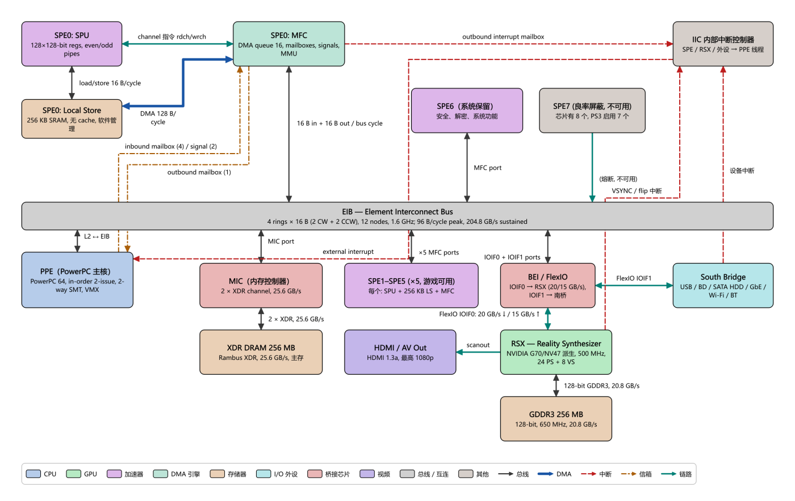

# 13 PS3 / Cell 导览：PPE、SPE、显式 DMA 与双缓冲

> **你将学到**
>
> - Cell Broadband Engine 的"1 个通用核 + 8 个协处理核"结构，PPE 与 SPE 的分工；
> - SPE 的 Local Store（本地存储）为什么不是 cache，MFC DMA 如何搬运数据、如何用 tag 等待完成；
> - mailbox 与 signal notification 这两种轻量通知机制；
> - EIB 环形总线、XDR 主存、RSX GPU 与 FlexIO 链路，以及"Cell 读显存极慢"的不对称；
> - 为什么 SPE 程序几乎都要做双缓冲（double buffering）；
> - 如何逐步播放 PS3 拓扑中的四条数据流，并在 Ripes 中运行 `examples/C/spe_double_buffer.c`。
>
> **前置条件**
>
> - 会使用 **Architecture** 标签页（第 11 章）；建议先读第 12 章（Neo Geo 的 mailbox）；
> - 运行 C 示例需要已配置好 RISC-V C 编译器（第 05 章）；
> - 了解 cache、DMA、中断的基本概念（第 07、08、10 章）。
>
> 本章数据来自 `docs/arch/ps3_cell.md`（IBM Cell 编程手册、IBM JRD 论文、Hot Chips 演示稿等）。原文标注为二手来源的数字，本章同样标注。

---

## 13.1 历史背景

PlayStation 3 于 2006 年 11 月发售，核心是 Sony、Toshiba、IBM（STI 联盟）从 2001 年起合作研发的 **Cell Broadband Engine（Cell BE）**，主频 3.2 GHz。它是消费级产品中第一次把"一个通用核心 + 一组显式管理本地存储的向量协处理器"这种**异构多核**结构推向大众；图形部分则是 NVIDIA 定制的 **RSX** GPU（G70/NV47 派生）。

Cell 的设计哲学可以浓缩为三句话：**把控制与计算分离**（PPE 管调度、SPE 做计算）；**用软件管理的 Local Store 取代 cache**（数据必须由程序员显式 DMA 进出）；**用高带宽环形总线 EIB 把一切连起来**。它在理论峰值上非常强，但以难编程著称——这正是它值得学习的原因：今天 GPU 的 shared memory + 异步拷贝、游戏引擎的 job system，都能在 Cell 身上找到源头。

| 项目 | 数值 |
|---|---|
| CPU | Cell BE，3.2 GHz |
| 通用核 | 1 × PPE（64-bit PowerPC，顺序双发射，2-way SMT） |
| 协处理核 | 8 × SPE（物理）；PS3 启用 7 个，其中 1 个被系统保留，**游戏可用 6 个** |
| 片上互连 | EIB，4 条 16 B 宽的环 |
| 主存 | 256 MB XDR DRAM，25.6 GB/s |
| GPU | RSX，500 MHz |
| 显存 | 256 MB GDDR3，128-bit，20.8 GB/s |
| CPU↔GPU | FlexIO（IOIF0），Cell→RSX 20 GB/s，RSX→Cell 15 GB/s |

## 13.2 在架构浏览器中打开 PS3

**做一步**：在 **Architecture** 标签页的下拉框中选择 **Sony PlayStation 3 / Cell Broadband Engine**，按 **Fit to view**。

**看到什么**：16 个方块、21 条连线，大致分层为：

- 上部：**SPE0** 被拆成三个方块——`SPE0: SPU`、`SPE0: Local Store`、`SPE0: MFC`，用来展示 SPE 内部；右侧是 `SPE6（系统保留）`、`SPE7 (良率屏蔽, 不可用)` 和 `IIC 内部中断控制器`；
- 中间：横贯全图的灰色宽条 **EIB — Element Interconnect Bus**（`kind: bus`，画成方块的总线）；
- 下部：`PPE`、`MIC`、`SPE1–SPE5 (×5, 游戏可用)`、`BEI / FlexIO`、`South Bridge`；
- 最下：`XDR DRAM 256 MB`、`HDMI / AV Out`、`RSX`、`GDDR3 256 MB`。



**为什么**：真实芯片有 8 个 SPE，全画出来会非常拥挤。拓扑只把 SPE0 展开画内部结构，其余 5 个游戏可用的 SPE 合成一个方块，另外两个（系统保留、熔断）单独画出，以说明"8 → 7 → 6"的来历。

## 13.3 PPE 与 SPE

**做一步**：依次单击 `PPE — Power Processing Element` 和 `SPE0: SPU`，对比右侧属性表。

| | PPE | SPE（SPU） |
|---|---|---|
| ISA | 64-bit PowerPC + VMX/AltiVec | 独立的 SPU ISA |
| 发射 | 顺序双发射，约 23 级流水，2-way SMT | 顺序双发射：even pipeline（算术）+ odd pipeline（访存、shuffle、分支、channel） |
| 寄存器 | 通用 PowerPC 寄存器 + VMX | **128 个 128-bit 统一寄存器** |
| 存储层次 | L1 32 KB I + 32 KB D，L2 512 KB | **没有 cache**，只有 256 KB Local Store |
| 分支 | 有预测 | **没有分支预测器**，用 branch hint 指令；错预测约 18 周期 |
| fp32 峰值 | 25.6 GFLOPS（VMX） | 每个 25.6 GFLOPS（4 路 SIMD × FMA × 3.2 GHz） |
| 职责 | 跑 Hypervisor、GameOS、游戏主线程，派发任务 | 做数据并行计算：顶点、物理、音频、解码、后处理 |

**为什么**：PPE 单线程性能平平，这不是失误，而是面积预算被优先给了 8 个 SPE。开发者的经验是"把所有能向量化的东西都搬到 SPE，PPE 只做必须串行的部分"。

还要注意 SPE 是**完整的独立核**：它有自己的 PC、自己的程序、可以独立运行很久；PPE 只是启动它、给它发消息。这和 GPU 的 warp（32 个 lane 锁步执行同一指令，见第 09 章）完全不同。

**8 → 7 → 6**：单击 `SPE7` 与 `SPE6` 读详情。芯片物理上有 8 个 SPE；为提高 90 nm 工艺的良率，PS3 只启用 7 个（有一个坏了的芯片也能用）；其中 1 个被 Hypervisor 独占，运行在 isolation mode 中做解密、签名验证等安全功能，游戏看不见。所以游戏可用 6 个。

## 13.4 Local Store 与 MFC DMA

### Local Store 不是 cache

**做一步**：单击 `SPE0: Local Store`。

SPU 的所有 load/store 指令**只能访问自己的 256 KB Local Store（LS）**——SPU 根本没有通向主存的 load/store 指令。代码、数据、栈、DMA 缓冲区全部挤在这 256 KB 里。LS：

- 没有标签、没有缺失、没有自动填充、没有保护（越界就回绕）；
- SPU 访问每周期 16 B，DMA 访问每周期 128 B；单端口，优先级 DMA > load/store > 取指；
- 同时映射在全局有效地址空间里，所以 PPE 和其他 SPE 可以 DMA 到它（LS→LS 直接传输）。

### MFC：SPE 通往外界的唯一通道

**做一步**：单击 `SPE0: MFC`（`kind: dma`，青绿色），读属性表。

| 资源 | 规格 |
|---|---|
| DMA 命令队列 | SPU 发起 16 项 + PPE 经 MMIO 代发（proxy）8 项 |
| 单条命令 | 1/2/4/8 B 或 16 B 的倍数，**最大 16 KB**；128 B 对齐性能最佳 |
| DMA list | `getl`/`putl` 一条命令带最多 2048 个元素，做 scatter/gather |
| Tag group | 每条命令带 5-bit tag（0–31）；写 tag 掩码，再读 tag 状态等待完成 |
| MMU | MFC 内有 SLB/TLB，DMA 使用的是**有效地址（虚拟地址）**，受页表保护 |

SPU 通过 **channel 指令**（`rdch`/`wrch`/`rchcnt`）跟 MFC 对话，图上是 SPU 与 MFC 之间的青色 `link` 线 `channel 指令 rdch/wrch`。MFC 与 LS 之间是蓝色粗线 `DMA 128 B/cycle`（`dma`）。

一次 DMA 在 C 语言里写作（`spu_mfcio.h`）：

```c
mfc_get(ls_buf, ea, size, tag, 0, 0);   /* 主存 -> LS，立即返回 */
mfc_write_tag_mask(1 << tag);           /* 选择要等的 tag 组 */
mfc_read_tag_status_all();              /* 阻塞直到这些 tag 的命令全部完成 */
```

**为什么**："DMA 发出即返回、之后再等 tag"是关键：发出和等待之间 SPU 可以继续算别的东西，这就是 13.7 节双缓冲的基础。DMA 完成**不会**自动通知 SPU，必须主动等 tag（或打开 MFC 事件）。

## 13.5 Mailbox 与 signal notification

大块数据走 DMA，**小消息**走 MFC 里的硬件寄存器：

| 机制 | 方向 | 深度 | 用法 |
|---|---|---|---|
| SPU inbound mailbox | PPE → SPU | 4 项 × 32-bit | PPE 经 MMIO 写；SPU `rdch SPU_RdInMbox`，空时阻塞 |
| SPU outbound mailbox | SPU → PPE | 1 项 | SPU 写，PPE 轮询读 |
| SPU outbound interrupt mailbox | SPU → PPE | 1 项 | SPU 写后向 PPE 发中断（经 IIC） |
| Signal notification 1/2 | 任意 → SPU | 2 个 32-bit 寄存器 | overwrite 或 **OR** 模式（多个发送者各置一位） |

在图上：`PPE → SPE0: MFC` 的点划线 `inbound mailbox (4) / signal (2)`，`MFC → PPE` 的点划线 `outbound mailbox (1)`，以及红色虚线 `outbound interrupt mailbox`（MFC → IIC）和 `external interrupt`（IIC → PPE）。

**为什么**：和第 12 章 Neo Geo 的 1 字节 sound latch 相比，Cell 的 mailbox 有了**深度**（inbound 4 项）、**双向**都有通知方式（含中断），但哲学相同：mailbox 只传"指针/编号"这类小东西，真正的数据通过共享内存 + DMA 传递。

## 13.6 EIB、XDR、RSX 与 FlexIO：带宽和一个著名的不对称

### EIB（Element Interconnect Bus）

**做一步**：单击灰色宽条 `EIB — Element Interconnect Bus`。

- **4 条 16 B 宽的单向环**（2 顺时针 + 2 逆时针），外加一条地址/命令总线；
- **12 个节点**：PPE、8 个 SPE、MIC、BEI 的 2 个端口（IOIF0/IOIF1）；每节点每总线周期 16 B 入 + 16 B 出；
- 总线时钟是核心的一半（1.6 GHz）；每环最多 3 个不重叠的并发传输，全片 12 个；
- 瞬时峰值 96 B/核心周期 = 307.2 GB/s，IBM 给出的**可持续峰值 204.8 GB/s**。

常见误区：204.8 GB/s 是**全片并发总和**，单个 SPE 的接口只有约 25.6 GB/s 每方向。

### XDR 主存与 MIC

`MIC` 驱动两条 32-bit Rambus XDR 通道（3.2 Gbps/pin），合计 **25.6 GB/s**。256 MB XDR 是"主存"：PPE 代码数据、SPE DMA 的源与目标、RSX 命令缓冲通常都在这里（GameOS 占用一部分，约 43–50 MB，随固件变化）。

### RSX、GDDR3 与 FlexIO

`RSX` 是独立芯片（500 MHz，24 个 pixel shader 管线、8 个 vertex shader，Shader Model 3.0），自带 256 MB GDDR3（128-bit，650 MHz，20.8 GB/s；早期公开规格为 700 MHz / 22.4 GB/s）。它通过 `BEI / FlexIO` 的 IOIF0 接到 Cell：Cell→RSX 20 GB/s，RSX→Cell 15 GB/s（实测约 15.8 / 11.9 GB/s）。IOIF1 接南桥，约 2.5 GB/s 每方向——**这个数字只有二手来源，未经 Sony 官方文档确认**。

### 不对称：谁能读谁的内存

**做一步**：把鼠标放在 `FlexIO IOIF0: 20 GB/s ↓ / 15 GB/s ↑` 连线上，或单击 `GDDR3 256 MB`，找到 `Cell 写 / 读` 属性。

| 方向 | 带宽 |
|---|---|
| Cell 读/写 XDR | ~25 GB/s |
| RSX 读 GDDR3（本地） | 20.8 GB/s |
| RSX 读 XDR（经 FlexIO） | ~15 GB/s |
| RSX 写 XDR | ~20 GB/s |
| Cell **写** GDDR3 | ~4 GB/s |
| Cell **读** GDDR3 | **~16 MB/s**（兆字节！） |

（这张表来自 Sony 2006 年开发者资料的公开转述，`docs/arch/ps3_cell.md` 引用的是 Wikipedia / psdevwiki 等二手来源。）

**为什么**：Cell 读 GDDR3 时，请求经 IOIF0 到 RSX，走 RSX 内部**非缓存、非流水**的 host 读路径，一次只能有一个未完成的读，每次都要等完整的往返延迟，所以只有 16 MB/s。写是 posted write，可以排队流水，所以有 4 GB/s。

工程后果：**永远不要让 Cell 读显存**。CPU 需要 GPU 的结果时，让 RSX 把结果写到 XDR（~20 GB/s），再由 Cell 从 XDR 读。这也是为什么很多 PS3 引擎让 SPE 当"GPU 的预处理器"：SPE→XDR→RSX 的路是通的，反方向却不是。

## 13.7 为什么双缓冲这么重要

SPE 只能在 LS 上算，数据必须先 DMA 进来。假设每块 16 KB，DMA 一块约 1200 周期，计算一块约 2000 周期（`docs/arch/ps3_cell.md` 4.5 节中的示例数字）：

**单缓冲（串行）**：

```
cycle:  0        1200           3200       4400          6400
        |---get0--|---compute0---|---get1---|---compute1---|
                                  SPU 空闲 1200 周期/块 → 利用率 62.5%
```

**双缓冲（重叠）**：在计算第 i 块**之前**，先对另一个缓冲区发出第 i+1 块的 `get`。等到计算完第 i 块、要算第 i+1 块时，它早已到达，等待立即返回。除第一块外 SPU 一直在算，总时间 ≈ 1 次 DMA 延迟 + N × max(计算, DMA)。

还有一个精妙之处：第 i 块的 `put`（写回）用的 tag 和这个缓冲区下一次 `get` 用的 tag 相同。于是两轮之后对该 tag 的那一次等待，**既保证新输入已到，也保证上次的输出已经离开这个缓冲区**——只用两块缓冲区就没有 WAR（写后读）冲突。

三缓冲（Sony SPURS job 的做法）进一步让"写回 i-1""计算 i""读取 i+1"三者完全并行，代价是三倍 LS 占用。

## 13.8 内置数据流逐步讲解

PS3 拓扑有四条 flow。下表中的连线用标签表示。

### Flow 1：PPE 通过 mailbox 把任务派发给 SPE，8 步

| 步 | 高亮方块 | 高亮连线 | 发生了什么 |
|---|---|---|---|
| 1 | PPE、XDR | `L2 ↔ EIB`、`MIC port`、`2 × XDR, 25.6 GB/s` | PPE 在 XDR 中写 job 描述符 `{in_ea, out_ea, n_bytes, op}` 和输入数据（128 B 对齐） |
| 2 | PPE、SPE0: MFC | `inbound mailbox (4) / signal (2)` | PPE 经 MMIO 把描述符的 32-bit 地址写进 SPE0 的 inbound mailbox（满了要等） |
| 3 | SPE0: SPU、MFC | `channel 指令 rdch/wrch` | SPU `rdch SPU_RdInMbox`；mailbox 空时阻塞，所以空闲 SPE 等任务不需要轮询 |
| 4 | MFC、EIB、MIC、XDR、LS | channel、`16 B in + 16 B out / bus cycle`、MIC port、XDR、`DMA 128 B/cycle` | 先 `mfc_get` 描述符，再按描述符 `mfc_get` 输入数据；MFC 的 MMU 翻译地址，数据经 EIB → LS |
| 5 | SPU、LS | `load/store 16 B/cycle` | tag wait 到 DMA 完成，然后在 LS 上用 128-bit SIMD 计算 |
| 6 | MFC、EIB、MIC、XDR | DMA、EIB、MIC、XDR | `mfc_put` 把结果写回 XDR，**必须等写回完成**再通知 PPE |
| 7 | MFC、IIC | `outbound interrupt mailbox` | `wrch SPU_WrOutIntrMbox` 写完成码，MFC 向 IIC 发中断 |
| 8 | IIC、PPE | `external interrupt`、`outbound mailbox (1)` | PPE（经 Hypervisor → GameOS）收到中断，读完成码，唤醒等待的线程 |

**为什么**：mailbox 里只传一个 32-bit 指针；描述符和数据都在 XDR 里，由 SPE **自己**用 DMA 取。这和第 10 章 NPU 的描述符环是同一个模式。

### Flow 2：SPE 双缓冲 DMA 流式处理，8 步

| 步 | 高亮方块 | 高亮连线 | 发生了什么 |
|---|---|---|---|
| 1 | SPU、MFC | channel | 初始化：`mfc_get(bufA, ea+0, CHUNK, tag=0)`，命令入队后立即返回 |
| 2 | MFC、EIB、MIC、XDR、LS | EIB、MIC、XDR、DMA | MFC 把 16 KB 拆成 128 B 的 EIB 事务，数据流入 bufA（第一块只能等） |
| 3 | SPU、MFC | channel | 循环 i=0：**先**发 `mfc_get(bufB, 第 1 块, tag=1)` 预取——双缓冲的关键 |
| 4 | SPU、MFC | channel | 只等 tag 0（bufA 的 get）；tag 1 的 DMA 继续在后台进行 |
| 5 | SPU、LS | `load/store 16 B/cycle` | 计算 bufA；同时 MFC 正在把第 1 块写入 bufB |
| 6 | MFC、EIB、MIC、XDR | DMA、EIB、MIC、XDR | `mfc_put(..., tag=0)`；仍用 tag 0，两轮后等 tag 0 时自动避免 WAR |
| 7 | SPU、MFC、LS | channel、load/store | i=1：发第 2 块的 get（tag 0），等 tag 1（通常立即返回），算 bufB，put（tag 1） |
| 8 | SPU、MFC | channel | 循环结束：等 tag 0 和 1 的最后两次 put，再通过 mailbox 通知 PPE |

### Flow 3：PPE → RSX 命令缓冲提交与一帧输出，8 步

| 步 | 高亮方块 | 高亮连线 | 发生了什么 |
|---|---|---|---|
| 1 | PPE、XDR | `L2 ↔ EIB`、MIC、XDR | PPE（libgcm）把本帧命令字写进 XDR 中的命令缓冲环 |
| 2 | PPE、BEI、RSX | `L2 ↔ EIB`、`IOIF0 + IOIF1 ports`、FlexIO IOIF0 | 经 MMIO 写 RSX 的 **PUT** 寄存器——唯一的"门铃"，命令本身不经 MMIO |
| 3 | RSX、BEI、EIB、MIC、XDR | FlexIO、BEI、MIC、XDR | RSX 发现 GET ≠ PUT，经 FlexIO 从 XDR 拉取命令并推进 GET |
| 4 | RSX、XDR、GDDR3 | FlexIO、`128-bit GDDR3, 20.8 GB/s` | 执行绘制：读顶点/纹理，把颜色/深度写进 GDDR3 的 back buffer |
| 5 | RSX、XDR | FlexIO | CPU 需要 GPU 结果时，让 RSX **写到 XDR**；绝不让 Cell 读 GDDR3 |
| 6 | RSX | — | 帧末命令：写 reference（fence）值，然后 flip |
| 7 | RSX、GDDR3、HDMI | GDDR3、`scanout` | VSYNC：切换 front buffer，从 GDDR3 扫描输出到 HDMI/AV |
| 8 | RSX、IIC、PPE | `VSYNC / flip 中断`、`external interrupt` | flip/VSYNC 中断经 IOIF0 → IIC → PPE，开始下一帧 |

### Flow 4：SPE 之间的 LS → LS 直接 DMA，5 步

| 步 | 高亮方块 | 高亮连线 | 发生了什么 |
|---|---|---|---|
| 1 | PPE、SPU、SPE1–5 | inbound mailbox | PPE 通过 mailbox 告诉 SPE0 下游 SPE 的 LS 有效地址 |
| 2 | SPU、LS | load/store | SPE0 在自己的 LS 中算出一块结果 |
| 3 | MFC、EIB、SPE1–5 | DMA、EIB、`×5 MFC ports` | `mfc_put` 到下游 LS 的有效地址，数据经 EIB 直接写入对方 LS，**不经过 MIC/XDR** |
| 4 | MFC、SPE1–5 | EIB、MFC ports | 确认 put 完成后，向下游写 signal notification（OR 模式）或 mailbox |
| 5 | SPE1–5 | — | 下游在 `rdch SPU_RdSigNotify1` 上阻塞，收到信号后处理自己 LS 中的数据 |

**做一步**：分别在 Flow 1 第 4 步和 Flow 4 第 3 步停下，比较高亮的连线：前者经过 `MIC port` 和 XDR，后者完全不碰主存。这就是 SPE 流水线（SPE0 解码 → SPE1 后处理）能节省主存带宽的原因。

## 13.9 动手实验：spe_double_buffer.c

### 它模拟了什么

`examples/C/spe_double_buffer.c`（**File → Load Example...** 中的 `spe_double_buffer.c`）在一颗 RISC-V 核上用纯软件复刻 13.7 节的循环骨架：

| 程序里的东西 | 对应的 Cell |
|---|---|
| `xdr_in[256]` / `xdr_out[256]` | XDR 主存中的输入/输出流 |
| `ls_in[2][16]` / `ls_out[2][16]` | Local Store 中的两组缓冲区 |
| `mfc_queue[16]` | 16 项 SPU DMA 命令队列 |
| `dma_get` / `dma_put` | `mfc_get` / `mfc_put`：只入队，立即返回 |
| `wait_tag(mask)` | `mfc_write_tag_mask` + `mfc_read_tag_status_all`：此时"DMA 引擎"才真正执行这些 tag 的拷贝 |
| `compute_chunk` | SPU 在 LS 上的计算：`out = in * 3 + 1` |
| `mailbox_notify` | `spu_write_out_intr_mbox`：这里只是打印 |

流长度 256 个字，每块 16 个字，共 16 块；tag 0 给缓冲区 A，tag 1 给缓冲区 B。注意它**不模拟时间**：拷贝发生在 `wait_tag` 里，所以你看到的是"命令的顺序和 tag 的语义"，而不是重叠带来的加速。

### 怎样运行

1. **配置编译器**：按第 05 章在 **Settings → Compiler**（设置 → 编译器）中填好 RISC-V C 编译器路径（"Compiler path:"）。没有编译器就无法运行本实验。
2. **加载**：**File → Load Example...**，选择 `spe_double_buffer.c`；编辑器切到 C 输入模式。
3. **编译参数**：文件头注释要求 `-O1 -nostdlib`。在 **Settings → Compiler** 的 "Compiler arguments:" 中确认包含这两项（`-nostdlib` 很重要：程序没有 libc，入口就是文件开头的几行内联汇编）（待核实：示例加载时是否自动带上这些参数）。
4. **处理器**：程序需要 RV32IM（有乘法）。如果当前处理器模型不支持 M 扩展，在处理器选择对话框中换一个支持 RV32IM 的模型（待核实：默认处理器的 ISA 扩展）。
5. **运行**：点 **Run**，在控制台看输出。

### 应该看到什么

根据代码推算（尚未在本环境实际编译运行，待核实）：

```
SPE double-buffer demo: 16 chunks x 16 words
[SPU->PPE outbound interrupt mailbox] 16
gets=16 puts=16 tag_waits=17 queue_full_stalls=0
OK: mismatches=0
```

- `gets=16 puts=16`：每块一次 get、一次 put；
- `tag_waits=17`：循环中每块等一次（16），最后再等一次两个 tag 的写回（1）；
- `queue_full_stalls=0`：任一时刻队列里最多只有几条未完成命令，远小于 16 项；
- `OK: mismatches=0`：PPE 侧验证每个输出都等于 `i*3+1`。

### 观察什么

- 在 **Editor** 标签页右侧的反汇编视图里找到 `spu_stream_double_buffered`，在 `wait_tag` 处设断点（单击行号左侧，待核实）后逐次 **Run**：每停一次，在 **Memory** 标签页查看 `mfc_queue`，数一数有几条 `pending = 1` 的命令、各属于哪个 tag（待核实：符号在 Memory 标签页中的定位方式）。
- 对照 Flow 2：第一次停下时队列里应有 get(0, tag 0) 和 get(1, tag 1)；`wait_tag(1<<0)` 只执行 tag 0 的那条，tag 1 的仍然 pending——这就是"后台进行中的 DMA"。

## 13.10 练习

1. **数节点**：EIB 有几个节点？在拓扑图中直接连到 EIB 方块的连线有几条？两者为什么不相等？
2. **找路径**：在 Flow 1 中，输入数据从 XDR 到 SPU 寄存器一共经过哪几条连线？哪一条是 `dma` 种类？
3. **不对称**：一个游戏想在 CPU 上读取 GPU 渲染出的 1 MB 遮挡查询结果。按 13.6 节的表，直接让 Cell 读 GDDR3 要多久？改成"RSX 写到 XDR，Cell 再读 XDR"大约多久（忽略延迟）？
4. **改成单缓冲**：把 `spe_double_buffer.c` 改成单缓冲：去掉循环开头预取 i+1 的 `dma_get`，改为在循环里先 `dma_get` 当前块再立即 `wait_tag`。输出的 `gets`、`tag_waits` 会变吗？结果还对吗？在真实 SPE 上性能会怎样？
5. **WAR 冲突**：如果把 `dma_put` 的 tag 改成另一个从不等待的 tag（例如 2），并去掉最后的 `wait_tag` 中对它的等待，在真实硬件上可能出什么错？为什么在 Ripes 模拟中可能看不出来？
6. **与 NPU 对比**：Cell 的 "PPE → mailbox → SPE 自己 DMA" 和第 10 章 NPU 的 "CPU 写描述符 → 门铃 → NPU 的 DMA" 有什么异同？

### 参考答案

1. 12 个（PPE、8 SPE、MIC、IOIF0、IOIF1）。图中连到 EIB 的线有 7 条：`16 B in + 16 B out / bus cycle`（SPE0 的 MFC）、`×5 MFC ports`、`MFC port`（SPE6）、`(熔断, 不可用)`（SPE7）、`L2 ↔ EIB`、`MIC port`、`IOIF0 + IOIF1 ports`。因为 SPE1–5 合并成一个方块（5 个节点一条线），BEI 的两个端口也画成一条线。
2. `2 × XDR, 25.6 GB/s` → `MIC port` → `16 B in + 16 B out / bus cycle` → `DMA 128 B/cycle`（这条是 `dma`）→ 数据进入 LS；之后计算时经 `load/store 16 B/cycle` 进入 SPU 寄存器。
3. 1 MB ÷ 16 MB/s ≈ 62.5 ms——差不多 4 帧（60 Hz）。RSX 写 XDR ≈ 1 MB ÷ 20 GB/s ≈ 0.05 ms，Cell 读 XDR ≈ 1 MB ÷ 25 GB/s ≈ 0.04 ms，合计约 0.1 ms，快几百倍。
4. `gets=16`、`puts=16`、`tag_waits=17` 都不变（每块仍是一次 get、一次 wait），结果也仍然正确，因为模拟中拷贝发生在 wait 时。但在真实 SPE 上，每块都要先等完整的 DMA 延迟再计算，SPU 在 DMA 期间空闲，按 13.7 节的例子利用率从接近 100% 降到 62.5%。这说明本示例验证的是**语义**而不是**性能**。
5. 下一次对同一个输出缓冲区计算时，上一次的 put 可能还没把数据读走，新结果覆盖了尚未写出的旧结果（WAR 冲突），主存里得到错误数据；结束时也可能在写回完成前就通知 PPE。Ripes 模拟里 `dma_put` 只是入队，而不等待的命令可能直到队列满（`stat_stalls`）或程序结束都没有执行，表现为输出缺失或时序完全不同——模拟并不建模真实的并发时序，所以看到的现象和真实硬件不同。
6. 相同：都是"任务描述放在主存，用一个小通知唤醒设备，设备自己 DMA 取数据，完成后中断或轮询"。不同：SPE 是可编程的通用核，DMA 由 SPE 上的程序自己发起和管理（tag、双缓冲都由程序员写）；NPU 的 DMA 和计算由固定的硬件状态机按描述符执行，程序员只填描述符。

## 13.11 小结

- Cell = 1 个 PPE（控制）+ 8 个 SPE（计算，PS3 游戏可用 6 个），用 EIB 环形总线连接；
- SPE 只能访问 256 KB Local Store；主存数据必须通过 MFC DMA 显式搬运，并用 tag 等待完成；
- mailbox / signal 传小消息，DMA 传大数据；Cell 的 mailbox 是 Neo Geo sound latch 的"放大版"；
- EIB 可持续 204.8 GB/s（全片总和），XDR 25.6 GB/s，FlexIO 20/15 GB/s；Cell 读 GDDR3 只有约 16 MB/s，要让 RSX 把结果写回 XDR；
- 双缓冲：在计算当前块之前发出下一块的 get，把 DMA 延迟藏在计算后面；共用 tag 同时解决 WAR；
- `spe_double_buffer.c` 在 Ripes 上复刻了这一骨架，用于观察命令顺序和 tag 语义。
