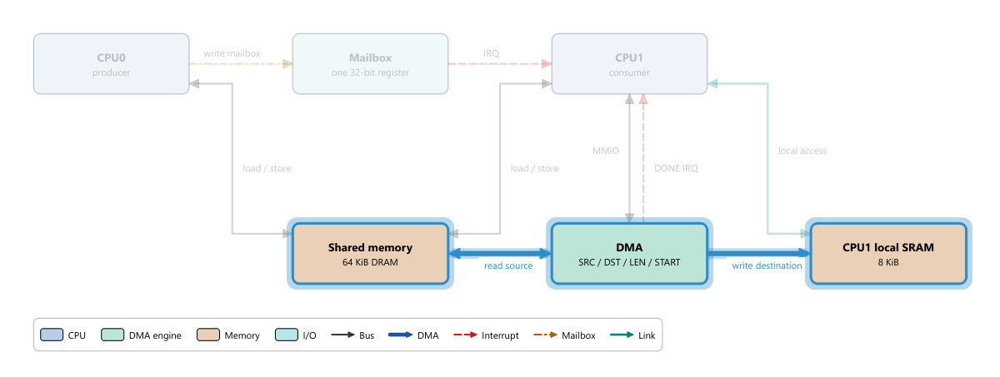

# 14 编写自己的拓扑 JSON

> **你将学到**
>
> - 拓扑 JSON 的每一个字段：顶层信息、方块（blocks）、连线（buses）、数据流（flows）与步骤（steps）；
> - 如何写中英双语字段；
> - 如何安排坐标，让连线和标签不重叠；
> - 如何用 `tools/validate_arch_json.py` 在不编译 Ripes 的情况下校验文件；
> - 如何在 Ripes 中预览、如何把拓扑打包成内置拓扑、如何用 `tools/arch_render` 渲染 PNG；
> - 一个可以直接粘贴使用的完整示例：双 CPU + 共享内存 + DMA。
>
> **前置条件**
>
> - 会使用 **Architecture** 标签页（第 11 章）；
> - 会编辑文本文件；了解 JSON 的基本语法（对象 `{}`、数组 `[]`、字符串必须用双引号）；
> - 校验器需要 Python 3；Windows 用户态工具链里自带的解释器是 `P:\workspace\soc\toolchain\venv\Scripts\python.exe`（见第 01 章；其他环境用你自己的 `python3`）。
>
> 权威来源：`docs/arch/arch_explorer.md`（schema 与作者指南）、`src/archexplorer/archmodel.cpp`（加载器）、`tools/validate_arch_json.py`（校验器）。

---

## 14.1 工作流程概览

```
复制模板 → 画草图定坐标 → 写 blocks → 写 buses → 写 flows
   → 校验器 → 在 Ripes 中 Open 预览（改完按 Ctrl+R）→ （可选）arch_render 检查几何
   → （可选）登记到 resources/arch/arch.qrc，重新编译成内置拓扑
```

拓扑是**纯数据**：不需要写一行 C++。加载器（`ArchModel::fromJson`）和 Python 校验器执行完全相同的检查，任何一条不满足都会拒绝整个文件，并给出形如 `buses[2].to: references unknown block id 'foo'` 的错误位置。

## 14.2 第一步：从模板开始

**做一步**：复制最小模板到一个你自己的工作目录：

```bash
cp resources/arch/example_minimal.json my_arch/dual_cpu_dma.json
```

**看到什么**：模板有 3 个方块（CPU、RAM、UART）、2 条连线、1 条 flow，可以在 **Architecture** 标签页里选 **Example: minimal system** 对照看效果（第 11 章 11.10 节）。

**为什么**：从一个能通过校验的文件出发，每次只改一点，出错时很容易定位。

## 14.3 Schema 逐字段说明

文件必须是 **UTF-8 编码的严格 JSON**：不允许注释，不允许尾逗号。下文的"必填"指缺少就会报错。

### 顶层对象

| 字段 | 类型 | 必填 | 说明 |
|---|---|---|---|
| `id` | 字符串 | 是 | 非空，唯一标识。建议与文件名相同 |
| `title` | 文本 | 是 | 非空，显示在 **Topology**（拓扑）下拉框中 |
| `subtitle` | 文本 | 否 | 显示在左侧标题下一行 |
| `description` | 文本 | 否 | 未选 flow 时显示在 **Description** 区；可用 `\n` 换行，`\n\n` 分段 |
| `blocks` | 数组 | 是 | 至少一个方块 |
| `buses` | 数组 | 否 | 可以省略或为空 |
| `flows` | 数组 | 否 | 可以省略或为空 |

"文本"表示可以写成普通字符串，也可以写成双语对象（14.4 节）。

### 方块 `blocks[]`

| 字段 | 类型 | 必填 | 说明 |
|---|---|---|---|
| `id` | 字符串 | 是 | 在 blocks 内唯一；连线和步骤通过它引用方块 |
| `label` | 文本 | 是 | 方块内的粗体标题；太长会被省略号截断 |
| `sublabel` | 文本 | 否 | 方块内的小字，可自动换行 |
| `kind` | 字符串 | 是 | 12 种之一：`cpu` `gpu` `accel` `dma` `memory` `cache` `io` `bridge` `audio` `video` `bus` `misc`。决定填充色和图例项（颜色对照见第 11 章 11.4 节） |
| `x`, `y` | 数字 | 是 | 左上角坐标（逻辑像素） |
| `w`, `h` | 数字 | 是 | 宽和高，必须 > 0 |
| `details` | 文本 | 否 | 单击方块后显示在右侧 **Details** 区 |
| `props` | 数组或对象 | 否 | 属性表，见下文"props 的两种写法" |

#### props 的两种写法

- **数组（推荐，内置拓扑都用这种）**：`"props": [{"key": "Clock", "value": "12 MHz"}, {"key": "Bits", "value": 32}]`。**按书写顺序显示**；`key` 和 `value` 都可以是文本（含双语对象），`value` 也可以是数字或布尔。
- **对象**：`"props": {"Clock": "12 MHz", "Bits": 32}`。写起来短，但显示时**按键名排序**（Qt 的 `QJsonObject` 会对键排序），不保留书写顺序。

### 连线 `buses[]`

| 字段 | 类型 | 必填 | 说明 |
|---|---|---|---|
| `id` | 字符串 | 是 | 在 buses 内唯一 |
| `from`, `to` | 字符串 | 是 | 必须是已定义的方块 id |
| `kind` | 字符串 | 是 | 5 种之一：`bus` `dma` `irq` `mailbox` `link`（线型见第 11 章） |
| `label` | 文本 | 否 | 画在连线中段旁边 |
| `bidirectional` | 布尔 | 否 | 默认 `false`；`true` 时两端都画箭头 |
| `props` | 数组或对象 | 否 | 与方块相同的两种写法；显示在鼠标悬停的 tooltip 和右栏 Connections 表的 tooltip 中 |

连线**没有坐标字段**：路径由渲染器根据两个方块的位置自动计算（14.5 节）。

### 数据流 `flows[]` 与步骤 `steps[]`

| 字段 | 类型 | 必填 | 说明 |
|---|---|---|---|
| `flows[].id` | 字符串 | 是 | 在 flows 内唯一 |
| `flows[].title` | 文本 | 是 | 显示在 **Data flow**（数据流）下拉框中 |
| `flows[].description` | 文本 | 否 | 选中 flow 后显示，也是列表项的 tooltip |
| `flows[].steps` | 数组 | 是 | 至少一步 |
| `steps[].text` | 文本 | 是 | 本步说明，显示在底部栏 |
| `steps[].highlight` | 字符串数组 | 否 | 要高亮的方块 id，每个都必须存在 |
| `steps[].buses` | 字符串数组 | 否 | 要高亮的连线 id，每个都必须存在 |

一步可以只高亮方块不高亮连线（例如"部件内部在计算"）。如果某一步 `highlight` 和 `buses` 都为空，图上不会有高亮，看起来和第 0 步一样，应尽量避免。**右侧面板会自动显示 `highlight` 中第一个方块的详情**，所以把"本步主角"放在数组第一位。

### 未知字段

加载器会忽略未知字段；Python 校验器会打印 `warning: ... unknown field (ignored by loader)`。拼错字段名（例如把 `sublabel` 写成 `subLabel`）不会报错，只会出 warning，所以请留意 warning。

## 14.4 中英双语字段

任何面向用户的文本字段都可以写成一个对象，包含 `zh` 和 `en` 两个键：

```json
"title": {"zh": "练习：双 CPU + 共享内存 + DMA", "en": "Exercise: dual CPU + shared memory + DMA"}
```

加载时 Ripes 按界面语言选择：中文界面用 `zh`，否则用 `en`；缺少对应语言时依次回退到 `en`、`zh`。纯字符串仍然合法（两种语言下显示同样的文字），所以 `"label": "DMA"` 这种与语言无关的写法完全可以保留。

可以双语的字段：`title`、`subtitle`、`description`、`blocks[].label`、`blocks[].sublabel`、`blocks[].details`、`buses[].label`、`flows[].title`、`flows[].description`、`steps[].text`，以及 `props` 的键和值（数组写法中的 `key`/`value`，对象写法中的值）。例如：

```json
"props": [
  {"key": {"zh": "角色", "en": "Role"}, "value": {"zh": "生产者", "en": "producer"}},
  {"key": "ISA", "value": "RV32I"}
]
```

不能双语的字段：所有 `id`、`kind`、`from`、`to`、`highlight`、`buses`（这些是给程序看的标识符）以及坐标。

一个双语对象至少要有 `zh` 或 `en` 之一；只写了一种语言时校验器会给出 `missing "en" text` 之类的 warning（文件仍然有效）。

## 14.5 坐标与布局技巧

坐标系：原点在左上角，x 向右、y 向下，单位是逻辑像素。建议画布控制在约 1200 × 700 以内；图例会自动放在所有方块下方 40 像素处。

**连线是怎么画的**（`src/archexplorer/archscene.cpp`）：

1. 两个方块在水平方向有重叠、垂直方向没有 → 从上下两边出发，画**竖线**；
2. 垂直方向有重叠、水平方向没有 → 从左右两边出发，画**横线**；
3. 都没有重叠 → 比较中心点的水平和垂直距离，距离大的方向决定横走还是竖走，画一条"Z"形折线（中间段在两块之间的中点）；
4. 两端锚点几乎对齐（相差 ≤ 8 像素）时画直线；
5. 同一方块同一条边上有多条连线时锚点自动错开（约 16 像素间距），连接同一对方块的多条线中段也会错开；
6. 标签放在最长那一段的中点：横段上方，或竖段右侧；横段上的标签会按段长换行。

由此得到的实用规则：

- **同一行的方块用横线连，同一列的方块用竖线连**，这是最整洁的；
- 方块之间至少留 **100–120 像素** 间隙，否则横线上方的标签会压到方块上；
- **不要让第三个方块挡在两个方块之间**——连线不会绕开方块，会直接穿过；
- 画成方块的总线（`kind: bus` 的宽条，如 PS3 的 EIB）会被所有竖线穿过，只在它真的是"中心互连"时使用；
- 一个方块连线很多时，把它做宽或做高，给锚点留空间；
- 先在纸上或表格里画网格（例如每列间隔 300、每行间隔 220），再填坐标。

**做一步**：本章的完整示例最初把 CPU0、信箱、CPU1 的间隙设为 80 像素，并把"CPU1 本地 SRAM"放在 DMA 正下方。几何检查报告了两个问题：标签 `write mailbox` 压在 CPU0 上，CPU1 → SRAM 的线穿过了 DMA。把间隙加大到 120、把 SRAM 移到 DMA 右侧后问题消失（检查方法见 14.8 节）。

## 14.6 用校验器检查

**做一步**：在仓库根目录运行：

```bash
P:/workspace/soc/toolchain/venv/Scripts/python.exe -I tools/validate_arch_json.py my_arch/dual_cpu_dma.json
```

（Linux/macOS：`python3 -I tools/validate_arch_json.py my_arch/dual_cpu_dma.json`。不带参数时默认检查 `resources/arch/` 下的全部文件；也可以给一个目录。）

**看到什么**：通过时输出

```
[OK  ] my_arch/dual_cpu_dma.json: 6 blocks, 9 buses, 1 flows, 7 steps
1/1 files valid
```

失败时，例如把一条连线的 `to` 写成了不存在的 `ramm`：

```
[FAIL] my_arch/dual_cpu_dma.json: buses[0].to: references unknown block id 'ramm'
0/1 files valid
```

退出码 0 表示全部通过，1 表示有失败，可以放进脚本或 CI。

**检查翻译是否完整**：加上 `--bilingual` 参数，校验器会额外把仍是普通字符串的文本字段（以及含中文的 props 键/值）列为 warning：

```bash
P:/workspace/soc/toolchain/venv/Scripts/python.exe -I tools/validate_arch_json.py --bilingual my_arch/dual_cpu_dma.json
```

对本章示例，它会列出 `blocks[0].label: plain string (not translated)` 等若干行——像 `CPU0`、`DMA`、`IRQ` 这类两种语言相同的文字本来就不需要翻译，warning 只是提醒你逐条确认。

常见错误信息：

| 信息 | 原因 |
|---|---|
| `JSON parse error at line L col C: ...` | 语法错误：多了逗号、少了引号、写了注释 |
| `blocks[3].kind: unknown block kind 'ram' (expected one of: ...)` | kind 拼错；内存应写 `memory` |
| `blocks[1].id: duplicate block id 'cpu'` | id 重复 |
| `blocks[0].w: must be > 0` | 宽度为 0 或负数 |
| `flows[0].steps[2].highlight: references unknown block id 'dma0'` | 步骤里引用的方块不存在 |
| `flows[0].steps: must not be empty` | flow 没有步骤 |
| `$.title: must be a string or a {"zh": ..., "en": ...} object` | 文本字段写成了数字、数组等 |
| `...: bilingual text object must contain "zh" and/or "en"` | 双语对象的键写错了（例如 `"cn"`） |

校验器每次只报告**第一个**错误，修好再运行，直到通过。

## 14.7 在 Ripes 中预览，以及拓扑从哪里加载

**做一步**：切到 **Architecture** 标签页，点击工具栏 **Open architecture JSON...**（打开架构 JSON），选择你的文件。

**看到什么**：拓扑下拉框中新增一项，标题后面带文件名，例如 `Exercise: dual CPU + shared memory + DMA (dual_cpu_dma.json)`（中文界面显示中文标题），并自动切换到它。若文件不合法，会弹出 "Failed to load ..." 对话框，内容与校验器的错误信息相同。

架构浏览器从两个地方获得拓扑（`src/archexplorer/archexplorertab.cpp`、`archmodel.cpp`）：

| 来源 | 机制 | 持续时间 |
|---|---|---|
| **内置** | 启动时枚举 Qt 资源目录 `:/arch/` 下所有 `*.json`。这些文件由 `resources/arch/arch.qrc` 编译进程序；真实机器排在前面，`example_minimal` 排在最后 | 永久 |
| **磁盘文件** | 工具栏 **Open architecture JSON...** | 文件路径会被记住，下次启动自动重新加载（文件被删除或变得不合法时自动去掉） |

Ripes **不会扫描磁盘上的某个目录**，所以把文件放到 `resources/arch/` 下但不登记、不重新编译，下拉框里是看不到的；用 Open 打开一次即可。

**编辑—预览循环**：在编辑器里修改并保存 JSON，回到 Ripes 按 **Ctrl+R**（工具栏 **Reload topology file**）重新读取当前拓扑。再次 Open 同一个文件（或另一个 `id` 相同的文件）会**替换**原来的条目，而不是新增一项。

### 打包为内置拓扑

1. 把文件放进 `resources/arch/`，文件名建议 `<id>.json`；
2. 在 `resources/arch/arch.qrc` 中加一行：

   ```xml
   <file>dual_cpu_dma.json</file>
   ```

3. 重新编译 Ripes（第 01 章）。`test/tst_archmodel` 会自动加载所有 `:/arch/*.json` 并校验，可以顺便运行它。

不要再把 `arch.qrc` 加到顶层可执行文件的资源列表里：它已经编译进 `archexplorer_lib`，重复添加会导致资源初始化函数重复定义。

## 14.8 用 arch_render 渲染 PNG 与检查几何

`tools/arch_render` 用和标签页**完全相同**的 `ArchScene` 代码离屏渲染拓扑，适合生成文档插图、检查布局。它可以处理**任意 JSON 文件**，不需要先打包。

**构建**（在仓库根目录的 Git Bash 中，直接用工具链里的 MinGW + Qt，不走 CMake）：

```bash
bash tools/arch_render/build.sh
```

产物是 `build/arch_render/arch_render.exe`（以及供 `--qm` 使用的中文翻译文件 `build/arch_render/archexplorer_zh_CN.qm`，让图例的种类名称显示中文）。

**使用**：

```bash
export QT_QPA_PLATFORM=offscreen QT_QPA_FONTDIR="C:/Windows/Fonts"   # 无头运行；字体目录保证中文不显示成方块
export PATH="/p/workspace/soc/toolchain/Qt/6.8.3/mingw_64/bin:$PATH"
R=build/arch_render/arch_render.exe

$R --lang en my_arch/dual_cpu_dma.json dump                 # 检查布局问题
$R --lang zh my_arch/dual_cpu_dma.json out.png              # 渲染成 PNG（中文文字）
$R --lang en --step 0:5 my_arch/dual_cpu_dma.json step5.png # 渲染第 0 个 flow 第 5 步的高亮状态
$R --lang en all dump                                       # 检查全部内置拓扑
```

即 `arch_render <file.json> <out.png>|dump [--step f:n] [--lang zh|en]`：`--lang` 决定双语文字取哪种语言（默认 `zh`），`--step f:n` 表示第 f 条 flow 的第 n 步，flow 从 0 数、步骤从 1 数（与标签页中"第 n 步 / 共 N 步"的编号相同），所以 `--step 0:5` 是第一条 flow 的第 5 步。更多用法（深色调色板、批量重新生成 `docs/arch/images`）见 `tools/arch_render/README.md`。

`dump` 的结尾是检查结果：

| 行 | 含义 |
|---|---|
| `OVERLAP label X x block Y` | 连线 X 的标签压在方块 Y 上 |
| `OVERLAP label X x label Z` | 两条连线的标签互相重叠 |
| `OVERLAP label X x legend` | 标签压在图例上 |
| `THROUGH bus X segment N x block Y` | 连线 X 的第 N 段穿过了不是它端点的方块 Y |
| `ELIDED  block Y label` | 方块 Y 的标题放不下，显示时被省略号截断 |
| `CLIPPED block Y sublabel` | 方块 Y 的 sublabel 换行后高度不够，被裁掉 |
| `note: label X crosses bus Z` | 标签压在另一条连线上（只提示，不计入问题数） |

最后一行是 `<id>: N problem(s)`，没有问题时退出码为 0。本章的示例检查结果为 `dual_cpu_dma: 0 problem(s)`。穿过 `kind: "bus"` 宽条（例如 PS3 的 EIB）的连线也会被报告为 `THROUGH`，是否接受由作者判断。



## 14.9 完整示例：双 CPU + 共享内存 + DMA

这个拓扑描述一个生产者/消费者系统：CPU0 把数据写进共享内存，写信箱通知 CPU1；CPU1 收到中断后配置 DMA，把数据搬到自己的本地 SRAM，等 DMA 完成中断后在本地计算。它把第 12 章（信箱）、第 13 章（Local Store + DMA）和第 10 章（门铃 + DMA）的共同模式浓缩到 6 个方块里。

把下面的内容保存为 `my_arch/dual_cpu_dma.json`：

```json
{
  "id": "dual_cpu_dma",
  "title": {"zh": "练习：双 CPU + 共享内存 + DMA", "en": "Exercise: dual CPU + shared memory + DMA"},
  "subtitle": {"zh": "生产者 / 消费者，经信箱通知、DMA 搬运", "en": "Producer / consumer with a mailbox and a DMA engine"},
  "description": {"zh": "CPU0 是生产者，把数据写入共享内存后敲信箱；CPU1 是消费者，收到中断后让 DMA 把数据搬进自己的本地 SRAM 再计算。\n\n这是 Cell（PPE + SPE）和 NPU（门铃 + DMA）共同的最小模型。", "en": "CPU0 is the producer: it writes data into shared memory and rings the mailbox. CPU1 is the consumer: on the interrupt it lets the DMA engine copy the data into its local SRAM and then computes.\n\nThis is the smallest model shared by Cell (PPE + SPE) and the NPU (doorbell + DMA)."},
  "blocks": [
    {"id": "cpu0", "kind": "cpu", "label": "CPU0", "sublabel": {"zh": "生产者", "en": "producer"},
     "x": 40, "y": 40, "w": 180, "h": 70,
     "details": {"zh": "把一块数据写进共享内存，然后写信箱寄存器通知 CPU1。", "en": "Writes a block of data into shared memory, then writes the mailbox register to notify CPU1."},
     "props": [{"key": "ISA", "value": "RV32I"}, {"key": "Role", "value": {"zh": "生产者", "en": "producer"}}]},
    {"id": "mbox", "kind": "io", "label": "Mailbox", "sublabel": {"zh": "1 个 32-bit 寄存器", "en": "one 32-bit register"},
     "x": 340, "y": 40, "w": 180, "h": 70,
     "details": {"zh": "CPU0 写入时向 CPU1 发中断；CPU1 读出后中断清除。", "en": "A write by CPU0 interrupts CPU1; reading it clears the interrupt."},
     "props": [{"key": "Depth", "value": 1}, {"key": "Width", "value": "32 bit"}]},
    {"id": "cpu1", "kind": "cpu", "label": "CPU1", "sublabel": {"zh": "消费者", "en": "consumer"},
     "x": 640, "y": 40, "w": 180, "h": 70,
     "details": {"zh": "收到信箱中断后配置 DMA，等待 DMA 完成中断，然后在本地 SRAM 上计算。", "en": "On the mailbox interrupt it programs the DMA, waits for the DMA-done interrupt and computes on its local SRAM."},
     "props": [{"key": "ISA", "value": "RV32IM"}, {"key": "Role", "value": {"zh": "消费者", "en": "consumer"}}]},
    {"id": "shmem", "kind": "memory", "label": {"zh": "共享内存", "en": "Shared memory"}, "sublabel": "64 KiB DRAM",
     "x": 340, "y": 260, "w": 180, "h": 70,
     "details": {"zh": "两颗 CPU 和 DMA 都能访问。", "en": "Accessible by both CPUs and the DMA engine."},
     "props": [{"key": "Size", "value": "64 KiB"}]},
    {"id": "dma", "kind": "dma", "label": "DMA", "sublabel": "SRC / DST / LEN / START",
     "x": 640, "y": 260, "w": 180, "h": 70,
     "details": {"zh": "CPU1 写 SRC、DST、LEN 后写 START；搬完后置 DONE 并发中断。", "en": "CPU1 writes SRC, DST, LEN and then START; when finished it sets DONE and raises an interrupt."},
     "props": [{"key": "Bandwidth", "value": "4 B / cycle"}]},
    {"id": "sram1", "kind": "memory", "label": {"zh": "CPU1 本地 SRAM", "en": "CPU1 local SRAM"}, "sublabel": "8 KiB",
     "x": 940, "y": 260, "w": 180, "h": 70,
     "details": {"zh": "只有 CPU1 和 DMA 能访问，类似 SPE 的 Local Store。", "en": "Only CPU1 and the DMA engine can access it, like an SPE Local Store."},
     "props": [{"key": "Size", "value": "8 KiB"}]}
  ],
  "buses": [
    {"id": "b_cpu0_mem", "from": "cpu0", "to": "shmem", "kind": "bus", "bidirectional": true, "label": "load / store"},
    {"id": "b_cpu1_mem", "from": "cpu1", "to": "shmem", "kind": "bus", "bidirectional": true, "label": "load / store"},
    {"id": "b_mbox_wr", "from": "cpu0", "to": "mbox", "kind": "mailbox", "label": {"zh": "写信箱", "en": "write mailbox"}},
    {"id": "b_mbox_irq", "from": "mbox", "to": "cpu1", "kind": "irq", "label": "IRQ"},
    {"id": "b_dma_cfg", "from": "cpu1", "to": "dma", "kind": "bus", "bidirectional": true, "label": "MMIO"},
    {"id": "b_dma_done", "from": "dma", "to": "cpu1", "kind": "irq", "label": "DONE IRQ"},
    {"id": "b_dma_rd", "from": "dma", "to": "shmem", "kind": "dma", "bidirectional": true, "label": {"zh": "读源数据", "en": "read source"}},
    {"id": "b_dma_wr", "from": "dma", "to": "sram1", "kind": "dma", "label": {"zh": "写目标", "en": "write destination"}},
    {"id": "b_cpu1_sram", "from": "cpu1", "to": "sram1", "kind": "link", "bidirectional": true, "label": {"zh": "本地访问", "en": "local access"}}
  ],
  "flows": [
    {"id": "handoff",
     "title": {"zh": "CPU0 把一块数据交给 CPU1", "en": "CPU0 hands a block of data to CPU1"},
     "description": {"zh": "信箱只传通知，数据由 DMA 搬运。", "en": "The mailbox carries only the notification; the DMA engine moves the data."},
     "steps": [
       {"highlight": ["cpu0", "shmem"], "buses": ["b_cpu0_mem"], "text": {"zh": "CPU0 把 1 KiB 数据写进共享内存。", "en": "CPU0 writes 1 KiB of data into shared memory."}},
       {"highlight": ["cpu0", "mbox"], "buses": ["b_mbox_wr"], "text": {"zh": "CPU0 把数据的地址写进信箱寄存器。", "en": "CPU0 writes the data's address into the mailbox register."}},
       {"highlight": ["mbox", "cpu1"], "buses": ["b_mbox_irq"], "text": {"zh": "信箱向 CPU1 发中断；CPU1 读出地址，中断清除。", "en": "The mailbox interrupts CPU1; CPU1 reads the address and the interrupt clears."}},
       {"highlight": ["cpu1", "dma"], "buses": ["b_dma_cfg"], "text": {"zh": "CPU1 写 DMA 的 SRC、DST、LEN，再写 START。", "en": "CPU1 writes the DMA's SRC, DST and LEN, then START."}},
       {"highlight": ["dma", "shmem", "sram1"], "buses": ["b_dma_rd", "b_dma_wr"], "text": {"zh": "DMA 从共享内存读、向本地 SRAM 写，CPU1 可以先做别的事。", "en": "The DMA reads shared memory and writes the local SRAM; CPU1 is free meanwhile."}},
       {"highlight": ["dma", "cpu1"], "buses": ["b_dma_done"], "text": {"zh": "搬运完成，DMA 置 DONE 并发中断。", "en": "Transfer complete: the DMA sets DONE and raises an interrupt."}},
       {"highlight": ["cpu1", "sram1"], "buses": ["b_cpu1_sram"], "text": {"zh": "CPU1 在本地 SRAM 上计算，不再访问共享内存。", "en": "CPU1 computes on its local SRAM without touching shared memory."}}
     ]}
  ]
}
```

布局说明：

| 行 | y | 方块（x） |
|---|---|---|
| 上 | 40 | CPU0（40）、Mailbox（340）、CPU1（640） |
| 下 | 260 | Shared memory（340）、DMA（640）、CPU1 local SRAM（940） |

每列间隔 300、方块宽 180，所以同一行相邻方块之间有 120 像素放标签；上下两行之间 150 像素。CPU0 → 共享内存、CPU1 → 共享内存、CPU1 → SRAM 三条线是自动生成的 Z 形折线，其余都是直线。

**做一步**：

1. 保存文件，用 14.6 节的命令校验（可以再加 `--bilingual` 看看哪些文字还是单语）；
2. 在 **Architecture** 标签页用 **Open architecture JSON...** 打开；单击 **CPU0**，确认属性表按书写顺序显示 `ISA`、`Role`；
3. 选择 flow "CPU0 把一块数据交给 CPU1"，按 → 走完 7 步。

**看到什么**：图例中出现 CPU、DMA engine、Memory、I/O 四种方块和 Bus、DMA、Interrupt、Mailbox、Link 五种连线；第 5 步 DMA、共享内存、SRAM 同时高亮，两条蓝色粗线发光。

## 14.10 练习

1. **加一个 flow**：给示例增加第二条 flow `cpu0_direct`："CPU0 直接把结果写进 CPU1 的本地 SRAM"。需要先加什么连线？写出你新增的 bus 和 3 步 steps。
2. **故意出错**：把示例中 `b_dma_rd` 的 `kind` 改成 `"DMA"`（大写），运行校验器，记录错误信息；再把某个 step 的 `highlight` 改成 `["cpu2"]`，记录错误信息。
3. **布局实验**：把 `sram1` 改回 `"x": 640, "y": 440`（DMA 正下方），用 arch_render 的 `dump` 或直接在 Ripes 里看：哪条线出了问题？为什么？
4. **双语**：把 `b_mbox_irq` 的标签 `"IRQ"` 改成双语对象，中文写"信箱中断"。切换 Ripes 界面语言后重启，确认两种语言下都正确显示。
5. **自己的系统**：为第 08 章用过的 Ripes 外设系统（RISC-V 核 + 内存 + LED 矩阵 + 开关）写一个拓扑，至少包含 1 条 flow，并通过校验器。

### 参考答案

1. 需要一条从 `cpu0` 到 `sram1` 的连线，例如：

   ```json
   {"id": "b_cpu0_sram", "from": "cpu0", "to": "sram1", "kind": "bus", "label": "remote store"}
   ```

   步骤示例：`{"highlight": ["cpu0"], "text": "CPU0 算出结果。"}`、`{"highlight": ["cpu0", "sram1"], "buses": ["b_cpu0_sram"], "text": "CPU0 直接写入 CPU1 的 SRAM。"}`、`{"highlight": ["cpu0", "mbox", "cpu1"], "buses": ["b_mbox_wr", "b_mbox_irq"], "text": "CPU0 写信箱通知 CPU1 数据已就绪。"}`。但这条线会出问题：`cpu0`（x 40..220）与 `sram1`（x 940..1120）水平距离远大于垂直距离，渲染器画一条横向 Z 形线，第一段横线在 y≈98 处穿过 Mailbox，最后一段在 y≈272 处穿过 DMA。用 `dump` 检查会看到 `THROUGH bus b_cpu0_sram segment 0 x block mbox`、`THROUGH bus b_cpu0_sram segment 2 x block dma` 等共 4 个问题。解决办法：调整布局（例如把 SRAM 移到第三行），或者在拓扑里改成"CPU0 → 共享内存 → DMA → SRAM"的路径来表达。
2. `buses[6].kind: unknown bus kind 'DMA' (expected one of: bus, dma, irq, mailbox, link)`（kind 区分大小写）；`flows[0].steps[k].highlight: references unknown block id 'cpu2'`。
3. `dump` 报告 `THROUGH bus b_cpu1_sram segment 0 x block dma`：CPU1、DMA、SRAM 在同一列，CPU1 → SRAM 的竖线必然穿过中间的 DMA。连线不会绕开方块，只能调整布局。
4. `"label": {"zh": "信箱中断", "en": "IRQ"}`。中文界面显示"信箱中断"，英文界面显示 "IRQ"。
5. 开放题。提示：RISC-V 核用 `cpu`，内存用 `memory`，LED 矩阵和开关用 `io`；可以模仿 `example_minimal.json` 的 "print_char" flow 写一条"CPU 读开关 → 写 LED"的 flow。

## 14.11 小结

- 拓扑 = 顶层信息 + blocks + buses + flows；必填项缺失、kind 拼错、id 重复或引用不存在的 id 都会让整个文件被拒绝；
- 面向用户的文本（含 props 的键和值）可以写成 `{"zh", "en"}` 双语对象；id、kind、坐标不能；props 用 `{key, value}` 数组可保持书写顺序；
- 连线路径自动计算：同行用横线、同列用竖线，留足间隙，不要让第三个方块挡路；
- 先用 `tools/validate_arch_json.py`（`--bilingual` 检查翻译）校验，再用 **Open architecture JSON...** 预览、**Ctrl+R** 重新加载；打开过的文件会被记住；要成为内置拓扑，需登记到 `resources/arch/arch.qrc` 并重新编译；
- `tools/arch_render <file.json> <out.png>|dump` 用同一套渲染代码渲染任意拓扑，并检查标签重叠、穿块与文字截断。
